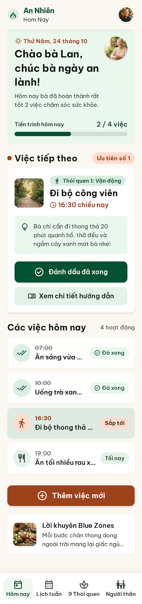
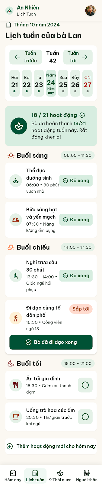
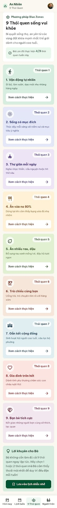
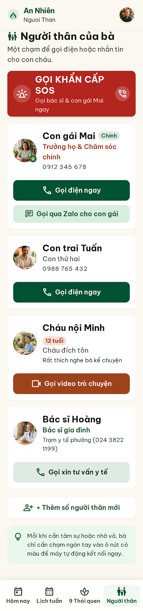
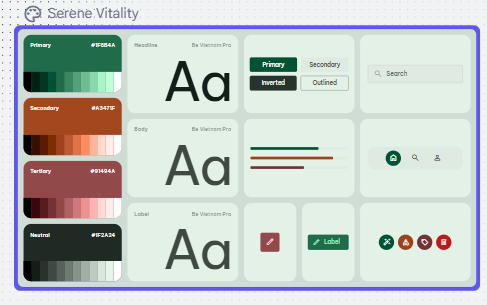

# AI Design Log

Chuỗi làm việc: **Google Stitch** sinh UI ban đầu (v0) → **Claude** rà soát theo persona và Nielsen, đề xuất chỉnh sửa (V1 – V3) → dựng và tinh chỉnh bản cuối trong **Figma**. Slide tương ứng: "Thiết kế với AI", "Các vòng tinh chỉnh", "Quyết định thiết kế", "Chọn giờ dễ hơn".

| Vòng | Mục tiêu | Ảnh trước | Ảnh sau |
| --- | --- | --- | --- |
| v0 | Sinh UI ban đầu từ persona + constraints | — | `assets/stitch/screen_day.png`, `screen_week.png`, `power9.png`, `screen_contact.png`, `bang_mau.png` |
| V1 | Chữ rõ, câu ngắn | `assets/stitch/screen_day.png` | `assets/figma/S03-hom-nay.png` |
| V2 | Nút lớn, phân cấp rõ | `assets/stitch/screen_contact.png` | `assets/figma/S09-gia-dinh.png` |
| V3 | Thống nhất hệ thống (token, component, chọn giờ) | `assets/figma/before-DLG-WakeTime.png` | `assets/figma/DLG-WakeTime.png`, `design-system.png`, `components.png` |

Ảnh `assets/figma/*` là ảnh export từ page `03 Final UI`, `04 Design System`, `05 Components` (quy ước tên ở [assets/figma/README.md](../assets/figma/README.md)).

---

## v0 – Google Stitch sinh UI ban đầu

**Công cụ:** Google Stitch, chế độ Mobile · **Ảnh lưu ngày:** 11/10/2026

**Prompt (nguyên văn):**

```
Design a mobile app (Android, 360x800 dp) called "An Nhiên" – a daily schedule app for elderly Vietnamese users (65+), based on the Blue Zones "Power 9" habits: move naturally, purpose, down shift, 80% rule, plant slant, afternoon tea with friends, belong, loved ones first, right tribe.
Persona: Mrs. Lan, 68, retired teacher, presbyopia, low finger dexterity, only uses Zalo and YouTube, forgets meal and walking times.
Tasks: see today's activities, mark an activity as done, add a new activity with time and reminder, view the weekly schedule, learn the 9 habits, call family.
Screens: Welcome with font-size choice, Profile setup, Today (home), Activity detail, Add activity step 1 (choose habit) and step 2 (time, repeat, reminder), Weekly schedule, 9 Habits library, Family, Display settings.
Constraints: all UI text in Vietnamese; body text at least 18sp; touch targets at least 56dp; contrast at least 4.5:1; every icon has a visible text label; bottom navigation with 4 labeled tabs; no swipe-only or long-press gestures; one primary action per screen.
Style: calm, warm and natural; cream background, deep green primary, terracotta accent; rounded cards; Be Vietnam Pro font; no gradients.
```

Trích đoạn prompt tiếng Việt trình bày trên slide "Thiết kế với AI":

> "Thiết kế ứng dụng điện thoại 'An Nhiên' bằng tiếng Việt dành cho người lớn tuổi tại Việt Nam. Giúp người lớn tuổi tự tạo, nhận nhắc và duy trì một vài hoạt động phù hợp với sinh hoạt hằng ngày, lấy cảm hứng từ Power 9. Không dùng bảng xếp hạng, mất streak, điểm sức khỏe hoặc điểm tuổi thọ. Tiếng Việt tự nhiên, ngắn, cụ thể, tôn trọng."

**Stitch tạo ra (ảnh đã lưu):**

| Ảnh | Màn |
| --- | --- |
|  | Hôm nay – lời chào "Chào bà Lan", tiến trình 2/4, thẻ "Việc tiếp theo", danh sách 4 việc, nút "Thêm việc mới", lời khuyên Blue Zones |
|  | Lịch tuần – chọn tuần, dải 7 ngày, "18 / 21 hoạt động", việc chia Buổi sáng / chiều / tối |
|  | 9 Thói quen – 9 thẻ màu riêng, mỗi thẻ có nút "Xem cách thực hiện" |
|  | Người thân – thẻ SOS đỏ, 4 người liên hệ, nhiều kiểu nút gọi |
|  | Bảng màu "Serene Vitality": primary `#1F654A`, secondary `#A3471F`, tertiary `#91424A`, neutral `#1F2A24`; font Be Vietnam Pro |

**Điểm tốt giữ lại:**

- Bảng màu xanh lá đậm đúng hướng (→ `primary #1F684B`, D5).
- Bottom nav 4 tab đều có nhãn chữ (→ D3).
- Thẻ "Việc tiếp theo" là khối nổi bật nhất trên Home (→ S03).
- Lịch chia theo buổi Sáng / Chiều / Tối – đúng cách người lớn tuổi nghĩ về một ngày (→ S11, D8).
- Mỗi thói quen có màu và icon riêng (→ collection `color/habit/*`).
- Thói quen 6 là trà chiều, không phải rượu (→ D1); trạng thái "Đã xong" có icon + chữ.

---

## Phản biện UX output v0 (9 phát hiện, gắn màn cụ thể)

| # | Màn (ảnh) | Vấn đề quan sát | Căn cứ | Mức độ | Sửa ở | Quyết định |
| --- | --- | --- | --- | --- | --- | --- |
| F1 | Hôm nay (`screen_day`) | Hai nút filled khác màu – xanh "Đánh dấu đã xong" và đất nung "Thêm việc mới" – tranh nhau làm điểm nhấn | Nguyên tắc một hành động chính; Nielsen #8 | Cao | V2 | D21 |
| F2 | Hôm nay, Lịch tuần | Tên việc bị cắt "Ăn sáng vừa …", "Uống trà xan…", "Đi bộ thong thả …" | WCAG 1.4.4; persona không đoán được việc | Cao | V1 | D6 |
| F3 | Mọi màn | App bar không dấu "Hom Nay", "Lich Tuan", "Nguoi Than"; năm hiển thị 2024 | Nielsen #2 Match with real world | Trung bình | V1 | D6 |
| F4 | Hôm nay | Chữ phụ, nhãn tab, chip trạng thái nhỏ so với nội dung chính; một màn có 6 khối thông tin | Persona viễn thị (pain point 1, 5); Nielsen #8 | Cao | V1 | D4, D20 |
| F5 | Lịch tuần, 9 Thói quen | Chấm điểm "18 / 21 hoạt động … Rất đáng khen ạ!", "4/9 thói quen tuần này", nhãn "Ưu tiên số 1" | Trái ràng buộc không điểm / không streak; tạo cảm giác bị theo dõi (P2, P4) | Cao | V2 | D7 |
| F6 | Người thân (`screen_contact`) | Thẻ đỏ "GỌI KHẨN CẤP SOS – Gọi bác sĩ & con gái Mai" lớn nhất màn | App không bảo đảm được cấp cứu; nút lớn dễ bấm nhầm (#5) | Cao | V2 | D7b |
| F7 | Người thân | 4 kiểu nút gọi (Gọi điện ngay, Gọi qua Zalo, Gọi video, Gọi xin tư vấn), 3 màu nút khác nhau | Nielsen #4 Consistency and standards | Trung bình | V2 | D7b, D18 |
| F8 | Hôm nay, Lịch tuần | Đánh dấu xong không thấy bước xác nhận hay Hoàn tác; vòng tròn trống không nhãn ở buổi tối | Nielsen #3, #5; WCAG 1.4.1 | Cao | V2 | D2 |
| F9 | 9 Thói quen | "Ăn vừa no 80%" khó ước lượng, dễ hiểu thành nhịn ăn | Persona; an toàn sức khỏe | Trung bình | V3 | D23 |

---

## V1 – Chữ rõ, câu ngắn

**Vấn đề nhắm tới:** F2, F3, F4.

**Prompt (nguyên văn):** *[Dán nguyên văn prompt vòng 1 từ lịch sử chat chụp ở slide "Các vòng tinh chỉnh".]*

**Kết quả áp dụng trong Figma:** nội dung 24 sp, nhỏ nhất 20 sp (kể cả nhãn nav), tiêu đề 30; tên việc xuống dòng thay vì cắt; mỗi đoạn mô tả ≤ 2 câu; mọi chữ có dấu.

| Trước | Sau |
| --- | --- |
|  |  |

**Quyết định:** Modify (D4, D6, D20) → text styles `body-lg`, `headline`, `caption`; frame `03 Final UI / S03 Hôm nay`.

---

## V2 – Nút lớn, phân cấp rõ

**Vấn đề nhắm tới:** F1, F5, F6, F7, F8.

**Prompt (nguyên văn):** *[Dán nguyên văn prompt vòng 2.]*

**Kết quả áp dụng trong Figma:** nút chính cao 60 dp; mỗi màn một nút filled `primary`, bỏ màu đất nung; thẻ người thân chỉ còn "Gọi điện" + "Nhắn tin"; bỏ thẻ SOS và chấm điểm tuần; "Tôi đã làm xong" mở `DLG-Done` và có Snackbar "Hoàn tác".

| Trước | Sau |
| --- | --- |
|  |  |

**Quyết định:** Modify / Reject (D2, D7, D7b, D18, D21) → component `Button`, `Dialog`, `Snackbar`; frame `S09 Gia đình`, `DLG-Done`.

---

## V3 – Thống nhất hệ thống

**Vấn đề nhắm tới:** giao diện các màn chưa đồng nhất; chọn giờ khó (ưu tiên sửa: chọn giờ · tràn chữ · nút chính/phụ); F9.

**Prompt (nguyên văn):** *[Dán nguyên văn prompt vòng 3.]*

**Kết quả áp dụng trong Figma:** gom màu, cỡ chữ, khoảng cách, bo góc vào Variables / Text styles / Effect styles (page `04 Design System`); 9 nhóm component có variant trạng thái (page `05 Components`); hộp chọn giờ mới – trước: số lặp, lệch tâm; sau: số lớn, hàng giữa cố định, nút Hủy / Xong rõ.

| Trước | Sau |
| --- | --- |
|  |  |

**Quyết định:** Modify (D22, D23) → `DLG-WakeTime`, `DLG-TaskTime`, collection `color`, `space`, `radius`, `Dễ đọc · Cỡ chữ`.

---

## Truy vết một thay đổi end-to-end (dùng khi demo)

| Bước | Nội dung |
| --- | --- |
| AI output | `assets/stitch/screen_day.png` – Home có hai nút filled: xanh "Đánh dấu đã xong" và đất nung "Thêm việc mới" |
| Critique | F1: hai điểm nhấn tranh nhau, người lớn tuổi không biết bấm nút nào trước |
| Prompt / vòng | V2 – Nút lớn, phân cấp rõ |
| Decision | Bỏ màu đất nung, `secondary` = `primary`; chỉ "Việc tiếp theo" có nút filled (D21) |
| Figma | `03 Final UI / S03 Hôm nay`; `05 Components / Button`; `06 Prototype` – Flow chính 2 |
