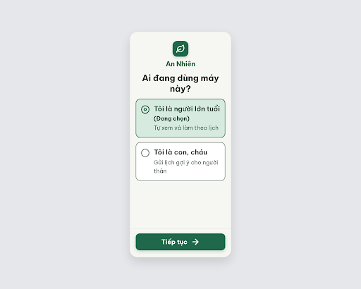
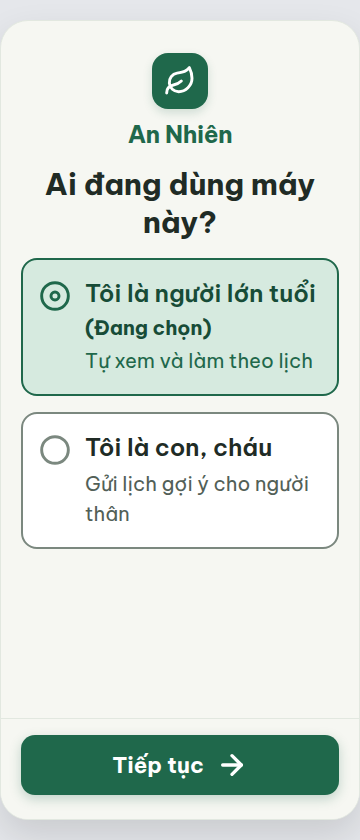

# C01 — Chọn vai trò (Hiếu, làn B)

Project riêng: `2013215887278758682` — An Nhiên (project của Sanh)

**Màn chốt hiện tại: v0 — 100 điểm**

Screen ID: `720a85a3a0254afa9cbc1a32825ce93c`

**Kết quả: CONVERGED** · stop_reason: score_100

| Vòng | Điểm | Error | Warn | Đã sửa | Regression |
|---|---:|---:|---:|---|---|
| v0 | 100 | 0 | 0 | — | — |

## v0 — 100 điểm

Screen: `projects/2013215887278758682/screens/720a85a3a0254afa9cbc1a32825ce93c`

C01 đạt mọi luật áp dụng: chữ 20–30px, lựa chọn rõ trạng thái, icon đúng nghĩa và nút Tiếp tục cao 60px.

## Đúng project và canvas

Theo yêu cầu người dùng, C01 nằm trong project An Nhiên của Sanh2013215887278758682. Generation không tự gắn canvas, nên đã thêm screen instance C01 ở x6784,y0. Đọc lại get_project xác nhận44 khung,43 khung cũ giữ nguyên hoàn toàn so với canvas-before.json. Xem canvas-verification.json. Bản này được reviewer độc lập chấm100 điểm, không kế thừa điểm project riêng cũ.

Project riêng cũ chưa xóa; lịch sử lưu ở codex-runs/archive/C01-project-4739396749322828698/.

## UI vẫn chưa xác nhận

Ảnh người dùng chưa thấy C01. API vẫn có instance ở x6784,y0 nhưng không coi là bằng chứng UI hiển thị. Đề xuất chuyển riêng C01 lên trên nhóm màn cũ bị automatic approval review từ chối vì chưa có chấp thuận cụ thể cho đổi vị trí/kích thước/nhãn/visibility và rủi ro ghi canvas chung. Lệnh không thực thi, chưa đổi vị trí.

## Đã duyệt đổi vị trí

Người dùng đã duyệt chuyển riêng C01 lên trên hàng màn đầu tiên. Đã chuyển x0,y-2304, kích thước1280×1024, nhãn C01 - CHỌN VAI TRÒ - HIẾU. Đọc lại API xác nhận đúng, các khung khác giữ nguyên. Chưa xác nhận hình ảnh UI trình duyệt.

## Quy ước tên chung

Theo yêu cầu người dùng, đổi nhãn canvas thành An Nhiên - Chọn vai trò, không thêm tên người chạy hay viết hoa toàn bộ. Không thay vị trí hoặc các màn khác.
