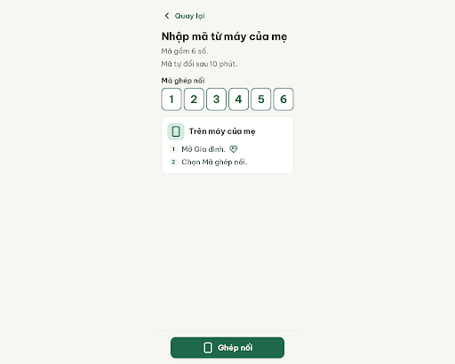
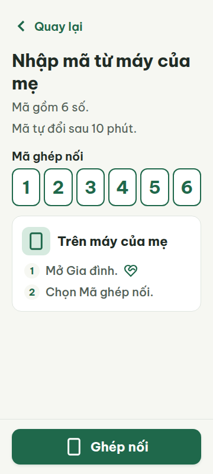
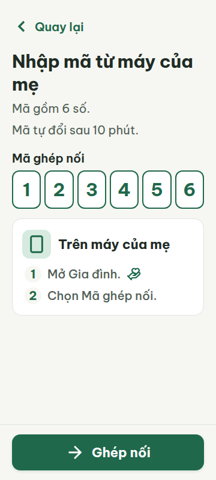
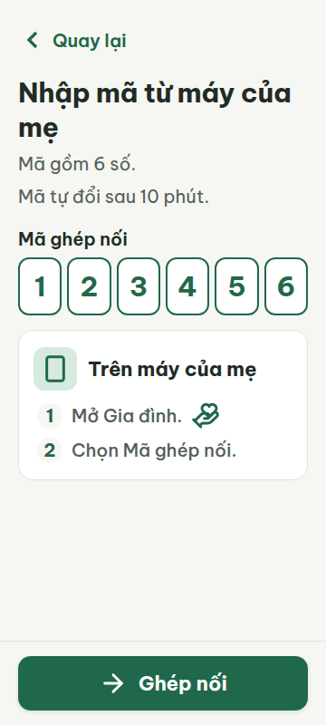

# C02 — Nhập mã ghép nối

Project: `2013215887278758682` — An Nhiên (project của Sanh)

**Màn chốt hiện tại: v2 — 100 điểm**

Screen ID: `178c1a0062734b6983dcd210d75ae56e`

**Kết quả: CONVERGED** · stop_reason: score_100

| Vòng | Điểm | Error | Warn | Đã sửa | Regression |
|---|---:|---:|---:|---|---|
| v0 | 87 | 1 | 1 | — | — |
| v1 | 97 | 0 | 1 | R-TXT-01 | — |
| v2 | 100 | 0 | 0 | R-ICON-03 | — |

## v0 — 87 điểm

Screen: `projects/2013215887278758682/screens/a367993040524f49a2d3c7ad1a8f9948`





- R-TXT-01 (error): Số thứ tự 1 và 2 trong thẻ Trên máy của mẹ. Bằng chứng: HTML .step-number có font-size:16px; cả hai số hiển thị rõ ở ảnh 360 và 412, nhỏ hơn mức sàn 20px.. Sửa: Đổi .step-number từ 16px thành 20px; tăng vòng số lên 28×28px nếu cần giữ cân đối.
- R-ICON-03 (warn): Icon Gia đình ở bước 1 và icon nút Ghép nối. Bằng chứng: HTML .guidance-step-item svg là 24×24px dù không phải chip trạng thái. SVG bước 1 có hình heart-handshake thay vì hand-heart của tab Gia đình. Nút Ghép nối dùng smartphone giống icon thông tin máy, trong khi dictionary dành smartphone cho thiết bị/quyền/dữ liệu.. Sửa: Đổi icon Gia đình sang đúng Lucide hand-heart kích thước 32×32px; đổi icon hành động tiếp tục ghép nối sang Lucide arrow-right 32×32px, giữ smartphone 32×32px cho thông tin máy của mẹ.

Bố cục nhập mã rõ ràng, không tràn ở 360/412px; còn số thứ tự 16px và icon bước hướng dẫn nhỏ/sai từ điển.

### Edit prompt

```text
Keep the overall layout and everything not mentioned below unchanged.
1. [R-TXT-01] In the instruction card, set .step-number font-size to20px (currently16px) and size both numbered circles to28x28px. No displayed text may be below20px.
2. [R-ICON-03] Replace the family icon after "Mở Gia đình." with exact Lucide hand-heart SVG32x32px,stroke2–2.5. The current24px heart-handshake shape is incorrect. Keep its visible label.
3. [R-ICON-03] In the main "Ghép nối" button replace smartphone with exact Lucide arrow-right32x32px for continuing the pairing action. Keep smartphone32px only beside "Trên máy của mẹ" as phone information. Preserve all other text/colors/layout and single accessible code input with6visual cells. Create a NEW screen version; do not overwrite source.

```

## v1 — 97 điểm

Screen: `projects/2013215887278758682/screens/bb0b36b65a0f45d4bfe92368bd6274a9`




- R-ICON-03 (warn): Icon Gia đình ở bước Mở Gia đình. Bằng chứng: SVG hand-heart có thuộc tính width/height=32, nhưng quy tắc CSS .guidance-step-item svg đặt width:24px;height:24px nên kích thước hiển thị vẫn 24×24px. Đây là icon hướng dẫn, không phải chip trạng thái. Ảnh viewport xác nhận nhỏ hơn icon 32px trên nút Ghép nối; arrow-right trên nút và smartphone ở tiêu đề thẻ đã đúng nghĩa.. Sửa: Đổi .guidance-step-item svg thành width:32px;height:32px; giữ Lucide hand-heart cho Gia đình, arrow-right cho Ghép nối và smartphone cho máy của mẹ.

Mã nhập, chữ và vùng chạm đạt yêu cầu ở 360/412px; icon Gia đình trong hướng dẫn vẫn bị CSS thu còn 24px, chưa đạt 32px.

### Edit prompt

```text
Keep the overall layout and everything not mentioned below unchanged.
1. [R-ICON-03] The hand-heart SVG after "Mở Gia đình." still renders24x24px because the CSS rule .guidance-step-item svg overrides its width/height attributes. Change that CSS rule to width:32px;height:32px (or explicitly32px on the relevant SVG style so no24px rule wins). Keep exact Lucide hand-heart paths. Preserve the corrected20px step numerals,32px arrow-right pairing action,32px smartphone header icon and all layout/text/colors. Generate a new screen version and preserve source.

```

## v2 — 100 điểm

Screen: `projects/2013215887278758682/screens/178c1a0062734b6983dcd210d75ae56e`





Icon Gia đình đã đạt 32px; màn nhập mã đạt toàn bộ luật áp dụng qua HTML, metrics và ảnh viewport 360/412px.
