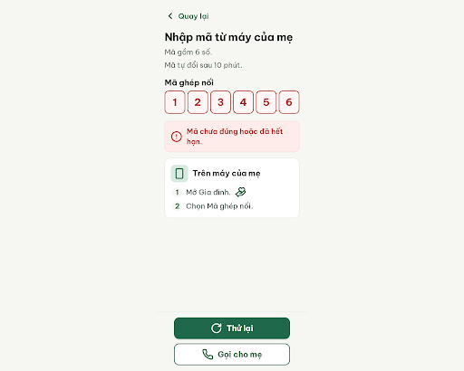
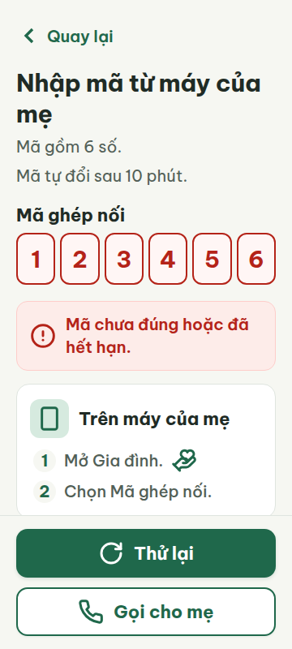
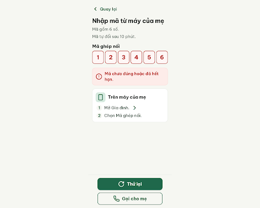
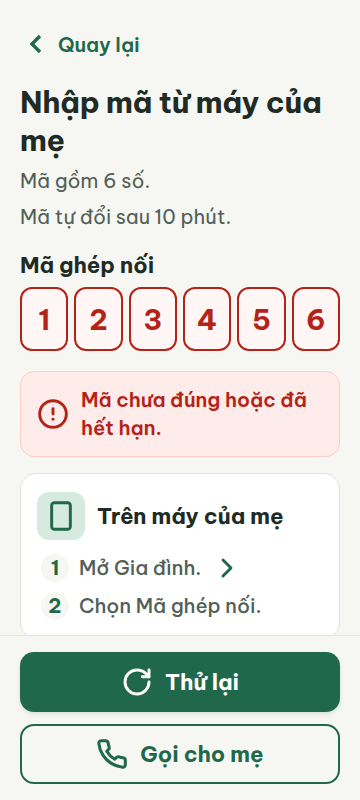
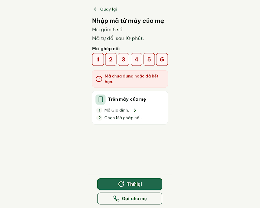
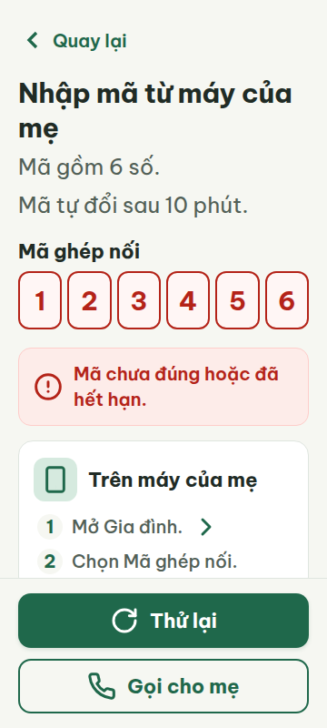
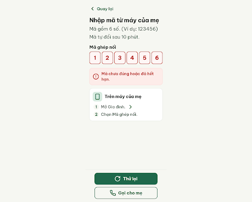
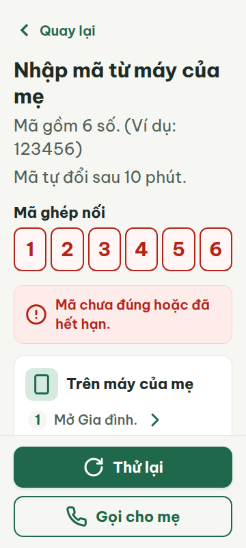

# C02e — Mã sai hoặc hết hạn

Project: `2013215887278758682` — An Nhiên (project của Sanh)

**Màn chốt hiện tại: v3 — 97 điểm**

Screen ID: `706eff40546b4a58ad062dd0df3c2daa`

**Kết quả: CONVERGED** · stop_reason: patience_2

| Vòng | Điểm | Error | Warn | Đã sửa | Regression |
|---|---:|---:|---:|---|---|
| v0 | 87 | 1 | 1 | — | — |
| v1 | 97 | 0 | 1 | R-ICON-03, R-ONE-01 | — |
| v2 | 97 | 0 | 1 | R-TXT-02 | R-SAFE-02 |
| v3 | 97 | 0 | 1 | R-TXT-02, R-SAFE-02 | — |

## v0 — 87 điểm

Screen: `projects/2013215887278758682/screens/7bb2a864267542d7a80342edccc24820`





- R-ICON-03 (warn): Bước 1 trong thẻ 'Trên máy của mẹ'. Bằng chứng: Biểu tượng tay-trái-tim đang dùng hand-heart (quy định riêng cho tab Gia đình), còn hướng dẫn này chỉ nhắc mở mục Gia đình.. Sửa: Thay biểu tượng bước 1 bằng chevron-right 32 × 32 px; giữ hand-heart riêng cho tab Gia đình.
- R-ONE-01 (error): Hai nút cố định cuối màn: 'Thử lại' và 'Gọi cho mẹ'. Bằng chứng: Ảnh cho thấy cả hai nút đều có nền đậm/đặc (nút đầu nền xanh đậm, nút sau nền trắng đặc), tạo hai nút filled trên cùng màn.. Sửa: Giữ 'Thử lại' nền #1F684B; đổi 'Gọi cho mẹ' sang nút text/tonal với nền trong suốt hoặc #D6EADF, bỏ nền trắng đặc.

Màn có chữ dễ đọc, thao tác đủ lớn và lỗi nhập được giải thích rõ; cần sửa hai nút filled cùng lúc và dùng icon đúng nghĩa.

### Edit prompt

```text
Edit C02e from the current best screen. Fix both remaining reviewer issues while preserving all correct error-state content: replace the hand-heart icon in step 1 (“Trên máy của mẹ”) with documented chevron-right 32×32px; keep hand-heart reserved for the Gia đình tab. Keep “Thử lại” as the single dark filled #1F684B CTA. Convert “Gọi cho mẹ” into an outlined/text/tonal secondary action with transparent or pale #D6EADF background and no white filled card. Maintain retained six entered digits in one OTP control with red #B42318 border, exact error banner “Mã chưa đúng hoặc đã hết hạn”, and responsive 360/412 layout without footer overlap. Return a new edited screen.

```

## v1 — 97 điểm

Screen: `projects/2013215887278758682/screens/0beba189c2834f8783d4dc07bc692a91`





- R-TXT-02 (warn): Hai dòng hướng dẫn dưới tiêu đề: 'Mã gồm 6 số.' và 'Mã tự đổi sau 10 phút.'. Bằng chứng: Ảnh và metrics 360 cho thấy chữ hướng dẫn nội dung ở cỡ 20 px, thấp hơn mức nội dung chính khoảng 24 px; các dòng hướng dẫn là nội dung chính của màn nhập mã.. Sửa: Tăng hai dòng hướng dẫn từ 20 px lên 24 px; giữ tiêu đề 30 px và nhãn nút 22 px.

Màn đã sửa hai nút về một nút filled, dùng icon phù hợp; chữ hướng dẫn 20 px vẫn nhỏ hơn mục tiêu 24 px cho nội dung chính.

### Edit prompt

```text
Edit C02e from the best reviewed screen and fix only the remaining R-TXT-02 warning: raise the two main guidance lines “Mã gồm 6 số.” and “Mã tự đổi sau 10 phút.” from 20px to 24px, preserving title30px and button22px. Keep the single filled “Thử lại” action, tonal “Gọi cho mẹ”, chevron-right guide icon, red OTP error border, exact error banner, retained six digits, and responsive layout. Ensure footer does not cover guidance at 360px. Return a new screen.

```

## v2 — 97 điểm

Screen: `projects/2013215887278758682/screens/de3aca09ba4449938bc4852a1da0b037`





- R-SAFE-02 (warn): Thông báo lỗi nhập mã và phần hướng dẫn ngay phía trên/dưới trường mã. Bằng chứng: Thông báo có icon cảnh báo và câu giải thích 'Mã chưa đúng hoặc đã hết hạn.'; màn chỉ nói 'Mã gồm 6 số.' mà không đưa ví dụ định dạng mã đúng.. Sửa: Thêm dòng 'Ví dụ: 123456' cạnh hướng dẫn 'Mã gồm 6 số.'; giữ icon cảnh báo và giải thích lỗi.

Màn đã tăng chữ hướng dẫn lên 24 px; thông báo lỗi nhập mã vẫn thiếu một ví dụ cụ thể về định dạng mã đúng.

### Edit prompt

```text
Edit C02e from its best reviewed screen and add a concrete example of the accepted code format next to “Mã gồm 6 số.”: the exact helper “Ví dụ: 123456”. Keep the error banner and warning icon, 24px guidance, retained input, tonal “Gọi cho mẹ” and primary “Thử lại”. Make clear the example illustrates six-digit format only; preserve all existing error-state semantics and the 360/412 layout.

```

## v3 — 97 điểm

Screen: `projects/2013215887278758682/screens/706eff40546b4a58ad062dd0df3c2daa`





- R-ICON-03 (warn): Nút cuối màn ‘Thử lại’. Bằng chứng: Nút dùng biểu tượng rotate-cw; biểu tượng này không có trong Từ điển icon của assets/stitch/DESIGN.md.. Sửa: Thay rotate-cw bằng biểu tượng Lucide alarm-clock-plus 32 × 32 px (nghĩa ‘Nhắc lại sau, Dời giờ’), hoặc bỏ icon và giữ nguyên nhãn ‘Thử lại’.

Màn đã tăng cỡ chữ hướng dẫn lên 24 px và thêm ví dụ mã đúng; chỉ còn biểu tượng thử lại chưa có trong từ điển icon.
