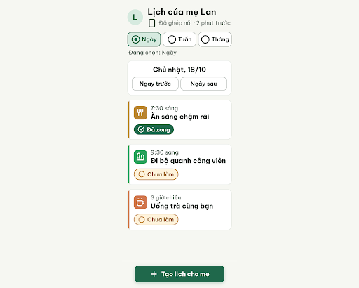
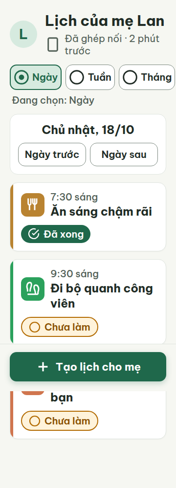
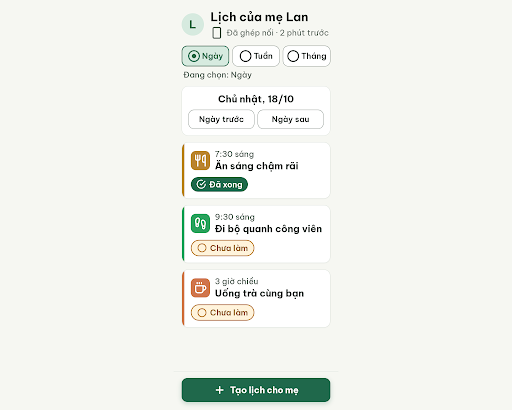
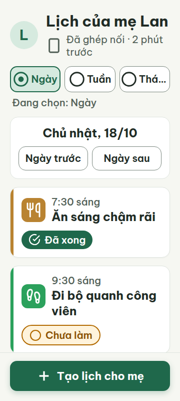
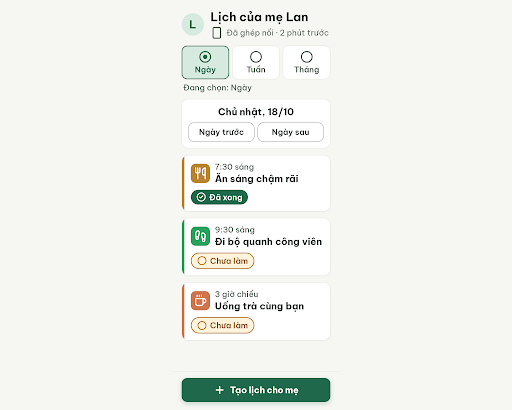
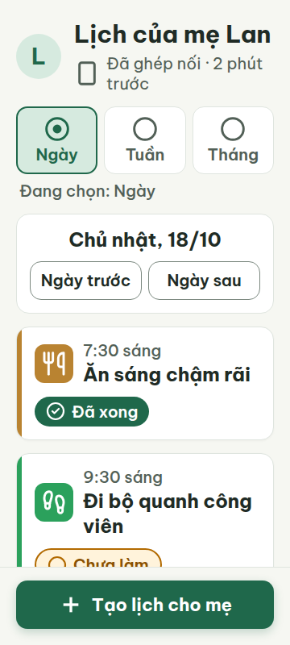
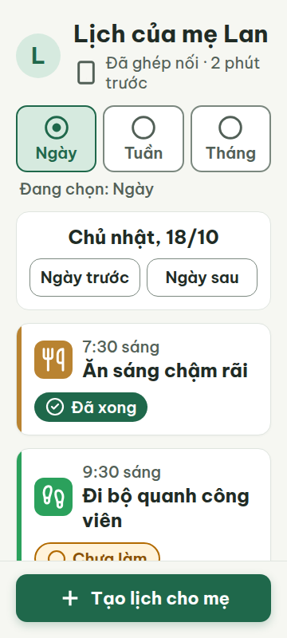
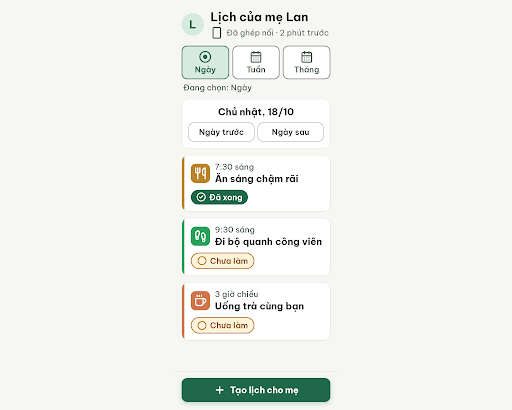
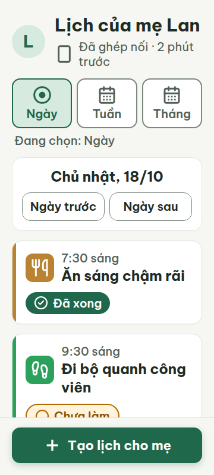

# C03 — Lịch của mẹ · Ngày

Project: `2013215887278758682` — An Nhiên (project của Sanh)

**Màn chốt hiện tại: v3 — 97 điểm**

Screen ID: `8728b1da9813434e8ea27bf1279d45e6`

**Kết quả: CONVERGED** · stop_reason: patience_2

| Vòng | Điểm | Error | Warn | Đã sửa | Regression |
|---|---:|---:|---:|---|---|
| v0 | 94 | 0 | 2 | — | — |
| v1 | 87 | 1 | 1 | R-STY-03 | R-LAY-01 |
| v2 | 97 | 0 | 1 | R-LAY-01, R-ICON-03 | R-CON-02 |
| v3 | 97 | 0 | 1 | R-CON-02 | R-ICON-03 |
| v4 | 94 | 0 | 2 | R-ICON-03 | R-ICON-03 |

## v0 — 94 điểm

Screen: `projects/2013215887278758682/screens/bbe95aed2282460789221b8b7bc97d89`





- R-ICON-03 (warn): Ô icon các thẻ việc. Bằng chứng: SVG tự dựng thay vì nguyên hình Lucide: utensils có hai chạc; footprints nối hai dấu chân bằng một đường ngang; coffee dùng path tự dựng. Khung 32px và chip 24px đạt kích thước.. Sửa: Thay bằng SVG Lucide chuẩn utensils, footprints, coffee 32×32px, stroke-width 2.2; dùng circle-check 24×24px cho Đã xong.
- R-STY-03 (warn): Bộ chọn ở 360px; CTA ở 412px. Bằng chứng: Metrics360: Tháng x242.906 + rộng115.453 =358.359, lề phải chỉ1.641px. Metrics412: CTA rộng320px và x46 nên lề46px. Yêu cầu lề20px. Các khối khác gap16px.. Sửa: Đặt grid-template-columns:repeat(3,minmax(0,1fr)); padding ngang lựa chọn2px và gap icon/chữ4px. Đặt CTA width:100% trong footer padding ngang20px: rộng320px ở360 và372px ở412.

Lịch ngày dễ đọc, đủ trạng thái và vùng chạm; còn icon tự dựng và lề ngang chưa ổn định ở 360/412px.

### Edit prompt

```text
Keep the overall layout and everything not mentioned below unchanged.
1. [R-ICON-03] Replace the three habit SVGs with the exact official Lucide utensils, footprints and coffee SVGs below; set actual rendered size32x32px, stroke2.2, white inside existing colored48px tiles. Do not approximate paths or draw a connecting line between the two footprints. Keep circle-check24px only for "Đã xong" and circle24px for "Chưa làm".
2. [R-STY-03] Keep the Ngày/Tuần/Tháng radio selector inside20px screen margins at360px. Use grid-template-columns:repeat(3,minmax(0,1fr));min-width:0 on children;padding-inline:2px;gap between icon and label4px;32px icons and20px labels. Preserve8px between interactive options. The last choice must end atx340 or less, notx358.
3. [R-STY-03] Set main CTA width:100% inside a footer with20px horizontal padding, and remove its max-width320px cap:320px wide at360 viewport,372px at412 viewport. Preserve60px height and14px radius, keep footer below content with adequate scroll padding. Preserve all other content/colors. Generate a new screen version, do not overwrite source.

utensils (official Lucide SVG; keep path data exact):
<svg
  xmlns="http://www.w3.org/2000/svg"
  width="32"
  height="32"
  viewBox="0 0 24 24"
  fill="none"
  stroke="currentColor"
  stroke-width="2.2"
  stroke-linecap="round"
  stroke-linejoin="round"
>
  <path d="M3 2v7c0 1.1.9 2 2 2h4a2 2 0 0 0 2-2V2" />
  <path d="M7 2v20" />
  <path d="M21 15V2a5 5 0 0 0-5 5v6c0 1.1.9 2 2 2h3Zm0 0v7" />
</svg>

footprints (official Lucide SVG; keep path data exact):
<svg
  xmlns="http://www.w3.org/2000/svg"
  width="32"
  height="32"
  viewBox="0 0 24 24"
  fill="none"
  stroke="currentColor"
  stroke-width="2.2"
  stroke-linecap="round"
  stroke-linejoin="round"
>
  <path d="M4 16v-2.38C4 11.5 2.97 10.5 3 8c.03-2.72 1.49-6 4.5-6C9.37 2 10 3.8 10 5.5c0 3.11-2 5.66-2 8.68V16a2 2 0 1 1-4 0Z" />
  <path d="M20 20v-2.38c0-2.12 1.03-3.12 1-5.62-.03-2.72-1.49-6-4.5-6C14.63 6 14 7.8 14 9.5c0 3.11 2 5.66 2 8.68V20a2 2 0 1 0 4 0Z" />
  <path d="M16 17h4" />
  <path d="M4 13h4" />
</svg>

coffee (official Lucide SVG; keep path data exact):
<svg
  xmlns="http://www.w3.org/2000/svg"
  width="32"
  height="32"
  viewBox="0 0 24 24"
  fill="none"
  stroke="currentColor"
  stroke-width="2.2"
  stroke-linecap="round"
  stroke-linejoin="round"
>
  <path d="M10 2v2" />
  <path d="M14 2v2" />
  <path d="M16 8a1 1 0 0 1 1 1v8a4 4 0 0 1-4 4H7a4 4 0 0 1-4-4V9a1 1 0 0 1 1-1h14a4 4 0 1 1 0 8h-1" />
  <path d="M6 2v2" />
</svg>

```

## v1 — 87 điểm

Screen: `projects/2013215887278758682/screens/3e2586c3d4b6405fab43b0e982c5551b`





- R-LAY-01 (error): Bộ chọn Ngày/Tuần/Tháng tại 360px. Bằng chứng: Ảnh viewport360 hiện nhãn “Thá...” thay vì Tháng. Metrics: label Tháng chỉ rộng59.34375px tại x277.65625, trong khi cùng chữ ở412px rộng63.453125px. HTML .choice-label có overflow:hidden, text-overflow:ellipsis, white-space:nowrap. scrollWidth=clientWidth=360 chỉ chứng minh không tràn trang, không chứng minh chữ không bị cắt.. Sửa: Giữ chữ20px và icon32px, đặt ba nút grid-template-columns:1fr 1fr 1.1fr (hoặc cho icon nằm trên nhãn) để nhãn Tháng có ít nhất64px; bỏ ellipsis và kiểm tại360px.
- R-ICON-03 (warn): Icon chip Đã xong. Bằng chứng: SVG24×24 dùng vòng tròn hở với path M22 11.08V12... và tick m9 11 3 3L22 4; hình là circle-check-big/open-circle thay vì circle-check trong từ điển. Kích thước icon thói quen32px và icon trạng thái24px đều đạt; không tính lỗi kích thước.. Sửa: Dùng Lucide circle-check24×24: circle cx12 cy12 r10 và path m9 12 2 2 4-4; giữ icon trắng trên #1F684B.

Lề ngang và CTA đã đúng tại360/412px, chữ và vùng chạm đạt; nhãn Tháng bị cắt tại360px, icon Đã xong chưa đúng circle-check trong từ điển.

### Edit prompt

```text
Keep the overall layout and everything not mentioned below unchanged.
You are editing the BEST source v0, not the regressed v1. Apply the best source critique below.
1. [R-ICON-03] Replace the habit SVGs with exact official Lucide utensils, footprints and coffee below, actual32x32px,white,stroke2.2; keep48px colored tiles and6px left stripes. Use the exact circle-check24px below for "Đã xong", not circle-check-big (check must remain inside circle); keep circle24px for "Chưa làm". Do not approximate paths.
2. [R-STY-03] Keep all three Ngày/Tuần/Tháng radio choices inside20px margins at360px: grid repeat(3,minmax(0,1fr)),8px gaps,each child min-width0. Within EACH radio option stack its32px circle/circle-dot icon ABOVE its20px text label (flex-direction:column,gap4px), height>=80px. Allow no ellipsis,clipping,nowrap truncation; every full word Ngày/Tuần/Tháng must be visible. Keep separate line "Đang chọn: Ngày" and selected pale styling. This improves fit while preserving labels/icons.
3. [R-STY-03] Primary footer button width100% within20px horizontal footer padding,no320px max cap:width320 at360 and372 at412,height60,radius14. Preserve adequate scroll bottom padding and every other element. Create NEW version, preserve source.

utensils:
<svg
  xmlns="http://www.w3.org/2000/svg"
  width="32"
  height="32"
  viewBox="0 0 24 24"
  fill="none"
  stroke="currentColor"
  stroke-width="2.2"
  stroke-linecap="round"
  stroke-linejoin="round"
>
  <path d="M3 2v7c0 1.1.9 2 2 2h4a2 2 0 0 0 2-2V2" />
  <path d="M7 2v20" />
  <path d="M21 15V2a5 5 0 0 0-5 5v6c0 1.1.9 2 2 2h3Zm0 0v7" />
</svg>

footprints:
<svg
  xmlns="http://www.w3.org/2000/svg"
  width="32"
  height="32"
  viewBox="0 0 24 24"
  fill="none"
  stroke="currentColor"
  stroke-width="2.2"
  stroke-linecap="round"
  stroke-linejoin="round"
>
  <path d="M4 16v-2.38C4 11.5 2.97 10.5 3 8c.03-2.72 1.49-6 4.5-6C9.37 2 10 3.8 10 5.5c0 3.11-2 5.66-2 8.68V16a2 2 0 1 1-4 0Z" />
  <path d="M20 20v-2.38c0-2.12 1.03-3.12 1-5.62-.03-2.72-1.49-6-4.5-6C14.63 6 14 7.8 14 9.5c0 3.11 2 5.66 2 8.68V20a2 2 0 1 0 4 0Z" />
  <path d="M16 17h4" />
  <path d="M4 13h4" />
</svg>

coffee:
<svg
  xmlns="http://www.w3.org/2000/svg"
  width="32"
  height="32"
  viewBox="0 0 24 24"
  fill="none"
  stroke="currentColor"
  stroke-width="2.2"
  stroke-linecap="round"
  stroke-linejoin="round"
>
  <path d="M10 2v2" />
  <path d="M14 2v2" />
  <path d="M16 8a1 1 0 0 1 1 1v8a4 4 0 0 1-4 4H7a4 4 0 0 1-4-4V9a1 1 0 0 1 1-1h14a4 4 0 1 1 0 8h-1" />
  <path d="M6 2v2" />
</svg>

circle-check:
<svg
  xmlns="http://www.w3.org/2000/svg"
  width="24"
  height="24"
  viewBox="0 0 24 24"
  fill="none"
  stroke="currentColor"
  stroke-width="2.2"
  stroke-linecap="round"
  stroke-linejoin="round"
>
  <circle cx="12" cy="12" r="10" />
  <path d="m16 9-5.5 5.5L8 12" />
</svg>

```

## v2 — 97 điểm

Screen: `projects/2013215887278758682/screens/75beaf1824f449a8b31f0f4043c73b4f`





- R-CON-02 (warn): Viền hai ô chọn Tuần và Tháng. Bằng chứng: HTML inline đổi viền ô chưa chọn thành #DFE5DF; computed metrics360/412 xác nhận border rgb(223,229,223). Contrast với nền trắng #FFFFFF chỉ 1.28:1, với nền màn #F6F7F2 chỉ 1.19:1, thấp hơn 3:1. Viền điều hướng ngày #7B887F đạt 3.70:1.. Sửa: Đổi viền ô Tuần và Tháng sang 2px solid #7B887F (contrast3.70:1 trên trắng); giữ selected border2px #1F684B.

Chữ Tháng hiện đủ tại360/412px; circle-check Đã xong có vòng tròn kín và dấu tick, icon trạng thái24px đạt ngoại lệ. Chữ tối thiểu20px, vùng chạm nhỏ nhất139×48px, CTA320×60px hoặc372×60px với lề20px. Còn viền hai ô chưa chọn tương phản thấp1.28:1.

### Edit prompt

```text
Edit the existing C03 screen in place as a new version, preserving every correct element. Fix the only remaining reviewer warning: set the unselected Tuần and Tháng selector borders to 2px solid #7B887F (3.70:1 on white) and retain selected border #1F684B. Preserve responsive layout at 360px and 412px, readable complete “Tháng” text, documented Lucide icons, typography, and all current content. Do not introduce new warnings or remove existing interactions.

```

## v3 — 97 điểm

Screen: `projects/2013215887278758682/screens/8728b1da9813434e8ea27bf1279d45e6`




- R-ICON-03 (warn): Ba ô chọn chế độ Ngày, Tuần, Tháng. Bằng chứng: HTML và ảnh cho thấy Ngày dùng circle-dot (đúng nghĩa đang chọn), còn Tuần và Tháng đều dùng cùng icon circle trống. Từ điển DESIGN.md quy định circle cho trạng thái chưa làm/chưa chọn, còn chế độ Lịch tuần phải dùng calendar-days; hai ô Tuần và Tháng cũng không có icon lịch/tháng riêng. Đây là dùng lặp một icon với nghĩa không cụ thể; dù khung SVG là 32×32 px, nét hình nhỏ trong khung.. Sửa: Dùng Lucide calendar-days 32×32 cho Tuần và icon calendar-days 32×32 cho Tháng với trạng thái tháng phân biệt bằng nhãn; không dùng circle làm biểu tượng chế độ lịch.

Còn icon chế độ lịch chưa đúng nghĩa: Tuần và Tháng đều dùng circle thay cho biểu tượng lịch riêng; các viền lựa chọn nay đạt tương phản đủ.

### Edit prompt

```text
Apply these changes to the selected C03 screen and generate/return the edited screen now. Do not describe a plan, suggest a preview, or ask a question. Replace generic circle icons on the Tuần and Tháng selectors with documented Lucide calendar-days glyphs at 32×32; retain circle-dot for selected Ngày. Keep corrected borders #7B887F, all text and layout, and verify responsive 360px and 412px without truncation. Make the glyph itself visibly 32px, not a tiny drawing inside a 32px box.

```

## v4 — 94 điểm

Screen: `projects/2013215887278758682/screens/2293431810904ab1b776328f9463512d`





- R-ICON-03 (warn): Chế độ xem Tuần và Tháng. Bằng chứng: Hai nút cùng hiển thị cùng một biểu tượng Lucide calendar-days 32×32, trong khi DESIGN.md quy định calendar-days chỉ cho tab và tiêu đề Lịch tuần. Biểu tượng trùng nghĩa dùng cho Tuần và Tháng; tháng không có biểu tượng riêng theo từ điển và icon không phân biệt hai chế độ.. Sửa: Dùng calendar-days 32×32 cho Tuần; bỏ icon khỏi lựa chọn Tháng (chỉ chữ Tháng), hoặc bổ sung icon riêng được duyệt vào từ điển trước khi dùng.
- R-STY-03 (warn): Khoảng cách giữa các nút Ngày / Tuần / Tháng. Bằng chứng: Ảnh và HTML hiển thị ba ô lựa chọn liền kề, cách nhau 8 px; DESIGN.md quy định khoảng cách giữa các khối là 16 px.. Sửa: Đặt khoảng cách giữa các khối chọn chế độ xem thành 16 px; giữ nút 48 px trở lên.

Các biểu tượng Tuần và Tháng nay trùng nhau, trái từ điển; khoảng cách giữa các nút chế độ xem còn 8 px thay vì 16 px theo token bố cục.
