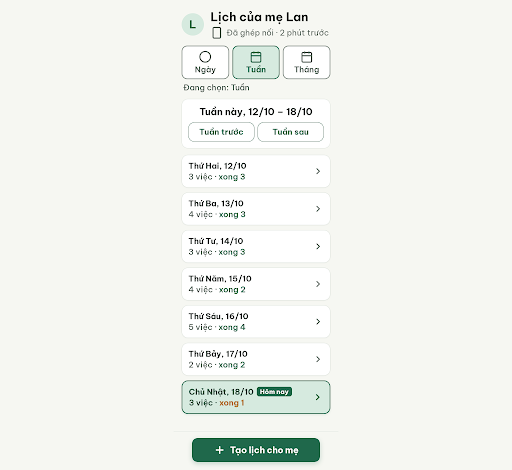
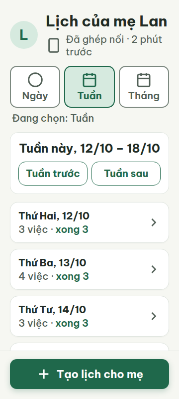
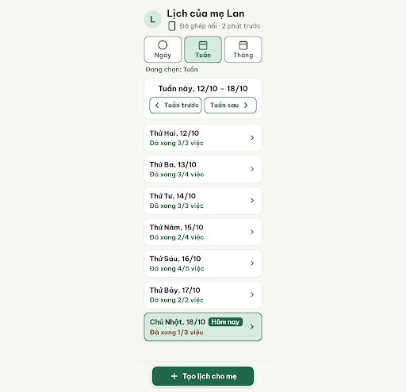
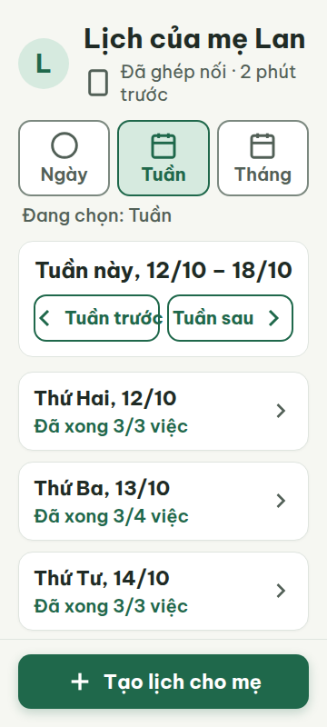
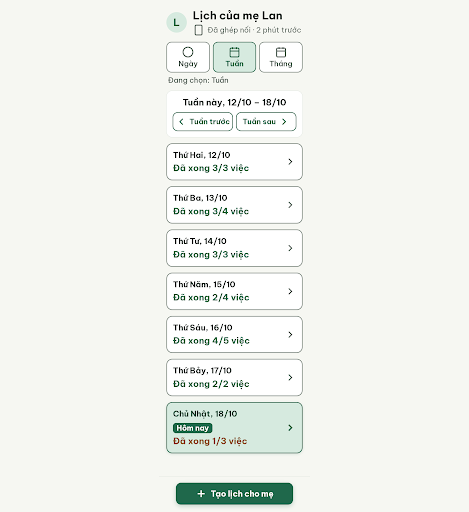
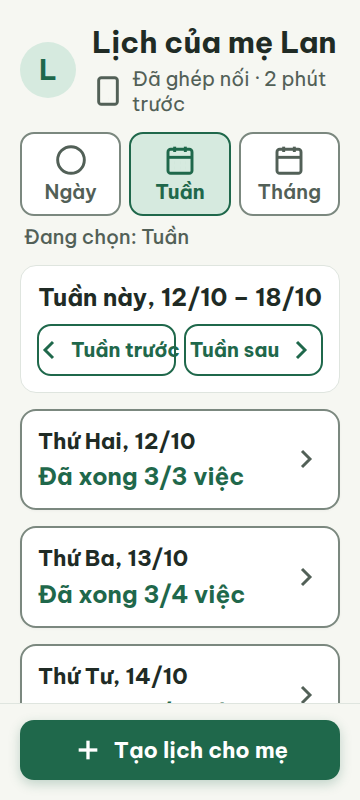

# C04 — Lịch của mẹ · Tuần

Project: `2013215887278758682` — An Nhiên (project của Sanh)

**Màn chốt hiện tại: v2 — 100 điểm**

Screen ID: `22264169a37842a3b64dcd8348ea65b9`

**Kết quả: CONVERGED** · stop_reason: score_100

| Vòng | Điểm | Error | Warn | Đã sửa | Regression |
|---|---:|---:|---:|---|---|
| v0 | 54 | 4 | 2 | — | — |
| v1 | 88 | 0 | 4 | R-TXT-01, R-LAY-01, R-ICON-02, R-STA-02, R-VOC-01 | — |
| v2 | 100 | 0 | 0 | R-TXT-02, R-CON-02, R-ICON-03, R-STY-03 | — |

## v0 — 54 điểm

Screen: `projects/2013215887278758682/screens/440d61ca87b64dc1b0e32dbda45248c5`





- R-TXT-01 (error): Nhãn badge ‘Hôm nay’ trên ngày Chủ Nhật. Bằng chứng: Metrics ghi chữ 16px (khoảng 20px thực tế do tỉ lệ co), dưới mức tối thiểu 20px.. Sửa: Đặt cỡ chữ badge ‘Hôm nay’ thành 20px và tăng chiều cao badge theo nội dung.
- R-TXT-02 (warn): Các dòng tiến độ ‘3 việc · xong 3’ trong từng ngày. Bằng chứng: Chữ tiến độ đọc được nhưng nhỏ hơn tên ngày, trong khi nội dung chính nên khoảng 24px.. Sửa: Tăng dòng tiến độ chính lên 24px.
- R-LAY-01 (error): Các thẻ ngày ở danh sách tuần trên màn 360px. Bằng chứng: Metrics có scrollWidth 360 ở viewport nhưng các thẻ ngày từ Thứ Năm trở đi rộng 372px, nội dung tràn qua cạnh phải và bị cắt trong ảnh.. Sửa: Giới hạn mọi thẻ ngày ở chiều rộng 320px (width:100%; min-width:0) bên trong lề 20px.
- R-ICON-02 (error): Các nút ‘Tuần trước’ và ‘Tuần sau’. Bằng chứng: Hai nút điều hướng tuần chỉ có chữ, không có icon.. Sửa: Thêm icon Lucide 32px cho mỗi nút điều hướng tuần, giữ nhãn chữ hiện có.
- R-STA-02 (warn): Tiến độ dưới tên mỗi ngày. Bằng chứng: UI dùng dạng ‘3 việc · xong 3’ thay vì câu tiến độ có nhãn rõ ‘Đã xong 3/6 việc’.. Sửa: Hiển thị tiến độ theo mẫu ‘Đã xong 3/6 việc’ cho từng ngày.
- R-VOC-01 (error): Nhãn badge ‘Hôm nay’ và các chỉ số ‘xong 3’, ‘xong 2’ trong lịch. Bằng chứng: Tránh dùng quy định Today và Done. Bản UI chứa ‘Hôm nay’ và ‘xong N’ (biến thể dịch của Done), còn từ vựng chuẩn trạng thái là ‘Đã xong’.. Sửa: Đổi badge thành ‘Ngày đang xem’ và mọi ‘xong N’ thành ‘Đã xong N’ để tránh nhãn tiếng Anh/biến thể không chuẩn.

Lịch tuần có cấu trúc rõ và nút chính dễ chạm, nhưng các thẻ ngày tràn ngang, badge chữ nhỏ và tiến độ chưa theo mẫu ngôn ngữ chuẩn.

### Edit prompt

```text
Edit C04 from its current best screen and return a new version. Fix the reviewer findings without dropping required week content: constrain every day row to width:100% and min-width:0 inside 20px side margins so max content width is 320px at 360 viewport; add documented Lucide chevron-left 32px and chevron-right 32px to “Tuần trước” and “Tuần sau” while retaining visible text; make the “Ngày đang xem” badge text >=20px; set each progress line to the exact pattern “Đã xong 3/6 việc” (vary counts realistically) and 24px primary content. Do not use “xong N” alone. Keep seven weekday rows, selected-day navigation to C03, 360/412 responsiveness, CTA fixed above safe area with no overlap, and all correct An Nhiên tokens/content.

```

## v1 — 88 điểm

Screen: `projects/2013215887278758682/screens/c5f4b1d1443e4503926cd38a63262bcd`





- R-TXT-02 (warn): Các dòng tiến độ dưới tên ngày, như ‘Đã xong 3/4 việc’. Bằng chứng: Tên ngày là 22px nhưng phần nội dung tiến độ đang 20px; nội dung chính nên xấp xỉ 24px.. Sửa: Tăng chữ tiến độ của mỗi ngày từ 20px lên 24px.
- R-CON-02 (warn): Viền các hàng ngày có thể bấm trong danh sách tuần. Bằng chứng: Các hàng có role=listitem, tabindex=0 và nền #FFFFFF nhưng viền #DFE5DF chỉ đạt khoảng 1.3:1 so với nền, dưới 3:1.. Sửa: Đổi viền hàng ngày sang #7B887F hoặc màu viền khác đạt tối thiểu 3:1 với nền #FFFFFF.
- R-ICON-03 (warn): Mũi tên mở chi tiết ở cuối từng hàng ngày. Bằng chứng: Các chevron-right của hàng ngày có kích thước 28×28px, dưới mức 32px; ngoại lệ 24px chỉ áp dụng cho icon trong chip trạng thái.. Sửa: Tăng mỗi icon chevron-right ở hàng ngày từ 28×28px lên 32×32px.
- R-STY-03 (warn): Khoảng cách dọc giữa các hàng ngày trong danh sách tuần. Bằng chứng: Các hàng cách nhau 12px theo style inline; quy tắc yêu cầu khoảng cách 16px giữa các khối.. Sửa: Đổi gap của danh sách ngày từ 12px lên 16px.

Màn lịch tuần đã sửa được các lỗi chặn chính từ v0; còn bốn điểm nên chỉnh về cỡ chữ tiến độ, độ tương phản viền, kích thước chevron và khoảng cách giữa các ngày.

### Edit prompt

```text
Edit C04 from best reviewed screen and fix all four remaining warnings without regressing v1 corrections: raise each weekday progress line “Đã xong X/Y việc” to 24px; change clickable day-row borders from #DFE5DF to 2px #7B887F; increase each row chevron-right glyph from 28px to visible 32×32px; set vertical gap between day rows to exactly 16px. Preserve seven days, full width fit at 360/412, icon+label navigation, “Ngày đang xem” badge, one CTA, fixed footer with no overlap and all existing wording.

```

## v2 — 100 điểm

Screen: `projects/2013215887278758682/screens/22264169a37842a3b64dcd8348ea65b9`






Màn lịch tuần đạt đủ 100 điểm; các lỗi cảnh báo về cỡ chữ tiến độ, viền, chevron và khoảng cách đã được khắc phục.
