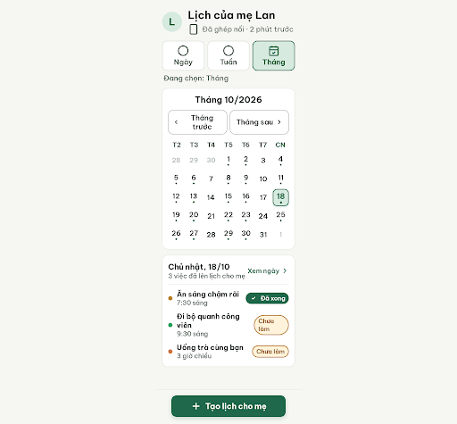
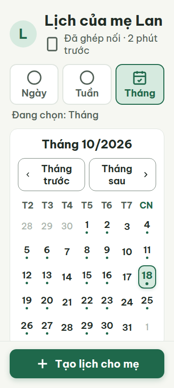
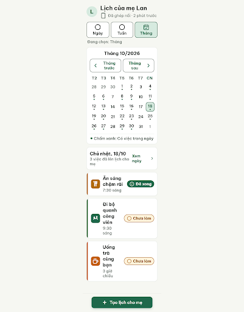
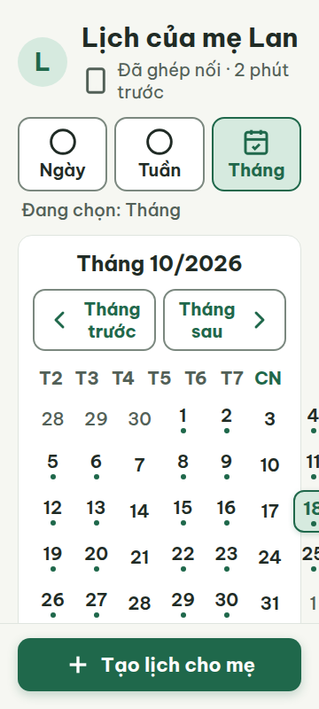
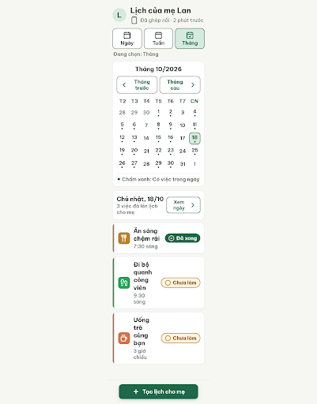
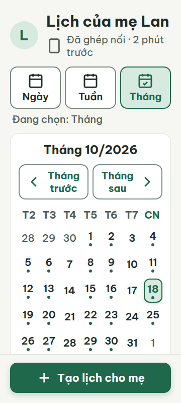

# C05 — Lịch của mẹ · Tháng

Project: `2013215887278758682` — An Nhiên (project của Sanh)

**Màn chốt hiện tại: v2 — 100 điểm**

Screen ID: `509ac29b1c6542fd8747f0a3b628fad6`

**Kết quả: CONVERGED** · stop_reason: score_100

| Vòng | Điểm | Error | Warn | Đã sửa | Regression |
|---|---:|---:|---:|---|---|
| v0 | 28 | 6 | 4 | — | — |
| v1 | 74 | 2 | 2 | R-TXT-01, R-TXT-02, R-CON-01, R-CON-02, R-ICON-02, R-COL-02, R-COL-01, R-STA-01, R-STY-01 | R-LAY-01, R-COL-03 |
| v2 | 100 | 0 | 0 | R-LAY-01, R-ICON-03, R-COL-03, R-TAP-01 | — |

## v0 — 28 điểm

Screen: `projects/2013215887278758682/screens/1068ae843fce4906a84f854e3f62a38b`





- R-TXT-01 (error): Nhãn thứ và chip trạng thái trong lịch ngày. Bằng chứng: metrics 360/412 đo nhãn thứ 18px và chip trạng thái 17px; đều dưới ngưỡng 20px.. Sửa: Đặt mọi chữ giao diện, gồm nhãn thứ và chữ chip, ở cỡ tối thiểu 20px.
- R-TXT-02 (warn): Tên việc trong danh sách ngày. Bằng chứng: Tên việc hiển thị khoảng 20px, nhỏ hơn cỡ nội dung chính khoảng 24px; tiêu đề màn 30px và nút 22px đã đúng.. Sửa: Tăng tên việc và nội dung chính từ 20px lên 24px.
- R-CON-01 (error): Các ngày ngoài tháng hiện tại. Bằng chứng: HTML dùng #AAB4AC cho ngày mờ trên nền #FFFFFF; độ tương phản thấp hơn 4.5:1.. Sửa: Đổi chữ ngày mờ từ #AAB4AC sang #526057 trên nền #FFFFFF.
- R-CON-02 (warn): Viền hai lựa chọn Ngày và Tuần. Bằng chứng: Viền control #DFE5DF trên nền trắng có tương phản thấp hơn 3:1.. Sửa: Đổi viền control sang #7B887F để đạt tương phản tối thiểu 3:1.
- R-ICON-02 (error): Ba việc trong danh sách ngày. Bằng chứng: Mỗi việc chỉ có một chấm màu 12px, không có icon thói quen trong ô icon; yêu cầu tất cả việc có icon.. Sửa: Thay mỗi chấm 12px bằng ô icon 48×48px nền màu thói quen, có icon Lucide trắng 32px và nhãn việc bên cạnh.
- R-ICON-03 (warn): Biểu tượng điều hướng lịch. Bằng chứng: Hai nút Tháng trước/sau dùng chevron 20px, Xem ngày dùng chevron 22px, nút Đã xong dùng dấu kiểm 18px; các kích thước thấp hơn 32px (chip cho phép tối thiểu 24px).. Sửa: Đặt chevron-left và chevron-right trong nút điều hướng ở 32px; dùng circle-check 24px cho chip Đã xong.
- R-COL-02 (error): Ba thẻ việc trong danh sách ngày. Bằng chứng: Các thẻ chỉ có chấm tròn màu 12px; không có ô icon màu nhấn và vạch màu dọc bên trái.. Sửa: Thêm vạch trái 6px và ô icon 48×48px nền đúng màu habit-*-accent cho từng thẻ.
- R-COL-01 (error): Các ngày có lịch trong lưới tháng. Bằng chứng: Dấu chấm xanh nhỏ là dấu hiệu duy nhất cho ngày có việc; không có nhãn hoặc giải thích kèm theo.. Sửa: Thêm nhãn chữ ngắn 'Có việc' kèm biểu tượng và đặt cạnh lịch tháng để giải thích dấu ngày có lịch.
- R-STA-01 (error): Hai thẻ có trạng thái Chưa làm. Bằng chứng: Chip vàng 'Chưa làm' không có biểu tượng ○; vì vậy trạng thái thiếu biểu tượng bắt buộc đi cùng chữ.. Sửa: Thêm circle 24px vào chip 'Chưa làm' và giữ chữ 'Chưa làm' cạnh biểu tượng.
- R-STY-01 (warn): Ngày ngoài tháng hiện tại. Bằng chứng: Nền, thẻ, chữ, màu nhấn, cảnh báo và border-subtle chính khớp token; chữ ngày mờ #AAB4AC không phải màu token trong DESIGN.md.. Sửa: Dùng màu token #526057 cho ngày ngoài tháng thay #AAB4AC.

Lưới tháng rõ và không tràn ngang, nhưng chữ và một số icon nhỏ; thẻ việc thiếu ô icon/vạch màu và chip Chưa làm thiếu biểu tượng.

### Edit prompt

```text
Edit C05 from its best reviewed screen and correct the month-calendar findings while keeping the seven-column grid and selected-day summary. Raise every weekday label and status-chip label to >=20px; raise task titles/main content to 24px. Change out-of-month date text from #AAB4AC to #526057. Set the unselected Ngày/Tuần selector borders to #7B887F. Replace tiny 12px habit dots with task cards: each card has a 6px left accent bar and 48×48px habit-color tile containing the correct white Lucide icon at visible 32×32, with the task name beside it. Add a clear “Có việc” text legend with an icon next to the month grid so scheduled-day markers are not color-only; keep date grid cells about 45×50 with touch areas >=48×48. Use chevron-left/right 32px in month navigation and circle-check 24px beside “Đã xong”; add circle 24px to each “Chưa làm” chip. Keep palette/token contrast, 360/412 responsiveness, no footer overlap, 20px margins and 16px gaps. Do not remove month grid or selected-day summary.

```

## v1 — 74 điểm

Screen: `projects/2013215887278758682/screens/9269ebfeaa834fb3b09d270d43ad2bd3`





- R-LAY-01 (error): Lưới tháng ở viewport rộng 360 px. Bằng chứng: v1-metrics-360.json ghi scrollWidth 376 và clientWidth 360; lưới tràn 16 px về bên phải, nên ngày ở cột cuối bị cắt.. Sửa: Giới hạn lưới và mọi con của nó trong 320 px chiều rộng nội dung tại viewport 360 px; đặt grid-template-columns: repeat(7, minmax(0, 1fr)) và min-width: 0 để scrollWidth không vượt 360 px.
- R-ICON-03 (warn): Lưới chọn chế độ Ngày và Tuần; nút Xem ngày. Bằng chứng: Hai nút Ngày và Tuần vẽ cùng một vòng tròn trống thay vì icon riêng có nghĩa; nút Xem ngày dùng chevron 24 px, dưới chuẩn 32 px. Các icon này không khớp từ điển icon.. Sửa: Dùng icon lịch có nghĩa riêng trong từ điển cho Ngày/Tuần hoặc bỏ icon trùng lặp; tăng chevron-right của Xem ngày từ 24 lên 32 px và giữ nhãn chữ.
- R-COL-03 (warn): Ô icon và vạch trái của ba thẻ việc. Bằng chứng: Thẻ Ăn sáng dùng #B26A00 thay habit-eighty-accent #B98331; Đi bộ dùng #1F684B thay habit-move-accent #2BA15C; Uống trà dùng #C25E00 thay habit-tea-accent #D0754E. Icon thói quen đi bộ trong HTML là hình activity tự vẽ, không khớp Lucide footprints trong từ điển.. Sửa: Đặt thẻ Ăn sáng ở #B98331 với Lucide utensils, Đi bộ ở #2BA15C với Lucide footprints, và Uống trà ở #D0754E với Lucide coffee; dùng đúng các màu này cho cả ô icon và vạch trái.
- R-TAP-01 (error): Nhãn Xem ngày ở đầu danh sách việc. Bằng chứng: HTML đặt nhãn và chevron trong một div thường, không có button/link hoặc vùng tương tác; kích thước cụm đo được khoảng 80 × 50 px nhưng không thực sự là control chạm.. Sửa: Bọc Xem ngày và chevron-right trong button rộng tối thiểu 96 px, cao tối thiểu 48 px, có handler mở chế độ Ngày.

Bản v1 sửa được kích thước chữ, thẻ việc và chip trạng thái, nhưng lưới tháng còn tràn ngang; màu/icon thói quen và một vùng Xem ngày cần chỉnh.

### Edit prompt

```text
Edit C05 from the best reviewed screen. Fix all four remaining findings: constrain the month grid to the 320px content width at 360px with `grid-template-columns: repeat(7,minmax(0,1fr))` and `min-width:0`, so no horizontal overflow; make “Xem ngày” a real button at least 96×48px with a handler to open C03 day view; use distinct meaningful documented icons for Ngày/Tuần and increase its chevron-right to visible 32px; use exact habit tokens/icons throughout: Ăn sáng #B98331 + Lucide utensils, Đi bộ #2BA15C + Lucide footprints, Uống trà #D0754E + Lucide coffee, matching both icon tiles and left accent bars. Preserve seven-column grid, selected date summary, labels, task statuses, CTA, and all correct v1 improvements. Check 360/412 overflow, tappable targets and footer.

```

## v2 — 100 điểm

Screen: `projects/2013215887278758682/screens/509ac29b1c6542fd8747f0a3b628fad6`






Bản v2 đáp ứng các luật chấm; đã khắc phục tràn ngang, icon chế độ xem, màu thói quen và vùng chạm Xem ngày của v1.
