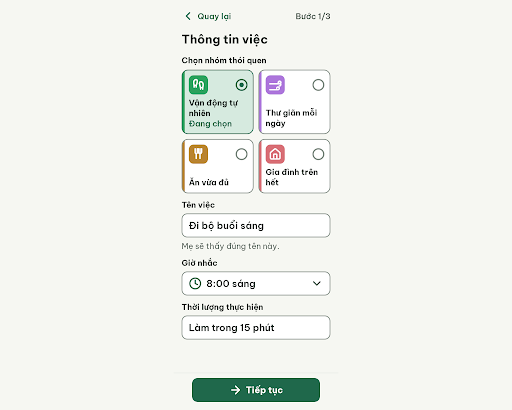
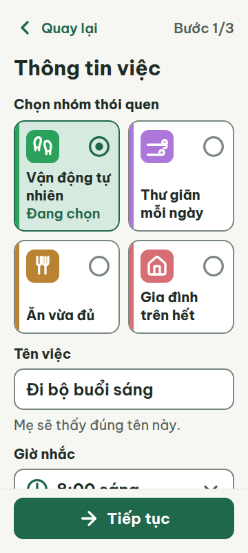
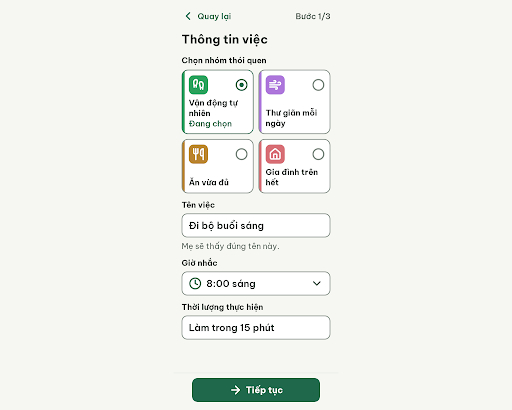
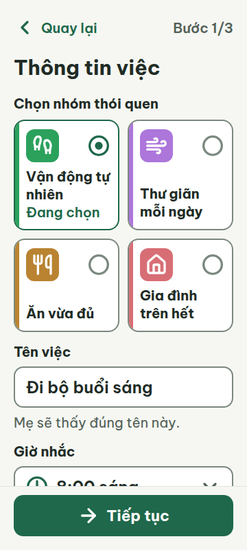

# C06 — Thông tin việc (Bước 1/3)

Project: `2013215887278758682` — An Nhiên (project của Sanh)

**Màn chốt hiện tại: v1 — 100 điểm**

Screen ID: `de3f6f6ef0ae40b4a901db925b2ee484`

**Kết quả: CONVERGED** · stop_reason: score_100

| Vòng | Điểm | Error | Warn | Đã sửa | Regression |
|---|---:|---:|---:|---|---|
| v0 | 94 | 0 | 2 | — | — |
| v1 | 100 | 0 | 0 | R-CON-02, R-ICON-03 | — |

## v0 — 94 điểm

Screen: `projects/2013215887278758682/screens/311943e6e7b544418171d30fce9cf683`





- R-CON-02 (warn): Ô icon Vận động tự nhiên đang chọn. Bằng chứng: Nền ô icon #2BA15C trên nền thẻ selected #D6EADF chỉ đạt 2,63:1, dưới 3:1. Viền control #7B887F trên trắng đạt 3,70:1.. Sửa: Giữ màu nhấn #2BA15C; đặt ô icon trên nền trắng #FFFFFF để đạt 3,30:1, dùng viền 2px #1F684B và circle-dot + Đang chọn để biểu thị lựa chọn.
- R-ICON-03 (warn): Icon thói quen Ăn vừa đủ và Thư giãn mỗi ngày. Bằng chứng: SVG được ghi chú Lucide nhưng đường nét tự dựng: utensils hiện hai chiếc nĩa, không phải hình nĩa và dao của Lucide utensils; wind có các nét cuộn chồng bất thường. Mọi khung SVG đều 32×32px nên không lỗi kích thước.. Sửa: Thay nguyên SVG bằng Lucide utensils và wind chính thức; giữ khung 32×32px, stroke-width 2.5 và màu trắng; không tự dựng lại path.

Form đọc rõ, cuộn tới cuối được và không có lỗi chặn; cần tăng tương phản ô icon đang chọn và dùng nguyên bản icon Lucide.

### Edit prompt

```text
Keep the overall layout and everything not mentioned below unchanged.
1. [R-CON-02] Keep the selected Vận động tự nhiên habit accent#2BA15C, but make the selected card white#FFFFFF instead of pale#D6EADF so its colored tile has>=3:1 contrast. Keep2px#1F684B selected border, circle-dot32px and visible "Đang chọn" so choice remains explicit. Preserve6px accent stripe and48px tile withwhite32px icon.
2. [R-ICON-03] Replace the entire utensils and wind SVGs with the exact official Lucide path data below. Actual rendered32x32px,white,stroke2.5. Do not draw two forks or re-create path shapes. Leave all other elements unchanged. Create a NEW screen version, preserve source.

utensils:
<svg
  xmlns="http://www.w3.org/2000/svg"
  width="32"
  height="32"
  viewBox="0 0 24 24"
  fill="none"
  stroke="currentColor"
  stroke-width="2.5"
  stroke-linecap="round"
  stroke-linejoin="round"
>
  <path d="M3 2v7c0 1.1.9 2 2 2h4a2 2 0 0 0 2-2V2" />
  <path d="M7 2v20" />
  <path d="M21 15V2a5 5 0 0 0-5 5v6c0 1.1.9 2 2 2h3Zm0 0v7" />
</svg>

wind:
<svg
  xmlns="http://www.w3.org/2000/svg"
  width="32"
  height="32"
  viewBox="0 0 24 24"
  fill="none"
  stroke="currentColor"
  stroke-width="2.5"
  stroke-linecap="round"
  stroke-linejoin="round"
>
  <path d="M12.8 19.6A2 2 0 1 0 14 16H2" />
  <path d="M17.5 8a2.5 2.5 0 1 1 2 4H2" />
  <path d="M9.8 4.4A2 2 0 1 1 11 8H2" />
</svg>

```

## v1 — 100 điểm

Screen: `projects/2013215887278758682/screens/de3f6f6ef0ae40b4a901db925b2ee484`






Đã sửa tương phản ô icon đang chọn và SVG wind, utensils; form đạt đủ các luật áp dụng ở khung chuẩn 360px, cuộn tới thời lượng được tại 360/412px.
