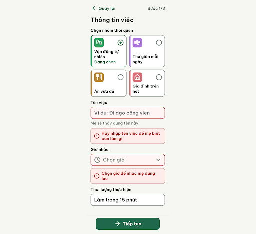
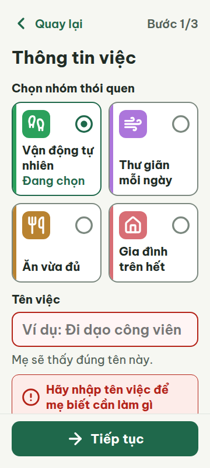

# C06e — Thiếu tên hoặc giờ

Project: `2013215887278758682` — An Nhiên (project của Sanh)

**Màn chốt hiện tại: v1 — 97 điểm**

Screen ID: `53723ff825954797a5a2316f16898550`

**Kết quả: CONVERGED** · stop_reason: patience_2

| Vòng | Điểm | Error | Warn | Đã sửa | Regression |
|---|---:|---:|---:|---|---|
| v0 | 97 | 0 | 1 | — | — |
| v1 | 97 | 0 | 1 | R-ICON-03 | R-SAFE-02 |
| v2 | 77 | 2 | 1 | R-SAFE-02 | R-TXT-03, R-LAY-01 |

## v0 — 97 điểm

Screen: `projects/2013215887278758682/screens/e05816e82aba4e829bbc187e938a2c0e`




- R-ICON-03 (warn): Hai biểu tượng lỗi nhập cạnh thông báo dưới ‘Tên việc’ và ‘Giờ nhắc’. Bằng chứng: Mỗi icon đo 28 × 28 px, nhỏ hơn yêu cầu 32 px; từ điển định nghĩa lỗi nhập là circle-alert.. Sửa: Dùng Lucide circle-alert ở 32 × 32 px cho cả hai thông báo lỗi.

Biểu mẫu dễ đọc, không tràn ngang và dùng đúng token; hai icon cảnh báo nhập nhỏ hơn ngưỡng 32 px.

### Edit prompt

```text
Edit C06e from its best reviewed screen. Fix only the remaining icon-size warning: set both validation error icons next to “Hãy nhập tên việc để mẹ biết cần làm gì” and “Chọn giờ để nhắc mẹ đúng lúc” to Lucide circle-alert, visibly 32×32 px each (not 28px SVGs). Preserve both exact error messages, empty name/unset time fields, selected habit/duration, title and step, C06 styling, fixed CTA and responsive layout.

```

## v1 — 97 điểm

Screen: `projects/2013215887278758682/screens/53723ff825954797a5a2316f16898550`




- R-SAFE-02 (warn): Thông báo lỗi dưới ô ‘Giờ nhắc’. Bằng chứng: Có icon cảnh báo và câu giải thích ‘Chọn giờ để nhắc mẹ đúng lúc’, nhưng không có ví dụ về giờ cụ thể; ô Tên việc có ví dụ trong placeholder còn ô Giờ nhắc thì không.. Sửa: Thêm ví dụ giờ vào lỗi, chẳng hạn ‘Chọn giờ, ví dụ 8 giờ sáng, để nhắc mẹ đúng lúc’.

Các biểu tượng lỗi đã đạt 32 px; thông báo lỗi giờ nhắc vẫn thiếu ví dụ cụ thể theo R-SAFE-02.

### Edit prompt

```text
Edit C06e from its best reviewed screen to fix only the remaining guidance warning. Make the exact time-error copy: “Chọn giờ, ví dụ 8 giờ sáng, để nhắc mẹ đúng lúc.” Keep the error icon 32px, the other exact name validation message, empty/unset field state, selected habit, duration, one “Tiếp tục” CTA, 360/412 layout and all correct design styling.

```

## v2 — 77 điểm

Screen: `projects/2013215887278758682/screens/0a98cf3f7241455da7cfadad83ee156a`


- R-LAY-01 (error): Khung nhìn 360 × 800 px, thông báo lỗi ‘Giờ nhắc’. Bằng chứng: Thanh hành động cố định bắt đầu tại y=708 px; thông báo lỗi giờ nhắc bắt đầu tại y=839.5 px và bị che hoàn toàn trong khung nhìn đầu, nên chữ bị khuất dù scrollWidth không vượt 360 px.. Sửa: Tăng phần đệm cuộn cuối màn lên tối thiểu 160 px và bảo đảm có thể cuộn lỗi giờ nhắc lên khỏi thanh cố định.
- R-TXT-03 (error): Thông báo lỗi dưới trường ‘Giờ nhắc’. Bằng chứng: Ở khung 360 px, câu ‘Chọn giờ, ví dụ 8 giờ sáng, để nhắc mẹ đúng lúc.’ chiếm 3 dòng (font 20 px; vùng chữ rộng 244 px), vượt giới hạn 2 dòng.. Sửa: Rút câu còn tối đa 2 dòng ở cỡ 20 px, ví dụ ‘Chọn giờ nhắc, ví dụ 8 giờ sáng.’
- R-STY-03 (warn): Khung 360 × 800 px, thông báo lỗi đầu tiên và thanh hành động cố định. Bằng chứng: Vùng chữ lỗi ở y=652.5–704.5 px; thanh cố định bắt đầu tại y=708 px, để lại khoảng cách khoảng 3.5 px. Thông báo lỗi kế tiếp nằm dưới thanh và bị che trong màn hình ban đầu.. Sửa: Giữ khoảng cách dọc 16 px giữa thông báo lỗi và thanh hành động; tăng vùng đệm cuộn cuối màn lên tối thiểu 160 px để thông báo lỗi kế tiếp cuộn lên khỏi thanh cố định.

Ví dụ giờ đã có và thông báo lỗi có icon; câu lỗi giờ nhắc vượt 2 dòng và bị che bởi thanh hành động cố định trong khung nhìn đầu.
