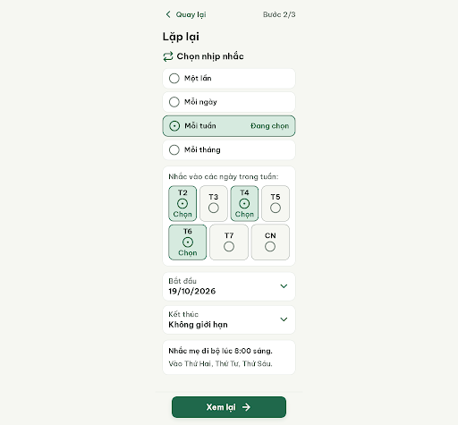
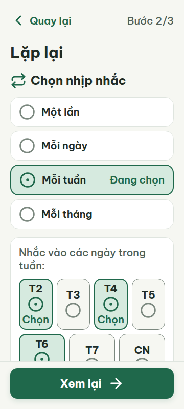
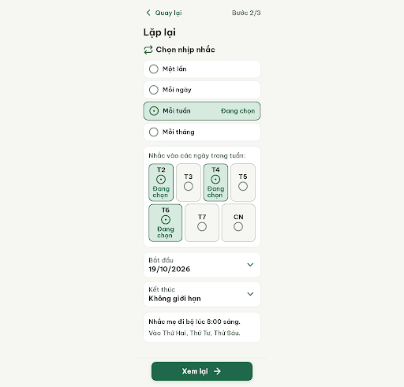
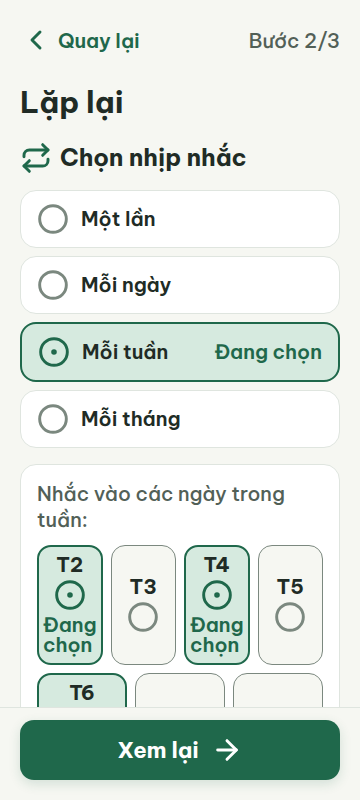
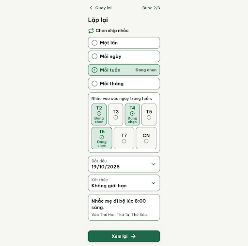
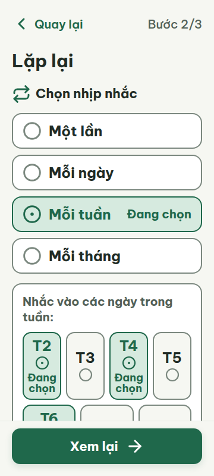
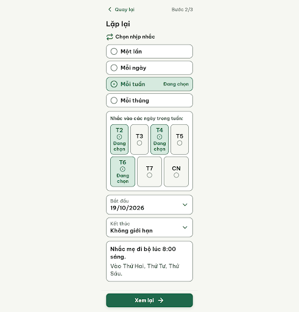
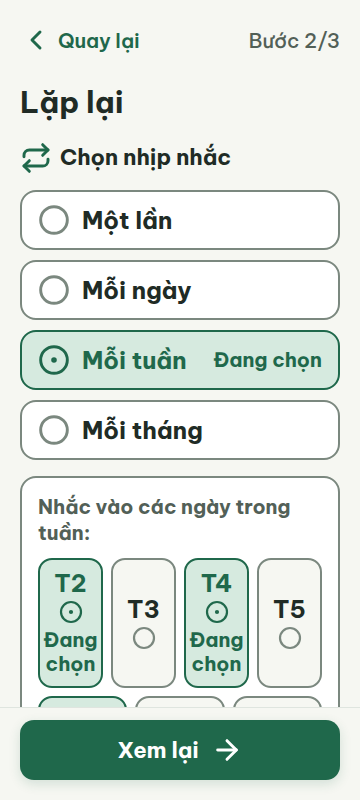
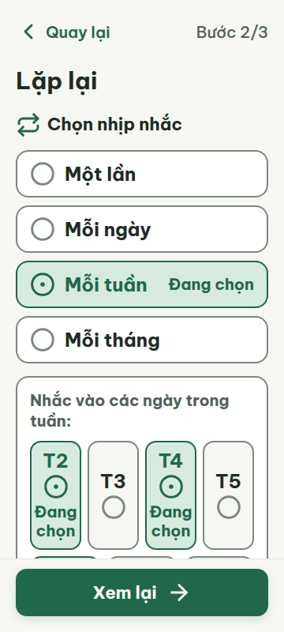

# C07 — Lặp lại mỗi tuần (Bước 2/3)

Project: `2013215887278758682` — An Nhiên (project của Sanh)

**Màn chốt hiện tại: v4 — 100 điểm**

Screen ID: `757085b74597441786088387267f7826`

**Kết quả: CONVERGED** · stop_reason: score_100

| Vòng | Điểm | Error | Warn | Đã sửa | Regression |
|---|---:|---:|---:|---|---|
| v0 | 91 | 0 | 3 | — | — |
| v1 | 94 | 0 | 2 | R-ICON-03 | — |
| v2 | 87 | 1 | 1 | R-CON-02 | R-TXT-01 |
| v3 | 97 | 0 | 1 | R-TXT-01, R-TXT-02 | — |
| v4 | 100 | 0 | 0 | R-ICON-03 | — |

## v0 — 91 điểm

Screen: `projects/2013215887278758682/screens/00123fce15c7460ea9c365f3bf86a6c2`





- R-TXT-02 (warn): Nhãn tần suất, ngày trong tuần và tóm tắt lịch. Bằng chứng: HTML và metrics 360/412: .radio-label, .weekday-name, .summary-p1/.summary-p2 = 20px; đây là nội dung chính. Tiêu đề 30px và CTA 22px đúng.. Sửa: Đổi .radio-label và .summary-p1/.summary-p2 sang 24px; giữ tiêu đề 30px, CTA 22px, nhãn phụ tối thiểu 20px.
- R-CON-02 (warn): Viền lựa chọn Một lần/Mỗi ngày/Mỗi tháng và ô Bắt đầu/Kết thúc. Bằng chứng: Viền #DFE5DF trên nền app #F6F7F2 chỉ 1.19:1, trên nền trắng 1.27:1, dưới 3:1. Viền ngày #7B887F đạt 3.44:1 trên nền app.. Sửa: Đổi viền các .radio-row chưa chọn và .date-field-card thành 2px solid #7B887F; giữ viền đang chọn 2px #1F684B.
- R-ICON-03 (warn): Trạng thái chọn ngày T2/T4/T6. Bằng chứng: Các icon circle-dot đúng nghĩa và 32px, nhưng nhãn đi kèm là “Chọn”; từ điển yêu cầu circle-dot kèm viền 2px primary và chữ “Đang chọn”. Hiện nhãn giống lời mời thao tác thay vì trạng thái.. Sửa: Đổi nhãn “Chọn” dưới circle-dot ở T2/T4/T6 thành “Đang chọn” với chữ ≥20px; tăng chiều rộng ô hoặc dùng danh sách ngày để không xuống quá 2 dòng. Giữ Lucide circle-dot 32px và viền 2px #1F684B.

Form đọc được, không tràn và vùng chạm đủ lớn; còn 3 cảnh báo về cỡ nội dung chính, tương phản viền control và nhãn trạng thái ngày đang chọn.

### Edit prompt

```text
Keep the overall layout and everything not mentioned below unchanged.
1. [R-TXT-02] Set .radio-label, .weekday-name, .summary-p1 and .summary-p2 font-size24px; keep heading30px,CTA22px and secondary/helper text>=20px. Keep each summary paragraph at most2lines at360px; allow natural wrapping and no truncation.
2. [R-CON-02] Set unselected .radio-row and .date-field-card borders to2px solid#7B887F,not#DFE5DF. Keep selected borders2px#1F684B and all current fill colors.
3. [R-ICON-03] For selected T2/T4/T6 replace caption "Chọn" with exact "Đang chọn" at20px,line-height24px. Preserve circle-dot32px and primary2px border. Let caption wrap to at most2lines, never clip; increase weekday tile height as needed (min-height144px,auto height) while preserving4+3 grid,8px target gaps,20px screen side margins and vertical scroll access. Do not shrink text/icon. All other elements unchanged; make NEW screen version, preserve source.

```

## v1 — 94 điểm

Screen: `projects/2013215887278758682/screens/c3e7c4cfc0874d8e9739b32f5e6572b7`





- R-TXT-02 (warn): Các nhãn tần suất, thứ trong tuần và hai dòng tóm tắt lịch. Bằng chứng: HTML/metrics 360 và 412 ghi .radio-label, .weekday-name, .summary-p1 và .summary-p2 đều 20px; đây là nội dung chính trong form, dưới mức khoảng 24px. Tiêu đề 30px và nút 22px đạt yêu cầu.. Sửa: Đặt .radio-label, .weekday-name và .summary-p1/.summary-p2 thành 24px; giữ nhãn phụ tối thiểu 20px, tiêu đề 30px và nút 22px.
- R-CON-02 (warn): Viền các lựa chọn tần suất chưa chọn và hai ô ngày Bắt đầu/Kết thúc. Bằng chứng: HTML dùng viền #DFE5DF trên thẻ trắng. Tương phản xấp xỉ 1.27:1, thấp hơn 3:1; viền ngày trong tuần #7B887F đạt khoảng 3.44:1 trên nền app.. Sửa: Đổi viền .radio-row chưa chọn và .date-field-card thành 2px solid #7B887F; giữ viền lựa chọn hiện tại 2px #1F684B.

Màn đạt 94 điểm; nhãn trạng thái ngày đã rõ hơn, còn nội dung chính 20px và viền control nhạt dưới ngưỡng tương phản.

### Edit prompt

```text
Edit C07 v1 from the best current screen, preserving all corrected weekdays/icons and layout. Fix both reviewer warnings: raise primary form content labels (.radio-label, .weekday-name, summary lines) from 20px to 24px while keeping secondary labels >=20px, title30px and button22px; set unselected frequency and start/end date-card borders to 2px solid #7B887F (3:1+ contrast), keeping selected #1F684B. Recheck 360px and 412px, no truncation, touch targets and fixed footer. Do not remove any correct content.

```

## v2 — 87 điểm

Screen: `projects/2013215887278758682/screens/16e3d5343dce4655b0921a706d0279a4`





- R-TXT-01 (error): Nhãn trạng thái ngày đã chọn: “Đang chọn” trong các ô thứ T2, T4, T6. Bằng chứng: v2-metrics-360/412 ghi .weekday-status-text ở 18px; ngưỡng tối thiểu là 20px.. Sửa: Đặt .weekday-status-text thành 20px trở lên; giữ chữ trong ô đủ rộng để hiển thị nguyên cụm “Đang chọn”.
- R-TXT-02 (warn): Dòng tóm tắt phụ “Vào Thứ Hai, Thứ Tư, Thứ Sáu.”. Bằng chứng: Metrics ở 360px và 412px cho .summary-p2 là 20px, thấp hơn cỡ nội dung chính khoảng 24px; ở 360px câu còn xuống hai dòng.. Sửa: Đặt .summary-p2 thành 24px và bảo đảm không quá hai dòng; giữ tiêu đề màn 30px và nút 22px.

Màn đạt 87 điểm; cỡ nội dung chính và viền control đã cải thiện, nhưng nhãn trạng thái 18px vi phạm mức tối thiểu và dòng tóm tắt phụ còn 20px.

### Edit prompt

```text
Edit C07 from its best reviewed screen. Raise the weekday selected-status text “Đang chọn” from 18px to at least 20px (prefer 20px) everywhere. Increase the secondary summary line to 24px, preserving a maximum of two lines without truncation at 360px. Keep corrected control contrast borders, iconography, contents and fixed footer. Ensure all visible text >=20px, responsive at 360px and 412px, no overlap or overflow.

```

## v3 — 97 điểm

Screen: `projects/2013215887278758682/screens/2d9bcdaf92d24015b7bddd1b831da562`





- R-ICON-03 (warn): Icon trạng thái trong các ô chọn ngày T2–CN. Bằng chứng: v3-metrics-360/412 và v3.html ghi các SVG trong weekday-btn là 24×24 px. Đây là icon của control chọn nhiều ngày, không phải icon nằm trong chip trạng thái được miễn ngưỡng 32 px.. Sửa: Tăng icon trong các ô chọn ngày lên 32×32 px; giữ nhãn ngày và chữ “Đang chọn” nguyên vẹn, đồng thời tăng chiều cao ô nếu cần để giữ khoảng đệm.

Màn đạt 97 điểm; hai lỗi cỡ chữ đã được sửa, còn icon chọn ngày trong tuần chỉ 24×24 px, thấp hơn mức 32 px.

### Edit prompt

```text
Edit C07 from its best reviewed screen. Fix the only remaining warning by increasing the Lucide icons inside all weekday selection controls T2–CN to actual visible 32×32px glyphs (not just a larger SVG viewBox). Preserve readable 20px+ labels including “Đang chọn”, 24px summary, corrected borders, targets, fixed footer, and responsive 360/412 layout. Increase tile height only as needed, avoid overlap, and keep all content.

```

## v4 — 100 điểm

Screen: `projects/2013215887278758682/screens/757085b74597441786088387267f7826`





Màn đạt 100 điểm; lỗi icon chọn ngày 24×24 px đã được khắc phục, các luật còn lại đều đạt hoặc không áp dụng.
