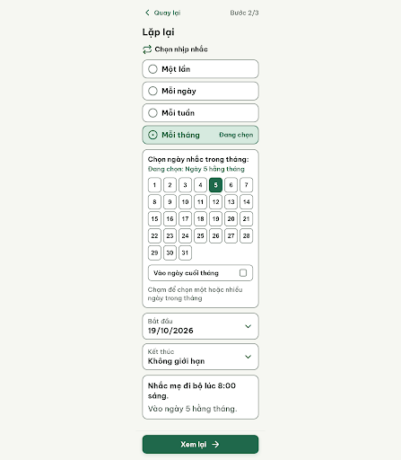
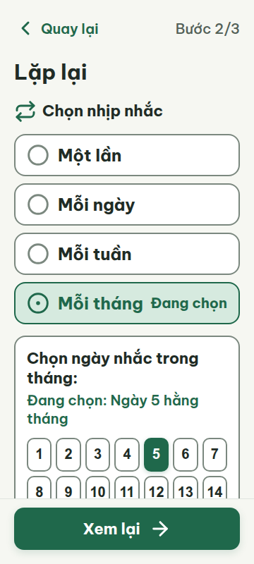
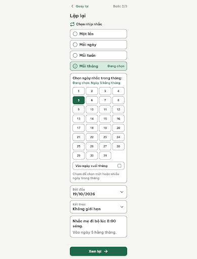
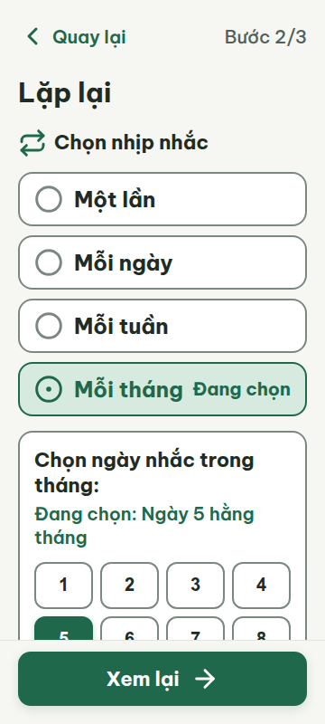
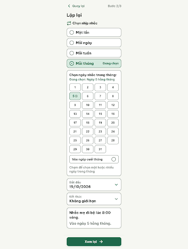
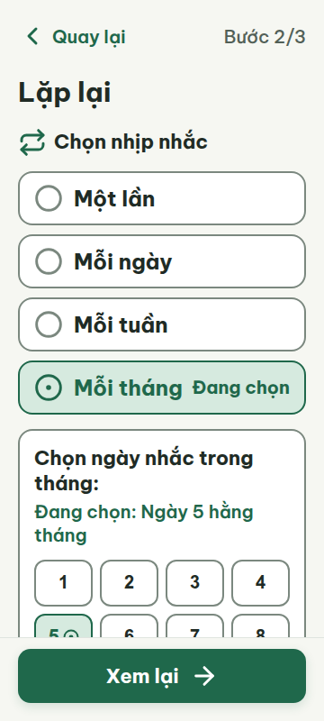
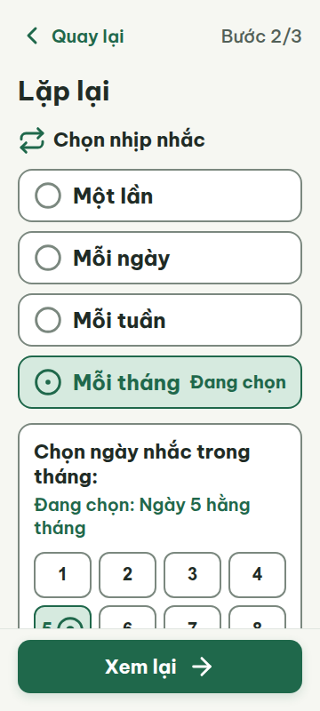

# C07m — Lặp lại mỗi tháng (Bước 2/3)

Project: `2013215887278758682` — An Nhiên (project của Sanh)

**Màn chốt hiện tại: v3 — 100 điểm**

Screen ID: `a0ad79b8e127494596d43d4fef27beb1`

**Kết quả: CONVERGED** · stop_reason: score_100

| Vòng | Điểm | Error | Warn | Đã sửa | Regression |
|---|---:|---:|---:|---|---|
| v0 | 87 | 1 | 1 | — | — |
| v1 | 87 | 1 | 1 | R-TAP-01, R-TAP-03 | R-ONE-01, R-ICON-03 |
| v2 | 97 | 0 | 1 | R-ONE-01 | — |
| v3 | 100 | 0 | 0 | — | — |

## v0 — 87 điểm

Screen: `projects/2013215887278758682/screens/24dccbdc024342269ba91b375e8420bb`





- R-TAP-01 (error): Lưới chọn ngày 1–31. Bằng chứng: Ở khung 360 px, mỗi nút ngày rộng khoảng 35.4 px (x=38…322), thấp nhất 48 px; vùng chạm nhỏ hơn 48×48 px.. Sửa: Đổi lưới thành 4 cột để mỗi ô ngày rộng ít nhất 48 px và cao 48 px; cho phép cuộn dọc.
- R-TAP-03 (warn): Các ô ngày liền kề trong lưới 1–31. Bằng chứng: Khoảng hở giữa hai nút cùng hàng khoảng 6 px (nút rộng 35.4 px; tọa độ x cách nhau 41.4 px), dưới 8 px.. Sửa: Đặt khoảng cách ngang giữa các nút ngày ít nhất 8 px.

Màn tháng dùng chữ và màu dễ đọc, nhưng các ô ngày quá hẹp và khoảng cách giữa chúng chưa đạt mức tối thiểu.

### Edit prompt

```text
Edit C07m from the best reviewed screen. Fix both grid target findings: change monthly date selection to a 4-column grid so every day button is at least 48×48px at 360px; add at least 8px horizontal and vertical gap between adjacent buttons. Keep dates 1–31 and separate “Cuối tháng” option, clear selected/unselected states with “Đang chọn”, exact monthly summary, correct task fields, fixed review CTA, 360/412 layout and all An Nhiên tokens. Allow vertical scrolling; do not shrink controls or introduce overflow.

```

## v1 — 87 điểm

Screen: `projects/2013215887278758682/screens/6f736369ab494b4294e6f61cfe5c963e`





- R-ICON-03 (warn): Biểu tượng ô chọn “Vào ngày cuối tháng”. Bằng chứng: HTML đặt SVG 28 × 28 px; rule yêu cầu icon tối thiểu 32 × 32 px, ngoài chip trạng thái.. Sửa: Tăng SVG ô chọn lên 32 × 32 px và dùng tên Lucide có trong từ điển icon.
- R-ONE-01 (error): Nút ngày 5 trong lưới ngày và nút “Xem lại”. Bằng chứng: Cả hai nút đều có nền primary đặc (#1F684B), vượt giới hạn một nút filled trên màn.. Sửa: Đổi trạng thái chọn ngày 5 sang nền nhạt #D6EADF với viền #1F684B, giữ nút “Xem lại” là nút filled duy nhất.

Lưới ngày đã đạt vùng chạm và khoảng cách tối thiểu; nút ngày được chọn tạo thêm một nút nền đậm và biểu tượng ô chọn tháng còn nhỏ hơn 32 px.

### Edit prompt

```text
Edit C07m from the best reviewed screen. Fix both findings: keep “Xem lại” as the only filled #1F684B button; change the selected day 5 tile to pale #D6EADF with #1F684B border and circle-dot state. Increase the “Cuối tháng” selection icon from 28px to visible 32×32px using the documented circle-dot/circle state icons, not an unlisted SVG. Preserve 4-column month grid with 48×48+ targets and 8px gaps, all dates 1–31, “Cuối tháng”, summary and responsive layout.

```

## v2 — 97 điểm

Screen: `projects/2013215887278758682/screens/1a7d68bb0ed04f5591e814dd7b47c5d2`





- R-ICON-03 (warn): Biểu tượng circle-dot trong nút ngày 5 đã chọn. Bằng chứng: HTML đặt SVG ở 18 × 18 px; đây là icon trạng thái lựa chọn, nhưng vẫn nhỏ hơn ngoại lệ tối thiểu 24 px.. Sửa: Tăng SVG circle-dot của nút ngày 5 lên 24 × 24 px; dùng circle-dot đúng theo từ điển icon.

Màn đạt 97 điểm; trạng thái chọn ngày đã chuyển sang nền nhạt, còn biểu tượng circle-dot 18px nhỏ hơn ngoại lệ 24px cho icon trạng thái.

### Edit prompt

```text
Edit C07m from v2. Keep “Xem lại” as the only filled #1F684B button and retain the selected day 5 tile's pale #D6EADF fill with #1F684B border. Increase the circle-dot icon inside the selected day 5 calendar control to a clearly visible 32×32 px, using the documented circle-dot icon. The 24 px exception applies only to labeled status chips, not calendar date controls. Preserve the 4-column month grid, 48×48 px minimum date targets, 8 px gaps, dates 1–31, “Cuối tháng”, summary, and responsive layout.

```

## v3 — 100 điểm

Screen: `projects/2013215887278758682/screens/a0ad79b8e127494596d43d4fef27beb1`





Màn chọn nhịp lặp và ngày trong tháng hiển thị rõ, vừa khung 360 px, đáp ứng các luật áp dụng.
