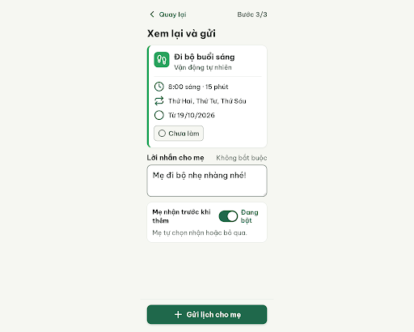
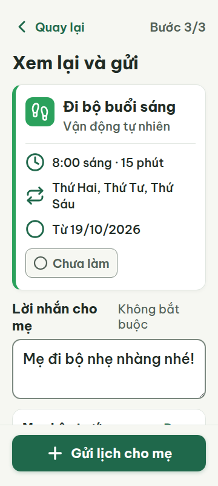
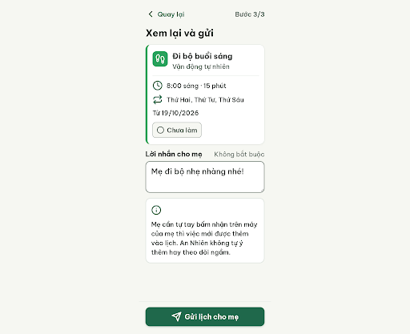
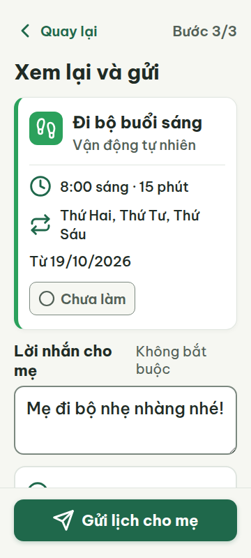
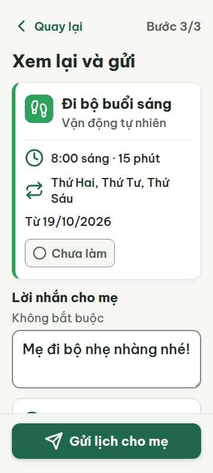
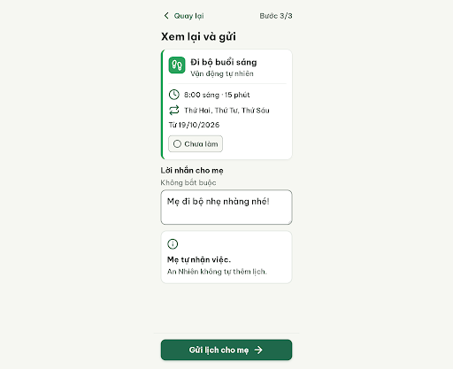
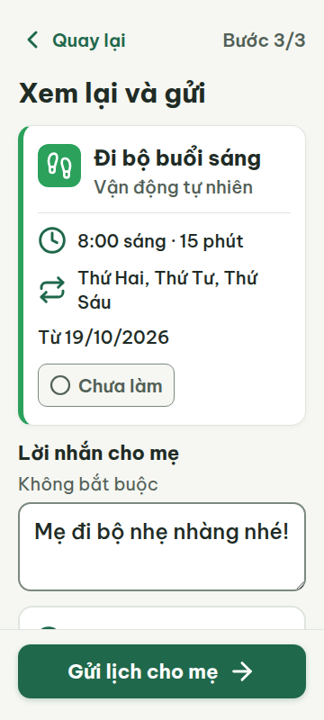

# C08 — Xem lại và gửi (Bước 3/3)

Project: `2013215887278758682` — An Nhiên (project của Sanh)

**Màn chốt hiện tại: v3 — 87 điểm**

Screen ID: `87e361beb4a245579dc92eebbf9163d5`

**Kết quả: NEEDS_HUMAN** · stop_reason: patience_2

| Vòng | Điểm | Error | Warn | Đã sửa | Regression |
|---|---:|---:|---:|---|---|
| v0 | 87 | 1 | 1 | — | — |
| v1 | 87 | 1 | 1 | R-ICON-02, R-ICON-03 | R-TXT-03 |
| v2 | 84 | 1 | 2 | R-TXT-03, R-STY-03 | R-ICON-03 |
| v3 | 87 | 1 | 1 | R-TXT-03, R-STY-03 | R-TAP-02 |

## v0 — 87 điểm

Screen: `projects/2013215887278758682/screens/184123c7b4da4203b8822b77ea6a5a52`





- R-ICON-02 (error): Thẻ tùy chọn Mẹ nhận trước khi thêm. Bằng chứng: Đây là mục cài đặt có switch, nhưng toàn hàng chỉ có chữ và track/thumb, không có icon có nghĩa.. Sửa: Thêm Lucide info 32 × 32 px kèm nhãn; tốt hơn trình bày điều kiện nhận bắt buộc bằng hàng thông tin info 32 px, bỏ switch để mẹ luôn tự quyết.
- R-ICON-03 (warn): Dòng Từ 19/10/2026 và nút Gửi lịch cho mẹ. Bằng chứng: SVG circle 32 px ở ngày bắt đầu lặp lại icon circle của Chưa làm (24 px), trái từ điển một icon một nghĩa. CTA dùng plus 32 px trong khi từ điển dành plus cho Thêm việc/Xem thêm. Ngoại lệ 24 px của chip trạng thái được áp dụng đúng.. Sửa: Bỏ circle khỏi dòng Từ 19/10/2026. Với hành động gửi, ghi đề xuất bổ sung Lucide send vào codex-runs/design-decisions.md rồi dùng send 32 × 32 px; không tái dùng plus cho gửi và không sửa nguồn DESIGN.md trong loop.

Chữ, tương phản và vùng chạm đạt ở360/412; cần thêm icon cho mục consent và sửa nghĩa icon ngày bắt đầu/gửi. Điều kiện mẹ tự nhận được ghi rõ nhưng switch khiến quyền này trông có thể tắt; nên chuyển thành thông tin bắt buộc, không suy diễn hành vi từ ảnh tĩnh.

### Edit prompt

```text
Perform an actual edit of the selected C08 screen and return the newly generated screen. Do not respond with a plan or ask for confirmation. Preserve the current layout and An Nhiên style. Apply these fixes: replace “Mẹ nhận trước khi thêm” switch with a clear required-condition info row stating mother personally accepts before task is added; add official Lucide info 32×32; remove generic circle from start-date row; replace plus on “Gửi lịch cho mẹ” with official Lucide send 32×32 (paths: <line x1="22" x2="11" y1="2" y2="13"/><polygon points="22 2 15 22 11 13 2 9 22 2"/>). Keep all text ≥20px, contrast and responsive 360/412 layout, fixed CTA, no automatic monitoring or acceptance.

```

## v1 — 87 điểm

Screen: `projects/2013215887278758682/screens/51022b50a33f4ff1b3bf939f10b34e68`





- R-TXT-03 (error): Thẻ giải thích về quyền nhận lịch. Bằng chứng: Câu ‘Mẹ cần tự tay bấm nhận trên máy của mẹ thì việc mới được thêm vào lịch.’ có 17 tiếng, vượt 15; câu tiếp ‘An Nhiên không tự ý thêm hay theo dõi ngầm.’ có 9 tiếng.. Sửa: Rút thành ‘Mẹ bấm nhận thì việc mới vào lịch.’ (8 tiếng) và ‘An Nhiên không tự thêm việc.’ (5 tiếng).
- R-STY-03 (warn): Nhãn ‘Lời nhắn cho mẹ’ và trợ giúp ‘Không bắt buộc’. Bằng chứng: Ở viewport 360, hai nhãn chiếm cùng hàng nhưng wrap thành hai dòng mỗi nhãn, khiến cụm form lệch và khó quét; lề ngoài 20 px đúng.. Sửa: Đặt ‘Không bắt buộc’ dòng riêng dưới nhãn hoặc căn dưới label; giữ lề 20 px và khoảng giữa khối 16 px.

V1 đã thêm icon cho consent và dùng đúng send ở CTA; câu giải thích còn vượt giới hạn 15 tiếng và nhãn trường bị gãy thành hai dòng ở 360 px. Icon trạng thái 24 px hợp lệ theo ngoại lệ; tăng lên 32 px chỉ là khuyến nghị.

### Edit prompt

```text
Edit the best C08 screen and generate a new screen. Shorten consent copy to exactly “Mẹ bấm nhận thì việc mới vào lịch.” and “An Nhiên không tự thêm việc.” Put “Không bắt buộc” on its own line below “Lời nhắn cho mẹ” so both labels scan cleanly at 360px; preserve 20px minimum. Keep all correct reviewer fixes (info icon/required condition, no generic start-date circle, send icon), existing card layout and CTA. Do not change meaning, add automatic monitoring, or alter styling beyond these fixes.

```

## v2 — 84 điểm

Screen: `projects/2013215887278758682/screens/f80d166f7ea74511b8c1cc3cea280aa8`




- R-TXT-03 (error): Đoạn giải thích trong thẻ quyền tự chủ ở cuối nội dung. Bằng chứng: HTML có hai câu ngắn, nhưng ở khung 360px vùng chữ rộng 284px, cỡ 20px, ảnh fullpage cho thấy câu cuối bị xuống dòng thành hai dòng và phần đầu bị footer che; đoạn hiển thị vượt giới hạn 2 dòng/khó đọc trọn vẹn. Metrics 360 cũ cũng ghi đoạn tương ứng 4 dòng, nhưng không khớp HTML hiện tại.. Sửa: Rút đoạn thành một câu tối đa 2 dòng, ví dụ ‘Mẹ nhận thì việc mới vào lịch.’; giữ cỡ chữ 20px và bảo đảm cả câu nằm trên footer.
- R-ICON-03 (warn): Icon máy bay giấy trên nút ‘Gửi lịch cho mẹ’. Bằng chứng: Icon gửi có kích thước 32px và nghĩa trực quan, nhưng icon `send` không có trong Từ điển icon; icon thói quen `footprints`, clock, repeat, info và circle còn lại khớp nghĩa, trong đó circle trạng thái 24px đúng ngoại lệ.. Sửa: Dùng icon Lucide `message-square` (đã có trong từ điển cho Nhắn tin), kích thước 32×32px, hoặc bổ sung nghĩa gửi vào từ điển trước khi dùng.
- R-STY-03 (warn): Thẻ giải thích tự chủ ở sát chân nội dung. Bằng chứng: Ở ảnh fullpage 360px, footer CTA phủ lên phần trên của thẻ; câu giải thích bị tách/che, làm khối nội dung không thoáng dù lề ngoài 20px và khoảng cách khối chính 16px.. Sửa: Tăng khoảng đệm cuối vùng cuộn lên ít nhất 180px hoặc đặt thẻ giải thích trước textarea; giữ lề 20px và gap khối 16px để toàn bộ thẻ nằm trên CTA.

V2 rút ngắn lời giải thích và xếp nhãn trường theo chiều dọc; ở 360px thẻ giải thích cuối vẫn bị CTA che, còn icon gửi chưa có nghĩa tương ứng trong từ điển.

### Edit prompt

```text
Perform an actual edit of the best C08 screen and generate a new version. Make the consent explanation short and readable at 360px: headline “Mẹ tự nhận việc.” and supporting text “An Nhiên không tự thêm lịch.” Ensure neither wraps behind the fixed footer; add enough bottom scroll padding so the entire consent card remains visible above/before the CTA. Change the CTA icon from unlisted send to the documented Lucide arrow-right 32×32 (meaning proceed), keeping label “Gửi lịch cho mẹ”. Preserve prior corrected required-condition row, info icon, removed start-date circle, and all other correct content. Keep visible text >=20px and responsive to 360/412; do not change consent semantics.

```

## v3 — 87 điểm

Screen: `projects/2013215887278758682/screens/87e361beb4a245579dc92eebbf9163d5`





- R-ICON-03 (warn): Icon mũi tên sang phải trên nút “Gửi lịch cho mẹ”. Bằng chứng: Icon arrow-right 32 × 32 px biểu đạt “Tiếp tục, Bắt đầu” theo từ điển icon, nhưng nút này gửi lịch cho mẹ; mũi tên không khớp nghĩa gửi/nhắn tin. Các icon footprints, clock, repeat, info và circle đúng nghĩa; circle 24 px trong chip đạt ngoại lệ.. Sửa: Thay icon trên “Gửi lịch cho mẹ” bằng Lucide message-square 32 × 32 px theo nghĩa Nhắn tin trong từ điển icon.
- R-TAP-02 (error): Footer tại ảnh cuộn cuối màn 360 × 800. Bằng chứng: Ảnh v3-bottom-360.png cho thấy sau khi cuộn đến thẻ tự chủ, vùng footer từ y≈699 đến đáy trống và không có nút chính; ảnh bottom 412 px vẫn có CTA. Metrics 360 ghi CTA 320 × 60 ở y=716 tại đầu trang, nên nút không được duy trì ở đáy khi cuộn trên khung 360 px.. Sửa: Giữ CTA “Gửi lịch cho mẹ” kích thước 320 × 60 px, lề ngang 20 px và neo cách đáy 24 px trên toàn bộ cuộn ở khung 360 × 800.

V3 rút gọn phần tự chủ và tách nhãn biểu mẫu thành các dòng dễ quét. Ở ảnh cuộn cuối màn 360 px, vùng chân trang trống và thiếu nút gửi; CTA cũng dùng arrow-right mang nghĩa tiếp tục thay vì gửi/nhắn tin.
