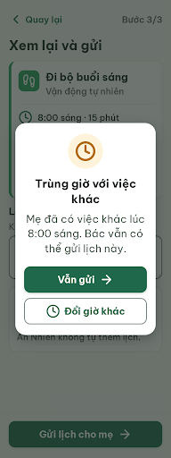
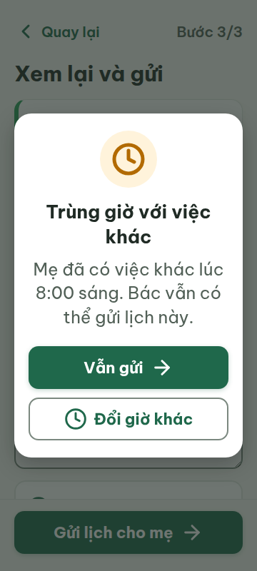
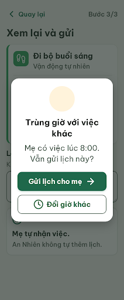
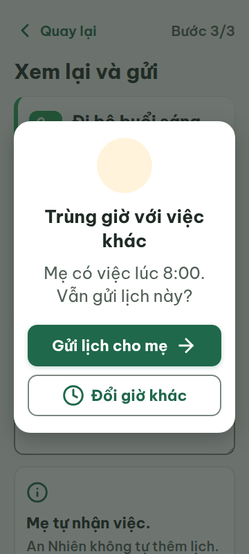
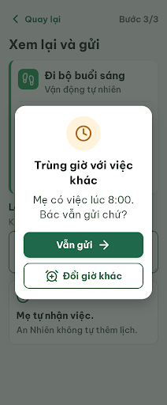
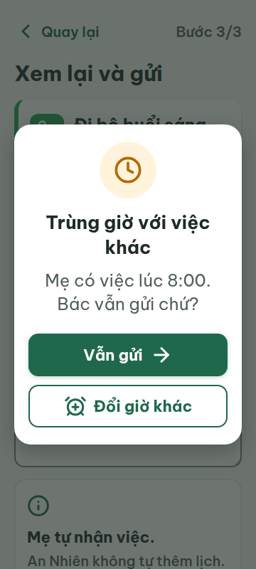

# C08w — Trùng giờ

Project: `2013215887278758682` — An Nhiên (project của Sanh)

**Màn chốt hiện tại: v2 — 97 điểm**

Screen ID: `1f9fb725d05349fdb02a63d84cafc439`

**Kết quả: running** · stop_reason: đang lặp

| Vòng | Điểm | Error | Warn | Đã sửa | Regression |
|---|---:|---:|---:|---|---|
| v0 | 64 | 3 | 2 | — | — |
| v1 | 94 | 0 | 2 | R-TXT-03, R-STA-01 | — |
| v2 | 97 | 0 | 1 | R-ICON-03 | — |

## v0 — 64 điểm

Screen: `projects/2013215887278758682/screens/2d7e343cfa09416b8d3071f9ec04e020`





- R-TXT-03 (error): Nội dung cảnh báo trong modal. Bằng chứng: Đoạn “Mẹ đã có việc khác lúc 8:00 sáng. Bác vẫn có thể gửi lịch này.” dài 3 dòng ở 24px trong metrics 360 và 412; rule giới hạn đoạn tối đa 2 dòng.. Sửa: Rút gọn thành “Mẹ có việc lúc 8:00 sáng. Bác vẫn gửi được.” và giữ tối đa 2 dòng.
- R-ICON-03 (warn): Icon đồng hồ trong modal cảnh báo trùng giờ. Bằng chứng: Ảnh cho thấy icon đồng hồ 48×48, nhưng từ điển chỉ gán `clock` cho “Giờ của việc”; icon trên cảnh báo trùng giờ không có nghĩa riêng trong từ điển. Ngoài ra, `arrow-right` được ghi cho “Tiếp tục, Bắt đầu” nhưng cũng xuất hiện trên “Vẫn gửi”.. Sửa: Dùng `clock` 32×32 cạnh thông tin giờ việc; bỏ `arrow-right` khỏi “Vẫn gửi” và thể hiện lựa chọn bằng nhãn chữ. Nếu cần icon cảnh báo riêng, bổ sung nghĩa vào từ điển trước khi dùng.
- R-STA-01 (error): Chip “Chưa làm” trên thẻ tóm tắt. Bằng chứng: Chip nền xám nhạt, viền xám và chữ xám; ảnh không có viền vàng đậm hay màu/icon vàng theo yêu cầu trạng thái chưa làm.. Sửa: Đổi chip sang nền `#FFF3DB`, icon `circle` 24×24 màu `#B26A00` và chữ `#8A5100`, đặt cạnh tên việc.
- R-ONE-01 (error): Modal “Trùng giờ với việc khác” chồng trên trang có nút gửi. Bằng chứng: Trong cùng ảnh có hai nút nền đậm: “Vẫn gửi” trên modal và “Gửi lịch cho mẹ” ở footer bên dưới overlay.. Sửa: Ẩn CTA footer khi modal mở để modal chỉ còn một nút filled; giữ “Đổi giờ khác” dạng viền.
- R-LANG-02 (warn): Câu giải thích trong modal “Trùng giờ với việc khác”. Bằng chứng: Câu “Mẹ đã có việc khác lúc 8:00 sáng. Bác vẫn có thể gửi lịch này.” dùng “Mẹ” cho người nhận và “Bác” cho người xem trong cùng lời thoại; giọng caregiver ở C03–C09 dùng cách gọi theo quan hệ gia đình.. Sửa: Đổi thành “Mẹ đã có việc lúc 8:00 sáng. Mẹ vẫn gửi được lịch này.” và giữ nhãn hành động cụ thể “Gửi lịch cho mẹ”.

Modal cảnh báo dễ đọc và có thứ bậc rõ, nhưng phần giải thích dài quá hai dòng, trạng thái “Chưa làm” nhạt, và hai hành động gửi cùng lúc làm lựa chọn chính kém phân biệt.

### Edit prompt

```text
Keep the overall layout and all elements not mentioned below unchanged.

1. [R-TXT-03] Replace the dialog body with exactly: “Mẹ có việc lúc 8:00. Vẫn gửi lịch này?” At 360px, keep this paragraph within 2 lines while preserving 24px text.
2. [R-LANG-02] In the caregiver dialog, use family-relationship wording without addressing the caregiver as “Bác”. Change the primary action label to exactly “Gửi lịch cho mẹ”. Keep the secondary action label “Đổi giờ khác”.
3. [R-ICON-03] Remove the large clock icon from the warning badge at the top of the dialog; do not replace it with an undocumented icon. Keep the documented clock beside the scheduled time and on “Đổi giờ khác”, and keep the documented `arrow-right` on “Gửi lịch cho mẹ” only as the forward/continue action to C09.
4. [R-STA-01] Restyle the background “Chưa làm” chip to a clear warning outline using a 24×24 `circle` icon and `#B26A00` accent on a pale `#FFF3DB` background, with the label still visible.
5. [R-ONE-01] Hide the underlying C08 footer “Gửi lịch cho mẹ” CTA while the modal is open so the full screen has only one filled button. Keep the dimmed C08 summary, message, and consent explanation visible behind the scrim.

Keep the modal centered, the two modal actions distinct (primary filled and secondary outlined), and preserve C08 layout, An Nhiên colors, typography, touch sizes, and all other copy. This is a caregiver flow: do not imply that the schedule is already added to the mother’s calendar.

```

## v1 — 94 điểm

Screen: `projects/2013215887278758682/screens/fb789e0618e24c479c628604f5abfa57`





- R-ICON-03 (warn): Icon đồng hồ trên nút “Đổi giờ khác”. Bằng chứng: Nút “Đổi giờ khác” dùng icon `clock`, trong khi Từ điển icon dành `clock` cho “Giờ của việc” và chỉ định `alarm-clock-plus` cho hành động “Dời giờ”. Icon `arrow-right` phù hợp với “Vẫn gửi” vì hành động tiếp tục sang bước kế tiếp.. Sửa: Đổi icon trên “Đổi giờ khác” thành `alarm-clock-plus` 32×32; giữ `arrow-right` 32×32 cho nút “Vẫn gửi”.
- R-LANG-02 (warn): Câu hỏi trong hộp thoại “Trùng giờ với việc khác”. Bằng chứng: “Mẹ có việc lúc 8:00. Vẫn gửi lịch này?” không nói rõ ai quyết định gửi, dù đây là màn trong chế độ người thân. SG-01/SG-04/SG-06 yêu cầu xưng hô nhất quán và theo quan hệ gia đình.. Sửa: Đổi nội dung thành “Mẹ có việc lúc 8:00. Bác vẫn gửi chứ?”; giữ nhãn nút theo luồng là “Vẫn gửi” và “Đổi giờ khác”.

Modal đã rút gọn, chip “Chưa làm” đúng màu và màu nhấn thói quen dùng đúng token; còn icon đổi giờ sai nghĩa và câu hỏi chưa nêu rõ người quyết định.

### Edit prompt

```text
Keep the overall layout and all other elements unchanged.

1. [R-ICON-03] On the secondary “Đổi giờ khác” action, replace Lucide `clock` with documented `alarm-clock-plus` at 32×32 px. Keep the `arrow-right` on “Vẫn gửi”; it represents continuing to C09.
2. [R-LANG-02] Replace the modal body with exactly: “Mẹ có việc lúc 8:00. Bác vẫn gửi chứ?” Keep the handoff action labels exactly “Vẫn gửi” and “Đổi giờ khác”. Preserve 24px body text and ensure it stays within 2 lines at 360px.

Preserve the fixed footer hidden while the modal is open, the “Chưa làm” chip colors, the documented `#2BA15C` Vận động accent, modal size/position, scrim, and all other content.

```

## v2 — 97 điểm

Screen: `projects/2013215887278758682/screens/1f9fb725d05349fdb02a63d84cafc439`





- R-LANG-02 (warn): Câu hỏi trong hộp thoại “Trùng giờ với việc khác”. Bằng chứng: “Mẹ có việc lúc 8:00. Bác vẫn gửi chứ?” gọi người nhận lịch là “Mẹ” nhưng lại gọi người đang quyết định là “Bác”. Trong chế độ Người thân, SG-04 yêu cầu xưng hô Mẹ–con và SG-06 gọi người lớn tuổi theo quan hệ, nên câu này trộn hai vai.. Sửa: Đổi câu hỏi thành “Lịch của mẹ bị trùng vào 8:00. Con vẫn gửi chứ?” để gọi đúng vai người gửi và người nhận.

Modal đã sửa icon đổi giờ đúng từ điển và giữ nội dung, bố cục dễ đọc; câu hỏi vẫn trộn vai Mẹ và Bác trong chế độ Người thân.
