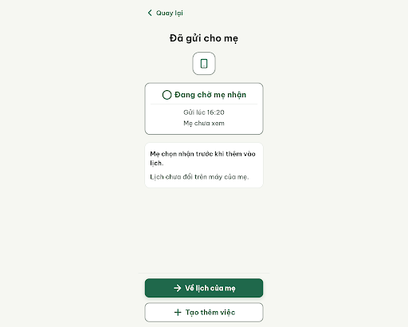
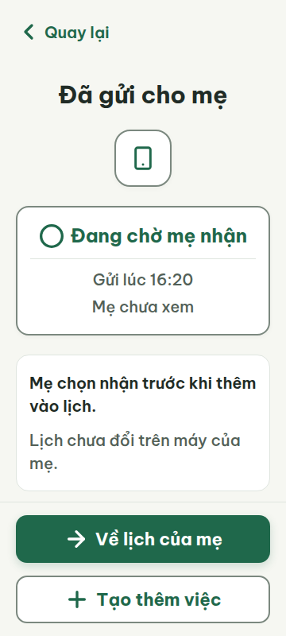
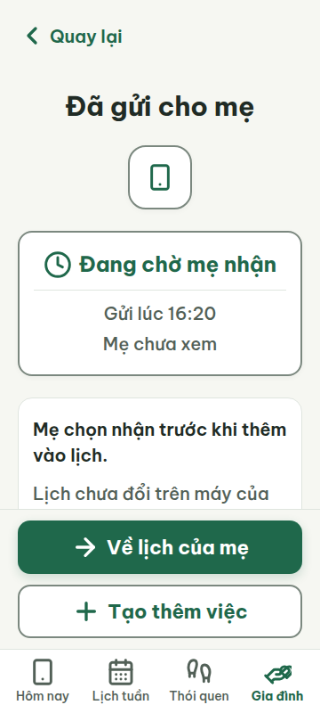
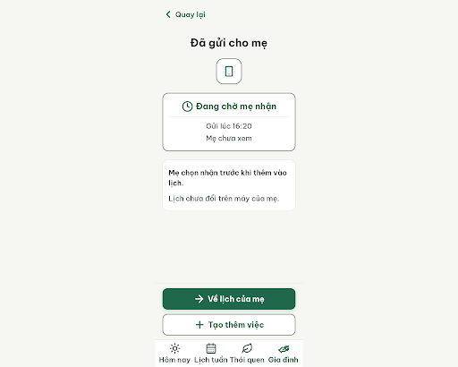
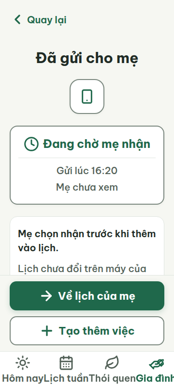
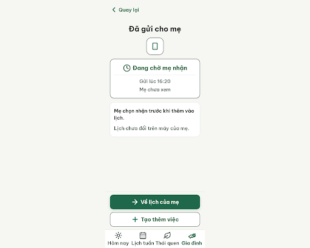
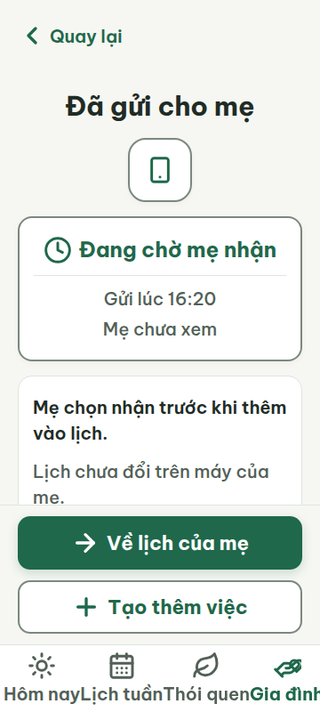
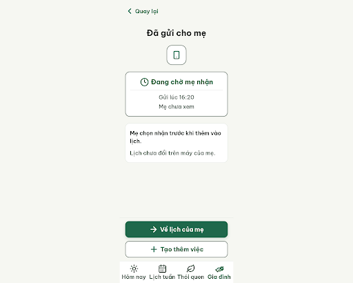
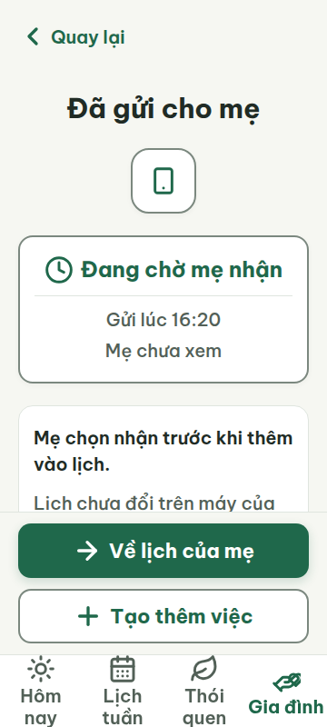

# C09 — Đã gửi · Chờ mẹ nhận

Project: `2013215887278758682` — An Nhiên (project của Sanh)

**Màn chốt hiện tại: v2 — 97 điểm**

Screen ID: `598921024b39445ba88974fb625edf63`

**Kết quả: CONVERGED** · stop_reason: patience_2

| Vòng | Điểm | Error | Warn | Đã sửa | Regression |
|---|---:|---:|---:|---|---|
| v0 | 87 | 1 | 1 | — | — |
| v1 | 87 | 1 | 1 | R-NAV-01 | R-TXT-01 |
| v2 | 97 | 0 | 1 | R-TXT-01, R-ICON-03 | R-STY-03 |
| v3 | 80 | 2 | 0 | R-STY-03 | R-LAY-01, R-NAV-01 |
| v4 | 90 | 1 | 0 | R-NAV-01 | — |

## v0 — 87 điểm

Screen: `projects/2013215887278758682/screens/b3e987db066344e394ad956705345de2`





- R-ICON-03 (warn): Biểu tượng trạng thái trong thẻ “Đang chờ mẹ nhận”. Bằng chứng: Biểu tượng là vòng tròn trơn 32 px, không nằm trong từ điển icon và không thể hiện rõ trạng thái đang chờ.. Sửa: Dùng icon Lucide `clock` 32 px cho trạng thái đang chờ; giữ nhãn “Đang chờ mẹ nhận”.
- R-NAV-01 (error): Dải dưới cùng của màn hình. Bằng chứng: Ảnh 360 × 800 chỉ có hai nút hành động ở đáy; không có thanh điều hướng 4 tab.. Sửa: Thêm thanh điều hướng cố định cao 72 px phía trên vùng nút, gồm đúng 4 mục có icon 32 px và nhãn “Hôm nay”, “Lịch tuần”, “Thói quen”, “Gia đình”.

Màn trạng thái dễ đọc và có hai hành động rõ ràng, nhưng thiếu thanh điều hướng bốn tab và dùng biểu tượng trạng thái trừu tượng.

### Edit prompt

```text
Edit C09 from the existing screen as a new version, preserving the “Đã gửi · Chờ mẹ nhận” meaning and An Nhiên styling. Address both reviewer findings: 1) Replace the generic status circle with official Lucide `clock` at 32×32 beside the exact label “Đang chờ mẹ nhận”; this is a local status-icon decision recorded in codex-runs/design-decisions.md, since the shared icon dictionary has no pending icon. 2) Add a fixed bottom navigation bar 72px high above the action area with exactly four items, each with a 32×32 icon and labels “Hôm nay”, “Lịch tuần”, “Thói quen”, “Gia đình”. Use the corresponding documented icons smartphone, calendar-days, footprints, hand-heart. Keep the CTA visible and accessible above or integrated without overlap. Maintain minimum 20px text, responsive 360px/412px layout, clear contrast, and do not imply automatic acceptance or monitoring.

```

## v1 — 87 điểm

Screen: `projects/2013215887278758682/screens/1c627ef6d3b6483da89ea13fc3d8423e`




- R-TXT-01 (error): Nhãn bottom nav “Hôm nay”, “Lịch tuần”, “Thói quen”, “Gia đình”. Bằng chứng: Trong `v1-metrics-360.json`, các span nhãn nav đều là 14px; luật yêu cầu mọi chữ hiển thị ≥20px.. Sửa: Đặt cả bốn nhãn nav thành 20px (font-size: 20px).
- R-ICON-03 (warn): Hai mục trong bottom nav. Bằng chứng: Icon tab “Hôm nay” là smartphone thay vì `sun`; icon tab “Thói quen” là footprints thay vì `leaf`, trái với Từ điển icon. Cả hai đều 32px nhưng sai nghĩa.. Sửa: Đổi icon tab “Hôm nay” thành Lucide `sun` 32px và icon tab “Thói quen” thành Lucide `leaf` 32px.

Thanh điều hướng bốn mục đã được khôi phục, nhưng nhãn nav vẫn 14px và hai icon nav chưa khớp từ điển.

### Edit prompt

```text
Edit C09 from its best reviewed screen. Fix the primary error by making all four fixed bottom-navigation labels 20px minimum. Fix the icon warning by using the project dictionary Lucide sun 32×32 for “Hôm nay” and leaf 32×32 for “Thói quen”; preserve the correct calendar-days and hand-heart icons. Keep status label/icon “Đang chờ mẹ nhận”, layout, colors, CTA, and 360/412 responsiveness. Do not change other content.

```

## v2 — 97 điểm

Screen: `projects/2013215887278758682/screens/598921024b39445ba88974fb625edf63`





- R-STY-03 (warn): Khoảng cách dọc giữa các khối nội dung: tiêu đề–biểu tượng, biểu tượng–thẻ trạng thái, thẻ trạng thái–thẻ giải thích. Bằng chứng: Ảnh và CSS cho thấy các khoảng cách chính là 24px; quy tắc yêu cầu khoảng cách giữa các khối là 16px. Lề ngang 20px đạt yêu cầu.. Sửa: Đặt khoảng cách giữa các khối chính thành 16px (giảm các margin-bottom 24px của tiêu đề, biểu tượng và thẻ trạng thái xuống 16px); giữ lề ngang 20px.

Độ cỡ chữ và biểu tượng điều hướng đã được sửa; các khối nội dung vẫn cách nhau 24px thay vì 16px.

### Edit prompt

```text
Edit C09 from best reviewed screen. Fix the sole remaining warning by setting the main vertical gaps between title, main status icon, status card, and explanatory card to exactly 16px (reduce any 24px main-block margins to 16px). Keep horizontal margins 20px, four tab labels 20px, sun/calendar-days/leaf/hand-heart icons, clock pending status, button, all copy and responsive 360/412 layout. Do not change any other content.

```

## v3 — 80 điểm

Screen: `projects/2013215887278758682/screens/87d256944948485ca68133500b6ac822`





- R-LAY-01 (error): Nhãn tab “Gia đình” ở thanh điều hướng dưới và phần cuối thẻ giải thích tại màn 360 × 800. Bằng chứng: Ở v3-metrics-360.json, nhãn “Gia đình” bắt đầu tại x≈316px, rộng ≈83px nên vượt mép phải 360px; ảnh v3-viewport-360.png cho thấy nhãn bị cắt. Thẻ giải thích kết thúc ở y≈573px trong khi footer cố định phủ từ y≈567px.. Sửa: Ở 360px, đặt mỗi tab rộng 90px (4 × 90px) và nhãn “Gia đình” tối đa 20px hoặc cho xuống dòng trong vùng tab; thêm ít nhất 16px khoảng đệm cuối nội dung ngoài vùng footer để không che dòng cuối.
- R-NAV-01 (error): Nhãn tab “Gia đình” ở thanh điều hướng dưới màn 360px. Bằng chứng: Thanh nav có đủ bốn biểu tượng và nhãn đúng, nhưng ảnh màn hình cho thấy “Gia đình” bị cắt ở mép phải nên nhãn không hiển thị trọn vẹn.. Sửa: Giữ bốn tab có icon và nhãn đầy đủ trong 360px; thu mỗi ô còn 90px và căn/thu nhỏ nhãn “Gia đình” tối đa 20px để toàn bộ chữ nằm trong màn.

Các khoảng cách dọc đã về 16px; ở màn 360px nhãn Gia đình bị cắt và nội dung cuối bị phủ một phần bởi footer cố định.

### Edit prompt

```text
Edit C09 from the best reviewed v2 screen. Fix both v3 regressions while preserving v2’s 20px labels, correct sun/calendar-days/leaf/hand-heart icons, pending clock status, and 16px content gaps: at 360px make exactly four equal 90px nav slots and ensure “Gia đình” is fully visible (wrap within its slot or reduce only that label to 20px); at 412px keep nav balanced. Add at least 16px scroll padding below the final explanation content beyond the sticky footer so no line is obscured. Keep CTA pinned and readable. Do not alter other content.

```

## v4 — 90 điểm

Screen: `projects/2013215887278758682/screens/de0d546e8e4741b983f43a99a94a54e9`





- R-LAY-01 (error): Khối giải thích phía dưới thẻ trạng thái trong khung 360 × 800 px. Bằng chứng: Trong v4-metrics-360.json, dòng “Lịch chưa đổi trên máy của mẹ.” nằm từ y=539 đến 597 px, trong khi footer cố định bắt đầu tại y=563 px; v4-viewport-360.png xác nhận footer che phần dưới của dòng này. scrollWidth bằng clientWidth (360 px), không thấy tràn ngang.. Sửa: Ở khung 360 × 800 px, giảm khoảng cách dọc hoặc chiều cao phần nội dung để dòng “Lịch chưa đổi trên máy của mẹ.” kết thúc trước y=563 px; nếu nội dung cuộn, đặt vùng nội dung cuộn độc lập và thêm đệm dưới bằng chiều cao footer (157 px) để dòng luôn có thể cuộn lên hoàn toàn phía trên footer.

Màn dùng đúng nội dung, biểu tượng, màu và kiểu chữ; bốn nhãn điều hướng đã hiển thị trọn ở 360 px. Footer cố định vẫn che phần cuối dòng giải thích trên khung 360 × 800 px.
