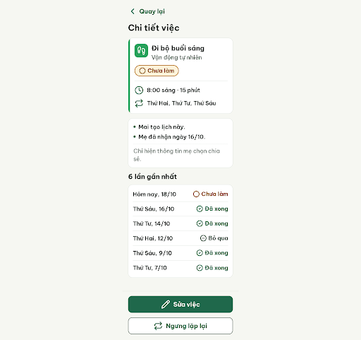
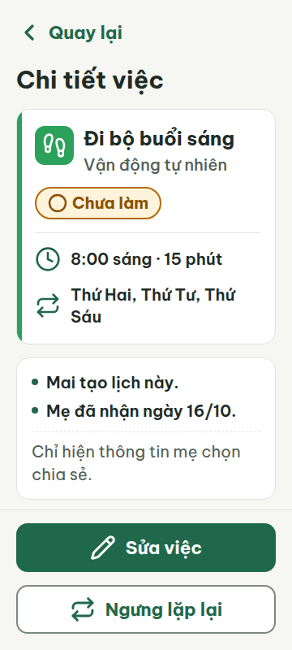
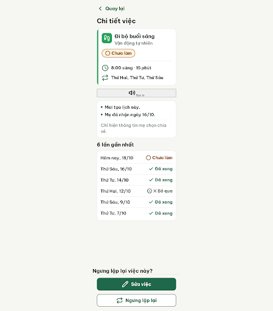
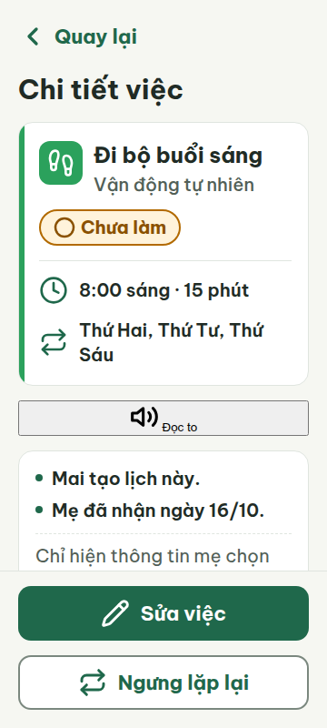
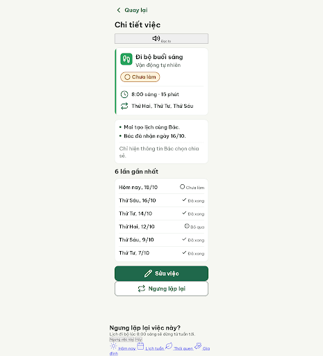
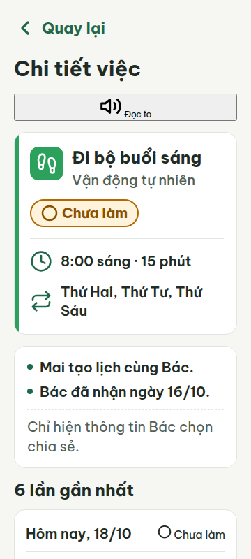

# C10 — Chi tiết việc lặp lại

Project: `2013215887278758682` — An Nhiên (project của Sanh)

**Màn chốt hiện tại: v0 — 67 điểm**

Screen ID: `ec509e26e1b049209314ade4d131d224`

**Kết quả: NEEDS_HUMAN** · stop_reason: patience_2

| Vòng | Điểm | Error | Warn | Đã sửa | Regression |
|---|---:|---:|---:|---|---|
| v0 | 67 | 3 | 1 | — | — |
| v1 | 19 | 6 | 7 | R-VOI-01 | R-TXT-01, R-TXT-02, R-TXT-03, R-ICON-03, R-TAP-01, R-CEN-01, R-LANG-02, R-STY-01, R-STY-02 |
| v2 | 22 | 6 | 6 | R-TXT-03, R-TXT-05, R-LANG-02, R-CEN-01, R-SAFE-01 | R-TXT-01, R-TXT-02, R-ICON-03, R-TAP-01, R-NAV-01, R-STA-01, R-STY-01, R-STY-02 |

## v0 — 67 điểm

Screen: `projects/2013215887278758682/screens/ec509e26e1b049209314ade4d131d224`





- R-NAV-01 (error): Thanh điều hướng dưới màn. Bằng chứng: Ảnh v0 không có thanh 4 tab Hôm nay · Lịch tuần · Thói quen · Gia đình, cũng không có icon + nhãn.. Sửa: Thêm bottom nav cố định cao 72 px với đủ 4 tab, mỗi tab icon Lucide 24 px và nhãn 20 px: “Hôm nay”, “Lịch tuần”, “Thói quen”, “Gia đình”.
- R-STA-01 (error): Trạng thái trong thẻ tóm tắt và lịch sử. Bằng chứng: Thẻ “Đã xong” chỉ có chữ xanh trên nền trắng, thiếu chip xanh đậm chữ trắng; trạng thái “Bỏ qua” thiếu ký hiệu ✕ được quy định.. Sửa: Đổi chip “Đã xong” thành nền #1F684B, chữ trắng; đổi nhãn bỏ qua thành “✕ Bỏ qua” kèm icon circle-minus 24 px.
- R-SAFE-01 (warn): Nút “Ngưng lặp lại” ở chân màn. Bằng chứng: Đây là hành động ngưng lịch lặp, nhưng màn không có bước hỏi lại hoặc “Hoàn tác”.. Sửa: Sau khi chạm “Ngưng lặp lại”, hiện hộp xác nhận có nút “Hủy” và “Ngưng lặp việc này”; hoặc thêm hoàn tác rõ ràng sau thao tác.
- R-VOI-01 (error): Màn chi tiết việc. Bằng chứng: Màn chi tiết không có nút “Đọc to” dù đây là màn S04 theo luật.. Sửa: Thêm nút có icon volume-2 và chữ “Đọc to”, cao 60 px, rộng gần hết màn với lề 20 px.

Màn có chữ lớn, bố cục gọn và màu thói quen đúng, nhưng thiếu điều hướng, giọng đọc và xác nhận ngưng lặp; hiển thị trạng thái hoàn tất chưa theo mẫu.

### Edit prompt

```text
Perform an actual C10 edit and return a new screen; do not provide a plan. Keep the An Nhiên styling and all correct task details. Fix reviewer errors/warning: add fixed 72px four-tab bottom nav (“Hôm nay”, “Lịch tuần”, “Thói quen”, “Gia đình”) with documented smartphone, calendar-days, footprints, hand-heart icons and readable 20px labels; style “Đã xong” as white text on #1F684B; render skipped exactly “✕ Bỏ qua” and include circle-minus 24px; add a prominent 60px-high “Đọc to” button with volume-2 icon and 20px+ text; make “Ngưng lặp lại” ask for confirmation with “Hủy” and “Ngưng việc này” or provide a clear undo. Preserve 360/412 responsiveness, accessible contrast, and avoid overlapping the bottom nav or CTA.

```

## v1 — 19 điểm

Screen: `projects/2013215887278758682/screens/b25cd8f3eb9d43d8baffe8feaa66138f`





- R-TXT-01 (error): Nút Đọc to, nút trong hộp xác nhận, và nhãn thanh tab ở cuối trang. Bằng chứng: HTML metrics cho thấy chữ nút mặc định 13.33 px và nhãn tab 16 px; cả hai nhỏ hơn 20 px.. Sửa: Đặt chữ Đọc to, hai nút xác nhận và 4 nhãn tab ở 20 px trở lên.
- R-TXT-02 (warn): Nút Đọc to. Bằng chứng: Tiêu đề 30 px và nội dung chính khoảng 24 px, nhưng chữ Đọc to hiện theo kiểu trình duyệt mặc định khoảng 13 px.. Sửa: Đặt chữ Đọc to thành Be Vietnam Pro 22 px, đậm; giữ tiêu đề 30 px và nội dung chính 24 px.
- R-TXT-03 (error): Mô tả trong hộp xác nhận ngưng lặp. Bằng chứng: Câu “Lịch nhắc đi bộ lúc 8:00 sáng sẽ không xuất hiện trong các tuần tới nữa.” có 16 tiếng, vượt giới hạn 15.. Sửa: Rút câu còn tối đa 15 tiếng, ví dụ: “Lịch đi bộ lúc 8:00 sáng sẽ dừng từ tuần tới.”
- R-TXT-05 (error): Thẻ tóm tắt việc đi bộ. Bằng chứng: Thẻ có tên việc và trạng thái, nhưng phần phụ gồm tên thói quen, giờ/thời lượng, và lịch lặp thành ba dòng thông tin phụ.. Sửa: Giữ tối đa một dòng phụ trong thẻ; gộp chi tiết lịch vào một dòng hoặc chuyển phần lịch lặp ra ngoài thẻ.
- R-ICON-03 (warn): Icon trong 4 tab điều hướng. Bằng chứng: Tab Hôm nay dùng hình điện thoại, tab Thói quen dùng footprints trùng nghĩa với thói quen Vận động tự nhiên, và tab Gia đình dùng trái tim; các hình này không khớp từ điển icon đã quy định.. Sửa: Dùng sun 32 px cho Hôm nay, calendar-days 32 px cho Lịch tuần, leaf 32 px cho Thói quen, và hand-heart 32 px cho Gia đình.
- R-TAP-01 (error): Nút Đọc to, nút xác nhận/hủy, và vùng chạm tab. Bằng chứng: Các control dùng kiểu trình duyệt mặc định; metrics cho thấy nút xác nhận cao 19 px, nút Đọc to thấp hơn 48 px, và tab chỉ có vùng nhãn 20 px.. Sửa: Đặt mỗi vùng chạm ít nhất 48 × 48 px; làm nút Đọc to và hai nút xác nhận cao tối thiểu 48 px, mỗi tab có khung chạm tối thiểu 48 × 48 px.
- R-NAV-01 (error): Thanh điều hướng dưới. Bằng chứng: Ảnh viewport không hiện thanh tab ở đáy; ảnh toàn trang đặt các liên kết sau nội dung ở cuối tài liệu, không có thanh nền/cố định. Nhãn cũng hiển thị theo kiểu liên kết mặc định.. Sửa: Đặt thanh điều hướng cố định ở đáy cao 72 px, có đúng 4 tab icon + nhãn 20 px: Hôm nay, Lịch tuần, Thói quen, Gia đình.
- R-STA-01 (error): Các trạng thái Đã xong và Chưa làm trong lịch sử. Bằng chứng: Các dòng Đã xong chỉ có dấu kiểm và chữ xanh trên nền trắng, không phải chip xanh đậm chữ trắng; trạng thái Chưa làm trong lịch sử cũng không có viền vàng đậm như quy định.. Sửa: Đổi Đã xong thành chip nền #1F684B chữ trắng; đặt Chưa làm trong chip viền #B26A00 và giữ icon vòng tròn cùng nhãn.
- R-CEN-01 (warn): Hộp xác nhận ngưng lặp. Bằng chứng: Hộp hỏi lại không được trình bày như hộp thoại phủ màn; trong ảnh toàn trang nội dung nằm dưới danh sách, căn trái và các nút hiện kiểu mặc định.. Sửa: Ẩn hộp xác nhận cho tới khi mở; khi mở, đặt hộp 320 px giữa màn theo cả hai chiều, với nội dung và nút nằm trong thẻ nền trắng.
- R-SAFE-01 (warn): Nút Ngưng lặp lại và hộp xác nhận. Bằng chứng: Nút chỉ thêm class active nhưng không có kiểu ẩn/hiện cho hộp thoại; hộp xác nhận vốn đã nằm thường trực dưới nội dung nên thao tác không tạo một bước xác nhận rõ ràng trước khi dừng lịch.. Sửa: Ẩn hộp thoại mặc định; khi chạm Ngưng lặp lại, mở hộp thoại phủ màn với hai nút riêng Hủy và Ngưng việc này, mỗi nút cao ít nhất 48 px.
- R-LANG-02 (warn): Thông báo đồng thuận và hộp xác nhận. Bằng chứng: Nội dung dùng “Mẹ đã nhận” và “mẹ chọn chia sẻ”, còn câu trong hộp hỏi lại chuyển sang xưng “Bác”.. Sửa: Thống nhất cách xưng hô trên màn; ví dụ đổi thành “Bác đã nhận ngày 16/10”, “Chỉ hiện thông tin Bác chọn chia sẻ”, và giữ “Bác có thể tạo lại bất cứ lúc nào.”
- R-STY-01 (warn): Nút Đọc to, hộp xác nhận, và thanh tab cuối trang. Bằng chứng: Các thành phần này đang dùng màu mặc định của trình duyệt: nút xám nhạt, chữ đen và liên kết xanh; chúng không theo các màu giao diện đã định nghĩa.. Sửa: Tạo kiểu cho các control bằng nền #FFFFFF hoặc #F6F7F2, chữ #202B25, nút chính #1F684B và nhãn tab theo màu chữ #526057/#1F684B.
- R-STY-02 (warn): Nút Đọc to và các nút trong hộp xác nhận. Bằng chứng: Các nút này hiển thị dạng control mặc định hình chữ nhật, không dùng Be Vietnam Pro và không bo góc 14 px như nút trong màn.. Sửa: Dùng Be Vietnam Pro cho mọi nút và bo góc 14 px; đặt nút Đọc to cao 48–60 px và các nút xác nhận cao tối thiểu 48 px.

Màn đã có nút Đọc to nhưng nhiều thành phần mới vẫn rơi về kiểu trình duyệt mặc định; nav chưa cố định, trạng thái lịch sử và hộp xác nhận chưa theo quy chuẩn.

### Edit prompt

```text
Edit C10 v1 and generate a new screen. Fix all reviewer findings while preserving correct details and An Nhiên style: style every visible control and nav item in Be Vietnam Pro with project colors; all labels and button text >=20px, primary content 24px; buttons radius14px, touch targets >=48px. Add fixed bottom nav 72px with exactly four items and 20px labels: Hôm nay (sun 32), Lịch tuần (calendar-days32), Thói quen (leaf32), Gia đình (hand-heart32). Keep the weekly summary card to one secondary line max. Use exact status chips: “Đã xong” white on #1F684B; “Chưa làm” with circle and #B26A00 border. Shorten confirmation copy to <=15 Vietnamese words, e.g. “Lịch đi bộ lúc 8:00 sáng sẽ dừng từ tuần tới.” Hide the confirmation dialog initially; when “Ngưng lặp lại” is tapped, open a true centered modal over a dimmed overlay with separate “Hủy” and “Ngưng việc này” buttons, both >=48px. Keep a clear “Đọc to” volume-2 button, styled 60px high, 22px bold. Use caregiver-respectful “Bác” consistently in copy. Do not remove the original screen content or add unrequested actions.

```

## v2 — 22 điểm

Screen: `projects/2013215887278758682/screens/d1142242942447bdae9241251a2a30ca`





- R-TXT-01 (error): Nút “Đọc to”, sáu nhãn trạng thái lịch sử và bốn nhãn thanh điều hướng. Bằng chứng: Metrics cho thấy nút Đọc to 13.33 px, trạng thái lịch sử 16 px và nhãn tab 16 px.. Sửa: Đặt chữ Đọc to, trạng thái lịch sử và nhãn bottom nav ở tối thiểu 20 px.
- R-TXT-02 (warn): Nút “Đọc to” và nhãn trạng thái lịch sử. Bằng chứng: Ảnh cho thấy nút Đọc to và các nhãn Đã xong/Chưa làm/Bỏ qua nhỏ rõ rệt so với nội dung 24 px; metrics lần lượt 13.33 px và 16 px.. Sửa: Đặt chữ trên nút Đọc to 22 px đậm; nhãn trạng thái tối thiểu 20 px.
- R-LAY-01 (error): Màn tổng thể / bottom nav. Bằng chứng: Ảnh 360 px cho thấy bốn liên kết nav nằm nội dòng; tab “Gia đình” bị đẩy xuống dòng kế, dù scrollWidth=360. Nội dung dùng 360 px ngang nhưng điều hướng bị vỡ bố cục.. Sửa: Tạo bottom nav flex 4 cột, mỗi mục chiếm 25% chiều rộng, chiều cao 72 px; giữ 4 mục trên cùng một hàng ở viewport 360 px.
- R-ICON-03 (warn): Icon lịch sử và bottom nav. Bằng chứng: Ảnh/HTML cho thấy icon trạng thái trong lịch sử chỉ 20 px (dưới cả ngoại lệ chip 24 px); icon lặp lại dùng repeat, không phải icon hành động đúng trong từ điển; icon Gia đình là heart+hand thay vì hand-heart.. Sửa: Đặt icon trạng thái chip lịch sử 24 px; dùng alarm-clock-plus 32 px cho chi tiết lịch lặp và hand-heart 32 px cho tab Gia đình.
- R-TAP-01 (error): Nút “Đọc to” và vùng chạm bottom nav. Bằng chứng: Nút Đọc to cao 39 px; nav link là inline, chỉ cao 20 px và không có vùng đệm chạm 48 px.. Sửa: Đặt nút Đọc to cao tối thiểu 48 px; mỗi tab dùng khung chạm tối thiểu 48 × 48 px.
- R-TAP-02 (error): Nút hành động “Sửa việc” và “Ngưng lặp lại”. Bằng chứng: Ảnh cho thấy hai nút filled/outlined nằm ở cuối nội dung, phía trên hộp hỏi lại; không có một nút chính duy nhất đặt cố định ở đáy màn.. Sửa: Đặt một nút chính cao 60 px, rộng 320 px với lề 20 px ở đáy viewport; chuyển nút phụ sang kiểu tonal/viền.
- R-NAV-01 (error): Thanh điều hướng dưới. Bằng chứng: Ảnh toàn trang cho thấy nav rơi về liên kết trình duyệt xanh gạch chân; bốn mục không nằm trong thanh 72 px và Gia đình bị xuống hàng.. Sửa: Tạo thanh nav cố định cao 72 px; 4 tab icon+nhãn 20 px chia đều cùng một hàng.
- R-STA-01 (error): Các nhãn trạng thái ở sáu dòng lịch sử. Bằng chứng: Tất cả sáu chip hiện bằng chữ 16 px và icon 20 px, không có nền xanh đậm chữ trắng cho Đã xong, viền vàng đậm cho Chưa làm, hay icon+nhãn đúng kiểu chip; trạng thái bỏ qua cũng chỉ là text.. Sửa: Đặt Đã xong trong chip nền #1F684B chữ trắng với circle-check 24 px; Chưa làm trong chip viền #B26A00 với circle 24 px; Bỏ qua trong chip với circle-minus 24 px.
- R-CEN-01 (warn): Hộp xác nhận ngưng lặp. Bằng chứng: Hộp xác nhận xuất hiện thường trực cuối trang, sát trên nav; không phủ màn và không căn giữa.. Sửa: Ẩn hộp mặc định; khi mở, đặt dialog nền trắng rộng tối đa 320 px, căn giữa viewport cả hai chiều.
- R-SAFE-01 (warn): Hành động Ngưng lặp lại. Bằng chứng: Hộp xác nhận có sẵn trong luồng nhưng không ẩn ban đầu; ảnh cho thấy nội dung xác nhận nằm thường trực phía dưới nút.. Sửa: Ẩn dialog ban đầu; chỉ mở khi chạm Ngưng lặp lại, với hai nút Hủy và Ngưng việc này cao tối thiểu 48 px.
- R-STY-01 (warn): Nút Đọc to và bottom nav. Bằng chứng: HTML metrics cho thấy nút Đọc to màu/nền mặc định trình duyệt (#EFEFEF, chữ đen); bottom nav là anchor xanh mặc định #0000EE thay vì token.. Sửa: Tạo style cho nút Đọc to và nav bằng nền #F6F7F2/#FFFFFF, chữ #202B25 hoặc #526057, màu chọn #1F684B.
- R-STY-02 (warn): Nút Đọc to và bottom nav. Bằng chứng: Nút Đọc to là nút mặc định hình chữ nhật viền đen; nav là link xanh gạch chân. Chúng không dùng Be Vietnam Pro/bo góc 14 px như hệ thống.. Sửa: Dùng Be Vietnam Pro; đặt nút Đọc to cao 48 px, bo góc 14 px; tạo nav item kiểu không gạch chân với hit area 48 px.

Màn hình tóm tắt việc đã rõ hơn, nhưng nút Đọc to, các trạng thái lịch sử, hộp xác nhận và bottom nav vẫn hiển thị kiểu trình duyệt mặc định hoặc sai bố cục.
