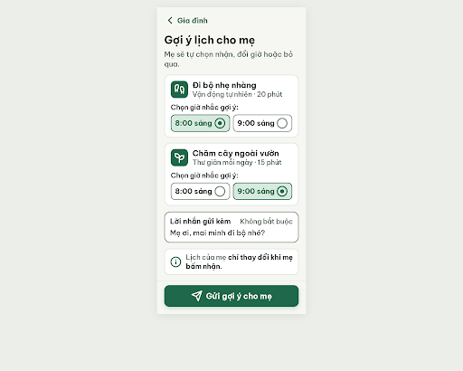
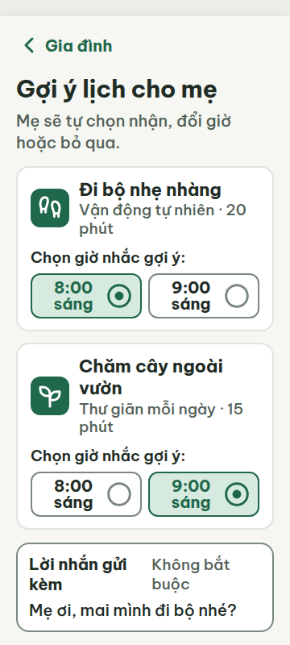
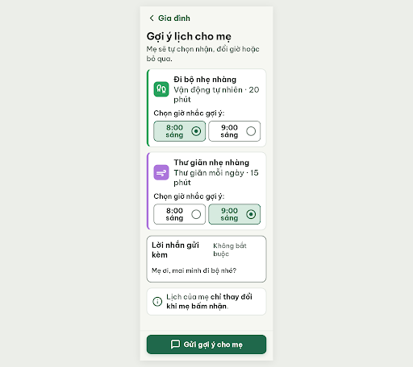
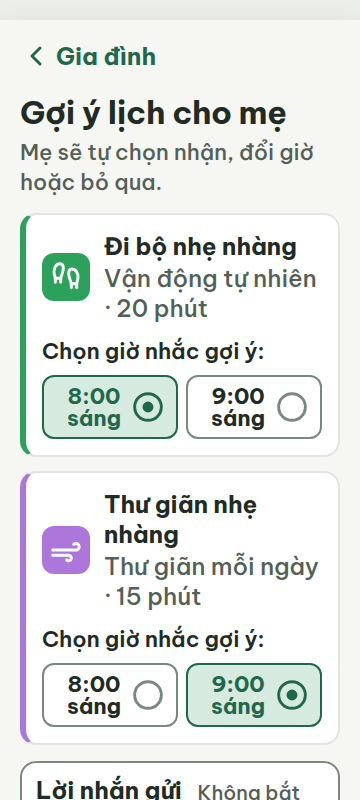
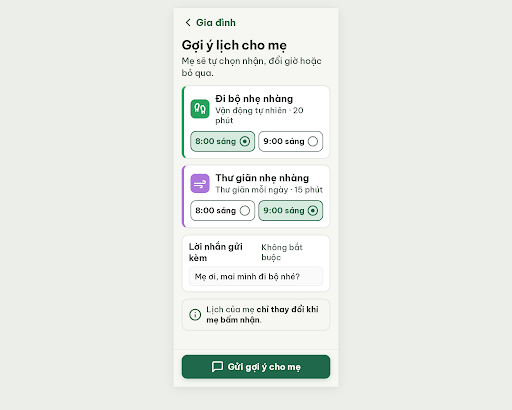
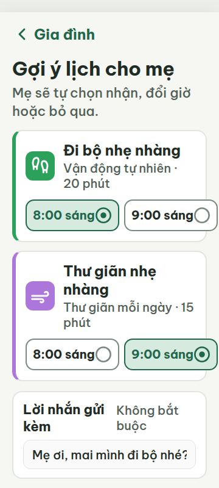
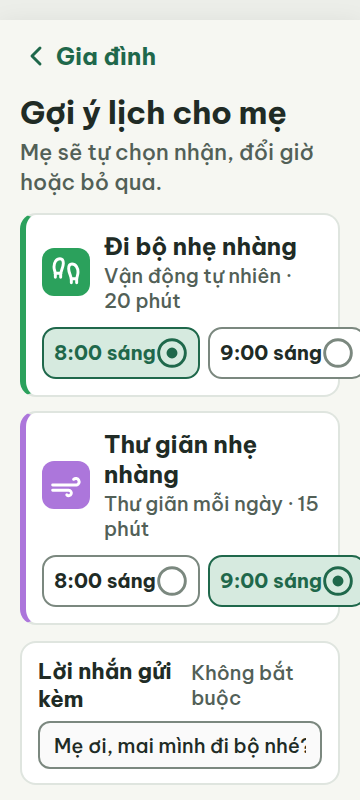

# G01 — Con cháu soạn lịch gợi ý

Project: `2013215887278758682` — An Nhiên (project của Sanh)

**Màn chốt hiện tại: v2 — 94 điểm**

Screen ID: `5fcdb9da3ee54b08bfb53961e9c1f213`

**Kết quả: CONVERGED** · stop_reason: patience_2

| Vòng | Điểm | Error | Warn | Đã sửa | Regression |
|---|---:|---:|---:|---|---|
| v0 | 42 | 4 | 6 | — | — |
| v1 | 64 | 3 | 2 | — | — |
| v2 | 94 | 0 | 2 | — | — |
| v3 | 87 | 1 | 1 | — | — |
| v4 | 61 | 3 | 3 | — | — |

## v0 — 42 điểm

Screen: `projects/2013215887278758682/screens/8aeab01313e84577aa18508fb3eeb08a`





- R-TXT-01 (error): Các dòng phụ thói quen, nhãn ‘Chọn giờ nhắc gợi ý:’ và ‘Không bắt buộc’. Bằng chứng: v0-metrics-360/412.json đo .activity-subtitle, .time-label và .message-hint ở 19px; .privacy-text cũng dùng 19px trong v0.html.. Sửa: Đặt tất cả chữ hiển thị hiện 19px lên tối thiểu 20px, gồm .activity-subtitle, .time-label, .message-hint và .privacy-text.
- R-TXT-02 (warn): Dòng phụ trong thẻ ‘Đi bộ nhẹ nhàng’ và ‘Chăm cây ngoài vườn’. Bằng chứng: Trong ảnh 360px, dòng mô tả ‘Vận động tự nhiên · 20 phút’ và ‘Thư giãn mỗi ngày · 15 phút’ trông nhỏ hơn tiêu đề/nội dung chính; HTML đặt chúng ở 19px, dưới mức nội dung khoảng 24px.. Sửa: Tăng chữ nội dung chính của hai dòng mô tả từ 19px lên 24px; giữ tiêu đề màn 30px và nút 22px.
- R-ICON-03 (warn): Icon thói quen trong thẻ ‘Chăm cây ngoài vườn’ và icon nút ‘Gửi gợi ý cho mẹ’. Bằng chứng: Icon thói quen thứ hai có hình mầm cây (Lucide sprout), trong khi từ điển quy định wind cho ‘Thư giãn mỗi ngày’; icon máy bay giấy trên nút gửi không khớp tên nào trong từ điển. Các icon đều đủ 32px.. Sửa: Đổi icon mầm cây thành Lucide wind 32px; đổi icon máy bay giấy thành Lucide message-square 32px theo từ điển.
- R-COL-02 (error): Hai thẻ ‘Đi bộ nhẹ nhàng’ và ‘Chăm cây ngoài vườn’. Bằng chứng: Ảnh 360/412 cho thấy mỗi thẻ chỉ có ô icon xanh lá đồng màu và không có vạch màu ở cạnh trái; các ô icon không dùng màu nhấn riêng của từng thói quen.. Sửa: Thêm vạch 4px ở cạnh trái mỗi thẻ và tô vạch cùng ô icon bằng màu nhấn đúng thói quen: #2BA15C cho Vận động tự nhiên, #AC76DB cho Thư giãn mỗi ngày; giữ icon trắng.
- R-COL-03 (warn): Nền hai ô icon thói quen. Bằng chứng: HTML dùng #1F684B cho cả hai .habit-icon-tile.green; DESIGN.md quy định màu nhấn #2BA15C cho Vận động tự nhiên và #AC76DB cho Thư giãn mỗi ngày.. Sửa: Đổi nền ô icon (và vạch trái tương ứng) sang #2BA15C cho Vận động tự nhiên và #AC76DB cho Thư giãn mỗi ngày.
- R-TAP-01 (error): Trường nhập ‘Lời nhắn gửi kèm’. Bằng chứng: v0-metrics-360.json đo .message-input cao 27px; nút chọn giờ đạt 56px ở 360px và 48px ở 412px.. Sửa: Đặt chiều cao tối thiểu vùng nhập lời nhắn là 48px (min-height: 48px), giữ nhãn và vùng nhập cùng vùng chạm dễ bấm.
- R-TAP-02 (error): Nút chính ‘Gửi gợi ý cho mẹ’ ở chân màn. Bằng chứng: Ở ảnh 360px, nội dung dài 1002px và nút nằm tại y=901.6–961.6, ngoài khung 800px; ở ảnh 412px nút nằm y=787.5–847.5, cũng vượt đáy khung 800px. Ảnh viewport cho thấy nút bị khuất.. Sửa: Giữ nút 60px cao, rộng trừ lề 20px, ghim vào đáy viewport với khoảng đệm 20px; dành phần đệm cuộn để nội dung không bị nút che.
- R-STY-01 (warn): Hai ô icon thói quen trên nền thẻ trắng. Bằng chứng: Nền, thẻ, chữ chính, chữ phụ và primary trong HTML khớp token; ô icon dùng #1F684B thay vì hai màu nhấn token #2BA15C và #AC76DB của các thói quen trên màn.. Sửa: Dùng #2BA15C cho ô icon Vận động tự nhiên và #AC76DB cho ô icon Thư giãn mỗi ngày, theo DESIGN.md.
- R-STY-02 (warn): Thẻ lưu ý ‘Lịch của mẹ chỉ thay đổi khi mẹ bấm nhận.’. Bằng chứng: HTML đặt .privacy-notice border-radius: 14px, trong khi token yêu cầu card bo 16px; các thẻ việc đã bo 16px, nút bo 14px và font Be Vietnam Pro.. Sửa: Đổi border-radius của .privacy-notice từ 14px lên 16px.
- R-STY-03 (warn): Khoảng cách giữa hai thẻ gợi ý việc. Bằng chứng: HTML đặt .activities-list gap: 14px, thấp hơn khoảng cách 16px giữa các khối theo token.. Sửa: Đổi gap của .activities-list từ 14px lên 16px.

Màn dễ đọc và không tràn ngang, nhưng còn bốn lỗi chặn gồm chữ 19px, thiếu màu nhấn/vạch thói quen, vùng nhập 27px và nút gửi bị khuất dưới khung 800px.

### Edit prompt

```text
Keep the overall layout and everything not mentioned below unchanged. Fix the reviewed issues: (1) Make every visible text size at least 20px; set the two activity supporting lines to 24px or simplify/remove them if needed. (2) Use an approved habit and exact icon mapping: change the second activity to “Thư giãn nhẹ nhàng” with the documented Lucide wind icon; use Lucide message-square for “Gửi gợi ý cho mẹ”. Both icons 32×32px. (3) Add a 6px left accent bar to each activity card and use the matching habit accent color for the icon tile and bar: #2BA15C for Vận động tự nhiên, #AC76DB for Thư giãn mỗi ngày. (4) Make the message field control at least 48px tall. (5) Keep the 60px primary CTA fixed at the bottom with 20px inset and leave enough scroll/content padding so it remains visible and does not cover content at both 360×800 and 412×800. (6) Set the privacy notice card radius to 16px and the activity card gap to 16px. Keep the two activity choices, time options, recipient, short note, accessible spacing, and one filled CTA. Remove nonessential explanatory copy or compress vertical spacing only as needed to fit; do not reduce text, icons, or targets below the documented minimums.

```

## v1 — 64 điểm

Screen: `projects/2013215887278758682/screens/ab4fcaa3bb6a45528cd2813b6a41048a`





- R-TXT-01 (error): Thẻ hoạt động, dòng phụ, nhãn chọn giờ, trường lời nhắn, lời nhắc quyền tự chủ. Bằng chứng: HTML khai báo nhiều nhãn 19px (activity-subtitle, time-label, message-hint, privacy-text); nội dung hiển thị theo v1-fullpage-360.png nhỏ hơn mức tối thiểu 20px ở vài thành phần.. Sửa: Đặt mọi chữ hiển thị tối thiểu 20px; tăng .activity-subtitle, .time-label, .message-hint và .privacy-text từ 19px lên 20px.
- R-TXT-02 (warn): Toàn màn, đặc biệt hai thẻ việc và phần chọn giờ. Bằng chứng: v1-fullpage-360.png cho thấy phần lớn chữ nội dung, nhãn giờ và lời nhắn bị thu nhỏ đáng kể trong bố cục; các dòng tên và giờ trong lựa chọn gãy thành hai dòng, giảm khả năng đọc lướt.. Sửa: Giữ nội dung chính 24px, tiêu đề khoảng 30px, chữ nút 22px và nới lựa chọn giờ để mỗi giờ như ‘8:00 sáng’ nằm trên một dòng.
- R-LAY-01 (error): Trường ‘Lời nhắn gửi kèm’ và thẻ chứa nó tại 360 px. Bằng chứng: v1-metrics-360.json ghi scrollWidth = clientWidth = 360 nhưng .message-input có x=36, width=340, kết thúc ở x=376; .message-card cũng vượt mép phải. .phone-container che ngang bằng overflow-x:hidden nên phần bị tràn bị cắt thay vì làm tăng scrollWidth.. Sửa: Sửa box model của .message-card/.message-input để toàn bộ nằm trong lề x=20..340 tại khung 360px; bỏ overflow-x:hidden dùng để che lỗi và xác nhận không có phần tử vượt x=360.
- R-TXT-05 (error): Hai thẻ gợi ý ‘Đi bộ nhẹ nhàng’ và ‘Thư giãn nhẹ nhàng’. Bằng chứng: Mỗi thẻ có tên việc, dòng phụ gồm tên thói quen + thời lượng, phần ‘Chọn giờ nhắc gợi ý’ và hai lựa chọn giờ; phần chọn giờ là thêm nhiều dòng thông tin thay vì cấu trúc thẻ chỉ có icon, giờ, tên việc, trạng thái và tối đa một dòng phụ.. Sửa: Thu gọn mỗi thẻ thành icon + giờ gợi ý + tên việc + trạng thái; tối đa một dòng phụ, chuyển phần chọn giờ thành lựa chọn ngắn gọn gắn trực tiếp vào giờ.
- R-STY-02 (warn): Thẻ lời nhắn và nút chọn giờ. Bằng chứng: Ảnh v1-fullpage-360.png cho thấy các góc bo tổng thể gần đúng nhưng các lựa chọn giờ bo khoảng 12px, trong khi token nút là 14px; font Be Vietnam Pro được khai báo trong HTML.. Sửa: Đặt border-radius của các nút chọn giờ thành 14px; giữ card 16px và Be Vietnam Pro.

G01 có CTA rõ, tương phản tốt và màu thói quen nhận diện được, nhưng bố cục trường lời nhắn tràn khung 360px và cấu trúc thẻ gợi ý quá nhiều lớp thông tin; vài nhãn cũng bị thu nhỏ hoặc xuống dòng khó đọc.

### Edit prompt

```text
Keep the overall layout and everything not mentioned below unchanged. Fix the reviewed issues from v1: (1) Set every visible label currently below 20px to at least 20px, including activity subtitles, time labels, message hint, and privacy text; keep main content at 24px, heading 30px, and CTA 22px. Ensure each time option such as “8:00 sáng” stays on one line. (2) At 360px, constrain the message card and input fully within x=20..340: use border-box sizing, width:100%, max-width:100%, min-width:0; remove any fixed width causing x=36 + 340px. Do not hide overflow to mask it. (3) Simplify each suggestion card to the habit icon/accent, activity name, one concise supporting line maximum, and time-choice controls directly beneath; remove the repeated “Chọn giờ nhắc gợi ý” label and any redundant help/status text. Keep each time choice clear and independently tappable. (4) Make the optional message input a single 48px-high field with its visible label, fitting within the card width. (5) Set time-choice button radius to 14px, preserve card radius 16px. Retain two activities, the visible recipient “mẹ”, single filled “Gửi gợi ý cho mẹ” CTA pinned at bottom, and the statement that the mother's calendar changes only after she accepts. Preserve 48px minimum targets and 8px gaps. Fit the primary action in the 360×800 viewport without overlap; allow content to scroll behind it when necessary.

```

## v2 — 94 điểm

Screen: `projects/2013215887278758682/screens/5fcdb9da3ee54b08bfb53961e9c1f213`





- R-CON-02 (warn): Viền ô nhập ‘Lời nhắn gửi kèm’. Bằng chứng: Viền #DFE5DF trên nền ô #FAFAFA có tương phản xấp xỉ 1.2:1, thấp hơn mức 3:1 cho viền control.. Sửa: Đổi viền ô nhập sang #7B887F để đạt tương phản ít nhất 3:1.
- R-ICON-03 (warn): Biểu tượng chọn giờ trong bốn nút giờ. Bằng chứng: Các vòng tròn lựa chọn hiển thị ở khung 28 × 28 px, nhỏ hơn 32 px; đây không phải icon chip trạng thái được hưởng ngoại lệ 24 px.. Sửa: Tăng biểu tượng vòng chọn giờ từ 28 px lên 32 × 32 px.

G01 giữ được bố cục rõ, chữ dễ đọc và thao tác chọn giờ chạm được; cần tăng biểu tượng chọn giờ và làm đậm viền ô nhập lời nhắn.

### Edit prompt

```text
Keep the overall layout and everything not mentioned below unchanged. Fix the two reviewed warnings only: (1) Increase each radio-choice circle icon beside the four time options to 32×32px; keep the same selected/unselected states and hit areas. These time controls are not status chips. (2) Change the message input border from #DFE5DF to #7B887F for at least 3:1 control contrast. Preserve all current copy, sizes, spacing, cards, and pinned CTA.

```

## v3 — 87 điểm

Screen: `projects/2013215887278758682/screens/76c906dcf2a947fa973bb592501415ab`


- R-LAY-01 (error): Hai nút chọn giờ ở cả hai thẻ việc. Bằng chứng: Ở 360 px, lựa chọn “9:00 sáng” nằm từ x=207.7 đến x=366.0; metrics báo clientWidth=scrollWidth=360 do khung điện thoại cắt phần tràn. Screenshot 360 cho thấy nút bị cắt ở cạnh phải; ở 412 px cả hai nút nằm gọn.. Sửa: Giữ tổng chiều rộng hai lựa chọn và khoảng cách trong 280 px ở 360 px; giảm padding ngang mỗi nút xuống 6 px và giữ icon 32 px để nút thứ hai kết thúc trước x=340 px.
- R-SAFE-01 (warn): Nút “Gửi gợi ý cho mẹ” ở chân màn. Bằng chứng: Chạm nút gửi trực tiếp phát tán gợi ý; không có bước xem lại hoặc Hoàn tác cho hành động khó đảo ngược.. Sửa: Thêm bước xác nhận 2 nút cách nhau ≥20 px: “Gửi gợi ý” và “Sửa lại”; đặt hộp hỏi lại ở giữa màn.

Hai lựa chọn giờ bị cắt ở khung 360 px, và gửi gợi ý chưa có bước xác nhận; các phần còn lại đạt luật áp dụng cho màn soạn gợi ý.

### Edit prompt

```text
Keep the overall layout and everything not mentioned below unchanged. Edit the best reviewed G01 v2 screen. Fix only its two remaining warnings: (1) Set each radio circle icon beside the four time choices to exactly 32×32px while preserving the existing v2 card widths, horizontal gaps, and full containment at 360px and 412px; do not make either time option wider or clip text. (2) Set the optional message input's control border to #7B887F for at least 3:1 contrast. Preserve all existing text, card geometry, responsive layout, and pinned CTA. Do not redesign other areas.

```

## v4 — 61 điểm

Screen: `projects/2013215887278758682/screens/927b365e9429489a9dbe74b1ba15f4d2`




- R-TXT-01 (error): Các tên việc / mô tả thói quen trong thẻ gợi ý. Bằng chứng: HTML đặt `.activity-title` và `.activity-subtitle` lần lượt 24 px và 20 px ở viewport, nhưng ảnh 360/412 hiển thị các dòng đó nhỏ hơn đáng kể (khoảng 16 px), trong khi phần còn lại như tiêu đề 32 px khớp gần đúng; chữ trên các thẻ không đạt 20 px theo render.. Sửa: Đặt cỡ chữ thực tế của `.activity-title` và `.activity-subtitle` ít nhất 20 px; bỏ mọi scale làm chúng render nhỏ hơn.
- R-LAY-01 (error): Hai nhóm lựa chọn giờ ở thẻ gợi ý, viewport 360 px. Bằng chứng: metrics 360: `.time-options` x=42, width=280, mỗi nút x=42 width≈157.7 và x≈207.7 width≈158.3; nút thứ hai kết thúc tại x≈366, vượt mép phone x=360 và bị clip trong ảnh 360. scrollWidth=clientWidth=360 do `.phone-container { overflow-x:hidden }`, không chứng minh nội dung không bị cắt. 412 px thì nút cuối x=374, nằm trong khung.. Sửa: Ở 360 px, làm mỗi nút lựa chọn giờ nằm trọn trong thẻ: đặt `.time-options` width:100%; grid-template-columns: minmax(0,1fr) minmax(0,1fr); đặt nút min-width:0 và giảm padding ngang đủ để tổng 2 nút + gap 8 px không vượt 248 px.
- R-ICON-03 (warn): Icon radio ở các lựa chọn giờ. Bằng chứng: Icon trạng thái lựa chọn có kích thước 32 px nhưng là hai vòng tròn tự viết (SVG circle); Từ điển icon chỉ định `circle` cho chưa chọn và `circle-dot` cho đang chọn. Icon cho thư giãn trông như gió, phù hợp `wind`; footprints cho đi bộ đúng nghĩa.. Sửa: Dùng Lucide `circle-dot` 32×32 px cho giờ đang chọn và Lucide `circle` 32×32 px cho giờ chưa chọn.
- R-TAP-01 (error): Các nút chọn giờ ở cả hai thẻ. Bằng chứng: HTML metrics ghi `.time-option-btn` cao 52 px ở cả 360 và 412; nhưng ảnh 360 cho thấy nút thứ hai bị cắt ở cạnh phải, khiến phần diện tích nhìn thấy/tương tác trong khung nhỏ hơn mục tiêu, còn diện tích theo bounding box vượt khung.. Sửa: Giữ toàn bộ mỗi nút trong vùng nội dung 248 px tại 360 px; đặt cả hai nút tối thiểu 48×48 px sau khi co giãn.
- R-STY-01 (warn): Nền ngoài khung điện thoại. Bằng chứng: HTML `body` computed background is `#ECEEE9`, while R-STY-01 requires `#F6F7F2` app background. The phone interior uses `#F6F7F2`; the differing gray shows as a narrow strip around the frame in both 360 and 412 renders.. Sửa: Đổi `body { background-color: #ECEEE9; }` thành `#F6F7F2`.
- R-STY-03 (warn): Các thẻ việc và nhóm lựa chọn giờ. Bằng chứng: Ở 360 px, thẻ thứ nhất x=20..340 (lề 20 đúng) nhưng hai nút giờ tràn khung; khoảng cách dọc giữa hai thẻ cũng khoảng 14 px trong ảnh, thấp hơn token 16 px.. Sửa: Đặt khoảng cách `.activities-list` thành 16 px và co nút giờ để vừa bề rộng thẻ 280 px, giữ 8 px gap nội bộ.

Màn G01 giữ được cấu trúc và nội dung chính, nhưng lựa chọn giờ bị cắt ở viewport 360 px; một số chữ trong thẻ nhỏ trong render và icon radio không theo Lucide đã quy định.
