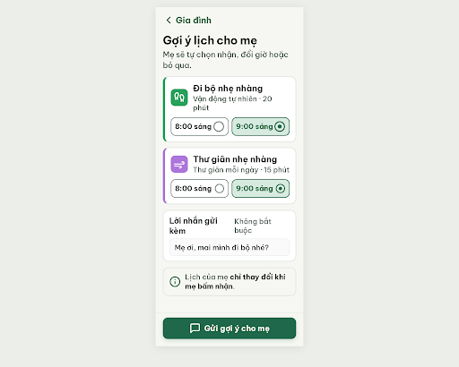
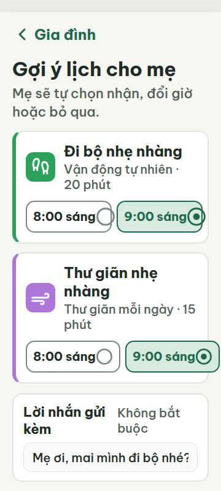
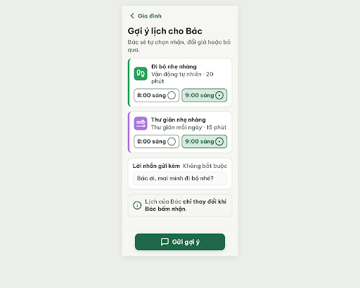
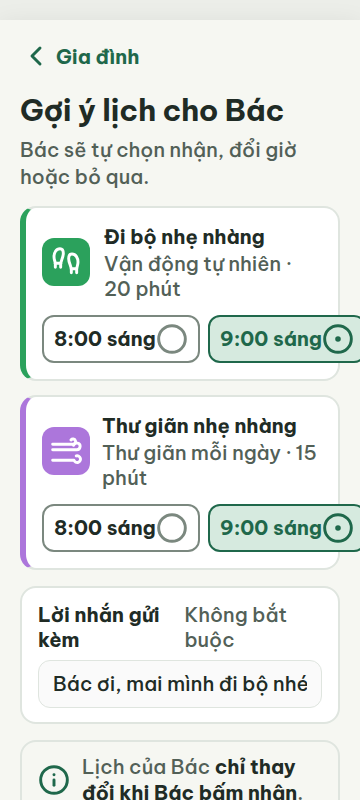
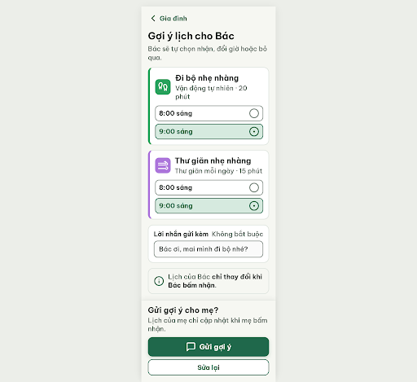
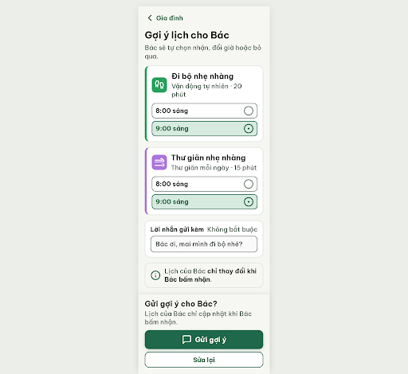
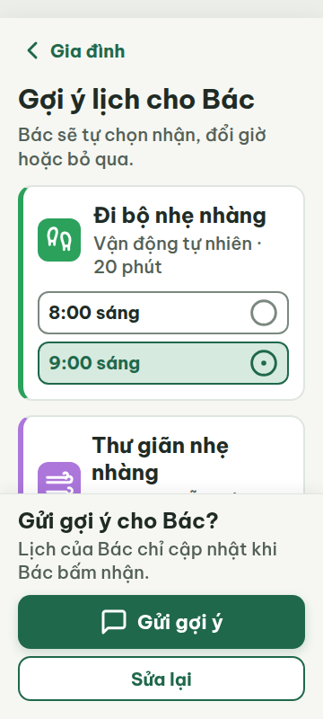

# G01b — Soạn gợi ý · chọn giờ

Project: `2013215887278758682` — An Nhiên (project của Sanh)

**Màn chốt hiện tại: v2 — 94 điểm**

Screen ID: `ca1deaa721214c60b43e97efc36f2425`

**Kết quả: CONVERGED** · stop_reason: patience_2

| Vòng | Điểm | Error | Warn | Đã sửa | Regression |
|---|---:|---:|---:|---|---|
| v0 | 68 | 2 | 4 | — | — |
| v1 | 71 | 2 | 3 | — | — |
| v2 | 94 | 0 | 2 | — | — |
| v3 | 77 | 2 | 1 | — | — |
| v4 | 84 | 1 | 2 | — | — |

## v0 — 68 điểm

Screen: `projects/2013215887278758682/screens/a3d08156385c4f02a7d45815a21a3f18`





- R-TXT-01 (error): Header và khung MAIN (360/412 px). Bằng chứng: Metrics ghi font 16px cho HEADER, MAIN, FOOTER; nút chọn giờ còn font 13.3333px. Chữ nhãn con 20px không làm các phần tử chữ 16px/13.33px đạt ngưỡng.. Sửa: Đặt mọi chữ hiển thị, kể cả nhãn chứa của header/footer và chữ điều khiển chọn giờ, tối thiểu 20px; đặt font-size:20px cho .time-option-btn.
- R-ICON-03 (warn): Ô icon của hai thẻ thói quen và các vòng chọn giờ. Bằng chứng: Ảnh cho thấy các nét minh họa trong ô thói quen là glyphs không nhận diện được là Lucide. Theo từ điển, icon dùng cho từng ý nghĩa phải là icon Lucide đã chỉ định; kích thước hộp đạt 32px.. Sửa: Thay icon tự vẽ bằng đúng tên Lucide trong từ điển DESIGN.md cho từng thói quen; dùng circle-dot 32×32 cho giờ đang chọn và circle 32×32 cho giờ chưa chọn.
- R-COL-03 (warn): Ô icon và vạch trái thẻ đi bộ, thư giãn. Bằng chứng: HTML dùng #2BA15C và #AC76DB; đây không phải màu accent được chỉ định cho hai thói quen trong DESIGN.md.. Sửa: Thay #2BA15C và #AC76DB lần lượt bằng đúng habit-walk-accent và habit-downshift-accent trong DESIGN.md, đồng nhất màu ô icon với vạch trái.
- R-TAP-02 (error): Nút Gửi gợi ý cho mẹ ở chân màn. Bằng chứng: Nút cao 60px và rộng 320px ở lề 20px, nhưng ở viewport 360×800 nó nằm tại y=941px (412px: y=861px), ngoài màn hình ban đầu do nội dung dài; người dùng phải cuộn để thấy hành động chính.. Sửa: Đặt nút cao 60px, rộng màn hình trừ 40px và ghim trong footer đáy viewport; bảo đảm luôn thấy trên màn 360×800.
- R-LANG-02 (warn): Toàn màn. Bằng chứng: Màn gọi người nhận là “mẹ” nhưng nút quay lại ghi “Gia đình”; không có lời gọi trực tiếp thống nhất theo Bác/Ông/Bà. Câu nút “Gửi gợi ý cho mẹ” không nói rõ việc thêm gợi ý vào lịch.. Sửa: Dùng một cách gọi xuyên suốt, ví dụ đổi tiêu đề/nội dung/nút thành “Gợi ý lịch cho Bác”, “Lịch của Bác…” và “Thêm gợi ý vào lịch”.
- R-STY-01 (warn): Các vùng nhấn thói quen và thẻ giờ. Bằng chứng: Màu nền/chữ chính khớp token; màu vùng accent #2BA15C/#AC76DB không khớp bảng token thói quen trong DESIGN.md.. Sửa: Dùng chính xác 9 token accent từ DESIGN.md; riêng hai thẻ này thay bằng accent đúng của Đi bộ tự nhiên và Thư giãn.

Màn rõ và dễ đọc, nhưng vi phạm cỡ chữ tối thiểu, icon/màu accent, vùng chạm và khả năng nhìn thấy nút gửi ngay trong viewport; cần chỉnh trước khi dùng.

### Edit prompt

```text
Keep the G01b selected-time state: first activity “9:00 sáng” selected with circle-dot, “8:00 sáng” unselected with circle. Fix the reviewed issues:
1. Set every visible control/container label to at least 20px, including header, footer, and time-option buttons. Keep button text at least 22px where primary.
2. Pin the primary send button in a fixed bottom footer so it is visible on initial 360×800 and 412px screens. Use 60px height, 20px side inset, and leave content scroll space.
3. Replace any custom/unlisted icons with the exact Lucide dictionary icons: footprints for Vận động tự nhiên; wind for Thư giãn mỗi ngày; circle-dot/circle for selected/unselected time choices; message-square for sending. All 32×32px, stroke 2–2.5.
4. Use the exact habit accent tokens from DESIGN.md: #2BA15C for Vận động tự nhiên and #AC76DB for Thư giãn mỗi ngày, including icon tiles and accent bars; icons white.
5. Make recipient wording consistent and clear: use “Bác” in the heading/message context; label the send action “Gửi gợi ý” so it is clear this sends a suggestion, not a confirmed schedule. Preserve the line that mẹ chooses whether to accept.
Keep all targets >=48px and gaps >=8px. Do not claim the suggestion is already on her calendar. Generate the new screen now.

```

## v1 — 71 điểm

Screen: `projects/2013215887278758682/screens/1a41247112a74a0eb5051de083710c5e`





- R-TXT-02 (warn): Tên và mô tả hoạt động trong hai thẻ gợi ý. Bằng chứng: Ảnh 360/412 cho thấy tên việc và dòng phụ hiển thị cỡ khoảng 20 px; nội dung chính cần gần 24 px. Tiêu đề 30 px và nút 22 px đạt mức quy định.. Sửa: Đặt tên hoạt động và dòng mô tả trong thẻ ở 24 px; giữ tiêu đề 30 px và nút 22 px.
- R-CON-02 (warn): Viền ô nhập ‘Lời nhắn gửi kèm’. Bằng chứng: HTML dùng viền #DFE5DF trên nền ô #FAFAFA, tương phản xấp xỉ 1.2:1, thấp hơn 3:1.. Sửa: Đổi viền ô nhập sang #7B887F (outline) để đạt tương phản tối thiểu 3:1 với nền #FAFAFA.
- R-LAY-01 (error): Hai lựa chọn giờ trong thẻ ‘Đi bộ nhẹ nhàng’ ở viewport 360 px. Bằng chứng: Metrics đặt lựa chọn ‘9:00 sáng’ tại x=207.67 với rộng 158.31 px, kết thúc ở x=365.98; ảnh 360 cắt phần phải của lựa chọn. scrollWidth báo 360 nhưng ảnh xác nhận nội dung bị cắt.. Sửa: Ở 360 px chuyển nhóm giờ thành hai hàng hoặc giảm cỡ/đệm để cả hai nút nằm trọn trong x=20–340 px; bảo đảm mép phải không vượt 340 px.
- R-TAP-02 (error): Nút chính ‘Gửi gợi ý’ ở viewport 360 × 800. Bằng chứng: Nút cao 60 px và rộng 280 px, nhưng metrics đặt nó ở y=879.5–939.5; ở 360 × 800 nó nằm dưới màn hình, do footer nằm sau nội dung cuộn.. Sửa: Đặt footer cố định trong viewport 360 × 800; neo nút cao 60 px ở đáy với lề ngang 20 px và giữ nút luôn thấy được mà không cuộn.
- R-SAFE-01 (warn): Nút ‘Gửi gợi ý’ ở chân màn. Bằng chứng: Handoff mô tả thao tác này gửi gợi ý cho mẹ và chuyển sang G02; màn không có bước xác nhận hay cách hoàn tác việc đã gửi.. Sửa: Thêm hộp xác nhận trước khi gửi với nút an toàn “Sửa lại” và nút cụ thể “Gửi gợi ý cho mẹ”; hoặc thêm “Hoàn tác” sau khi gửi.

Hai lỗi chặn còn lại ở 360 px: lựa chọn giờ bị cắt ngang và nút gửi nằm ngoài khung ban đầu; cần tăng cỡ chữ nội dung, làm rõ viền ô nhập và xác nhận thao tác gửi.

### Edit prompt

```text
Keep the G01b selected-time state: first activity “9:00 sáng” selected and “8:00 sáng” unselected. Fix the v1 review findings:
1. Set activity names/descriptions to 24px; keep all visible copy >=20px.
2. At 360px, fit both time buttons fully inside x=20..340: use two rows if necessary, each button min 48px high, 32px documented circle/circle-dot icon, no clipping. Preserve 8px gaps.
3. Fix message field border to #7B887F.
4. Pin the 60px primary CTA in a fixed bottom footer with 20px side inset and safe area; keep it visible at 360×800/412px. Reserve scroll padding.
5. Add a compact explicit send-confirmation state near the CTA: “Gửi gợi ý cho mẹ?” with actions “Gửi gợi ý” and “Sửa lại” (safe choice), stacked with 8px gap. Clearly indicate this is still only a suggestion and does not alter mẹ’s calendar until she accepts.
Preserve exact approved icons, colors and layout elsewhere. Generate the screen now.

```

## v2 — 94 điểm

Screen: `projects/2013215887278758682/screens/ca1deaa721214c60b43e97efc36f2425`




- R-LANG-02 (warn): Phần cuối màn: ‘Gửi gợi ý cho mẹ?’ và ‘Lịch của mẹ chỉ cập nhật khi mẹ bấm nhận.’. Bằng chứng: Phần nội dung trên gọi người nhận là ‘Bác’, nhưng phần cuối đổi sang ‘mẹ’.. Sửa: Đổi hai câu cuối thành ‘Gửi gợi ý cho Bác?’ và ‘Lịch của Bác chỉ cập nhật khi Bác bấm nhận.’
- R-STY-03 (warn): Khoảng cách dọc giữa hai thẻ gợi ý trong danh sách.. Bằng chứng: CSS của .activities-list đặt gap: 14px, thấp hơn mức 16px của luật.. Sửa: Đặt gap của .activities-list thành 16px.

Màn G01b đạt các yêu cầu đọc, tương phản và thao tác; còn hai cảnh báo về xưng hô và khoảng cách giữa thẻ.

### Edit prompt

```text
Keep the overall G01b v2 layout unchanged. Fix only the two remaining warnings: replace “Gửi gợi ý cho mẹ?” with “Gửi gợi ý cho Bác?” and “Lịch của mẹ chỉ cập nhật khi mẹ bấm nhận.” with “Lịch của Bác chỉ cập nhật khi Bác bấm nhận.” Set the vertical gap between the two activity cards to exactly 16px. Preserve the selected 9:00 time, confirmation controls, fixed CTA, all colors/icons and target sizes. Generate a new screen now.

```

## v3 — 77 điểm

Screen: `projects/2013215887278758682/screens/38e949fd4da44658a007f1c4ff85d000`




- R-TXT-05 (error): Hai thẻ gợi ý việc.. Bằng chứng: Mỗi thẻ hiển thị icon thói quen, tên việc, tên thói quen và thời lượng, cùng bốn hàng chọn giờ. Phần thời lượng/tên thói quen và nhiều lựa chọn giờ vượt cấu trúc thẻ việc được quy định.. Sửa: Giữ trong thẻ icon, một giờ đề xuất, tên việc và một nhãn trạng thái; chuyển chọn giờ thay thế sang bước riêng.
- R-NAV-02 (error): Nút quay lại ở đầu màn.. Bằng chứng: Ảnh 360/412 hiển thị chevron cùng chữ ‘Gia đình’; nút không có nhãn ‘Quay lại’ nhìn thấy được.. Sửa: Đổi nhãn hiển thị thành ‘Quay lại’ (20px), hoặc tên màn trước nếu biết chính xác.
- R-STY-03 (warn): Hàng ‘Lời nhắn gửi kèm / Không bắt buộc’ trên màn 360px.. Bằng chứng: Metrics 360 cho LABEL và SPAN mỗi dòng cao 50px, xếp cạnh nhau ở cùng hàng; ảnh fullpage cho thấy các từ rơi xuống thành hai dòng và sát cạnh nhau. Lề 20px và gap 16px được giữ ở các khối chính.. Sửa: Ở 360px đổi hàng nhãn thành cột hoặc để nhãn ‘Không bắt buộc’ xuống hàng riêng; đặt gap dọc 8px và giữ lề 20px.

Hai lỗi chặn là cấu trúc thẻ gợi ý vượt giới hạn nội dung và nút quay lại thiếu nhãn; hàng nhãn biểu mẫu cần xếp lại ở 360px.

### Edit prompt

```text
Keep the best reviewed G01b v2 screen unchanged except for the two remaining warning fixes: use “Bác” consistently in the send confirmation and privacy line (“Gửi gợi ý cho Bác?”; “Lịch của Bác chỉ cập nhật khi Bác bấm nhận.”); set `.activities-list` gap to exactly 16px. Preserve the selected 9:00 state, all controls, fixed send CTA, widths and icons. Generate a new screen now.

```

## v4 — 84 điểm

Screen: `projects/2013215887278758682/screens/1ef49e64807d478f97e4599ec9b6dff2`




- R-COL-03 (warn): Ô icon và vạch trái của hai thẻ gợi ý. Bằng chứng: HTML đặt màu Vận động tự nhiên #2BA15C và Thư giãn mỗi ngày #AC76DB; màu đúng theo bảng DESIGN.md là #2E7D5A và #8E6BC7.. Sửa: Đổi #2BA15C thành #2E7D5A và #AC76DB thành #8E6BC7 ở cả ô icon và vạch trái.
- R-NAV-01 (error): Toàn màn hình Gợi ý lịch. Bằng chứng: Trong ảnh viewport 360×800 và 412×800 cùng HTML không có bottom nav; nội dung kết thúc bằng nút “Gửi gợi ý” và “Sửa lại”.. Sửa: Thêm bottom nav với đúng 4 tab “Hôm nay”, “Lịch tuần”, “Thói quen”, “Gia đình”, mỗi tab có icon Lucide và nhãn 20px.
- R-STY-01 (warn): Ô icon và vạch trái của thẻ Vận động tự nhiên, Thư giãn mỗi ngày. Bằng chứng: Màu nhấn trong HTML là #2BA15C và #AC76DB, không khớp token thói quen trong DESIGN.md là #2E7D5A và #8E6BC7. Nền #F6F7F2 và màu chữ chính/phụ đúng token.. Sửa: Thay #2BA15C bằng #2E7D5A và #AC76DB bằng #8E6BC7.

V4 rõ ràng, không tràn ngang và đáp ứng phần lớn luật; còn thiếu bottom nav và hai màu nhấn thói quen lệch token.
