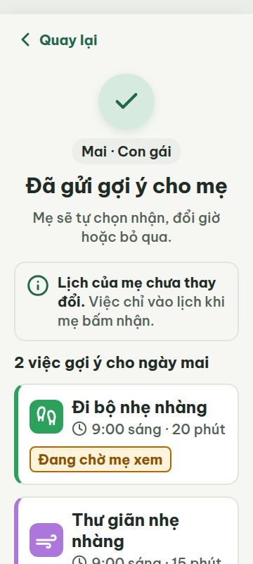
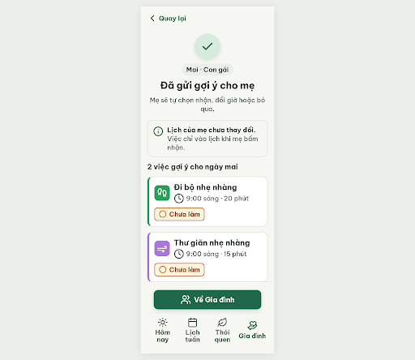
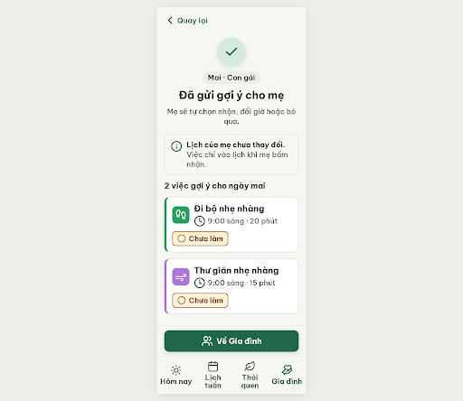
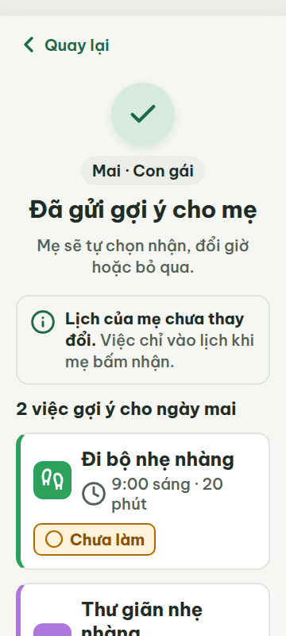
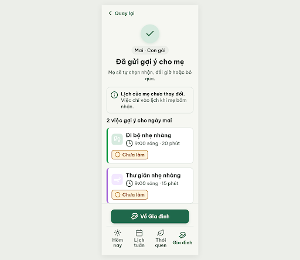
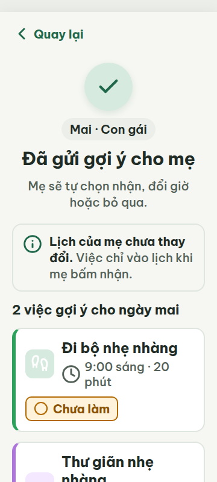

# G02 — Đã gửi gợi ý

Project: `2013215887278758682` — An Nhiên (project của Sanh)

**Màn chốt hiện tại: v1 — 90 điểm**

Screen ID: `4e784ab19ba14d8395082edab0a8cd47`

**Kết quả: NEEDS_HUMAN** · stop_reason: patience_2

| Vòng | Điểm | Error | Warn | Đã sửa | Regression |
|---|---:|---:|---:|---|---|
| v0 | 77 | 2 | 1 | — | — |
| v1 | 90 | 1 | 0 | — | — |
| v2 | 84 | 1 | 2 | — | — |
| v3 | 81 | 1 | 3 | — | — |

## v0 — 77 điểm

Screen: `projects/2013215887278758682/screens/bb36c1b9dc154669829916831894e31f`




- R-LAY-01 (error): Thanh điều hướng dưới cùng ở 360 px và 412 px. Bằng chứng: Ảnh viewport cho thấy bốn nhãn nav dính/chồng lên nhau; metrics ghi nhãn Hôm nay x=20.09..105.92 và Lịch tuần x=95.05..186.95 (chồng 10.87 px), Thói quen x=170.77..267.25 và Gia đình x=255.34..338.67 (chồng 11.91 px). Ở 412 px hai nhãn trung tâm vẫn chạm/chồng nhẹ. scrollWidth=clientWidth nên lỗi là chồng chữ, không phải cuộn ngang.. Sửa: Giữ 4 tab trên một hàng ở 360 px bằng cách giảm icon nav xuống 24 px và đặt nhãn nav 18 px hoặc rút gọn nhãn theo từ điển; đảm bảo mép chữ các tab cách nhau ít nhất 4 px.
- R-ICON-03 (warn): Icon giờ ở hai thẻ việc và icon tab Gia đình. Bằng chứng: Icon đồng hồ trong cả hai thẻ có kích thước 22×22 px, thấp hơn 32 px. Tab Gia đình dùng biểu tượng nhóm người (users) trong khi từ điển quy định hand-heart cho tab này; users dành riêng cho thói quen Gắn kết cộng đồng.. Sửa: Đổi mỗi icon clock 22×22 px thành 32×32 px; đổi icon tab Gia đình sang Lucide hand-heart 32×32 px.
- R-STA-01 (error): Nhãn trạng thái trong hai thẻ việc. Bằng chứng: Hai việc gợi ý đều mang nhãn “Đang chờ mẹ xem”, không thuộc một trong năm nhãn trạng thái được yêu cầu; nhãn cũng không có icon trạng thái đi kèm.. Sửa: Đổi trạng thái thành nhãn được quy định, ví dụ “○ Chưa làm” với icon circle 24×24 px; đặt chip cạnh tên việc.

G02 có hai lỗi chặn: nhãn trạng thái thẻ không theo bộ trạng thái quy định và nhãn bottom nav chồng nhau; icon đồng hồ nhỏ hơn chuẩn và icon Gia đình sai từ điển.

### Edit prompt

```text
Keep the overall G02 screen unchanged except for these review fixes; generate a new screen now:
1. Resolve bottom-nav label overlap at 360px and 412px without shrinking text below 20px: use four equal-width tab columns, centered labels allowed to wrap to at most two lines, 20px type, line-height 1.1, and a nav height of 104px. Keep at least 4px visible gap between labels.
2. Increase both clock icons beside task times from 22px to 32×32px.
3. Replace the bottom-nav Gia đình icon `users` with documented Lucide `hand-heart` 32×32px.
4. Replace “Đang chờ mẹ xem” on each task with the specified state chip “○ Chưa làm”, using Lucide circle 24×24px and documented warning styling.
Preserve task names, sent-message content, privacy statement, and the same single primary action. Keep text >=20px, touch targets >=48px, no horizontal overlap and no footer/nav covering content.

```

## v1 — 90 điểm

Screen: `projects/2013215887278758682/screens/4e784ab19ba14d8395082edab0a8cd47`




- R-TXT-01 (error): Màn G02 — xem bằng chứng tại v1.html và ảnh viewport 360/412.. Bằng chứng: Một số chữ hiển thị nhỏ hơn 20 px: tiêu đề phụ/tên hoạt động 19 px; thông tin header 16 px.. Sửa: Đặt mọi chữ hiển thị, kể cả phụ đề và nhãn thẻ, tối thiểu 20 px.

G02 v1 là màn xác nhận phía người gửi, có nội dung xác nhận và điều hướng phù hợp; còn lỗi cỡ chữ dưới 20 px.

### Edit prompt

```text
Keep the overall G02 screen unchanged. Fix only R-TXT-01 from the independent review: every visible text element and its containing control label must render at >=20px, including secondary activity names/descriptions currently 19px and header information currently 16px. Increase these to at least 20px; preserve the 30px heading and 22px primary button. Do not change the G02 sender-side success flow, colors, icons, content, or navigation. Generate a new screen now.

```

## v2 — 84 điểm

Screen: `projects/2013215887278758682/screens/a8dd4392fd6646b98d3e550dd4d39a09`





- R-TXT-01 (error): Nhãn 4 tab ở footer, 360 và 412 px. Bằng chứng: Metrics v2 cho cả 4 nút Hôm nay/Lịch tuần/Thói quen/Gia đình đều ghi font 13.333px; thấp hơn ngưỡng 20px.. Sửa: Đặt font-size computed của nhãn nav thành 20px (hiện đang bị thu còn 13.33px), giữ 1–2 dòng.
- R-TXT-02 (warn): Nhãn bottom nav ở footer. Bằng chứng: Chữ nav được render 13.33px theo metrics ở cả 360 và 412, nhỏ hơn rõ rệt so với nội dung 20–24px.. Sửa: Tăng nhãn nav lên 20px computed để đồng bộ chữ giao diện người lớn tuổi.
- R-ICON-03 (warn): Nút “Về Gia đình” ở footer. Bằng chứng: Icon users dùng cho hành động này nhưng từ điển dành users cho thói quen “Gắn kết cộng đồng”; icon hành động “Tab Gia đình” là hand-heart. Icon 32px, nhưng nghĩa bị dùng sai.. Sửa: Đổi icon users thành Lucide hand-heart, cỡ 32px, cạnh nhãn “Về Gia đình”.

G02 giữ nội dung và trạng thái dễ hiểu, nhưng nhãn điều hướng render dưới cỡ tối thiểu và icon ở nút về Gia đình dùng sai nghĩa trong từ điển.

### Edit prompt

```text
Keep the best reviewed G02 v1 screen and its correct icons/layout. Fix the remaining minimum text-size issue from its critique and guard against the v2 regression: every visible text element, including header metadata, activity labels, status chip text, and all four bottom-nav labels, must have computed font-size >=20px at both 360px and 412px. Keep nav labels within their tab by wrapping to at most two lines; do not shrink them. Preserve the documented `hand-heart` icon for Gia đình (do not replace it with `users`), and keep the 4-tab nav, sender-side success copy, status chips, primary action and colors unchanged. Generate a new screen now.

```

## v3 — 81 điểm

Screen: `projects/2013215887278758682/screens/2c7b2e7c31e446dea227670667de862b`





- R-CON-02 (warn): Viền thẻ việc và ô icon nền xanh/tím. Bằng chứng: Habit glyphs are #1F684B/#7C3AED on pale #D6EADF/#F3E8FF tiles; their foreground/background contrast is below the required 3:1 for icon controls.. Sửa: Use #2BA15C and #AC76DB accent fills with white 32px icons, each meeting at least 3:1 contrast.
- R-ICON-03 (warn): Two activity cards: footprints and wind tiles; status chips. Bằng chứng: Habit glyphs are 32px and recognizable, but use colored strokes on pale tiles instead of white glyphs on the corresponding accent color. Status circle is 24px, within exception. Success check is generic and does not encode an explicit done status.. Sửa: Keep status circle at 24px; render footprints/wind as white 32px glyphs on #2BA15C and #AC76DB. Use a 32px Lucide circle-check only for an explicit ‘Đã xong’ status, or remove the success glyph.
- R-COL-02 (error): Activity cards ‘Đi bộ nhẹ nhàng’ and ‘Thư giãn nhẹ nhàng’. Bằng chứng: Cards have left accent bars, but the 48×48 tiles are pale #D6EADF/#F3E8FF with colored icons, not accent-color tiles with white icons.. Sửa: Set tile backgrounds to #2BA15C and #AC76DB respectively and their 32×32 Lucide icons to #FFFFFF; retain matching 6px left bars.
- R-LANG-02 (warn): Sender line, heading, body and CTA. Bằng chứng: UI addresses recipient as ‘mẹ’ (‘Đã gửi gợi ý cho mẹ’, ‘Mẹ sẽ tự chọn…’) while another sentence switches to third-person ‘mẹ’; the handoff specifies recipient-facing ‘Bác’ for G03, but sender-side G02 uses mother wording. CTA ‘Về Gia đình’ is a destination label rather than verb + object.. Sửa: Use the intended G02 sender-facing ‘mẹ’ consistently throughout and change CTA to the explicit action ‘Xem Gia đình’ (3 tiếng).

G02 clearly communicates suggestion delivery and preserves the mother’s choice, but its habit icon tiles miss the required accent treatment and a few details in the footer and sender wording need adjustment.
