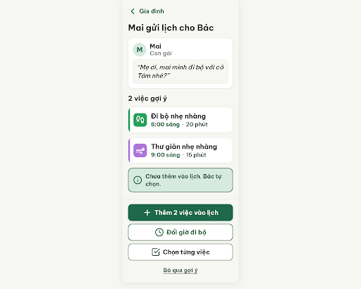
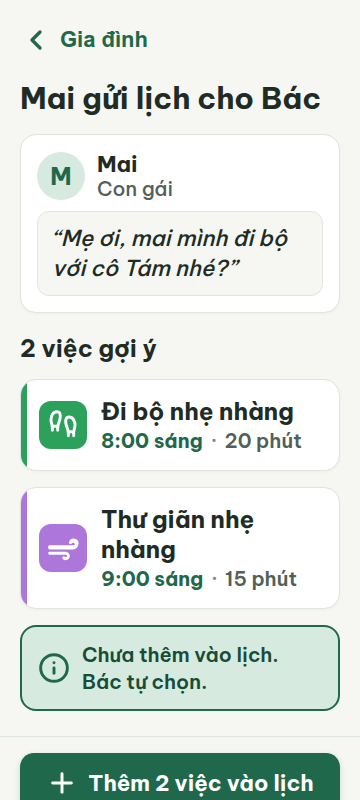
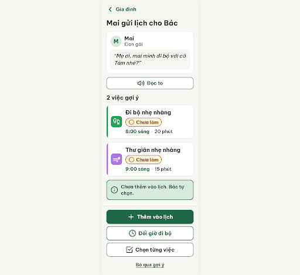
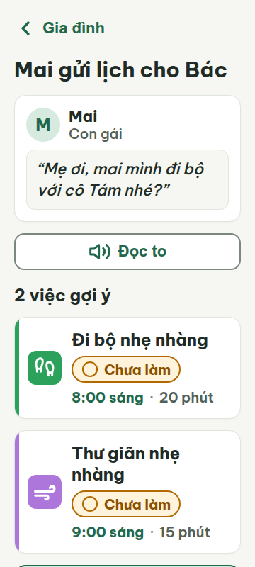
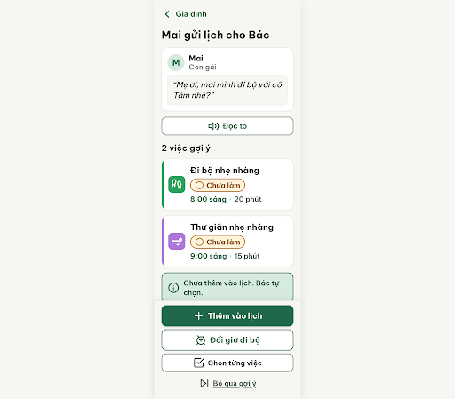
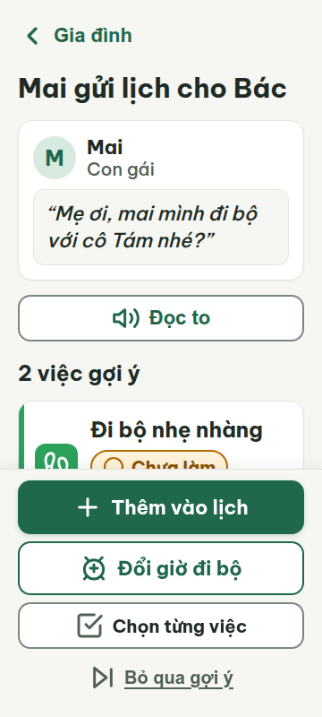

# G03 — Lịch Mai gợi ý

Project: `2013215887278758682` — An Nhiên (project của Sanh)

**Màn chốt hiện tại: v3 — 100 điểm**

Screen ID: `79ebadfcd74e46e189bd4e8a77be685e`

**Kết quả: CONVERGED** · stop_reason: score_100

| Vòng | Điểm | Error | Warn | Đã sửa | Regression |
|---|---:|---:|---:|---|---|
| v0 | 60 | 4 | 0 | — | — |
| v1 | Không sinh màn | — | — | — | — |
| v2 | 77 | 2 | 1 | — | — |
| v3 | 100 | 0 | 0 | — | — |

## v0 — 60 điểm

Screen: `projects/2013215887278758682/screens/3dd22d6ca0c4422da18f825a661cf241`





- R-TXT-04 (error): Nhãn nút chính “Thêm 2 việc vào lịch”. Bằng chứng: Nhãn có 6 tiếng (“Thêm / 2 / việc / vào / lịch”), vượt mức tối đa 5 tiếng.. Sửa: Đổi thành “Thêm vào lịch” (3 tiếng).
- R-TXT-05 (error): Hai thẻ việc gợi ý. Bằng chứng: Mỗi thẻ hiển thị icon, tên việc, giờ và thời lượng; chưa có nhãn trạng thái cạnh tên việc.. Sửa: Thêm chip “○ Chưa làm” cỡ chữ 20px cạnh tên mỗi việc.
- R-STA-01 (error): Hai thẻ việc gợi ý. Bằng chứng: Không có nhãn nào trong bộ 5 trạng thái gắn với từng việc; dòng đồng thuận phía dưới không xác định trạng thái từng thẻ.. Sửa: Thêm chip “○ Chưa làm” cạnh tên mỗi việc, dùng nền/viền vàng đậm và chữ 20px.
- R-VOI-01 (error): Màn G03 gợi ý từ người thân. Bằng chứng: Không có nút “Đọc to” có chữ; rule và nguồn thiết kế yêu cầu nút voice cho G03.. Sửa: Thêm nút “🔊 Đọc to” với icon volume-2 32px.

Màn rõ ràng, dễ đọc và giữ màu/icon nhất quán; cần bổ sung trạng thái từng gợi ý, nút Đọc to và rút ngắn nhãn nút chính.

### Edit prompt

```text
Keep the overall layout and everything not mentioned below unchanged. Fix the four reviewed issues: (1) Shorten the primary CTA from “Thêm 2 việc vào lịch” to “Thêm vào lịch” (3 syllables), retaining one filled primary action. (2) Add a labeled 20px status chip “○ Chưa làm” to each suggested activity card, with the documented warning colors and a 24px-or-larger chip icon; the line below must still make clear nothing is added until Bác accepts. (3) Add an accessible secondary “Đọc to” control with Lucide volume-2 32×32px and text, not icon-only. Preserve the two suggested items, times, sender message, and autonomy statement. Keep all controls at least 48×48px with 8px gaps, text at least 20px, and avoid overlap with the pinned footer at 360px and 412px.

```

## v1 — không sinh màn

Stitch trả về nội dung kế hoạch thay vì screen; không chấm vòng này. Phản hồi đã lưu tại `v1-attempt-response.json`.


## v2 — 77 điểm

Screen: `projects/2013215887278758682/screens/5822007f89f04e21bf027c74d740101e`





- R-ICON-02 (error): Nút cuối trang “Bỏ qua gợi ý”. Bằng chứng: Nút hành động chỉ có chữ, không có icon; các nút “Thêm vào lịch”, “Đổi giờ đi bộ” và “Chọn từng việc” đều có icon.. Sửa: Thêm icon Lucide skip-forward kích thước 32 × 32 px bên cạnh nhãn “Bỏ qua gợi ý”.
- R-ICON-03 (warn): Nút “Đổi giờ đi bộ” ở chân trang. Bằng chứng: Nút đang dùng icon clock, trong khi từ điển DESIGN.md chỉ định alarm-clock-plus cho hành động dời giờ.. Sửa: Thay icon clock bằng Lucide alarm-clock-plus kích thước 32 × 32 px.
- R-TAP-02 (error): Nhóm nút hành động ở chân trang trong ảnh viewport 360 × 800 dp. Bằng chứng: Ảnh viewport không hiển thị các nút; trong metrics, nút chính bắt đầu tại y=925 px và footer kết thúc tại y=1203 px, nằm dưới chiều cao màn 800 px.. Sửa: Ghim .fixed-footer ở đáy viewport bằng position: fixed; bottom: 0 và dành ít nhất 295 px padding-bottom cho vùng cuộn để nội dung không bị che.

G03 giữ được chữ lớn, độ tương phản và màu thói quen; cần ghim nhóm hành động vào đáy viewport, thêm icon skip-forward cho “Bỏ qua gợi ý” và đổi clock thành alarm-clock-plus cho “Đổi giờ đi bộ”.

### Edit prompt

```text
Apply these edits to the selected G03 screen and generate a new screen now. Keep all other content unchanged.
1. Pin the action footer to the bottom of the 360×800/412px viewport; the primary button must appear in the first viewport. Reserve enough scroll padding so it never covers content.
2. Add Lucide skip-forward 32×32px to “Bỏ qua gợi ý”.
3. Replace the clock icon on “Đổi giờ đi bộ” with the documented Lucide alarm-clock-plus 32×32px.
Preserve the short primary label “Thêm vào lịch”, both “○ Chưa làm” chips, “Đọc to”, all copy, colors, touch target sizes and 8px gaps. Create the edited screen, do not return a plan.

```

## v3 — 100 điểm

Screen: `projects/2013215887278758682/screens/79ebadfcd74e46e189bd4e8a77be685e`






G03 đạt các luật đang áp dụng; chữ, tương phản, trạng thái, vùng chạm và bố cục phù hợp ở 360 px và 412 px.
