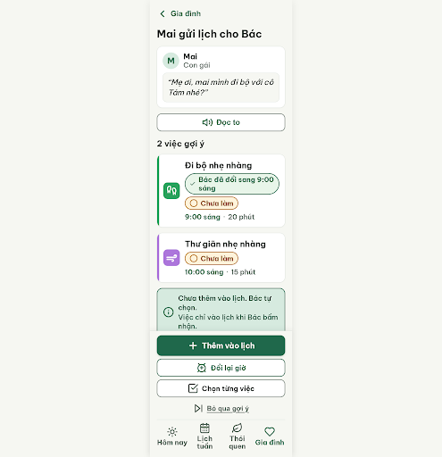
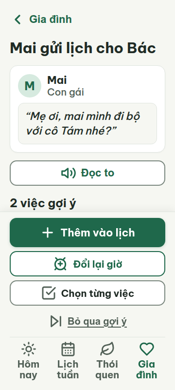
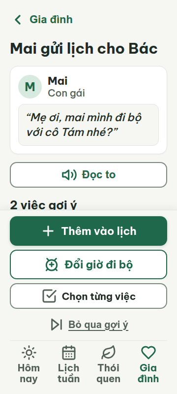
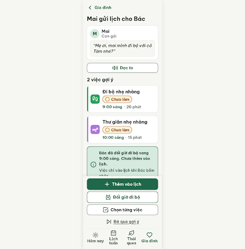
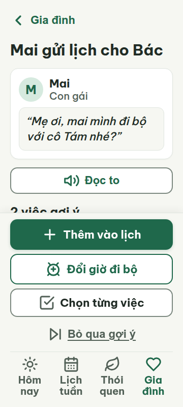
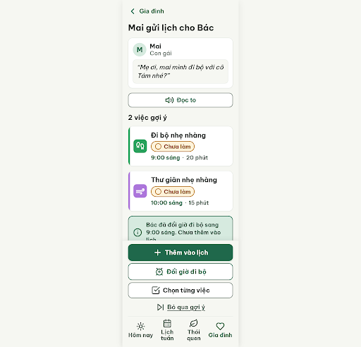
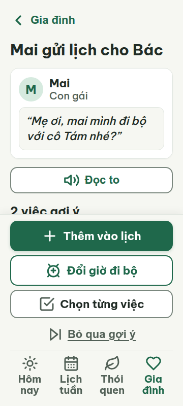

# G03b — Lịch Mai gợi ý · đã đổi giờ

Project: `2013215887278758682` — An Nhiên (project của Sanh)

**Màn chốt hiện tại: v2 — 91 điểm**

Screen ID: `3971b7a1bb9e4834be899bdc86e23b66`

**Kết quả: CONVERGED** · stop_reason: patience_2

| Vòng | Điểm | Error | Warn | Đã sửa | Regression |
|---|---:|---:|---:|---|---|
| v0 | Không sinh màn | — | — | — | — |
| v1 | 81 | 1 | 3 | — | — |
| v2 | 91 | 0 | 3 | — | — |
| v3 | 90 | 1 | 0 | — | — |
| v4 | 77 | 2 | 1 | — | — |

## v0 — không sinh màn

Stitch trả về nội dung kế hoạch thay vì screen; không chấm vòng này. Phản hồi đã lưu tại `v0-attempt-response.json`.


## v1 — 81 điểm

Screen: `projects/2013215887278758682/screens/04567397fbd1489197e1eeea73ae417e`





- R-TXT-05 (error): Hai thẻ việc gợi ý. Bằng chứng: Thẻ Đi bộ có thêm chip “Bác đã đổi sang 9:00 sáng” ngoài tên, trạng thái, giờ và thời lượng; phần này làm vỡ cấu trúc gọn của thẻ.. Sửa: Bỏ chip khỏi thẻ; thể hiện giờ đã đổi ngay ở dòng giờ “9:00 sáng”.
- R-ICON-03 (warn): Chip “Bác đã đổi sang 9:00 sáng” trong thẻ Đi bộ. Bằng chứng: Icon dấu kiểm 22×22 px không theo Từ điển icon; circle-check được dành riêng cho trạng thái/nút “Đã xong”.. Sửa: Bỏ icon khỏi thông báo đổi giờ hoặc dùng Lucide info 32×32 px cho nghĩa thông tin.
- R-LANG-02 (warn): Nút hành động trong footer. Bằng chứng: Nhãn “Đổi lại giờ” (3 tiếng) không theo mẫu động từ + việc cụ thể; ngữ cảnh yêu cầu đổi giờ đi bộ.. Sửa: Đổi nhãn thành “Đổi giờ đi bộ” (4 tiếng).
- R-STY-03 (warn): Footer hành động cố định. Bằng chứng: Các nút footer cách nhau 8 px, nhưng cụm footer đẩy nội dung lên và che thẻ thứ hai ở vị trí y≈700 px trong ảnh 360; nhịp/không gian khối không giữ 16 px tĩnh.. Sửa: Đặt footer dưới nội dung cuộn thay vì phủ lên; giữ khoảng trống nội dung cuối ≥ 332 px (chiều cao footer 320 px + lề 12 px) và khoảng cách khối 16 px.

Màn có cấu trúc rõ, voice và trạng thái dễ nhận biết; còn lỗi cấu trúc thẻ, nhãn đổi giờ và vùng footer chồng lấp ở 360 px.

### Edit prompt

```text
Keep the overall G03b layout unchanged. Fix the four reviewed findings:
1. Remove the extra “Bác đã đổi sang 9:00 sáng” chip from the walking task card. The changed time is already shown as “9:00 sáng”; keep a short change explanation outside the task card only if needed.
2. Remove the 22px check icon from that change message; do not use circle-check for an edited-time state.
3. Change footer action label “Đổi lại giờ” to “Đổi giờ đi bộ”.
4. Place the action footer below the scroll content instead of overlaying it; reserve at least 332px of bottom content space (footer 320px + 12px inset) so both cards remain visible at 360×800 and 412px. Keep 16px block gaps.
Preserve the accepted-flow actions, changed walking time 9:00, second activity 10:00, consent statement, four-tab nav, fonts >=20px and targets >=48px. Generate a new screen now.

```

## v2 — 91 điểm

Screen: `projects/2013215887278758682/screens/3971b7a1bb9e4834be899bdc86e23b66`




- R-TXT-02 (warn): Toàn màn. Bằng chứng: H1 “Mai gửi lịch cho Bác” là 30 px; nội dung trích dẫn 22 px và tên việc 24 px đạt gần mục tiêu, nhưng nhãn “Chưa làm”, thời gian và nút phụ là 20 px, nhỏ hơn nút chữ mục tiêu 22 px.. Sửa: Tăng chữ các nút phụ “Chọn từng việc”, “Bỏ qua gợi ý” từ 20 lên 22 px.
- R-CEN-01 (warn): Thẻ trạng thái sau khi đổi giờ. Bằng chứng: Đây là thông báo kết quả đứng riêng nhưng nội dung căn trái; ảnh cho thấy hộp màu xanh nhạt với biểu tượng và hai câu.. Sửa: Căn giữa biểu tượng và nội dung thông báo trong hộp trạng thái, giữ lề trong hộp tối thiểu 16 px.
- R-SAFE-01 (warn): Bỏ qua gợi ý. Bằng chứng: “Bỏ qua gợi ý” kết thúc gợi ý mà không có bước xác nhận hoặc “Hoàn tác” hiển thị trên màn.. Sửa: Thêm xác nhận “Bỏ qua gợi ý này?” với nút “Giữ gợi ý” / “Bỏ qua”, hoặc hiện “Hoàn tác” sau thao tác.

Chữ và điều hướng đạt yêu cầu; ưu tiên tăng cỡ nút phụ và bảo đảm có thể hoàn tác khi bỏ qua gợi ý.

### Edit prompt

```text
Keep the best reviewed G03b v2 screen and everything not mentioned below unchanged. Fix its three warnings:
1. Increase text in secondary buttons “Chọn từng việc” and “Bỏ qua gợi ý” from 20px to 22px, preserving 48px minimum height.
2. Center the icon and text inside the status card that says the walking time changed; retain at least 16px internal padding.
3. Make the “Bỏ qua gợi ý” action safe: tapping it must show an explicit confirmation with “Bỏ qua gợi ý này?”, and choices “Giữ gợi ý” (safe choice) and “Bỏ qua”. Keep the default suggestion screen readable; the confirmation may be a compact dialog state in the inspectable screen. Do not claim anything was skipped unless confirmed.
Preserve all other content, selected time 9:00, second task 10:00, consent, colors, icons, responsive layout. Generate a new screen now.

```

## v3 — 90 điểm

Screen: `projects/2013215887278758682/screens/fd6299d9bce9424c9a7083a8c7b52c5d`





- R-TXT-03 (error): State notice under the two suggested activities. Bằng chứng: At 360 px, ‘Bác đã đổi giờ đi bộ sang 9:00 sáng. Chưa thêm vào lịch.’ renders as 3 lines; the rule limits each paragraph to 2 lines.. Sửa: Shorten the notice to ‘Bác đổi giờ đi bộ sang 9:00 sáng. Chưa thêm lịch.’ and keep it within 2 lines at 360 px.

Còn một lỗi chặn: thông báo trạng thái dài ba dòng; phần chân trang cố định che danh sách việc ở khung nhìn đầu tiên 360 px.

### Edit prompt

```text
Keep the best reviewed G03b v2 screen, its layout, and all other content unchanged. Fix the three warnings from its review: set secondary button labels “Chọn từng việc” and “Bỏ qua gợi ý” to 22px; center the icon and text in the time-change notice with 16px internal padding; make “Bỏ qua gợi ý” open an explicit confirmation dialog (“Bỏ qua gợi ý này?”; “Giữ gợi ý” / “Bỏ qua”) before the state changes. Keep the dialog closed on initial load. Preserve the existing short status notice as one paragraph of at most 2 lines at 360px; do not add explanatory lines. Preserve changed time 9:00, second activity 10:00, consent statement, controls and colors. Generate a new screen now.

```

## v4 — 77 điểm

Screen: `projects/2013215887278758682/screens/b4efe2b2102b40ef82e2b940eae64713`





- R-CON-01 (error): Dấu phân cách ‘·’ cạnh giờ trong hai thẻ gợi ý. Bằng chứng: v4.html sets .detail-dot to #7B887F; trên nền thẻ trắng, contrast là 3.70:1, dưới 4.5:1. Kết quả metrics ở cả 360 và 412 đều cho thấy dấu này hiển thị ở cỡ 20px.. Sửa: Đổi màu .detail-dot từ #7B887F sang #526057 để đạt contrast 6.15:1 trên nền trắng.
- R-TXT-03 (error): Thông báo dưới danh sách gợi ý: ‘Bác đã đổi giờ đi bộ sang 9:00 sáng. Chưa thêm vào lịch.’. Bằng chứng: Metrics ghi state-text có 3 dòng ở cả 360px (rộng 238px) và 412px (rộng 290px); luật giới hạn đoạn văn tối đa 2 dòng.. Sửa: Rút gọn thành ‘Đã đổi sang 9:00. Bác chưa thêm vào lịch.’ và giữ cỡ chữ 20px; kiểm tra hiển thị tối đa 2 dòng ở khung 360px.
- R-ICON-03 (warn): Tab Gia đình ở bottom nav và nút ‘Chọn từng việc’. Bằng chứng: Tab Gia đình dùng hình trái tim đơn, trong khi Từ điển icon quy định hand-heart cho nghĩa này. Nút ‘Chọn từng việc’ dùng hình checklist chưa được ánh xạ trong Từ điển icon. Các icon đều hiển thị ở kích thước 32px.. Sửa: Đổi icon tab Gia đình sang Lucide hand-heart 32×32px; dùng icon Lucide có ánh xạ riêng cho ‘Chọn từng việc’ trong Từ điển icon, cũng ở 32×32px.

Hai lỗi cần sửa: dấu phân cách có tương phản thấp và thông báo dài ba dòng; tab Gia đình cùng nút Chọn từng việc cần icon theo từ điển. Dock hành động cố định che phần tiêu đề/danh sách gợi ý trong khung ban đầu, dù không có tràn ngang ở 360px hoặc 412px.
