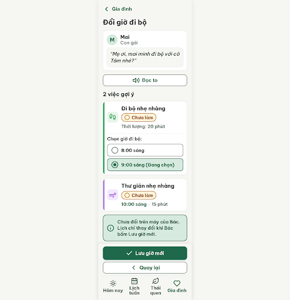
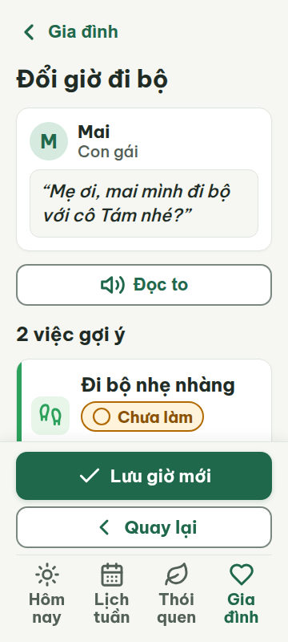
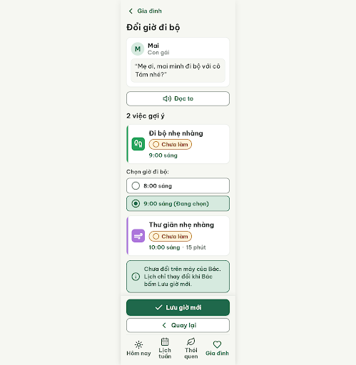
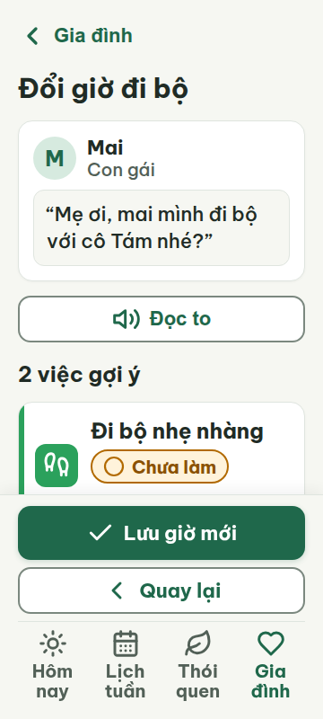
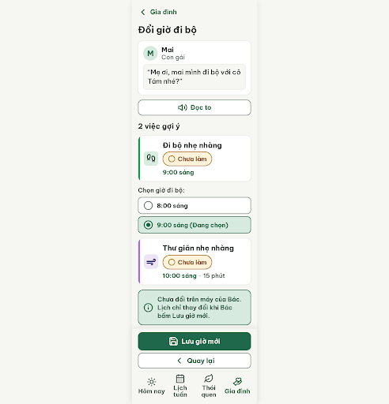
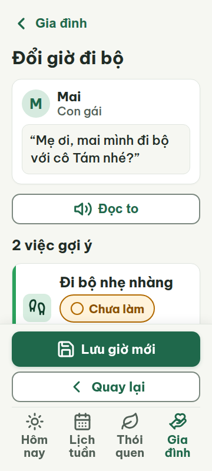

# G04 — Đổi giờ đi bộ

Project: `2013215887278758682` — An Nhiên (project của Sanh)

**Màn chốt hiện tại: v2 — 90 điểm**

Screen ID: `0ac398ac30ac47b6aabf7ec8adc939a0`

**Kết quả: NEEDS_HUMAN** · stop_reason: patience_2

| Vòng | Điểm | Error | Warn | Đã sửa | Regression |
|---|---:|---:|---:|---|---|
| v0 | Không sinh màn | — | — | — | — |
| v1 | 71 | 2 | 3 | — | — |
| v2 | 90 | 1 | 0 | — | — |
| v3 | 81 | 1 | 3 | — | — |
| v4 | 74 | 2 | 2 | — | — |

## v0 — không sinh màn

Stitch trả về nội dung kế hoạch thay vì screen; không chấm vòng này. Phản hồi đã lưu tại `v0-attempt-response.json`.


## v1 — 71 điểm

Screen: `projects/2013215887278758682/screens/ccbd3f51107542f588a4019ffbbfd436`





- R-CON-02 (warn): Ô icon trong thẻ 'Đi bộ nhẹ nhàng' và 'Thư giãn nhẹ nhàng'. Bằng chứng: Màu nền ô icon #E8F5E9 và #F3E8FF sát với nền thẻ #FFFFFF; tương phản lần lượt khoảng 1.2:1 và 1.1:1, dưới 3:1.. Sửa: Đổi nền hai ô icon sang màu nhấn của thói quen #2BA15C và #AC76DB, giữ icon trắng.
- R-TXT-05 (error): Thẻ 'Đi bộ nhẹ nhàng'. Bằng chứng: Thẻ chứa dòng phụ 'Thời lượng: 20 phút' và thêm cả khối 'Chọn giờ đi bộ' với hai lựa chọn giờ, vượt giới hạn tối đa một dòng phụ và cấu trúc thẻ quy định.. Sửa: Giữ trong thẻ icon, giờ, tên việc và trạng thái; chuyển khối chọn giờ ra ngoài thẻ và bỏ dòng 'Thời lượng: 20 phút' khỏi thẻ.
- R-COL-02 (error): Ô icon và vạch màu bên trái của hai thẻ hoạt động. Bằng chứng: Vạch trái dùng màu nhấn chính xác, nhưng ô icon có nền pastel (#E8F5E9, #F3E8FF) và icon nét màu thay vì nền màu nhấn với icon trắng như luật yêu cầu.. Sửa: Đặt nền ô icon lần lượt #2BA15C và #AC76DB, đổi nét icon thành #FFFFFF; giữ vạch trái cùng màu nhấn.
- R-STY-01 (warn): Ô icon của hai thói quen. Bằng chứng: Nền màu #E8F5E9 và #F3E8FF không thuộc màu nhấn được định nghĩa; các màu nhấn cho hai thói quen là #2BA15C và #AC76DB.. Sửa: Thay nền ô icon bằng đúng màu nhấn #2BA15C và #AC76DB, dùng icon trắng.
- R-STY-02 (warn): Lời nhắn trong bong bóng trích dẫn. Bằng chứng: Câu “Mẹ ơi, mai mình đi bộ với cô Tám nhé?” được in nghiêng; hướng dẫn thiết kế yêu cầu không dùng chữ nghiêng.. Sửa: Bỏ font-style: italic; hiển thị câu trích dẫn bằng Be Vietnam Pro 22px chữ đứng.

Màn G04 dễ đọc và có điều hướng rõ, nhưng cần rút gọn thẻ đi bộ và sửa màu ô icon; lời nhắn cũng đang dùng chữ nghiêng.

### Edit prompt

```text
Keep the overall layout and everything not mentioned below unchanged.
1. R-TXT-05: Simplify the “Đi bộ nhẹ nhàng” activity card to only its habit icon, time, task name, and status chip; remove the “Thời lượng: 20 phút” subline. Keep the two radio choices “8:00 sáng” and “9:00 sáng” immediately below the card as a separate selection group, not nested inside the activity card.
2. R-COL-02, R-CON-02, R-STY-01: Change the walking habit icon tile background to exact accent #2BA15C with a white icon (#FFFFFF). Change the relaxation habit icon tile background to exact accent #AC76DB with a white icon (#FFFFFF). Keep each card’s left accent stripe in its matching habit accent color.
3. R-STY-02: Remove italic styling from Mai’s message; render it upright in Be Vietnam Pro, 22px.
Keep the selected radio state on “9:00 sáng”, “8:00 sáng” unselected, the other activity at “10:00 sáng”, consent that the calendar stays unchanged until Bác accepts, the “Đọc to” control, “Lưu giờ mới” primary action, “Quay lại” secondary action, all task status chips, and the four-tab navigation. Keep all text at least 20px, touch targets at least 48px, and preserve the G03 visual style. Generate a new screen and preserve the source screen unchanged.

```

## v2 — 90 điểm

Screen: `projects/2013215887278758682/screens/0ac398ac30ac47b6aabf7ec8adc939a0`




- R-TXT-05 (error): Thẻ việc thứ hai ‘Thư giãn nhẹ nhàng’. Bằng chứng: Ngoài icon thói quen, giờ, tên việc và nhãn trạng thái, thẻ còn có thông tin thời lượng ‘15 phút’.. Sửa: Bỏ ‘· 15 phút’ khỏi thẻ; chỉ để giờ ‘10:00 sáng’ ở dòng chi tiết.

Màn rõ ràng, đủ điều khiển và giữ đúng màu sắc; thẻ việc thư giãn còn thêm thời lượng ngoài cấu trúc được phép.

### Edit prompt

```text
Keep the overall layout and everything not mentioned below unchanged.
1. R-TXT-05: In the second task card “Thư giãn nhẹ nhàng”, remove the extra duration text “· 15 phút”. Keep its habit icon, time “10:00 sáng”, task name, and status chip only.
Preserve all other content, colors, icons, selected “9:00 sáng” radio choice, consent statement, “Đọc to”, actions, and four-tab navigation. Generate a new screen and keep the source screen unchanged.

```

## v3 — 81 điểm

Screen: `projects/2013215887278758682/screens/a753d056d66b40ea85d52a4f0a4a9dde`




- R-ICON-03 (warn): Tab Gia đình và nút “Lưu giờ mới”. Bằng chứng: Tab Gia đình dùng hình trái tim thay Lucide `hand-heart`; nút Lưu dùng dấu tick thay `save` theo từ điển icon.. Sửa: Đổi icon Gia đình thành Lucide `hand-heart` 32×32 px và icon nút Lưu thành Lucide `save` 32×32 px.
- R-COL-03 (warn): Ô icon và vạch trái của hai thẻ việc. Bằng chứng: Màu đang dùng #2BA15C và #AC76DB, không khớp cặp màu của thói quen trong DESIGN.md (Vận động: #D7EDE0/#0F3D2A; Thư giãn: #EDE4F6/#4B2A73).. Sửa: Dùng đúng màu token của từng thói quen trong DESIGN.md; đồng bộ nền ô icon, màu icon tương phản và vạch trái theo cùng màu thói quen.
- R-TAP-01 (error): Hai chip trạng thái “Chưa làm”. Bằng chứng: HTML đặt min-height 38px; nhỏ hơn vùng chạm tối thiểu 48×48px.. Sửa: Tăng min-height mỗi chip lên 48px và bảo đảm vùng bấm rộng tối thiểu 48px.
- R-STY-01 (warn): Ô icon và vạch trái của các thẻ việc. Bằng chứng: #2BA15C và #AC76DB khác màu nhấn theo DESIGN.md; các màu nền/chữ chính còn lại dùng đúng token.. Sửa: Thay màu hai thói quen bằng cặp token tương ứng trong DESIGN.md: Vận động #D7EDE0/#0F3D2A; Thư giãn #EDE4F6/#4B2A73.

Màn có 1 lỗi chặn do chip trạng thái thấp hơn vùng chạm tối thiểu; sai màu thói quen và hai icon cần chỉnh theo từ điển.

### Edit prompt

```text
Keep the overall layout and everything not mentioned below unchanged.
1. R-TAP-01: Increase both “Chưa làm” status-chip hit areas to at least 48×48px (minimum height 48px and minimum width 48px); preserve readable label text.
2. R-COL-03 and R-STY-01: Align habit colors to DESIGN.md exactly. For “Đi bộ nhẹ nhàng” use habit-move-bg #D7EDE0 and habit-move-fg #0F3D2A in the habit icon tile, with habit-move-accent #2BA15C for the left stripe. For “Thư giãn nhẹ nhàng” use habit-downshift-bg #EDE4F6 and habit-downshift-fg #4B2A73 in its icon tile, with habit-downshift-accent #AC76DB for the left stripe. Do not replace the accent stripe colors with the background colors.
3. R-ICON-03: Use Lucide hand-heart at 32×32px for the Gia đình tab, and Lucide save at 32×32px for “Lưu giờ mới”. Keep each icon with its visible Vietnamese label.
Preserve all already-correct content and visual structure, including the selected “9:00 sáng” option and the calendar consent copy. Generate a new screen while preserving this source screen unchanged.

```

## v4 — 74 điểm

Screen: `projects/2013215887278758682/screens/01508a36ddeb4aab8733ebb712bd5fcb`





- R-CON-02 (warn): Ô icon trong hai thẻ việc. Bằng chứng: Nền ô icon #D7EDE0 và #EDE4F6 sát nền thẻ #FFFFFF, không đạt tương phản 3:1 theo luật cho ô icon màu nhấn.. Sửa: Dùng nền accent #2BA15C và #AC76DB cho ô icon; dùng icon trắng.
- R-TXT-03 (error): Thông báo dưới hai thẻ việc. Bằng chứng: Câu “Chưa đổi trên máy của Bác. Lịch chỉ thay đổi khi Bác bấm Lưu giờ mới.” có 16 tiếng và bị xuống 3 dòng trong ảnh.. Sửa: Rút thành “Lịch chỉ đổi khi Bác bấm Lưu giờ mới.” (9 tiếng).
- R-COL-02 (error): Ô icon của thẻ Đi bộ nhẹ nhàng và Thư giãn nhẹ nhàng. Bằng chứng: Hai ô icon đang dùng nền pastel #D7EDE0 và #EDE4F6, icon nét tối; luật yêu cầu nền màu accent của thói quen và icon trắng. Vạch bên trái đã đúng màu accent.. Sửa: Đổi nền ô icon lần lượt thành #2BA15C và #AC76DB, đổi nét icon thành #FFFFFF; giữ vạch trái cùng màu.
- R-LANG-02 (warn): Lời nhắn của Mai và thông báo dưới thẻ. Bằng chứng: Lời nhắn gọi người nhận là “Mẹ”, còn thông báo của giao diện gọi là “Bác”.. Sửa: Đổi cách xưng hô trong lời nhắn thành “Bác ơi” để thống nhất với “Bác” trên màn.

Hai lỗi cần sửa: thông báo dài quá giới hạn và ô icon chưa dùng nền accent với icon trắng; cách xưng hô giữa lời nhắn và giao diện chưa thống nhất.
