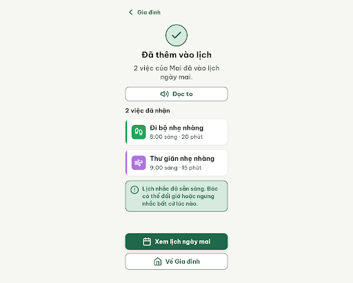
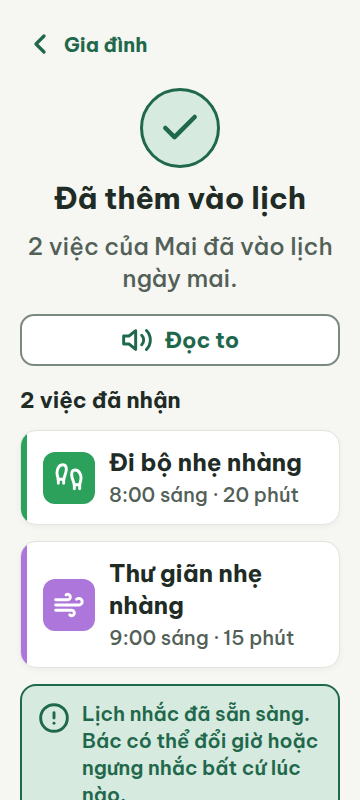
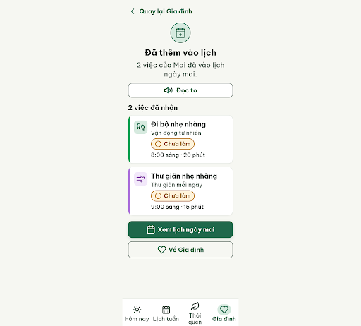
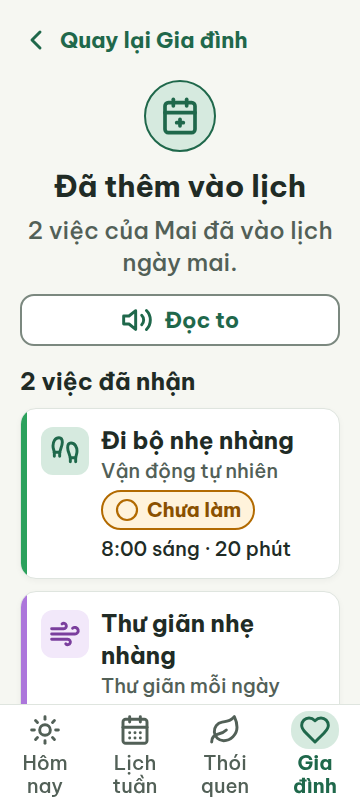
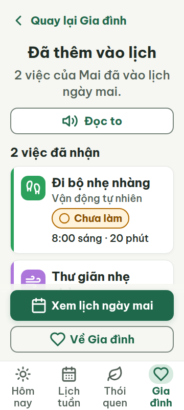
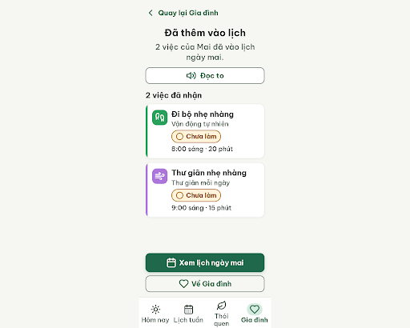
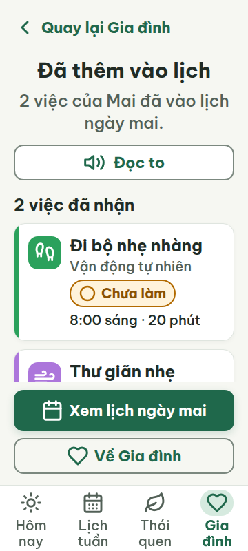
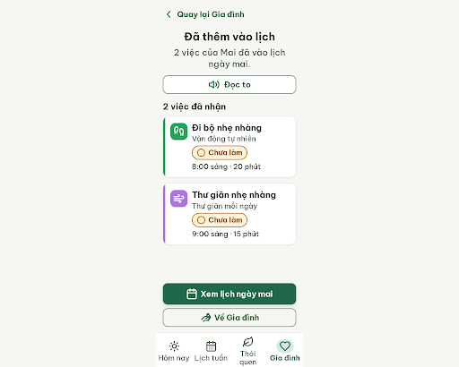
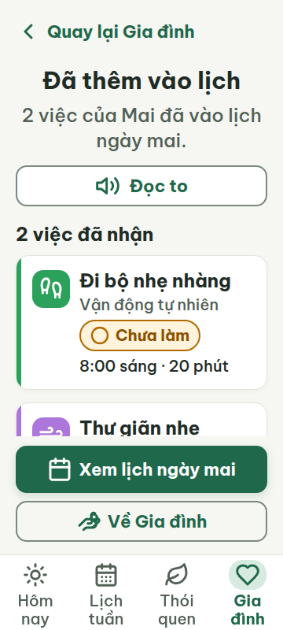

# G05 — Đã nhận gợi ý

Project: `2013215887278758682` — An Nhiên (project của Sanh)

**Màn chốt hiện tại: v3 — 94 điểm**

Screen ID: `f18eacbd1f164974bc5850ca65a77ee9`

**Kết quả: CONVERGED** · stop_reason: patience_2

| Vòng | Điểm | Error | Warn | Đã sửa | Regression |
|---|---:|---:|---:|---|---|
| v0 | 27 | 7 | 1 | — | — |
| v1 | 54 | 4 | 2 | — | — |
| v2 | 94 | 0 | 2 | — | — |
| v3 | 94 | 0 | 2 | — | — |
| v4 | 77 | 2 | 1 | — | — |

## v0 — 27 điểm

Screen: `projects/2013215887278758682/screens/23954dfb48dd44918ba0d6944314f9e8`





- R-TXT-04 (error): Nút ‘Xem lịch ngày mai’. Bằng chứng: Nhãn có 5 tiếng, đúng giới hạn; tuy nhiên tên thói quen ở thẻ ‘Đi bộ nhẹ nhàng’ / ‘Thư giãn nhẹ nhàng’ dùng tên việc thay cho hai tên thói quen đã thống nhất.. Sửa: Đổi tên thói quen trên thẻ thành ‘Vận động tự nhiên’ và ‘Thư giãn mỗi ngày’ (mỗi tên 3 tiếng); giữ tên việc riêng nếu cần.
- R-TXT-05 (error): Khối thông tin dưới hai thẻ việc. Bằng chứng: Có khối lời khuyên giải thích riêng ‘Lịch nhắc đã sẵn sàng. Bác có thể đổi giờ hoặc ngưng nhắc bất cứ lúc nào.’ ngoài cấu trúc thẻ việc.. Sửa: Xóa khối giải thích 2 câu này khỏi màn; giữ thông tin trong màn chi tiết nếu cần.
- R-ICON-02 (error): Hai thẻ việc và cụm điều hướng đầu trang. Bằng chứng: Hai thẻ chỉ có tên việc và giờ, không có nhãn trạng thái. Cụm quay lại hiển thị ‘Gia đình’ thay vì nhãn ‘Quay lại’.. Sửa: Thêm chip ‘○ Chưa làm’ cạnh tên mỗi việc; đổi chữ nút đầu trang thành ‘Quay lại’ hoặc ‘Quay lại Gia đình’.
- R-ICON-03 (warn): Huy hiệu dấu kiểm ở đầu màn. Bằng chứng: Huy hiệu success dùng circle-check để biểu thị đã nhận/thêm lịch; từ điển chỉ định circle-check riêng cho trạng thái/nút ‘Đã xong’. Các icon khác hiển thị 32 px.. Sửa: Đổi icon huy hiệu sang icon thông tin/hoàn tất không trùng nghĩa đã xong, hoặc bỏ icon huy hiệu; giữ icon thẻ theo từ điển.
- R-COL-01 (error): Hai thẻ việc. Bằng chứng: Không có nhãn trạng thái dạng icon + chữ cạnh tên việc; hiện màu ô icon/vạch bên trái là dấu hiệu phân biệt duy nhất của mỗi thẻ.. Sửa: Thêm chip có biểu tượng và chữ ‘○ Chưa làm’ cho mỗi việc, cỡ chữ tối thiểu 20 px.
- R-NAV-01 (error): Cuối màn. Bằng chứng: Không có bottom nav 4 tab Hôm nay, Lịch tuần, Thói quen, Gia đình.. Sửa: Thêm bottom nav cố định gồm đúng 4 tab và icon + nhãn 20 px: Hôm nay, Lịch tuần, Thói quen, Gia đình.
- R-NAV-02 (error): Nút điều hướng đầu màn. Bằng chứng: Nút có mũi tên nhưng chữ hiển thị là ‘Gia đình’; chữ không nói đây là thao tác quay lại.. Sửa: Đổi nhãn hiển thị thành ‘Quay lại’ (hoặc ‘Quay lại Gia đình’).
- R-STA-01 (error): Hai thẻ việc dưới ‘2 việc đã nhận’. Bằng chứng: Cả hai thẻ đều thiếu một trong năm nhãn trạng thái bắt buộc; chỉ icon thói quen và giờ được hiển thị.. Sửa: Thêm cạnh tên mỗi việc chip ‘○ Chưa làm’ với icon circle 24 px trở lên và chữ trắng/viền vàng đậm theo trạng thái.

Màn xác nhận dễ đọc, gọn màu và không tràn ngang; cần bổ sung trạng thái cho từng việc và sửa điều hướng quay lại, đồng thời bỏ khối giải thích riêng.

### Edit prompt

```text
Keep the overall layout and all content not mentioned below unchanged. Fix the reviewed issues:
1. Use the exact habit names “Vận động tự nhiên” for the walking card and “Thư giãn mỗi ngày” for the rest card. Keep task names “Đi bộ nhẹ nhàng” / “Thư giãn nhẹ nhàng” as separate labels if space allows.
2. Remove the standalone explanatory advice paragraph under the two cards.
3. Add a labeled warning status chip “○ Chưa làm” to each card, with warning colors and 24px+ circle icon, so each item has a visible state.
4. Replace the success badge’s circle-check icon with a non-conflicting documented icon, or remove that icon; circle-check is reserved for completed tasks.
5. Add the required fixed four-tab bottom navigation: Hôm nay, Lịch tuần, Thói quen, Gia đình, each with documented Lucide 32px icon and visible 20px label. Keep it above the device bottom safe area.
6. Change the top back control label to “Quay lại” or “Quay lại Gia đình” with a left arrow and full 48px target.
Preserve the one primary “Xem lịch ngày mai” action and existing confirmation text. Keep all text >=20px, controls >=48px, gaps >=8px, and prevent overlap between content, CTA and bottom navigation at 360×800 and 412px. Generate the new edited screen now.

```

## v1 — 54 điểm

Screen: `projects/2013215887278758682/screens/3be239d587214db3abbc334691cd7efa`





- R-TXT-01 (error): Hai chip trạng thái và bốn tab điều hướng. Bằng chứng: Mỗi chip `.status-chip` và thẻ liên kết `.nav-tab` được tính font mặc định 16px ở cả 360 và 412 dp; dù nhãn con lớn hơn, phần tử chứa vẫn hiển thị chữ với cỡ 16px.. Sửa: Đặt font-size:20px cho `.status-chip` và `.nav-tab`, đồng thời giữ `.status-chip-text`/`.nav-tab-label` tối thiểu 20px.
- R-ICON-03 (warn): Các thẻ “Đi bộ nhẹ nhàng” và “Thư giãn nhẹ nhàng”. Bằng chứng: Tile icon có nền pastel (`#D6EADF`, `#F2E8FA`) thay vì màu nhấn thói quen; footprint còn xanh thay vì trắng. Các glyph 32px và chip 24px đạt kích thước; icon hero calendar-plus không phải icon trong từ điển cho nghĩa “Đã thêm vào lịch”.. Sửa: Dùng `footprints` trắng 32px trên `#2BA15C`, `wind` trắng 32px trên `#AC76DB`; đổi icon hero thành icon có trong từ điển, ví dụ `calendar-days` 40px cho lịch.
- R-COL-02 (error): Hai thẻ việc. Bằng chứng: Vạch trái dùng đúng `#2BA15C`/`#AC76DB`, nhưng ô icon không dùng màu accent và icon không trắng.. Sửa: Đặt nền `.tile-walking` `#2BA15C`, `.tile-resting` `#AC76DB`; đặt cả hai icon thành trắng.
- R-TAP-02 (error): Nút “Xem lịch ngày mai” ở cuối màn. Bằng chứng: Nút cao 60px, rộng 320px với lề 20px, nhưng nằm sau nội dung ở khoảng y=814px trên màn 360×800; không nằm ở đáy màn nhìn thấy khi mở.. Sửa: Đặt nút chính fixed/bottom ở đáy vùng nhìn 360×800, cao 60px, cách mép ngang 20px.
- R-STA-01 (error): Hai thẻ việc, chip trạng thái cạnh phần tên. Bằng chứng: Cả hai thẻ ghi “Chưa làm”; bộ trạng thái quy định là “○ Chưa làm” và viền vàng đậm. Hiện icon tròn có nhưng nhãn thiếu ký hiệu quy định.. Sửa: Đổi nhãn cả hai thành “○ Chưa làm”, giữ viền `#B26A00` tối thiểu 2px.
- R-STY-03 (warn): Bố cục màn kết quả. Bằng chứng: Lề ngang 20px đúng, nhưng các khối dọc không giữ nhịp 16px: ví dụ tiêu đề section có margin-bottom 12px, thẻ đầu→thẻ sau 12px.. Sửa: Đặt margin giữa các khối chính và hai thẻ là 16px; đổi `.section-title` margin-bottom từ 12px lên 16px và `.card-walking` margin-bottom từ 12px lên 16px.

Màn kết quả dễ đọc, có điều hướng và đọc to, nhưng cần sửa nhãn trạng thái, các ô icon accent và đưa nút chính vào đáy màn.

### Edit prompt

```text
Keep the current G05 screen and everything not mentioned unchanged. Apply these fixes and generate a new screen now:
1. Set font-size:20px or larger on the actual `.status-chip` and `.nav-tab` elements as well as their text labels.
2. On the walking activity, use a #2BA15C icon tile with white Lucide footprints 32px; on the rest activity use #AC76DB tile with white Lucide wind 32px. Keep matching 6px accent bars.
3. Change both status labels exactly to “○ Chưa làm” and keep the documented warning border #B26A00 at least 2px.
4. Pin “Xem lịch ngày mai” to the bottom of the 360×800/412px viewport with 60px height and 20px side inset; reserve footer space so it does not cover content. It must be visible without scrolling on initial load.
5. Remove the hero icon if it is not an exact DESIGN.md dictionary icon for this success meaning.
6. Set the main section/card vertical gaps to 16px.
Preserve the 4-tab nav, title, confirmation, two tasks, one filled CTA, all icons from the documented dictionary, 48px targets and 8px gaps. Ensure the content, CTA, and nav do not overlap at either viewport.

```

## v2 — 94 điểm

Screen: `projects/2013215887278758682/screens/63089859a9a148f0834caef34b4290d6`




- R-ICON-03 (warn): Biểu tượng vòng tròn trong hai chip “Chưa làm”. Bằng chứng: HTML đặt SVG ở 22 × 22 px; ngoại lệ chip trạng thái yêu cầu biểu tượng tối thiểu 24 px.. Sửa: Tăng hai biểu tượng trong chip trạng thái từ 22 × 22 lên 24 × 24 px.
- R-STY-02 (warn): Thanh nền cố định phía sau các nút hành động. Bằng chứng: CSS dùng linear-gradient(to top, #F6F7F2 85%, rgba(246, 247, 242, 0.9) 100%), trái với quy tắc không gradient.. Sửa: Thay nền gradient của .actions-stack bằng màu đặc #F6F7F2.

Màn xác nhận gọn, dễ đọc và đủ điều hướng; còn cần tăng icon trạng thái lên 24 px và bỏ gradient dưới cụm nút.

### Edit prompt

```text
Keep the overall layout and everything else unchanged. Fix only the two remaining warnings on best v2: (1) Increase the circle icon inside each “○ Chưa làm” status chip from 22px to 24×24px, retaining visible text. (2) Replace the gradient behind the fixed action area with a solid #F6F7F2 background. Preserve the 4-tab navigation, colors, content, CTA position, text sizes, and touch targets. Generate the edited screen now.

```

## v3 — 94 điểm

Screen: `projects/2013215887278758682/screens/f18eacbd1f164974bc5850ca65a77ee9`





- R-ICON-03 (warn): Nút phụ “Về Gia đình” ở cuối màn. Bằng chứng: codex-runs/G05/v3.html dùng icon Lucide hình trái tim đơn (32 × 32 px); từ điển icon trong assets/stitch/DESIGN.md quy định icon tab Gia đình là hand-heart.. Sửa: Đổi icon của nút “Về Gia đình” thành Lucide hand-heart, cỡ 32 × 32 px.
- R-STY-03 (warn): Khoảng cách dọc giữa hai thẻ việc. Bằng chứng: Trong v3.html, .card-walking đặt margin-bottom: 12px; ảnh v3-viewport-360.png cho thấy khe giữa hai thẻ là 12 px, thấp hơn token 16 px giữa các khối.. Sửa: Đổi khoảng cách giữa hai thẻ việc từ 12 px thành 16 px bằng cách đặt margin-bottom: 16px cho .card-walking.

G05 dễ đọc và thao tác, nhưng icon trái tim ở nút về Gia đình chưa khớp từ điển và hai thẻ việc cách nhau 12 px thay vì 16 px.

### Edit prompt

```text
Keep the best reviewed G05 v3 screen and everything else unchanged. Fix only the two remaining warnings: (1) Replace the heart icon on “Về Gia đình” with the documented Lucide hand-heart 32×32px. (2) Increase the vertical gap between the two activity cards from 12px to 16px. Preserve all text, four-tab navigation, task accents/icons, status chips, fixed primary CTA and solid #F6F7F2 action background. Generate a new screen now.

```

## v4 — 77 điểm

Screen: `projects/2013215887278758682/screens/16092725f0aa44e092e8372faf7d8b9f`





- R-TXT-05 (error): Hai thẻ việc trong danh sách đã nhận. Bằng chứng: Mỗi thẻ có tên việc, tên thói quen, trạng thái và thời gian; nội dung vượt cấu trúc thẻ việc (icon · giờ · tên việc · trạng thái; tối đa một dòng phụ), đồng thời trạng thái hiện là Chưa làm dù đã nhận vào lịch.. Sửa: Mỗi thẻ chỉ giữ icon 48×48, giờ 20 px, tên việc 24 px, chip trạng thái 20 px; bỏ dòng tên thói quen hoặc hiển thị tối đa một dòng phụ; dùng trạng thái Đã xong/Chưa làm theo việc thực tế.
- R-COL-03 (warn): Ô icon của hai thẻ việc. Bằng chứng: Trong HTML, ô icon đi bộ dùng #2BA15C và thư giãn dùng #AC76DB; đây không phải màu nền accent được quy định cho các habit-icon tương ứng trong DESIGN.md.. Sửa: Đổi nền ô icon vận động sang habit-move-accent và nền ô icon thư giãn sang habit-downshift-accent theo đúng hex token trong assets/stitch/DESIGN.md; giữ icon trắng.
- R-STA-01 (error): Chip trạng thái trên cả hai việc đã nhận. Bằng chứng: Hai thẻ đều ghi “Chưa làm” dù tiêu đề nói “Đã thêm vào lịch” và “2 việc đã nhận”; đây không phải trạng thái phù hợp của thao tác vừa nhận gợi ý và gây mâu thuẫn trong cùng màn.. Sửa: Đổi nhãn trạng thái nhận thành “Đã nhận” kèm icon circle-check 24 px; chỉ chuyển sang “Chưa làm” khi hiển thị lịch ngày mai trước giờ thực hiện.

Màn xác nhận có chữ lớn, tiếng Việt rõ và điều hướng đầy đủ, nhưng trạng thái hai việc mâu thuẫn với việc vừa nhận và màu ô icon không theo màu thói quen. Nút cố định bị tràn ra ngoài tại 412 px, dù luật tràn ngang chỉ kiểm tra 360 px.
