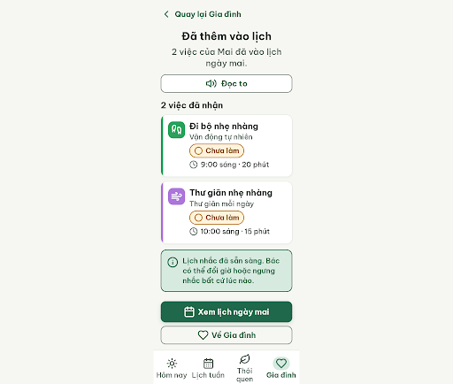
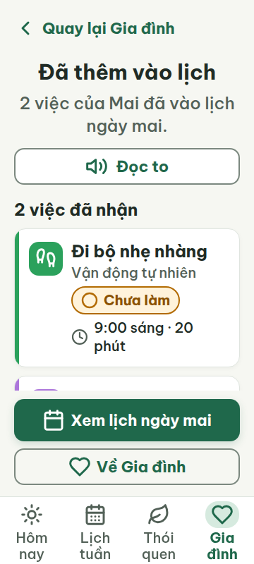
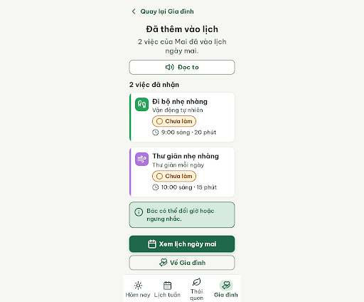
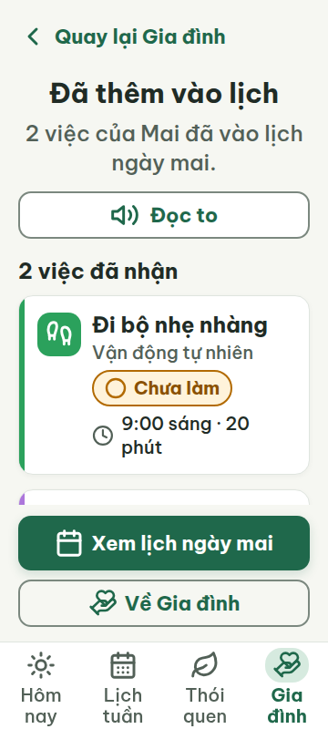

# G05b — Đã nhận · đổi giờ

Project: `2013215887278758682` — An Nhiên (project của Sanh)

**Màn chốt hiện tại: v1 — 100 điểm**

Screen ID: `a833f6e054bb42dba500417fda5f9798`

**Kết quả: CONVERGED** · stop_reason: score_100

| Vòng | Điểm | Error | Warn | Đã sửa | Regression |
|---|---:|---:|---:|---|---|
| v0 | 84 | 1 | 2 | — | — |
| v1 | 100 | 0 | 0 | R-TXT-03, R-ICON-03, R-STY-03 | — |

## v0 — 84 điểm

Screen: `projects/2013215887278758682/screens/3fcf6dfaf09f47c7a23847669bbb33cb`





- R-TXT-03 (error): Thông báo lịch nhắc. Bằng chứng: Câu “Lịch nhắc đã sẵn sàng. Bác có thể đổi giờ hoặc ngưng nhắc bất cứ lúc nào.” dài hơn giới hạn 15 tiếng.. Sửa: Rút thành “Bác có thể đổi giờ hoặc ngưng nhắc.” (8 tiếng).
- R-ICON-03 (warn): Tab “Gia đình” ở thanh điều hướng dưới. Bằng chứng: Icon hình trái tim trong HTML không khớp nghĩa/icon Lucide `hand-heart` đã quy định cho tab Gia đình trong từ điển.. Sửa: Thay icon tab Gia đình bằng Lucide `hand-heart` kích thước 32 × 32 px.
- R-STY-03 (warn): Khoảng cách dọc giữa hai thẻ việc. Bằng chứng: Thẻ thứ nhất kết thúc với `margin-bottom: 12px`, khoảng dưới token md 16 px.. Sửa: Tăng `margin-bottom` giữa các thẻ từ 12 px lên 16 px.

Màn rõ ràng, tương phản tốt và có đủ điều hướng; cần rút ngắn thông báo, sửa icon tab Gia đình và chuẩn hóa khoảng cách giữa thẻ.

### Edit prompt

```text
Keep the overall layout and everything not mentioned below unchanged.
1. R-TXT-03: Replace the reminder sentence “Lịch nhắc đã sẵn sàng. Bác có thể đổi giờ hoặc ngưng nhắc bất cứ lúc nào.” with the exact shorter copy “Bác có thể đổi giờ hoặc ngưng nhắc.” (8 tiếng).
2. R-ICON-03: Replace the heart icon on the Gia đình tab with the exact Lucide `hand-heart` icon at 32×32px; keep the visible “Gia đình” label.
3. R-STY-03: Increase the vertical gap between the two accepted activity cards from 12px to 16px.
Preserve the accepted confirmation, walking at “9:00 sáng”, relaxation at “10:00 sáng”, other text, “Đọc to”, primary “Xem lịch ngày mai”, return action, colors, and four-tab navigation. Generate a new screen and preserve G05b v0 unchanged.

```

## v1 — 100 điểm

Screen: `projects/2013215887278758682/screens/a833f6e054bb42dba500417fda5f9798`






Các lỗi câu dài, icon Gia đình và khoảng cách thẻ của vòng trước đã được sửa; không còn vi phạm.
