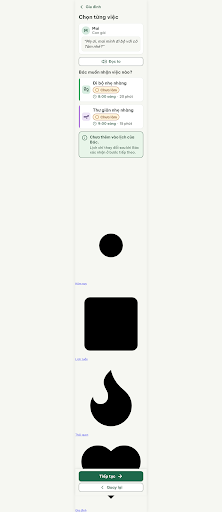
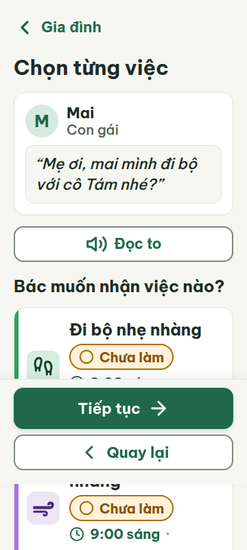
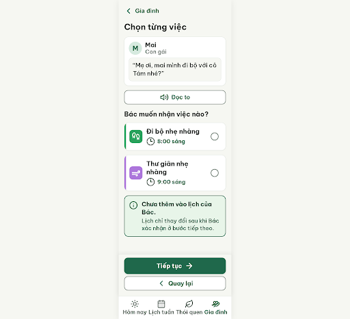
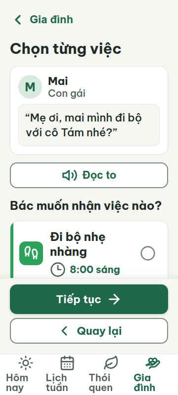
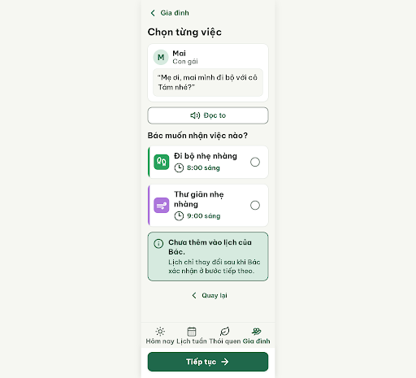
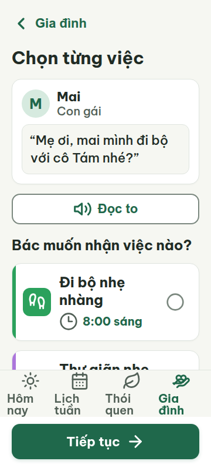
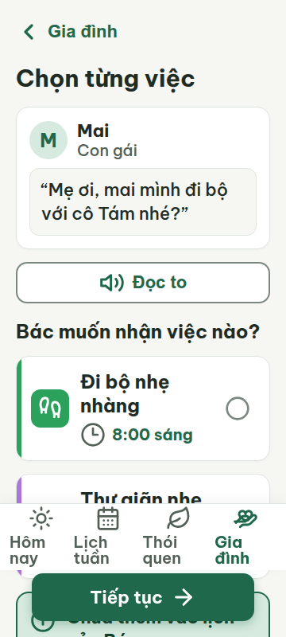
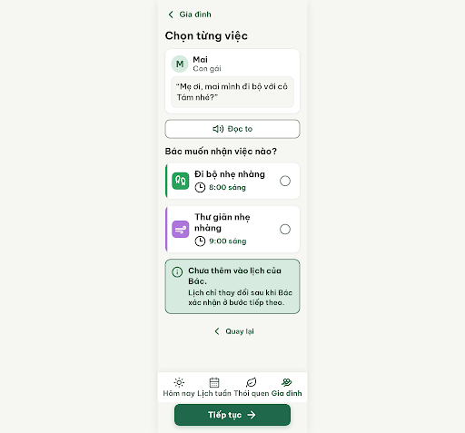

# G06 — Chọn từng việc

Project: `2013215887278758682` — An Nhiên (project của Sanh)

**Màn chốt hiện tại: v5 — 97 điểm**

Screen ID: `707c32d5e49447dabfc7ae7485e541e7`

**Kết quả: CONVERGED** · stop_reason: patience_2

| Vòng | Điểm | Error | Warn | Đã sửa | Regression |
|---|---:|---:|---:|---|---|
| v0 | 68 | 2 | 4 | — | — |
| v1 | 87 | 1 | 1 | R-TXT-05, R-ICON-03, R-COL-02, R-COL-03, R-STY-02 | R-TAP-02 |
| v2 | 84 | 1 | 2 | R-TAP-02, R-STY-01 | R-CON-02, R-TXT-03, R-ICON-03 |
| v3 | 97 | 0 | 1 | R-TAP-02, R-STY-01 | R-ICON-03 |
| v4 | 94 | 0 | 2 | — | — |
| v5 | 97 | 0 | 1 | — | — |

## v0 — 68 điểm

Screen: `projects/2013215887278758682/screens/958b3a21f2294b5cbd2827ad4496736e`





- R-TXT-05 (error): Hai thẻ việc: Đi bộ nhẹ nhàng và Thư giãn nhẹ nhàng. Bằng chứng: Mỗi thẻ hiển thị tên, chip trạng thái, giờ và thêm thời lượng (20 phút / 15 phút), tạo hai dòng phụ ngoài tên việc.. Sửa: Giữ mỗi thẻ đúng một dòng phụ; gộp giờ và thời lượng trên cùng một dòng, chuyển chip trạng thái vào cạnh tên việc.
- R-ICON-03 (warn): Biểu tượng trạng thái trong chip và biểu tượng đồng hồ ở cả hai thẻ. Bằng chứng: Icon trong chip Chưa làm được đặt 22×22 px, thấp hơn ngoại lệ 24 px; icon đồng hồ cũng chỉ 22×22 px. Tab Gia đình dùng hình trái tim thay cho hand-heart; tab Thói quen dùng lửa thay cho leaf theo từ điển.. Sửa: Tăng icon chip lên 24×24 px và icon đồng hồ lên 32×32 px; thay icon tab Gia đình bằng hand-heart 32×32 px, tab Thói quen bằng leaf 32×32 px.
- R-COL-02 (error): Ô icon và vạch trái của hai thẻ việc. Bằng chứng: Ô icon dùng nền nhạt với nét icon đậm, trong khi luật yêu cầu nền màu nhấn và icon trắng; vạch trái dùng #2BA15C và #AC76DB thay cho màu tương ứng trong thiết kế.. Sửa: Dùng ô icon màu nhấn đặc với icon trắng 32 px, đồng thời đặt vạch trái 6 px cùng màu đó trên mỗi thẻ.
- R-COL-03 (warn): Thẻ Đi bộ nhẹ nhàng và Thư giãn nhẹ nhàng. Bằng chứng: Màu nhấn trong CSS là #2BA15C và #AC76DB; hai màu này không khớp token màu của hai thói quen trong DESIGN.md.. Sửa: Đổi màu nhấn thành cặp màu của token move và downshift trong DESIGN.md, áp dụng cùng màu cho ô icon và vạch trái.
- R-STY-01 (warn): Ô icon thói quen và trạng thái thông tin. Bằng chứng: Các nền accent #2BA15C, #AC76DB và nền thông tin #E8F5E9 không khớp token màu được chỉ định trong DESIGN.md.. Sửa: Dùng đúng token nền #F6F7F2, thẻ #FFFFFF và các màu accent thói quen đã khai báo trong DESIGN.md.
- R-STY-02 (warn): Nội dung gợi ý của Mai. Bằng chứng: Câu trích dẫn trong quote-text được đặt italic, trái với hướng dẫn không dùng chữ nghiêng.. Sửa: Đặt font-style: normal cho câu trích dẫn.

Màn có chữ dễ đọc và điều hướng rõ, nhưng thẻ việc vượt giới hạn dòng phụ và màu/icon thói quen chưa theo từ điển thiết kế.

### Edit prompt

```text
Keep the overall layout and everything not mentioned below unchanged.
1. R-TXT-05: Simplify each activity card to the habit icon, time, task name, and selection control only. Remove the extra duration text “· 20 phút” and “· 15 phút”; do not add any extra subline. Keep both tasks individually selectable and initially unchecked.
2. R-COL-02, R-COL-03, R-STY-01: Use the exact tokens from DESIGN.md for these two habits. Walking: icon tile background #2BA15C with white #FFFFFF Lucide icon; left stripe #2BA15C. Relaxation: icon tile background #AC76DB with white #FFFFFF Lucide icon; left stripe #AC76DB. Do not use pastel colors for the icon tile or substitute habit background/foreground colors for the specified accent colors.
3. R-ICON-03: Use Lucide `circle` at 32×32px for each unchecked selection control; use Lucide `clock-3` at 32×32px for time where shown; use Lucide `hand-heart` at 32×32px for Gia đình and `leaf` at 32×32px for Thói quen. Keep “Chưa làm” chip icon at least 24×24px if retained.
4. R-STY-02: Set Mai’s quoted message to upright Be Vietnam Pro (font-style: normal).
Preserve the title “Chọn từng việc”, the question “Bác muốn nhận việc nào?”, both suggested task names and their times, Mai’s message, the exact four navigation labels, the single primary action, and visible “Quay lại”. Keep all text at least 20px and all touch targets at least 48×48px. The calendar must remain unchanged until Bác confirms acceptance. Generate a new screen and preserve source G06 v0 unchanged.

```

## v1 — 87 điểm

Screen: `projects/2013215887278758682/screens/5c679c9b110044d38f134e40a4fa40a3`





- R-TAP-02 (error): Footer actions. Bằng chứng: The primary “Tiếp tục” and secondary “Quay lại” buttons are pinned above the bottom navigation (footer bottom: 84px), leaving the primary action away from the screen bottom.. Sửa: Place the primary 60px “Tiếp tục” button at the screen bottom with 20px side margins; keep bottom navigation below or move it above the action area.
- R-STY-01 (warn): Consent notice background. Bằng chứng: Inline background #E8F5E9 does not match the specified app surfaces; required backgrounds are #F6F7F2 and cards #FFFFFF.. Sửa: Set the notice background to #FFFFFF (or the defined #D6EADF primary container).

Các thẻ việc đã gọn lại, dùng đúng màu/icon và đọc to; còn nút chính đặt quá cao so với đáy màn, nền thông báo lệch token màu.

### Edit prompt

```text
Keep the overall layout and everything not mentioned below unchanged.
1. R-TAP-02: Reorder the bottom area so the four-tab navigation sits directly above the primary action, and pin the 60px “Tiếp tục” button at the very bottom of the content area with 20px side margins and a 20px safe-area inset. Keep the secondary “Quay lại” as a text action above the navigation. Do not overlap content or reduce any touch target below 48×48px.
2. R-STY-01: Change the consent notice background from #E8F5E9 to the defined primary-container #D6EADF, retaining readable foreground text with sufficient contrast.
Preserve the existing two unchecked choices, all task text and times, sender message, icon meanings, habit accent tokens, and current visual style. Generate a new screen and preserve G06 v1 unchanged.

```

## v2 — 84 điểm

Screen: `projects/2013215887278758682/screens/ff64beefe6684316a12cb375ca40178c`





- R-CON-02 (warn): Viền hai thẻ chọn việc. Bằng chứng: Viền #DFE5DF trên thẻ trắng #FFFFFF có tương phản xấp xỉ 1.2:1, dưới mức 3:1 cho control.. Sửa: Đổi viền thẻ chọn việc sang #7B887F hoặc đậm hơn để đạt tương phản tối thiểu 3:1 với nền trắng.
- R-TXT-03 (error): Thông báo dưới hai thẻ việc. Bằng chứng: Đoạn “Lịch chỉ thay đổi sau khi Bác xác nhận ở bước tiếp theo.” xuống 3 dòng trong ảnh, vượt giới hạn 2 dòng.. Sửa: Rút gọn thành “Lịch đổi khi Bác xác nhận.” để hiển thị tối đa 2 dòng.
- R-ICON-03 (warn): Biểu tượng giờ ở cả hai thẻ chọn việc. Bằng chứng: Hai thẻ dùng Lucide clock-3; Từ điển icon quy định icon giờ của việc là clock.. Sửa: Đổi cả hai biểu tượng lucide-clock-3 thành Lucide clock, cỡ 32 × 32 px.

Nút Tiếp tục đã xuống đáy và nền thông báo dùng đúng màu token; đoạn thông báo còn quá dài, viền thẻ thiếu tương phản và icon giờ sai từ điển.

### Edit prompt

```text
Keep the overall layout and everything not mentioned below unchanged.
1. R-TAP-02: Reorder the bottom area so the four-tab navigation sits directly above the primary action, and pin the 60px “Tiếp tục” button at the very bottom of the content area with 20px side margins and a 20px safe-area inset. Keep “Quay lại” as a visible text action above the navigation; prevent overlap and preserve 48×48px minimum touch targets.
2. R-STY-01: Set the consent notice background to the defined primary-container token #D6EADF; keep foreground text readable.
Preserve the two unchecked individual choices, activity text and times, sender message, corrected habit colors and Lucide icons. Generate a new screen and keep G06 v1 unchanged.

```

## v3 — 97 điểm

Screen: `projects/2013215887278758682/screens/2bfc718ed8e94d2086b49dd39d0cc6e9`




- R-ICON-03 (warn): Biểu tượng giờ trên hai thẻ việc. Bằng chứng: HTML dùng Lucide `clock-3`; từ điển icon quy định nghĩa Giờ của việc dùng `clock`.. Sửa: Đổi cả hai icon `clock-3` thành Lucide `clock`, giữ kích thước 32 px.

Nút Tiếp tục đã nằm sát đáy màn và màu thông báo khớp token; còn icon giờ trên thẻ việc chưa đúng từ điển Lucide.

### Edit prompt

```text
Keep the overall layout and everything not mentioned below unchanged.
1. R-ICON-03: Replace both time icons `clock-3` with the exact Lucide `clock` icon at 32×32px.
Preserve the two unchecked activity choices, correct habit accent tokens, consent notice, bottom navigation above the bottom-pinned primary action, and all other text and styling. Generate a new screen and preserve G06 v3 unchanged.

```

## v4 — 94 điểm

Screen: `projects/2013215887278758682/screens/88422771afb04db59573ae065d089496`


- R-ICON-03 (warn): Biểu tượng giờ trên hai thẻ việc. Bằng chứng: HTML dùng Lucide `clock` nhưng nét vẽ chỉ chiếm phần giữa khung 32 px và lại dùng màu #526057; v3 đã ghi sai rằng icon là clock-3, còn v4 thực tế là clock.. Sửa: Dùng icon clock tối thiểu 32 × 32 px với nét chiếm khung rõ, đúng nghĩa Giờ của việc; giữ tên Lucide `clock`.
- R-COL-03 (warn): Ô icon và vạch trái của hai thẻ việc. Bằng chứng: Vận động dùng #2BA15C và Thư giãn dùng #AC76DB; các màu cặp trong DESIGN.md lần lượt là #D7EDE0/#0F3D2A và #EDE4F6/#4B2A73.. Sửa: Đổi ô icon/vạch Vận động sang màu thói quen #0F3D2A; Thư giãn sang #4B2A73; dùng đúng token màu thói quen cho cả ô icon và vạch trái.

Màn có bố cục rõ và mọi luật chặn đều đạt; còn icon giờ chưa rõ nét và hai màu thói quen chưa khớp bảng màu.

### Edit prompt

```text
Keep the overall layout and everything not mentioned below unchanged.
1. R-ICON-03: Make the existing Lucide `clock` time icon clearly legible at 32×32px by using a 2px stroke and the defined on-surface color #202B25; keep the exact `clock` icon shape and meaning.
Preserve the two habit accent colors, unchecked choices, bottom navigation above the pinned “Tiếp tục” action, and consent notice. Generate a new screen and preserve G06 v3 unchanged.

```

## v5 — 97 điểm

Screen: `projects/2013215887278758682/screens/707c32d5e49447dabfc7ae7485e541e7`




- R-ICON-03 (warn): Biểu tượng giờ trên hai thẻ việc. Bằng chứng: HTML dùng Lucide `clock-3`; từ điển icon quy định nghĩa Giờ của việc dùng `clock`.. Sửa: Đổi cả hai icon `clock-3` thành Lucide `clock`, giữ kích thước 32 px.

Màn chọn việc rõ ràng, dễ đọc và giữ đúng bố cục; icon giờ vẫn chưa khớp từ điển Lucide.
