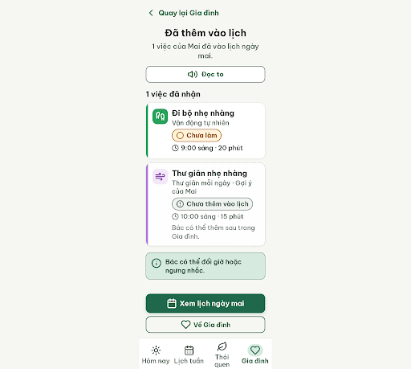
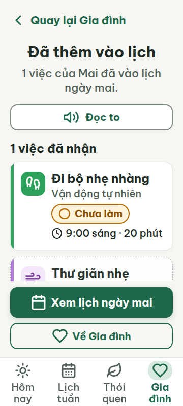
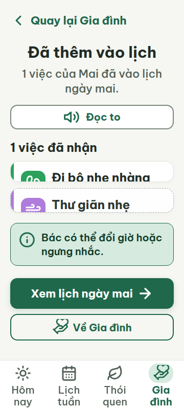
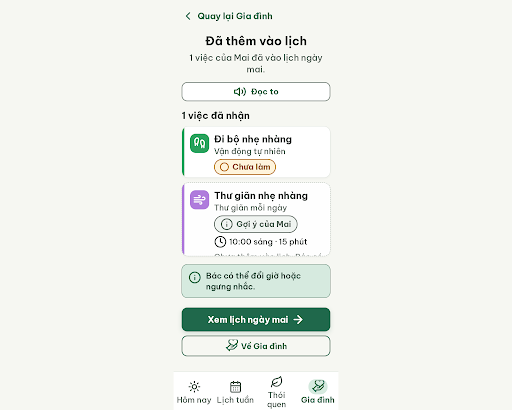

# G07 — Đã nhận một việc

Project: `2013215887278758682` — An Nhiên (project của Sanh)

**Màn chốt hiện tại: v1 — 97 điểm**

Screen ID: `ef2e4cef6df04d8fbadaee5239b862cf`

**Kết quả: CONVERGED** · stop_reason: patience_2

| Vòng | Điểm | Error | Warn | Đã sửa | Regression |
|---|---:|---:|---:|---|---|
| v0 | 77 | 2 | 1 | — | — |
| v1 | 97 | 0 | 1 | R-LAY-01, R-STA-01 | — |
| v2 | 74 | 2 | 2 | R-ICON-03 | R-COL-03 |
| v3 | 77 | 2 | 1 | R-COL-03 | — |

## v0 — 77 điểm

Screen: `projects/2013215887278758682/screens/d474c26a8b644f91a6f998825253a724`





- R-LAY-01 (error): Khung màn rộng 360 px; nội dung dưới vùng nút cố định. Bằng chứng: .app-viewport có padding-bottom 240px (inline 270px); .actions-stack fixed cách đáy 96px, bottom-nav cao 96px, khiến nội dung bị che và không có khả năng cuộn dọc được khai báo.. Sửa: Cho .app-viewport cuộn dọc (overflow-y:auto), bỏ padding-bottom 240/270px và bố trí footer/nút cố định với vùng nội dung có thể cuộn hết đến trên bottom-nav.
- R-ICON-03 (warn): Ô icon việc đi bộ và thư giãn; các icon tab và nút hành động. Bằng chứng: Hai ô thói quen dùng footprints và wind đúng nghĩa/kích thước 32px, nhưng icon ở ô đi bộ nằm trên nền xanh nhạt thay vì màu icon đậm theo từ điển. Tab Hôm nay dùng sun-like icon đúng; Gia đình dùng heart thay vì hand-heart; nút chính dùng calendar-days dù đây là hành động xem lịch ngày mai, và nút về gia đình dùng heart thay vì chevron-left/navigation semantics.. Sửa: Đổi nền tile đi bộ thành #0F3D2A với icon trắng; dùng hand-heart cho tab Gia đình, plus hoặc arrow-right cho hành động chính theo nghĩa đã đăng ký, và chevron-left cho nút quay lại; giữ icon ≥32px.
- R-STA-01 (error): Thẻ việc đi bộ và thẻ gợi ý thư giãn. Bằng chứng: Cả hai trạng thái đều hiện chữ “Chưa làm” với icon circle, nhưng trạng thái thứ hai chưa được thêm vào lịch nên không thuộc một trong năm nhãn trạng thái việc được quy định.. Sửa: Đổi nhãn ở thẻ gợi ý thành “Gợi ý của Mai” với icon info (32px), và chỉ hiện một trong năm nhãn trạng thái chuẩn cho việc đã có trong lịch.

Màn kết quả có chữ lớn, nút dễ chạm và điều hướng rõ; cần sửa vùng cuộn và màu/icon các thẻ thói quen, cùng nhãn trạng thái của gợi ý chưa thêm.

### Edit prompt

```text
Keep the overall layout and everything not mentioned below unchanged.
1. R-LAY-01: Make the content area vertically scrollable at 360×800. Remove the oversized 240/270px bottom padding and fixed positioning that covers the second card; reserve a real safe footer/nav area and allow the last content to scroll fully above it. Keep all task information visible without horizontal overflow at both 360px and 412px.
2. R-STA-01: The walking activity is accepted and scheduled, so keep its standard “○ Chưa làm” task chip. The relaxation activity was not accepted and is only a suggestion, so remove its “Chưa làm” chip and show the info label “Gợi ý của Mai” with Lucide `info` 32×32px.
3. R-ICON-03: Use Lucide `hand-heart` 32×32px for the Gia đình bottom-nav tab, Lucide `arrow-right` 32×32px for “Xem lịch ngày mai”, and Lucide `chevron-left` 32×32px beside the visible “Quay lại Gia đình” control. Keep the habit icons as documented and white over their accent tiles.
Preserve confirmation that only walking at 9:00 was added; keep the 10:00 relaxation item clearly marked as not added. Preserve colors, labels, and voice context. Generate a new screen and preserve G07 v0 unchanged.

```

## v1 — 97 điểm

Screen: `projects/2013215887278758682/screens/ef2e4cef6df04d8fbadaee5239b862cf`




- R-ICON-03 (warn): Biểu tượng đồng hồ cạnh giờ ở cả hai thẻ việc. Bằng chứng: Cả hai icon clock đều hiển thị 22 × 22 px, nhỏ hơn mức tối thiểu 32 px; các icon trong chip trạng thái đạt ngoại lệ 24 px trở lên.. Sửa: Tăng hai icon clock cạnh giờ từ 22 × 22 px lên 32 × 32 px.

Hai lỗi vùng cuộn và nhãn trạng thái từ vòng trước đã được sửa; còn một icon đồng hồ 22 px cần tăng lên 32 px.

### Edit prompt

```text
Keep the overall layout and everything not mentioned below unchanged.
1. R-ICON-03: Increase the two Lucide `clock` icons beside the task times from 22×22px to 32×32px, preserving their shape, meaning, and visible time labels.
Preserve the accepted walking item at 9:00, the unaccepted relaxation suggestion at 10:00, the status labels, icon meanings, scrolling content, footer and four-tab navigation. Generate a new screen and preserve G07 v1 unchanged.

```

## v2 — 74 điểm

Screen: `projects/2013215887278758682/screens/0cf735d885ab4d48b48c7b9fd9d18ed7`




- R-TXT-05 (error): Dòng phụ ở thẻ ‘Thư giãn nhẹ nhàng’. Bằng chứng: ‘Chưa thêm vào lịch. Bác có thể thêm sau trong Gia đình.’ xuống thành hai dòng, trong khi thẻ chỉ được có tối đa một dòng phụ.. Sửa: Rút dòng phụ thành một dòng, ví dụ ‘Chưa vào lịch; thêm sau ở Gia đình.’, cỡ 20 px.
- R-COL-03 (warn): Ô icon và vạch trái của hai thẻ việc. Bằng chứng: Màu thói quen đi bộ dùng #2BA15C/#D6EADF thay cặp #D7EDE0/#0F3D2A; thói quen thư giãn dùng #AC76DB/#F2E8FA thay #EDE4F6/#4B2A73.. Sửa: Dùng nền #D7EDE0, icon #0F3D2A và vạch trái #0F3D2A cho đi bộ; dùng nền #EDE4F6, icon #4B2A73 và vạch trái #4B2A73 cho thư giãn.
- R-STA-01 (error): Thẻ ‘Thư giãn nhẹ nhàng’. Bằng chứng: Chip ‘Gợi ý của Mai’ không thuộc một trong năm trạng thái yêu cầu; dòng mô tả lại cho biết việc chưa được thêm vào lịch.. Sửa: Thay chip bằng ‘○ Chưa làm’ (nền #FFF3DB, viền #8A5100) và giữ rõ đây là gợi ý chưa được nhận; hoặc bỏ thẻ này khỏi danh sách việc đã nhận.
- R-SAFE-01 (warn): Thông báo ‘Đã thêm vào lịch’ và nút ‘Xem lịch ngày mai’. Bằng chứng: Việc được thêm vào lịch nhưng không có bước xác nhận hoặc nút ‘Hoàn tác’ để đảo ngược thao tác.. Sửa: Thêm thông báo có nút ‘Hoàn tác’ cao tối thiểu 48 px ngay dưới xác nhận, giữ khoảng cách tối thiểu 20 px tới nút khác.

Icon đồng hồ đã đạt kích thước; thẻ gợi ý vẫn dùng nhãn trạng thái không hợp lệ, đồng thời màu nhận diện hai thói quen lệch token và nội dung phụ chiếm hai dòng.

### Edit prompt

```text
Keep the overall layout and everything not mentioned below unchanged.
1. R-ICON-03: Increase the two Lucide `clock` icons beside the task times from 22×22px to 32×32px, preserving their shape, meaning, and visible time labels.
Preserve the accepted walking item at 9:00, the unaccepted relaxation suggestion at 10:00, the status labels, icon meanings, scrolling content, footer and four-tab navigation. Generate a new screen from best G07 v1 and preserve G07 v1 unchanged.

```

## v3 — 77 điểm

Screen: `projects/2013215887278758682/screens/7f7caffadd5240cc85d41e35a0d266c5`


- R-TXT-05 (error): Thẻ ‘Thư giãn nhẹ nhàng’. Bằng chứng: Sau dòng tên việc và dòng ‘Thư giãn mỗi ngày’, thẻ còn thêm dòng phụ ‘Chưa thêm vào lịch. Bác có thể thêm sau trong Gia đình.’, vượt quá giới hạn một dòng phụ.. Sửa: Bỏ dòng ‘Chưa thêm vào lịch. Bác có thể thêm sau trong Gia đình.’ khỏi thẻ; giữ tối đa một dòng phụ 20 px.
- R-STA-01 (error): Thẻ ‘Thư giãn nhẹ nhàng’. Bằng chứng: Chip ‘Gợi ý của Mai’ không thuộc năm nhãn trạng thái được phép; thẻ vẫn hiển thị như một việc trong mục ‘1 việc đã nhận’.. Sửa: Đổi chip thành ‘○ Chưa làm’ với viền #B26A00, hoặc bỏ thẻ này khỏi mục việc đã nhận.
- R-SAFE-01 (warn): Xác nhận ‘Đã thêm vào lịch’. Bằng chứng: Việc đã được thêm vào lịch nhưng không có nút ‘Hoàn tác’ để đảo ngược thao tác ngay trên màn kết quả.. Sửa: Thêm nút ‘Hoàn tác’ cao ít nhất 48 px, đặt sau xác nhận và cách nút kế tiếp tối thiểu 20 px.

Màu nhấn hai thói quen khớp token; thẻ gợi ý vẫn vượt giới hạn dòng phụ và dùng nhãn không hợp lệ, đồng thời thao tác thêm lịch chưa có Hoàn tác.
