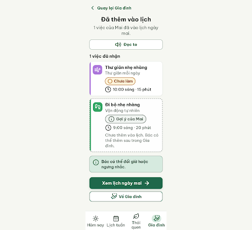
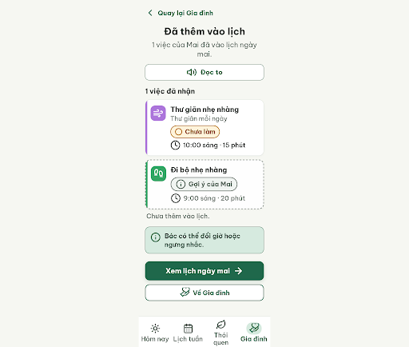

# G07b — Đã nhận một việc · nhánh B

Project: `2013215887278758682` — An Nhiên (project của Sanh)

**Màn chốt hiện tại: v1 — 100 điểm**

Screen ID: `6cbb3a14aa194593939bd3561a19e335`

**Kết quả: CONVERGED** · stop_reason: score_100

| Vòng | Điểm | Error | Warn | Đã sửa | Regression |
|---|---:|---:|---:|---|---|
| v0 | 80 | 2 | 0 | — | — |
| v1 | 100 | 0 | 0 | R-TXT-03, R-TXT-05 | — |

## v0 — 80 điểm

Screen: `projects/2013215887278758682/screens/35a72921269b4c1d934a16f6f95d3b72`




- R-TXT-03 (error): Đoạn phụ trong thẻ gợi ý đi bộ. Bằng chứng: ‘Chưa thêm vào lịch. Bác có thể thêm sau trong Gia đình.’ ngắt thành 4 dòng ở ảnh, vượt giới hạn 2 dòng/đoạn.. Sửa: Rút còn tối đa 2 dòng, ví dụ ‘Bác có thể thêm sau.’
- R-TXT-05 (error): Thẻ gợi ý ‘Đi bộ nhẹ nhàng’. Bằng chứng: Thẻ có hai dòng phụ: ‘Vận động tự nhiên’ và đoạn ‘Chưa thêm vào lịch…’, vượt giới hạn một dòng phụ.. Sửa: Bỏ đoạn giải thích trong thẻ hoặc gộp nội dung thành một dòng phụ ngắn, tối đa 1 dòng.

Màn kết quả rõ ràng, nhưng thẻ gợi ý đi bộ có đoạn giải thích quá dài và thêm dòng phụ thứ hai.

### Edit prompt

```text
Keep the overall layout and everything not mentioned below unchanged.
1. R-TXT-03: Remove the long explanatory paragraph “Chưa thêm vào lịch. Bác có thể thêm sau trong Gia đình.” from the walking suggestion card. If needed, replace it with the short standalone label “Chưa thêm vào lịch.” outside the card, at no more than 2 lines.
2. R-TXT-05: Simplify the unaccepted “Đi bộ nhẹ nhàng” card to only its habit icon, time, task name and status chip; remove the extra “Vận động tự nhiên” subline and any explanatory sentence inside the card. Keep the accepted relaxation card at 10:00 as already shown.
Preserve the one-item acceptance confirmation, distinguish walking at 9:00 as not added, keep “Xem lịch ngày mai”, voice, return control and four-tab navigation. Generate a new screen and preserve G07b v0 unchanged.

```

## v1 — 100 điểm

Screen: `projects/2013215887278758682/screens/6cbb3a14aa194593939bd3561a19e335`




Màn đạt toàn bộ luật; hai lỗi về độ dài và dòng phụ trong thẻ gợi ý ở vòng trước đã được sửa.
