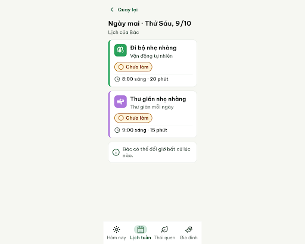
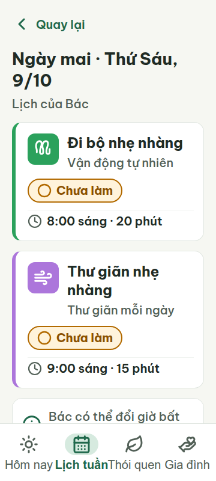
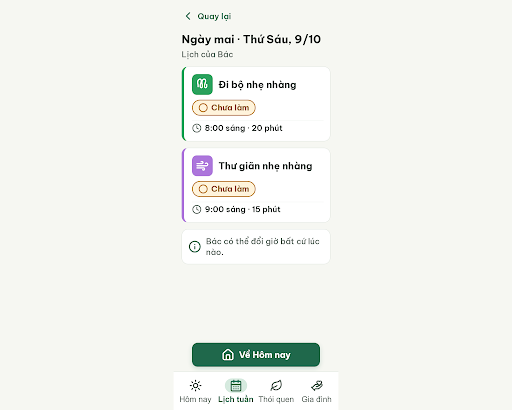
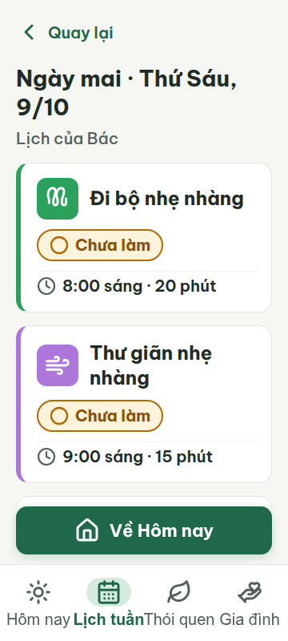
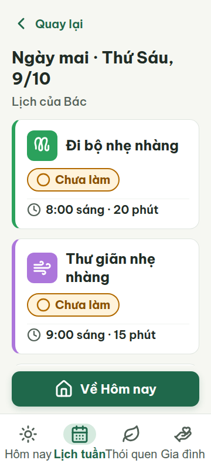
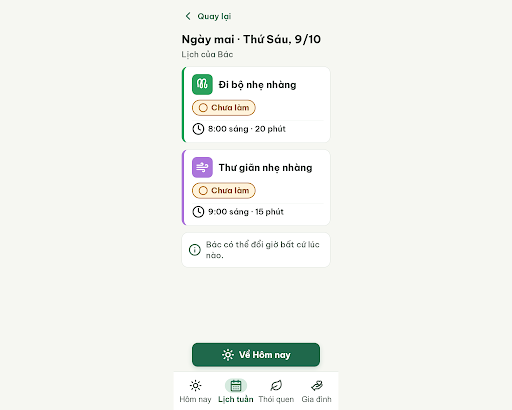
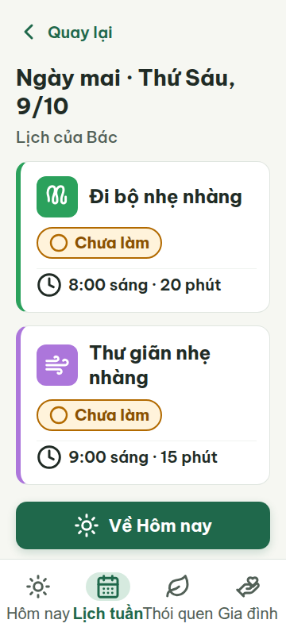

# G08 — Lịch ngày mai

Project: `2013215887278758682` — An Nhiên (project của Sanh)

**Màn chốt hiện tại: v2 — 94 điểm**

Screen ID: `a439ab41c55746ffbee5dbc4bdb2aa82`

**Kết quả: CONVERGED** · stop_reason: patience_2

| Vòng | Điểm | Error | Warn | Đã sửa | Regression |
|---|---:|---:|---:|---|---|
| v0 | 70 | 3 | 0 | — | — |
| v1 | 94 | 0 | 2 | — | — |
| v2 | 94 | 0 | 2 | — | — |
| v3 | 90 | 1 | 0 | — | — |

## v0 — 70 điểm

Screen: `projects/2013215887278758682/screens/82b1e0de27834ca4953fafd4818b32c9`





- R-TXT-05 (error): Cả hai thẻ việc, ngay dưới tên thói quen. Bằng chứng: Mỗi thẻ hiển thị thêm nhãn thói quen ('Vận động tự nhiên' / 'Thư giãn mỗi ngày'), ngoài icon, giờ, tên việc và nhãn trạng thái; đây là dòng phụ thứ hai cùng thông tin thói quen.. Sửa: Bỏ dòng tên thói quen trong mỗi thẻ; giữ tối đa một dòng phụ, ví dụ giờ và thời lượng trên cùng một dòng.
- R-ICON-02 (error): Hai thẻ việc. Bằng chứng: Thẻ có icon thói quen, nhưng không có icon cho hành động chính/đánh dấu việc; không thấy nút hành động chính trong giao diện.. Sửa: Thêm nút hành động chính có icon Lucide 32 px và nhãn chữ, cao 60 px, đặt dưới nội dung phía trên bottom nav.
- R-TAP-02 (error): Phần cuối nội dung trước bottom nav. Bằng chứng: Không có nút hành động chính; nội dung kết thúc bằng thẻ thông báo, còn bottom nav che phần dưới màn ở 360 dp.. Sửa: Thêm một nút chính có chữ và icon, cao 60 px, rộng 320 px pada lề 20 px, đặt đáy vùng nội dung ngay trên bottom nav.

Lịch ngày mai giữ được độ tương phản và cỡ chữ, nhưng còn thiếu hành động chính, cấu trúc thẻ và màu accent chưa theo quy chuẩn; ở 360 px thẻ thông báo bị che bởi thanh điều hướng cố định.

### Edit prompt

```text
Keep the overall layout and everything not mentioned unchanged. Fix the reviewed issues: (1) Remove the extra habit-name line from both task cards; keep only the habit icon/color, time + duration, task name, and status “○ Chưa làm”, with at most one supporting line. (2) Add one 60px-high primary action above the bottom navigation, 320px wide with 20px side margins, labeled “Về Hôm nay” and using the documented Lucide house icon 32×32px. Keep the 4-tab navigation. Make sure the CTA is visible at 360×800 and does not overlap the fixed bottom nav; reserve sufficient content space. Preserve all other colors, copy, task times, 48px targets, and 8px gaps. Generate the new screen now.

```

## v1 — 94 điểm

Screen: `projects/2013215887278758682/screens/c9ecfbba199a4f0087b053d7bc51d8c0`





- R-COL-04 (warn): Dải cố định phía trên bottom nav, phía sau nút ‘Về Hôm nay’. Bằng chứng: Nền của dải dùng gradient tuyến tính từ trong suốt sang #F6F7F2, trái quy tắc không gradient.. Sửa: Bỏ linear-gradient và dùng nền đặc #F6F7F2.
- R-STY-02 (warn): Dải phủ nút ‘Về Hôm nay’. Bằng chứng: Linear gradient is used despite the no-gradient style rule; font is Be Vietnam Pro and card/button radii match 16/14 px.. Sửa: Thay gradient bằng nền phẳng #F6F7F2.

Bố cục đọc rõ, đủ tab và trạng thái; hai vi phạm cảnh báo cùng xuất phát từ dải nền gradient quanh nút cố định.

### Edit prompt

```text
Keep the overall layout and all elements unchanged. Fix only the gradient warnings: replace the linear-gradient behind the fixed “Về Hôm nay” button with a solid #F6F7F2 background. Preserve the CTA, nav, content, responsive sizes and touch targets. Generate a new screen now.

```

## v2 — 94 điểm

Screen: `projects/2013215887278758682/screens/a439ab41c55746ffbee5dbc4bdb2aa82`




- R-ICON-03 (warn): Icon đồng hồ ở dòng giờ của cả hai thẻ; icon ngôi nhà trên nút ‘Về Hôm nay’. Bằng chứng: Đồng hồ chỉ 24×24 px, dưới ngưỡng 32 px. Từ điển quy định house cho thói quen Gia đình trên hết; nút về Hôm nay đang dùng house thay vì icon Hôm nay là sun.. Sửa: Tăng icon clock ở dòng giờ lên 32×32 px; đổi icon house trên nút ‘Về Hôm nay’ thành Lucide sun 32×32 px.
- R-STY-03 (warn): Thẻ nhắn ‘Bác có thể đổi giờ bất cứ lúc nào’ phía dưới danh sách. Bằng chứng: Trong render 360 px và 412 px, CTA cố định ở y=632 px chồng lên thẻ bắt đầu lần lượt tại y≈619 px và y≈572 px; nội dung thẻ bị che, rõ nhất ở 360 px.. Sửa: Đặt CTA trong luồng cuộn sau thẻ nhắn với khoảng cách dọc 16 px; giữ nút cao 60 px và lề ngang 20 px.

Màn không tràn ngang và đạt các yêu cầu chữ, trạng thái, điều hướng; còn lỗi icon nhỏ/sai nghĩa và nút cố định che nội dung thẻ nhắn ở cả hai kích thước.

### Edit prompt

```text
Keep the best reviewed G08 v2 layout unchanged except for these fixes:
1. Increase the clock icon beside each task time from 24px to 32×32px.
2. Change the “Về Hôm nay” button icon from house to the documented Lucide sun 32×32px.
3. Place the reassurance card “Bác có thể đổi giờ bất cứ lúc nào” in the scroll content before the CTA; the fixed CTA must not cover it at 360×800 or 412px. Keep 16px spacing, 60px CTA, and 20px horizontal inset.
Preserve all other text, task cards, bottom nav, colors, and targets. Generate a new screen now.

```

## v3 — 90 điểm

Screen: `projects/2013215887278758682/screens/f177e56510f844a59ee286d8456748ef`





- R-LAY-01 (error): Bottom nav ở viewport 360 px, nhãn ‘Lịch tuần’ và ‘Thói quen’. Bằng chứng: Metrics 360 px cho thấy hai nhãn rộng lần lượt 88.89 px và 88.97 px nhưng mỗi tab chỉ rộng 88 px; hộp nhãn thứ hai và thứ ba chồng nhau khoảng 0.94 px. Ảnh viewport cũng cho thấy các nhãn dính/chạm nhau.. Sửa: Giữ cỡ chữ 20 px và cho nhãn xuống tối đa 2 dòng (white-space: normal; text-align: center; line-height: 1.1); tăng bottom nav lên 112 px để đủ chỗ theo chiều cao.

Màn lịch ngày mai có chữ lớn, thẻ việc rõ và trạng thái dễ nhận biết; nhãn bottom nav va nhau nhẹ ở viewport 360 px.
