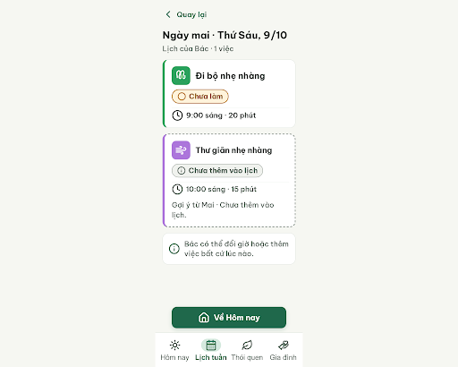
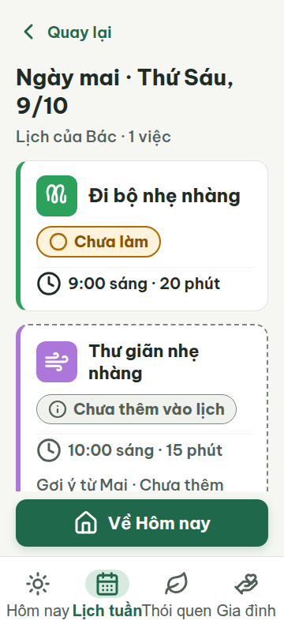
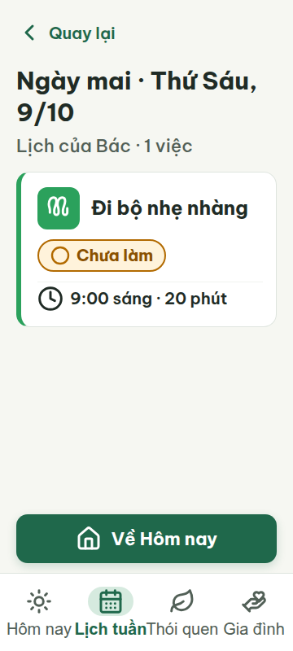
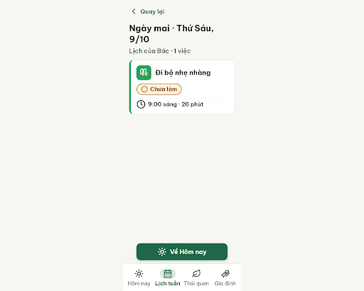

# G08c — Lịch ngày mai

Project: `2013215887278758682` — An Nhiên (project của Sanh)

**Màn chốt hiện tại: v3 — 100 điểm**

Screen ID: `0f037be5b44540d9be762933d67eee9c`

**Kết quả: CONVERGED** · stop_reason: score_100

| Vòng | Điểm | Error | Warn | Đã sửa | Regression |
|---|---:|---:|---:|---|---|
| v0 | 84 | 1 | 2 | — | — |
| v1 | 97 | 0 | 1 | R-TXT-02, R-TXT-05, R-TXT-06 | R-ICON-03 |
| v2 | 90 | 1 | 0 | R-ICON-03 | R-LAY-01 |
| v3 | 100 | 0 | 0 | R-ICON-03 | — |

## v0 — 84 điểm

Screen: `projects/2013215887278758682/screens/e4877754214e4b548b32a95e1baeada0`





- R-TXT-02 (warn): Tiêu đề ‘Ngày mai · Thứ Sáu, 9/10’. Bằng chứng: CSS đặt cỡ 28px, thấp hơn mốc tiêu đề khoảng 30px.. Sửa: Đặt tiêu đề màn 30px.
- R-TXT-05 (error): Thẻ gợi ý ‘Thư giãn nhẹ nhàng’. Bằng chứng: Thẻ gồm nhãn trạng thái, giờ, dòng phụ ‘Gợi ý từ Mai · Chưa thêm vào lịch.’ ngoài các thành phần được phép; thêm cả khối giải thích bên dưới thẻ.. Sửa: Bỏ dòng ‘Gợi ý từ Mai · Chưa thêm vào lịch.’; giữ tối đa một dòng phụ trong thẻ.
- R-TXT-06 (warn): Dòng dưới thẻ gợi ý và thẻ nhắc màu trắng. Bằng chứng: Có lời giải thích ‘Gợi ý từ Mai · Chưa thêm vào lịch.’ và ‘Bác có thể đổi giờ hoặc thêm việc bất cứ lúc nào.’ trên màn lịch.. Sửa: Xóa hai câu giải thích này khỏi màn; chuyển trợ giúp sang màn chi tiết.

Màn rõ ràng, dễ chạm và có trạng thái; cần chỉnh màu token thói quen, rút gọn thẻ gợi ý và tăng cỡ tiêu đề.

### Edit prompt

```text
Keep the overall layout and everything not mentioned below unchanged.
1. R-TXT-02: Increase the screen heading “Ngày mai · Thứ Sáu, 9/10” from 28px to 30px.
2. R-TXT-05 and R-TXT-06: Remove the entire unaccepted “Thư giãn nhẹ nhàng” suggestion card from this calendar screen, along with the separate explanations “Gợi ý từ Mai · Chưa thêm vào lịch.” and “Bác có thể đổi giờ hoặc thêm việc bất cứ lúc nào.” Keep only the accepted calendar activity “Đi bộ nhẹ nhàng” at 9:00 sáng. Do not show unaccepted tasks or advice on this calendar view.
Preserve date context, correct habit accent tokens, calendar navigation, and the accepted-one-activity state. Generate a new screen and preserve G08c v0 unchanged.

```

## v1 — 97 điểm

Screen: `projects/2013215887278758682/screens/412034105b1a4d148f6b3e1f080931ba`




- R-ICON-03 (warn): Nút ‘Về Hôm nay’ ở đáy màn. Bằng chứng: Nút dùng icon nhà (Lucide house), nhưng từ điển dành house riêng cho thói quen ‘Gia đình trên hết’; icon này đang mang nghĩa quay về Hôm nay.. Sửa: Đổi icon của nút ‘Về Hôm nay’ thành Lucide sun 32 × 32 px để dùng cùng nghĩa Hôm nay như tab tương ứng.

Đã tăng tiêu đề và rút gọn thẻ lịch; cần đổi icon nhà trên nút về Hôm nay vì icon đó được dành cho thói quen Gia đình trên hết.

### Edit prompt

```text
Keep the overall layout and everything not mentioned below unchanged.
1. R-ICON-03: Replace the Lucide `house` icon on the “Về Hôm nay” button with Lucide `sun` at 32×32px, matching the documented Hôm nay navigation meaning. Keep the visible text label.
Preserve the single accepted walking event at 9:00, date heading, calendar controls, colors, and footer. Generate a new screen and preserve G08c v1 unchanged.

```

## v2 — 90 điểm

Screen: `projects/2013215887278758682/screens/bedf99d2b9da40ee8a948022f603ac13`




- R-LAY-01 (error): Bottom navigation labels at 360 px viewport. Bằng chứng: v2-viewport-360.png shows ‘Lịch tuần’ touching/overlapping ‘Thói quen’; the labels are nowrap and their four tab columns are too narrow.. Sửa: At 360 px, reduce bottom-nav label font from 20 px to at most 16 px or give each label enough width so all four labels have visible gaps and no horizontal overflow.

Icon trên nút về Hôm nay đã được đổi đúng; ở khung 360 px, nhãn hai tab giữa vẫn chạm nhau và cần thu gọn hoặc nới đủ khoảng cách.

### Edit prompt

```text
Keep the overall layout and everything not mentioned below unchanged.
1. R-ICON-03: Replace the Lucide `house` icon on the “Về Hôm nay” button with Lucide `sun` at 32×32px, matching the documented Hôm nay meaning. Keep the visible text.
Keep the original G08c v1 bottom-nav geometry exactly: four equal columns with visible gaps between “Hôm nay”, “Lịch tuần”, “Thói quen”, and “Gia đình”; do not change label font size, widths, or wrapping. Preserve the accepted walking event at 9:00, date heading and calendar controls. Generate a new screen from best v1 and preserve it unchanged.

```

## v3 — 100 điểm

Screen: `projects/2013215887278758682/screens/0f037be5b44540d9be762933d67eee9c`


Màn lịch ngày mai đáp ứng các luật áp dụng; icon sun trên nút Về Hôm nay đã sửa đúng lỗi icon của vòng 1.
