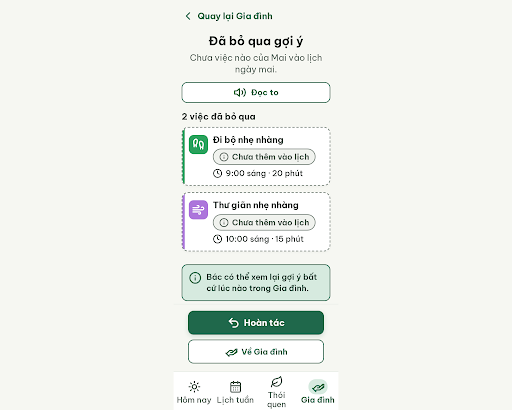
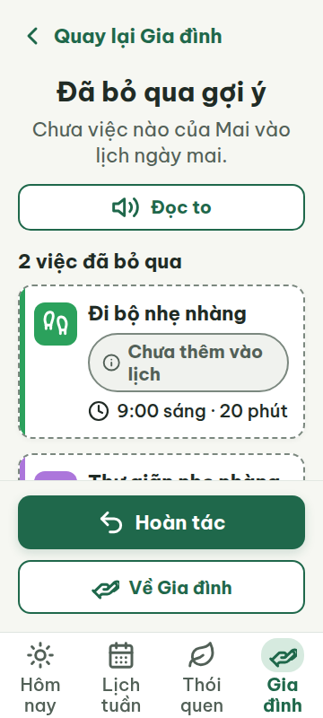
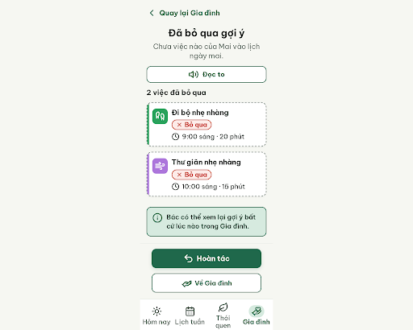
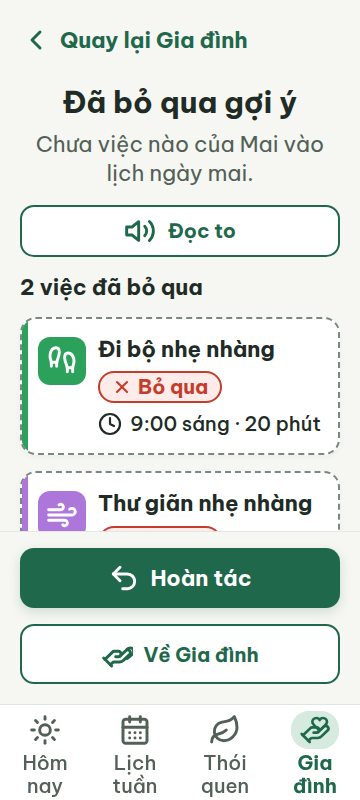
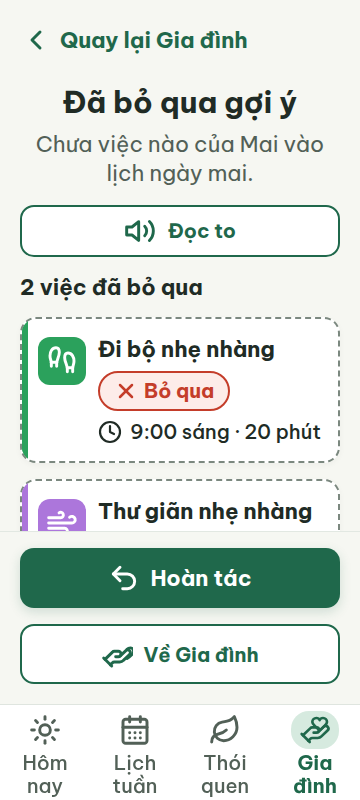

# G09 — Đã bỏ qua gợi ý

Project: `2013215887278758682` — An Nhiên (project của Sanh)

**Màn chốt hiện tại: v2 — 97 điểm**

Screen ID: `6230f724dd5f47259a633094d1fc1264`

**Kết quả: CONVERGED** · stop_reason: score_100

| Vòng | Điểm | Error | Warn | Đã sửa | Regression |
|---|---:|---:|---:|---|---|
| v0 | 84 | 1 | 2 | — | — |
| v1 | 97 | 0 | 1 | R-ICON-03, R-STA-01, R-STY-03 | R-ICON-03 |
| v2 | 100 | 0 | 0 | R-ICON-03 | — |

## v0 — 84 điểm

Screen: `projects/2013215887278758682/screens/c595728d2d154b40bcf3b682ffeb2483`





- R-ICON-03 (warn): Icon tab Gia đình ở bottom nav. Bằng chứng: Dùng biểu tượng bắt tay (handshake) trong khi từ điển quy định hand-heart cho tab Gia đình.. Sửa: Đổi icon tab Gia đình thành Lucide hand-heart, kích thước 32 × 32 px.
- R-STA-01 (error): Chip trạng thái trong cả hai thẻ việc. Bằng chứng: Hai thẻ ghi “Chưa thêm vào lịch”, không khớp một trong năm nhãn trạng thái quy định; ảnh cũng không cho thấy nhãn đặt cạnh tên việc.. Sửa: Đổi nhãn trên mỗi thẻ thành “✕ Bỏ qua” và đặt chip ngay cạnh tên việc.
- R-STY-03 (warn): Khoảng cách giữa các khối, gồm tiêu đề danh sách và các nút cố định. Bằng chứng: HTML đặt margin-bottom tiêu đề là 12 px và khoảng cách giữa hai nút là 12 px, dưới mức 16 px của token khoảng cách khối.. Sửa: Đặt khoảng cách khối và gap giữa các nút thành 16 px; giữ lề màn 20 px.

Màn G09 rõ ràng và dễ đọc; cần dùng nhãn trạng thái chuẩn, icon Gia đình đúng từ điển và khoảng cách khối 16 px.

### Edit prompt

```text
Keep the overall layout and everything not mentioned below unchanged.
1. R-STA-01: For both skipped suggestions, replace “Chưa thêm vào lịch” with the approved status “✕ Bỏ qua”, and place each status chip beside its task name. Preserve the clear overall result that neither activity entered the calendar and keep the “Hoàn tác” action visible.
2. R-ICON-03: Replace the Gia đình bottom-nav icon `handshake` with the exact Lucide `hand-heart` at 32×32px, with visible “Gia đình” label.
3. R-STY-03: Set the gap between content blocks and between the two action buttons to 16px; keep 20px screen margins.
Preserve all other content, colors, text and layout. Generate a new screen and preserve G09 v0 unchanged.

```

## v1 — 97 điểm

Screen: `projects/2013215887278758682/screens/686f8ac73127449eaf05c2f20fcc17d9`





- R-ICON-03 (warn): Icon dấu × trong chip “Bỏ qua” ở cả hai thẻ việc. Bằng chứng: SVG của icon trong chip đặt width và height 20 px, thấp hơn mức ngoại lệ tối thiểu 24 px cho chip trạng thái.. Sửa: Tăng icon × trong mỗi chip trạng thái từ 20 × 20 px lên ít nhất 24 × 24 px.

Nhãn trạng thái và khoảng cách khối đã được sửa; icon trong chip Bỏ qua vẫn nhỏ hơn mức tối thiểu 24 px.

### Edit prompt

```text
Keep the overall layout and everything not mentioned below unchanged.
1. R-ICON-03: Increase the × icon inside each “✕ Bỏ qua” status chip from 20×20px to 24×24px minimum; keep the chip label visible and the icon centered.
Preserve the skipped state, visible “Hoàn tác” action, status labels beside task names, four-tab nav, 16px spacing and all existing text. Generate a new screen and preserve G09 v1 unchanged.

```

## v2 — 100 điểm

Screen: `projects/2013215887278758682/screens/6230f724dd5f47259a633094d1fc1264`





Đã sửa kích thước icon trạng thái lên 24 px và dùng đúng màu nhấn theo token; các luật áp dụng đều đạt.
