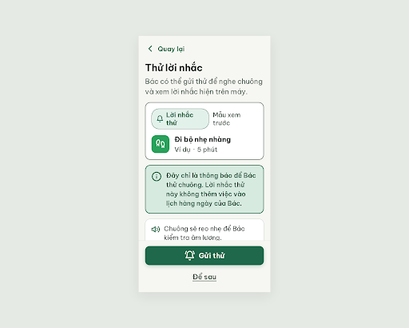
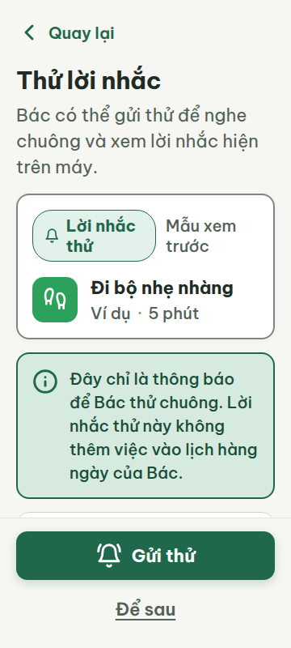
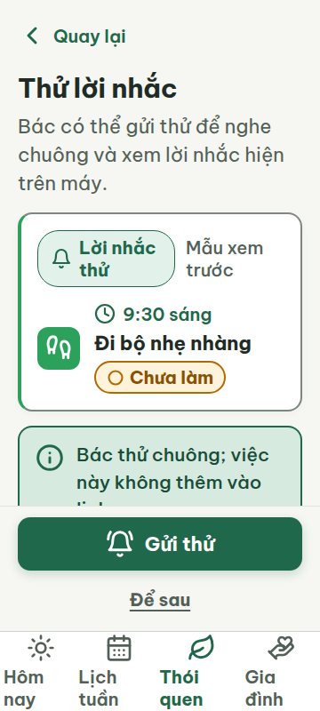
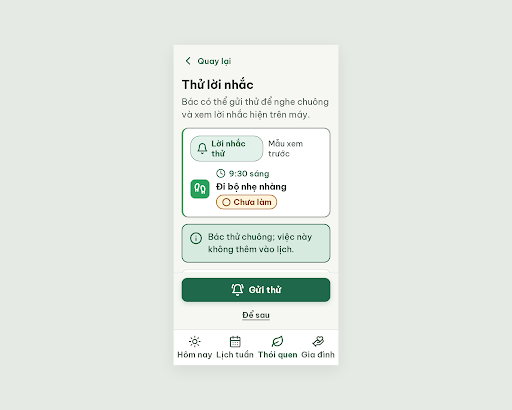
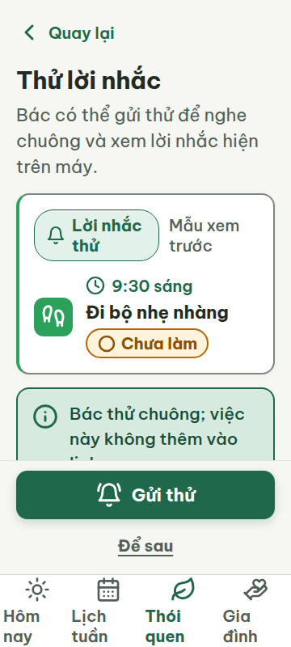
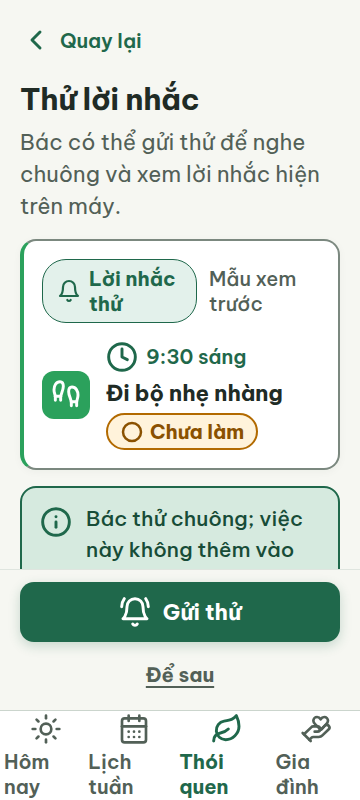

# N01 — Thử lời nhắc

Project: `2013215887278758682` — An Nhiên (project của Sanh)

**Màn chốt hiện tại: v3 — 97 điểm**

Screen ID: `3d3ecf9383b04a34b9394f1396ae02d2`

**Kết quả: CONVERGED** · stop_reason: patience_2

| Vòng | Điểm | Error | Warn | Đã sửa | Regression |
|---|---:|---:|---:|---|---|
| v0 | 57 | 4 | 1 | — | — |
| v1 | 97 | 0 | 1 | R-TXT-03, R-TXT-05, R-COL-02, R-NAV-01 | — |
| v2 | 97 | 0 | 1 | — | — |
| v3 | 97 | 0 | 1 | R-ICON-03 | R-STY-03 |

## v0 — 57 điểm

Screen: `projects/2013215887278758682/screens/e37f65a8115142c08aa8c3ea6be1cfdf`





- R-TXT-03 (error): Khung giải thích dưới thẻ mẫu. Bằng chứng: Đoạn chữ 13 tiếng được ngắt thành 4 dòng trong ảnh, vượt giới hạn 2 dòng.. Sửa: Rút gọn còn tối đa 2 dòng, ví dụ: ‘Bác thử chuông; việc này không thêm vào lịch.’
- R-TXT-05 (error): Thẻ ‘Đi bộ nhẹ nhàng’. Bằng chứng: Thẻ có nhãn ‘Ví dụ’ và ‘5 phút’ nhưng không có giờ hay nhãn trạng thái như luật yêu cầu.. Sửa: Hiển thị giờ cụ thể như ‘07:00’, tên việc và chip trạng thái ‘○ Chưa làm’; bỏ nhãn ‘Ví dụ’ khỏi thẻ.
- R-ICON-03 (warn): Biểu tượng chuông trong nhãn ‘Lời nhắc thử’ và biểu tượng loa/điện thoại ở phần hướng dẫn. Bằng chứng: Các SVG lần lượt là 24 px, 28 px và 28 px, dưới mức tối thiểu 32 px; ngoại lệ 24 px chỉ dành cho icon trong chip trạng thái.. Sửa: Tăng các icon bell, volume-2 và smartphone lên 32 × 32 px; dùng đúng Lucide volume-2 cho hành động Đọc to.
- R-COL-02 (error): Thẻ mẫu ‘Đi bộ nhẹ nhàng’. Bằng chứng: Ô icon dùng đúng màu #2BA15C nhưng cạnh trái thẻ không có vạch màu thói quen.. Sửa: Thêm vạch trái rộng 4 px, cao hết thẻ, màu #2BA15C.
- R-NAV-01 (error): Cuối màn hình. Bằng chứng: Không có bottom nav 4 tab Hôm nay, Lịch tuần, Thói quen, Gia đình.. Sửa: Thêm bottom nav 4 tab có icon và nhãn, mỗi nhãn 20 px.

Màn có chữ và nút dễ đọc, nhưng thiếu bottom nav, vạch màu trên thẻ mẫu, và một số icon cùng đoạn giải thích cần chỉnh.

### Edit prompt

```text
Keep the overall layout and everything not mentioned below unchanged.
1. R-TXT-03: Replace the long explanatory paragraph with the exact short copy “Bác thử chuông; việc này không thêm vào lịch.” Keep it within 2 lines.
2. R-TXT-05: In the sample “Đi bộ nhẹ nhàng” card, remove “Ví dụ · 5 phút” and instead show time “9:30 sáng”, the task name, and a standard “○ Chưa làm” status chip beside the task name. This remains a test sample and must not be added to the calendar.
3. R-ICON-03: Increase the bell, volume-2, and smartphone icons to 32×32px. Use exact Lucide `bell` for the sample reminder, `volume-2` for reading audio, and `smartphone` for the device note.
4. R-COL-02: Add a 4px full-height left accent stripe to the sample walking card in accent #2BA15C; retain its icon tile and white Lucide icon.
5. R-NAV-01: Add the required four-tab bottom navigation with Lucide sun / calendar-days / leaf / hand-heart and visible labels “Hôm nay”, “Lịch tuần”, “Thói quen”, “Gia đình”, each 20px. Preserve the primary “Gửi thử” action at the screen bottom above the nav and “Để sau” as visible text.
Keep every other claim conditional; do not claim the notification was sent or received. Generate a new screen and preserve N01 v0 unchanged.

```

## v1 — 97 điểm

Screen: `projects/2013215887278758682/screens/5cb9fab2ff5f44c29070aa197efe9c94`




- R-ICON-03 (warn): Biểu tượng vòng tròn trong chip ‘Chưa làm’. Bằng chứng: SVG của icon có width/height 20 px, thấp hơn ngoại lệ tối thiểu 24 px dành cho icon trong chip trạng thái.. Sửa: Tăng icon circle trong chip ‘Chưa làm’ lên 24 × 24 px.

Các lỗi về đoạn giải thích, cấu trúc thẻ, vạch màu và bottom nav đã được sửa; icon trạng thái Chưa làm vẫn nhỏ hơn 24 px.

### Edit prompt

```text
Keep the overall layout and everything not mentioned below unchanged.
1. R-ICON-03: Increase the Lucide `circle` icon inside the “○ Chưa làm” status chip from 20×20px to 24×24px minimum, keeping the label visible and the icon centered.
Preserve the four-tab navigation, 32px main icons, sample task at 9:30, short test-only note, “Gửi thử” and “Để sau” actions. Do not claim the reminder has been sent or received. Generate a new screen and preserve N01 v1 unchanged.

```

## v2 — 97 điểm

Screen: `projects/2013215887278758682/screens/fcdef0d0390947778b9437e0a20dc60a`





- R-ICON-03 (warn): Biểu tượng giờ cạnh ‘9:30 sáng’ trong thẻ việc. Bằng chứng: SVG clock có kích thước 24 × 24 px; ngoại lệ 24 px chỉ áp dụng cho icon trong chip trạng thái, còn icon thông tin này cần tối thiểu 32 × 32 px.. Sửa: Tăng SVG clock cạnh ‘9:30 sáng’ từ 24 × 24 px lên 32 × 32 px.

Màn đạt 97 điểm; chip ‘Chưa làm’ đã tăng lên 24 px nhưng icon giờ vẫn 24 px, dưới ngưỡng 32 px dành cho icon ngoài chip trạng thái.

### Edit prompt

```text
Keep the overall layout and everything not mentioned below unchanged.
1. R-ICON-03: Increase the Lucide `clock` icon beside “9:30 sáng” from 24×24px to 32×32px. Keep the exact clock icon and its time label.
Preserve the 24px circle in the status chip, four-tab nav, 32px main icons, test-only note and bottom actions. Generate a new screen and preserve N01 v2 unchanged.

```

## v3 — 97 điểm

Screen: `projects/2013215887278758682/screens/3d3ecf9383b04a34b9394f1396ae02d2`




- R-STY-03 (warn): Phần hướng dẫn phía dưới ghi chú, sau card mẫu. Bằng chứng: Ở khung 360 × 800, footer cố định che phần dưới của instruction-card; chỉ lộ đầu dòng đầu tiên nên nội dung bị khuất khi mở màn.. Sửa: Giảm khoảng đệm dưới content từ 240 px xuống 16 px và bố trí footer trong luồng cuộn hoặc thu gọn nội dung để toàn bộ hướng dẫn nằm phía trên footer; giữ lề ngang 20 px và khoảng cách khối 16 px.

Màn đạt 97 điểm; icon giờ đã đạt 32 px, nhưng footer che khuất phần lớn hướng dẫn bên dưới thẻ mẫu.
