# Information Architecture & User Flows

## 1. Information architecture

App có **hai chế độ**, chọn ở màn đầu tiên (C01 "Ai đang dùng máy này?"):

- **Người lớn tuổi** (bà Lan): 4 tab cấp cao, mỗi tab sâu tối đa 2 cấp con, để không bị lạc. Màn Cài đặt mở từ nút có chữ trên app bar, không chiếm một tab riêng.
- **Người thân** (chị Mai): ghép nối với máy của mẹ bằng mã 6 số, xem và lập lịch cho mẹ (C02 – C12). Lịch chỉ vào máy mẹ khi mẹ chọn Nhận.

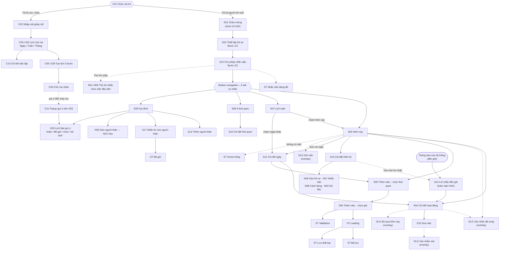

| Cấp | Màn hình |
| --- | --- |
| Onboarding (chỉ lần đầu) | S01, S02 (Bước 1/2), S13 Cho phép nhắc việc (Bước 2/2) |
| Ngoài app (hệ thống gọi) | S14 Lời nhắc đến giờ – hiện toàn màn hình khi tới giờ, kể cả lúc khóa máy; xem thử được từ S10 |
| Cấp 1 – tab | S03 Hôm nay · S07 Lịch tuần · S08 9 thói quen · S09 Gia đình |
| Cấp 2 | S04 Chi tiết hoạt động · S05 Thêm việc bước 1 · S10 Cài đặt · S11 Chi tiết ngày (con của S07, hoặc "Xem cả ngày" từ S03) · S12 Thêm người thân (con của S09) · S16 Chi tiết thói quen (con của S08) · S17 Nhắn tin cho người thân (con của S09, hoặc từ thẻ "xong 6/6" ở S03) |
| Cấp 3 | S06 Thêm việc bước 2 · S15 Sửa việc (con của S04) · N06 / N07 / N08 / N20 (con của S10) · N09 Sửa người thân (con của S09) |
| Gợi ý từ người thân | G03 – G09 mở từ hàng "Gợi ý từ Mai · 2 việc" ở S09 hoặc popup G11 / thẻ G12 ở S03 |
| Chế độ Người thân | C01 → C02 / C02e → C03 · C04 · C05 (3 tab Ngày / Tuần / Tháng) → C06 / C06e → C07 / C07m → C08 (+ C08w) → C09; C03 → C10 → C06 (sửa) → C11 → C03; C10 → C12 → C03 |
| State / overlay | ST-Empty, S13d (nhắc việc đang tắt), ST-Validation, ST-Loading, ST-Error, ST-Saved, S03 + snackbar "Hoàn tác" (đã dời / đã bỏ qua / đã xóa / đã sửa / nhắc lại sau), S03 xong 6/6, S11b (ngày đã qua), S12e (thiếu số điện thoại), S09b (đã thêm người thân), S17b (đã gửi), DLG-Done, DLG-Later, DLG-Skip, DLG-Delete |

S04 mở được từ hai nơi (S03 và S11) nên nút Back ghi "Quay lại" thay vì tên màn trước.

## 2. Flow 1 – Lần đầu mở app (Onboarding)

**Mục tiêu:** bà Lan cài xong và thấy lịch hôm nay trong dưới 2 phút.

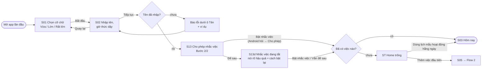

| Loại nhánh | Mô tả |
| --- | --- |
| Happy path | S01 → S02 → S13 "Bật nhắc việc" → ST-Empty (người mới chưa có việc) → "Dùng lịch mẫu hoạt động hằng ngày" → S03 |
| Alternate | ST-Empty → "Thêm việc đầu tiên" → Flow 2; người đã có lịch (cài lại app) → thẳng S03 |
| Error / recovery | Bỏ trống tên → báo lỗi ngay dưới ô (icon + chữ + ví dụ) → nhập lại; S13 chọn "Để sau" hoặc bấm "Từ chối" ở hộp thoại Android → S13d nói rõ "đến giờ sẽ không đổ chuông" và chỉ đường bật lại, không chặn bà dùng app |

## 3. Flow 2 – Thêm việc mới (có lỗi và phục hồi)

**Mục tiêu:** thêm "Tập thở chậm 10 phút, 8:00 sáng mỗi ngày" trong ≤ 60 giây.

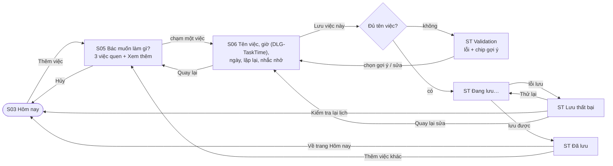

| Loại nhánh | Mô tả |
| --- | --- |
| Happy path | S03 → S05 → S06 → Loading → Đã lưu → S03 |
| Alternate | Đã lưu → "Thêm việc khác" → S05; S05 → "Hủy" → S03 |
| Error / recovery 1 | Thiếu tên việc → ST-Validation → chọn chip gợi ý → S06 |
| Error / recovery 2 | Lưu thất bại (demo S06o) → ST-Error "Chưa thể lưu trên điện thoại. Nội dung đang nhập vẫn được giữ lại." → Thử lại / Kiểm tra lại lịch / Quay lại sửa; lưu được việc nhưng chưa đặt được lời nhắc → N16 "Việc đã được lưu · Kiểm tra nhắc việc" |
| Thoát giữa chừng | Bấm Quay lại khi đã nhập → N14 "Chưa lưu thay đổi": "Tiếp tục chỉnh" (nút chính) / "Bỏ thay đổi" |

> Từ 15/10, S05 không còn là lưới 9 thói quen mà là "Bác muốn làm gì?" với 3 việc quen thuộc (Đi bộ nhẹ nhàng, Chăm cây, Gọi người thân) + "Xem thêm hoạt động"; giờ chọn bằng ô giờ mở `DLG-TaskTime`, ngày bằng N11, lặp lại bằng N12.

## 4. Flow 3 – Hoàn thành, dời hoặc bỏ qua một việc

**Mục tiêu:** đánh dấu "Đi bộ quanh công viên" đã xong trong ≤ 2 lần chạm.

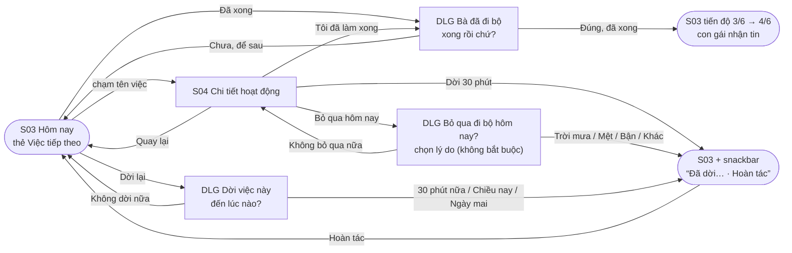

| Loại nhánh | Mô tả |
| --- | --- |
| Happy path | S03 → "Đã xong" → DLG → "Đúng, đã xong" → S03 cập nhật |
| Alternate | S03 → S04 → "Dời 30 phút" hoặc "Bỏ qua hôm nay" (DLG-Skip, chọn lý do); S03 → "Dời lại" → DLG-Later chọn một trong 3 mốc giờ có sẵn. Mọi kết quả quay về S03 với snackbar nói rõ đã đổi gì |
| Error prevention / recovery | Dialog xác nhận chặn việc bấm nhầm; "Chưa, để sau" / "Không bỏ qua nữa" đưa về như cũ, không đổi dữ liệu; snackbar không tự tắt và có nút "Hoàn tác" cao 48 dp. Cuối ngày xong cả 6 việc → S03 hiện thẻ chúc mừng thay thẻ Việc tiếp theo (Flow 9) |

## 5. Flow 4 – Xem trước lịch một ngày trong tuần

**Mục tiêu:** từ Lịch tuần, bà Lan biết ngày Thứ Sáu có việc gì, mấy giờ, và xem được cách làm một việc trong ≤ 2 lần chạm.

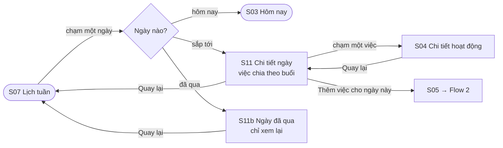

| Loại nhánh | Mô tả |
| --- | --- |
| Happy path | S07 → chạm "Thứ Sáu 9/10" → S11 → chạm "Đi bộ quanh công viên" → S04 → Quay lại |
| Alternate | Chạm hàng "Hôm nay" → S03; ngày sắp tới → "Thêm việc cho ngày này" → Flow 2 |
| Error prevention | Ngày đã qua (S11b) chỉ cho xem, không có nút sửa hay đánh dấu xong, nên không thể vô tình đổi dữ liệu cũ; việc bị bỏ qua ghi bằng chữ "Bỏ qua · 9:30 sáng (trời mưa)" chứ không chỉ đổi màu |

## 6. Flow 5 – Thêm người thân (có lỗi và phục hồi)

**Mục tiêu:** bà Lan tự thêm số của cháu Bin để gọi bằng một lần chạm và để cháu nhận tin khi bà xong việc, trong ≤ 60 giây, không phải gõ số nếu số đã có trong danh bạ.

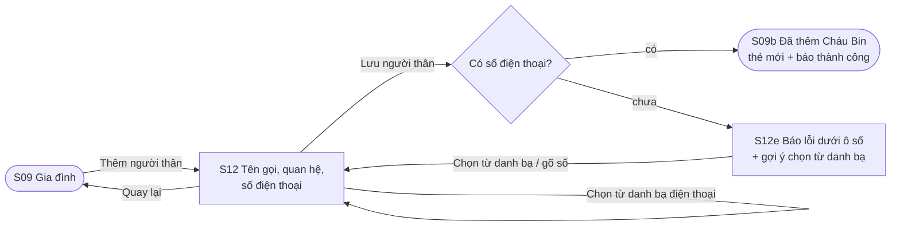

| Loại nhánh | Mô tả |
| --- | --- |
| Happy path | S09 → "Thêm người thân" → "Chọn từ danh bạ điện thoại" → "Lưu người thân" → S09b |
| Alternate | Tự gõ tên và số thay vì chọn từ danh bạ |
| Error / recovery | Bấm Lưu khi chưa có số → S12e: viền đỏ, icon, câu "Bà chưa nhập số điện thoại", gợi ý dùng danh bạ; tên và quan hệ đã nhập vẫn giữ nguyên |

## 7. Flow 6 – Lời nhắc đến giờ

**Mục tiêu:** tới 9:20 điện thoại đổ chuông, bà Lan biết ngay việc gì, mấy giờ, và chọn được cách xử lý trong 1 lần chạm, không cần vuốt.

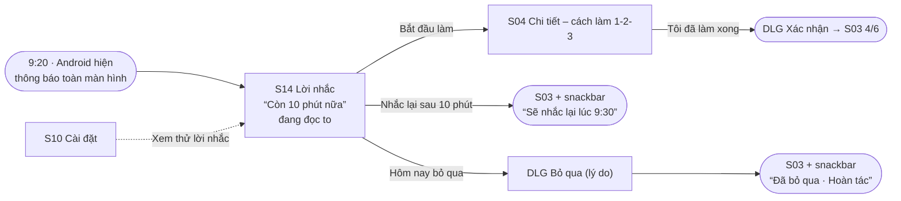

| Loại nhánh | Mô tả |
| --- | --- |
| Happy path | Thông báo → S14 → "Bắt đầu làm" → S04 → "Tôi đã làm xong" → DLG-Done |
| Alternate | "Nhắc lại sau 10 phút" → nhắc lại đúng giờ hẹn; "Hôm nay bỏ qua" → DLG-Skip; xem thử từ S10 để bà quen trước khi nhận thật |
| Error prevention | Không có cử chỉ vuốt để tắt (vuốt nhầm là mất lời nhắc); 3 nút xếp dọc cao 60 dp, cách nhau 10 dp; bỏ qua phải xác nhận; lời nhắc vừa đọc to vừa hiện chữ vừa rung |

## 8. Flow 7 – Sửa và xóa một việc

**Mục tiêu:** đổi giờ đi bộ từ 9:30 sang 10:00 trong ≤ 4 lần chạm; xóa nhầm thì lấy lại được.

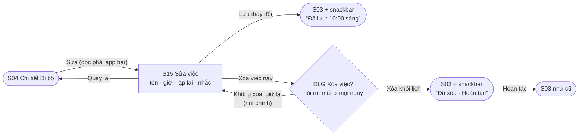

| Loại nhánh | Mô tả |
| --- | --- |
| Happy path | S04 → "Sửa" → S15 → chạm ô giờ → DLG-TaskTime chọn 10 : 00 sáng → "Xong" → "Lưu thay đổi" → N13 "Chỉ lần này" → S03 |
| Alternate | S15 → "Xóa việc này" → DLG-Delete (ghi rõ phạm vi) → "Xóa khỏi lịch" → S03 còn 3/5 việc; với việc lặp lại, N13 cho chọn "Chỉ lần này" / "Lần này và các lần sau" / "Giữ nguyên", ngày đã làm hoặc đã bỏ qua không bị đổi |
| Error prevention / recovery | Nút xóa viền đỏ đặt cuối nội dung, xa nút Lưu; dialog nói rõ hậu quả và nút an toàn "Không xóa, giữ lại" là nút chính; sau khi xóa vẫn có "Hoàn tác"; dòng "Đã đổi từ 9:30 sáng" cho bà thấy mình vừa sửa gì |

## 9. Flow 8 – Tìm hiểu một thói quen

**Mục tiêu:** bà Lan hiểu "Ăn vừa đủ" là gì, tuần này mình đã làm được mấy lần, và thêm một việc cho thói quen đó.

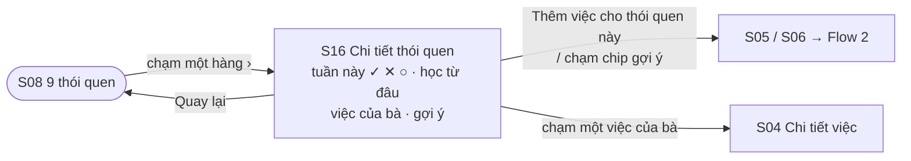

| Loại nhánh | Mô tả |
| --- | --- |
| Happy path | S08 → chạm "3. Thư giãn mỗi ngày" → S16 → "Thêm việc cho thói quen này" → S06 (đã chọn sẵn thói quen) → Flow 2 |
| Alternate | Chạm một việc trong "Việc của bà" → S04 của lần làm gần nhất sắp tới |
| Empty state | Thói quen chưa có việc nào (vd "9. Bạn bè tích cực") → hộp "Bà chưa có việc nào cho thói quen này. Thử một gợi ý bên dưới nhé." + 3 chip gợi ý |

## 10. Flow 9 – Nhắn tin cho con cháu

**Mục tiêu:** bà Lan gửi cho Mai tin "hôm nay mẹ đã làm gì" trong 2 lần chạm, không phải gõ chữ.

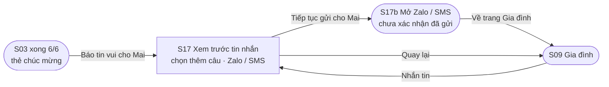

| Loại nhánh | Mô tả |
| --- | --- |
| Happy path | S03 xong 6/6 → "Báo tin vui cho Mai" → S17 (chọn điều muốn kể) → "Tiếp tục gửi cho Mai" → S17b |
| Alternate | Từ S09 bấm "Nhắn tin" ở thẻ của Mai, Hùng hoặc Bin (mỗi người một bản, xưng hô đúng: "Mẹ – con", "Bà – cháu") |
| Trung thực về kết quả | An Nhiên chỉ mở Zalo / SMS với nội dung soạn sẵn; S17b và N10 ghi "An Nhiên chưa xác nhận tin đã gửi" thay vì báo "Đã gửi" |

## 11. Flow 10 – Người thân ghép nối với máy của mẹ (chế độ Người thân)

**Mục tiêu:** chị Mai ở TP.HCM ghép nối điện thoại của mình với máy của mẹ trong ≤ 1 phút, qua điện thoại, không cần cầm máy mẹ.

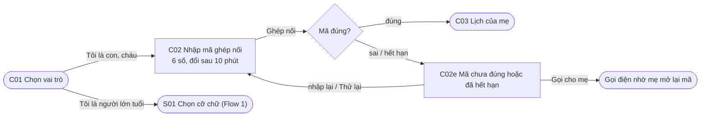

| Loại nhánh | Mô tả |
| --- | --- |
| Happy path | C01 → "Tôi là con, cháu" → C02 (mẹ đọc 6 số qua điện thoại: máy mẹ › Gia đình › Mã ghép nối) → "Ghép nối" → C03 |
| Alternate | C01 → "Tôi là người lớn tuổi" → Flow 1 |
| Error / recovery | Mã sai hoặc quá 10 phút → C02e: 6 ô viền đỏ, banner giải thích, hướng dẫn lấy mã mới, nút "Thử lại" và "Gọi cho mẹ" |

## 12. Flow 11 – Người thân lập lịch cho mẹ theo ngày / tuần / tháng

**Mục tiêu:** chị Mai đặt "Đi bộ nhẹ nhàng 8:00 sáng, T2-T4-T6 hằng tuần" cho mẹ trong ≤ 90 giây; mẹ chỉ cần bấm Nhận.

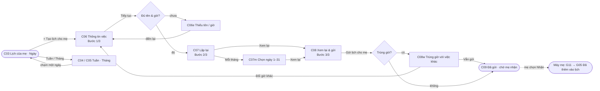

| Loại nhánh | Mô tả |
| --- | --- |
| Happy path | C03 → C06 (Vận động · Đi bộ nhẹ nhàng · 8:00 sáng · 15 phút) → C07 (Mỗi tuần, T2 T4 T6, từ 16/10, không kết thúc) → C08 → "Gửi lịch cho mẹ" → C09 |
| Alternate | Lặp mỗi tháng (C07m: ngày 1 và 15, 1/11 – 31/12/2026); xem lịch theo Tuần (C04: số việc và số đã xong mỗi ngày) hoặc Tháng (C05) |
| Error prevention / recovery | C06e báo lỗi ngay dưới ô thiếu tên / thiếu giờ; câu tóm tắt bằng chữ ở C07 ("Mẹ được nhắc… vào Thứ Hai, Thứ Tư, Thứ Sáu") để kiểm tra trước khi gửi; C08w cảnh báo trùng giờ nhưng vẫn cho gửi; switch "Mẹ nhận trước khi thêm" bật sẵn nên lịch không tự chen vào máy mẹ |

## 13. Flow 12 – Người thân sửa / ngưng một lịch lặp

**Mục tiêu:** đổi giờ đi bộ từ 8:00 sang 7:30 cho một ngày, hoặc ngưng hẳn lịch, mà không xóa lịch sử mẹ đã làm.

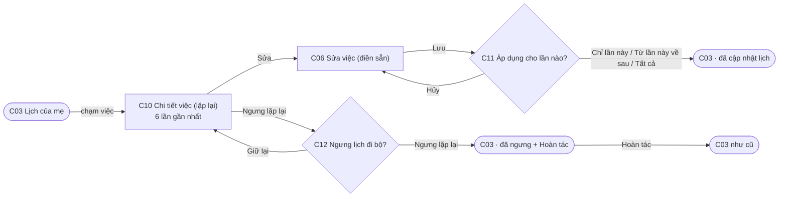

| Loại nhánh | Mô tả |
| --- | --- |
| Happy path | C03 → C10 → "Sửa việc" → C06 đổi 7:30 → C11 "Chỉ lần này · 19/10" → C03 |
| Alternate | C11 "Từ lần này về sau" hoặc "Tất cả các lần" |
| Error prevention / recovery | C12 nói rõ hậu quả ("Mẹ sẽ không còn được nhắc vào T2, T4, T6. Những lần mẹ đã làm vẫn được giữ lại"), nút an toàn "Giữ lại"; sau khi ngưng có "Hoàn tác" |

## 14. Flow bổ sung – Bác nhận gợi ý lịch từ người thân (G01 – G12)

Flow này chưa vẽ trên page `01 User Flow` nhưng đã có đủ màn trong `03 Final UI` và `06 Prototype`.

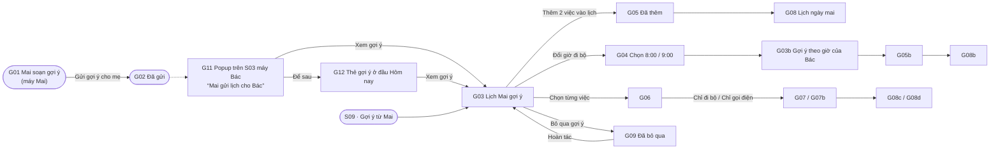

| Loại nhánh | Mô tả |
| --- | --- |
| Happy path | G11 "Xem gợi ý" → G03 → "Thêm 2 việc vào lịch" → G05 → "Xem lịch ngày mai" → G08 |
| Alternate | Đổi giờ (G04 → G03b → G05b), chọn từng việc (G06 → G07 / G07b), để sau (G12) |
| Error prevention / recovery | Lịch chỉ đổi khi Bác bấm nhận ("Chưa thêm vào lịch. Bác tự chọn việc và giờ phù hợp."); bỏ qua có "Hoàn tác"; app không tự báo cho Mai là Bác đã bỏ qua hay đã làm |

## 15. Ánh xạ flow → màn hình → frame Figma

| Flow | Màn hình / state đi qua | Vị trí trong page 06 |
| --- | --- | --- |
| ★ Demo chính (gồm Flow 1) | 24 bước, đi qua 14 màn chính: S01 → S02 → S13 → ST-Empty → S03 → S11 hôm nay → S04 → DLG-Done → S03b → S05 → S06 → ST-Loading → ST-Saved → S07 → S11 Thứ Sáu → S04 Đi khám → S08 → S09 → S12a → S12e → S12 → S09b → S10 → S14 | Flow starting point `★ Main flow – Một ngày của bà Lan` đặt tại S01 – từ đây đi được tới cả 17 màn chính bằng nút bấm (S15 qua nút "Sửa" ở S04, S16 qua S08, S17 qua S09) |
| Flow 2 Thêm việc | S03, S05, S06, ST-Validation, ST-Loading, ST-Error, ST-Saved | Hàng chính bước 10–13; hàng "↳ từ S06 · Lỗi khi thêm việc" (S06e → ST-Validation → S06o → ST-Error) |
| Flow 3 Hoàn thành / dời / bỏ qua | S03, S04, DLG-Done, DLG-Later, DLG-Skip, S03 + snackbar (đã dời 30 phút / chiều nay / ngày mai, đã bỏ qua) | Hàng chính bước 5–9; hàng "↳ từ S03 · Dời lại" và "↳ từ S04 · Bỏ qua hôm nay" |
| Flow 4 Xem lịch một ngày | S07, S11, S11b, S04, (S03, S05) | Hàng chính bước 14–16; hàng "↳ từ S07 · Các ngày khác trong tuần" |
| Flow 5 Thêm người thân | S09, S12a (chưa có số), S12e, S12, S09b | Hàng chính bước 18–22 |
| Flow 6 Lời nhắc đến giờ | S14, S04, DLG-Done, S03 + snackbar nhắc lại, DLG-Skip | Flow starting point `Flow chính 2 – Lời nhắc` đặt tại S14 |
| Flow 7 Sửa & xóa | S04, S15, S03 đã lưu, DLG-Delete, S03 đã xóa | Hàng "↳ từ S04 · Sửa & xóa việc (Flow 7)" |
| Flow 8 Thói quen | S08, S16 × 9 thói quen, S05 / S06, S04 | Flow starting point `Flow chính 1 – Khám phá` đặt tại S08 |
| Flow 9 Nhắn tin cho con cháu | S03 xong 6/6, S09, S17 (Mai / Hùng / Bin), S17b | Hàng "↳ từ S09 · Nhắn tin cho từng người" và "↳ từ S03b · Cuối ngày xong 6/6" |
| Ngoài flow (bottom nav / app bar) | S08, S10 | Mở từ bất kỳ màn có bottom nav / nút Cài đặt |
| Trạng thái onboarding | S13d Nhắc việc đang tắt | Từ S13 bấm "Để sau" |

Trong prototype, mỗi việc của hôm nay và các ngày sắp tới có một frame chi tiết riêng (hàng ④ ở page 06). Chỉ "việc tiếp theo" (Đi bộ 9:30) có nút "Tôi đã làm xong"; việc chưa tới giờ hiện giờ hẹn và lời nhắc, việc đã xong hiện "Bà đã làm xong việc này".

Bổ sung từ 13–15/10:

| Flow | Màn hình / state đi qua | Vị trí trong page 06 |
| --- | --- | --- |
| Flow 10 Ghép nối | C01, C02, C02e, C03 | Hàng "NGƯỜI THÂN – Con, cháu ghép nối & lập lịch cho mẹ" (bước 1 – 3) |
| Flow 11 Lập lịch cho mẹ | C03, C04, C05, C06, C06e, C07, C07m, C08, C08w, C09 | `Flow chính 3 – Gia đình: người thân lập lịch cho mẹ (Flow 11)` đặt tại C03 |
| Flow 12 Sửa / ngưng lịch lặp | C10, C11, C12 | Cùng hàng Người thân (bước 14 – 16) |
| Gợi ý lịch (G) | G01 – G12 | Hàng G ở page 06, mở từ S09 "Gợi ý từ Mai" hoặc G11 |
| Flow chính 1 Khám phá (Flow 8 + 2) | S08, S16, S05, S06, ST-Saved | `Flow chính 1 – Khám phá` đặt tại S08 |
| Flow chính 2 Lời nhắc (Flow 6 + 3) | S14, S04, DLG-Done, DLG-Skip, S03-snooze | `Flow chính 2 – Lời nhắc` đặt tại S14 |

Page 06 hiện có 4 flow starting point: ★ Main flow (S01), Flow chính 1 (S08), Flow chính 2 (S14), Flow chính 3 (C03). Các flow 2 – 9 cũ vẫn đi được từ Main flow; nhãn "↳ từ …" phía trên mỗi hàng cho biết hàng đó mở từ màn nào.

Kiểm tra không có ngõ cụt: mọi màn cấp 2–3 có nút "Quay lại" (prototype action **Back**); mọi state có ít nhất một nút dẫn tiếp. Frame START HERE ghi: 964 tham chiếu điều hướng đều có đích trong Final UI.
