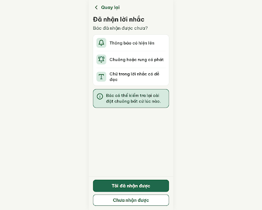
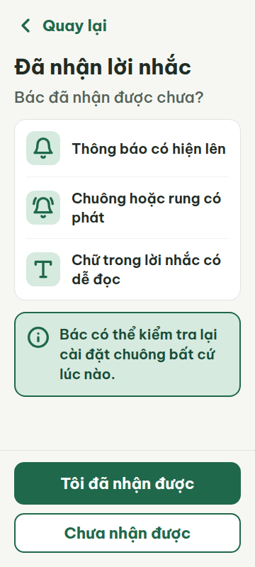
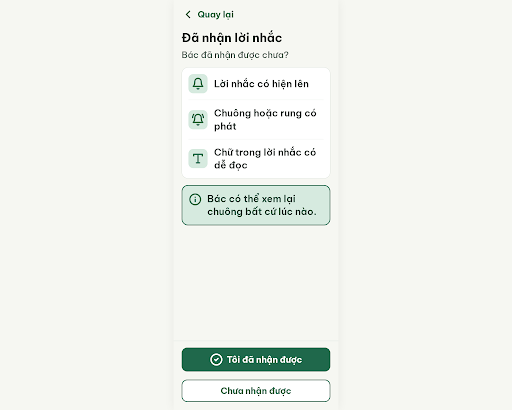
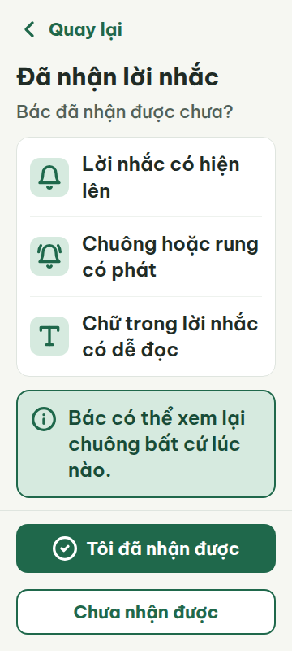
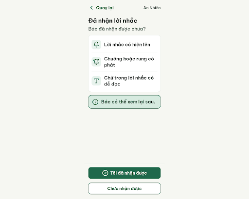
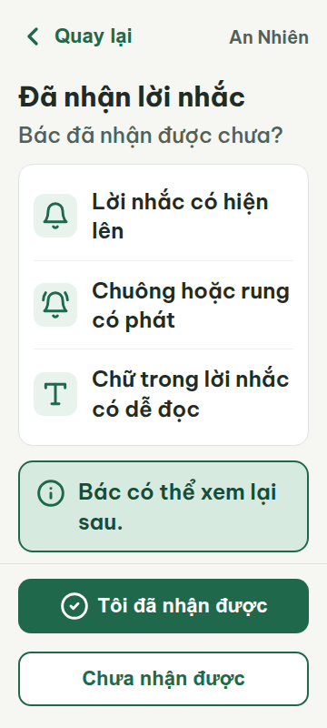

# N02 — Đã nhận lời nhắc

Project: `2013215887278758682` — An Nhiên (project của Sanh)

**Màn chốt hiện tại: v3 — 100 điểm**

Screen ID: `8bda680054794169988681a86e9e0a1a`

Nguồn v0: `3d3ecf9383b04a34b9394f1396ae02d2`. Lệnh edit trực tiếp v1 đã sửa đè cùng screen ID khi thử tạo v2; phản hồi được lưu ở `v2-attempt-response.json`. Để giữ lịch sử, v2 được dựng thành screen riêng `f3e9cc4506ce434592e8592c9f4f6872` từ `v2-rebuild-prompt.txt`; v3 là biến thể screen riêng `8bda680054794169988681a86e9e0a1a`. Cả hai phiên bản mới được thêm lên canvas, các frame cũ được giữ nguyên. Nhãn canvas v3 đã xác minh theo quy tắc chung: `An Nhiên - Đã nhận lời nhắc`.

**Kết quả: CONVERGED** · stop_reason: score_100

| Vòng | Điểm | Error | Warn | Đã sửa | Regression |
|---|---:|---:|---:|---|---|
| v0 | 61 | 3 | 3 | — | — |
| v1 | 90 | 1 | 0 | R-TXT-02, R-ICON-02, R-TAP-03 | — |
| v2 | 97 | 0 | 1 | R-TXT-03 | R-ICON-03 |
| v3 | 100 | 0 | 0 | R-ICON-03 | — |

## v0 — 61 điểm

Screen: `projects/2013215887278758682/screens/a77219681c624fe7b0184e1ddca77ea6`





- R-TXT-02 (warn): Ba dòng trong thẻ kiểm tra và ghi chú xanh. Bằng chứng: Ảnh cho thấy nội dung checklist và lời ghi chú chỉ ở cỡ khoảng 20px, nhỏ hơn mức nội dung chính khoảng 24px.. Sửa: Tăng chữ ba dòng checklist và ghi chú lên 24px; giữ tiêu đề 30px và chữ nút 22px.
- R-TXT-03 (error): Ghi chú 'Bác có thể kiểm tra lại cài đặt chuông bất cứ lúc nào.'. Bằng chứng: Câu có 10 tiếng nhưng metrics ở viewport 360 ghi 3 dòng trong nội dung; giới hạn đoạn văn là tối đa 2 dòng.. Sửa: Rút thành câu tối đa 2 dòng ở 360px, ví dụ: 'Bác có thể xem lại chuông bất cứ lúc nào.'
- R-ICON-02 (error): Nút chính 'Tôi đã nhận được' ở chân màn. Bằng chứng: Nút hành động chính chỉ có chữ, không có icon; các biểu tượng trong thẻ kiểm tra đều có nhãn.. Sửa: Thêm icon Lucide circle-check 32×32px vào nút 'Tôi đã nhận được'.
- R-ICON-03 (warn): Icon Quay lại và hai icon chuông trong thẻ kiểm tra. Bằng chứng: Cả hai hình chuông dùng cùng glyph dù biểu đạt hai nghĩa khác nhau; từ điển dành bell cho lời nhắc và bell-ring cho bật nhắc. Nét vẽ thủ công trong SVG cũng không xác định được là Lucide.. Sửa: Dùng Lucide chevron-left 32×32px cho Quay lại, bell 32×32px cho thông báo hiện lên, bell-ring 32×32px cho chuông/rung phát.
- R-TAP-03 (warn): Hai nút ở chân màn. Bằng chứng: Khoảng cách dọc giữa nút chính và nút phụ là 12px; cặp lời nhắc cần cách nhau ≥20px.. Sửa: Tăng khoảng cách giữa hai nút lên 20px.
- R-VOC-01 (error): Mục checklist 'Thông báo có hiện lên'. Bằng chứng: Từ 'Thông báo' tương ứng mục tránh dùng notification trong danh sách vocabulary mục 5.. Sửa: Đổi thành 'Lời nhắc có hiện lên'.

Màn có bố cục rõ, nhưng cần rút ghi chú xuống tối đa hai dòng, bổ sung icon cho nút chính, sửa icon chưa đúng từ điển và thay từ “Thông báo”.

### Edit prompt

```text
Keep the overall layout and everything not mentioned below unchanged.
1. [R-TXT-02] Increase the three checklist labels and the green note text to 24px. Keep the title at 30px and button labels at 22px.
2. [R-TXT-03] Replace the note “Bác có thể kiểm tra lại cài đặt chuông bất cứ lúc nào.” with “Bác có thể xem lại chuông bất cứ lúc nào.” and ensure it wraps to no more than 2 lines at a 360px viewport.
3. [R-ICON-02] Add the Lucide circle-check icon, 32×32px, to the primary “Tôi đã nhận được” button.
4. [R-ICON-03] Use Lucide chevron-left 32×32px for back, bell 32×32px for “Lời nhắc có hiện lên”, and bell-ring 32×32px for “Chuông/rung phát”. These must be distinct Lucide icons matching those meanings.
5. [R-TAP-03] Increase the vertical gap between the primary and secondary buttons to 20px.
6. [R-VOI-01] Change the checklist label “Thông báo có hiện lên” to “Lời nhắc có hiện lên”. Preserve the other checklist copy and all navigation targets.

```

## v1 — 90 điểm

Screen: `projects/2013215887278758682/screens/eff674e465f5464f8a8c6e515cb461dc`





- R-TXT-03 (error): Ghi chú 'Bác có thể xem lại chuông bất cứ lúc nào.'. Bằng chứng: Câu có 10 tiếng; metrics tại khung 360 px cho thấy ghi chú chiếm 3 dòng, vượt giới hạn 2 dòng.. Sửa: Rút câu để tối đa 2 dòng ở 360 px, ví dụ: 'Bác có thể xem lại sau.'

Màn đã sửa cỡ chữ checklist, icon nút chính và khoảng cách giữa hai nút; ghi chú vẫn vượt giới hạn hai dòng ở khung 360 px.

### Edit prompt

```text
Keep the overall layout and everything not mentioned below unchanged.
1. [R-TXT-03] In the green note card, replace “Bác có thể xem lại chuông bất cứ lúc nào.” with the exact shorter sentence “Bác có thể xem lại sau.” Ensure the note occupies no more than 2 lines at a 360px viewport. Preserve the 24px note font and all other text, icons, button spacing, colors, and layout.

```

## v2 — 97 điểm

Screen: `projects/2013215887278758682/screens/f3e9cc4506ce434592e8592c9f4f6872`





- R-ICON-03 (warn): Biểu tượng trên nút chính “Tôi đã nhận được”. Bằng chứng: Nút dùng circle-check; từ điển icon quy định biểu tượng này chỉ dùng cho trạng thái/nút “Đã xong”, còn đây là xác nhận đã nhận lời nhắc.. Sửa: Bỏ circle-check khỏi nút “Tôi đã nhận được”; dùng biểu tượng Lucide đúng nghĩa theo từ điển sau khi bổ sung nghĩa xác nhận nhận lời nhắc.

Ghi chú đã gọn trong hai dòng; biểu tượng circle-check trên nút xác nhận nhận lời nhắc dùng sai nghĩa theo từ điển icon.

### Edit prompt

```text
Keep the overall layout and everything not mentioned below unchanged.
1. [R-ICON-03] Remove `circle-check` from the primary button “Tôi đã nhận được”; the dictionary reserves it for the “Đã xong” state. Replace it with documented Lucide `arrow-right` 32×32px to indicate continuing to N04. Do not change the label, route, note, card content, or other icons.

```

## v3 — 100 điểm

Screen: `projects/2013215887278758682/screens/8bda680054794169988681a86e9e0a1a`


Biểu tượng circle-check đã được thay bằng arrow-right; các luật còn lại đạt yêu cầu hoặc không áp dụng.
