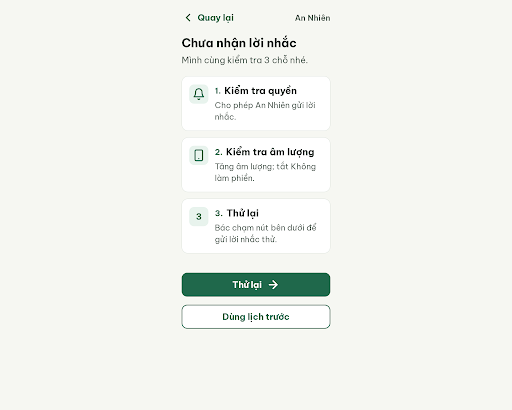
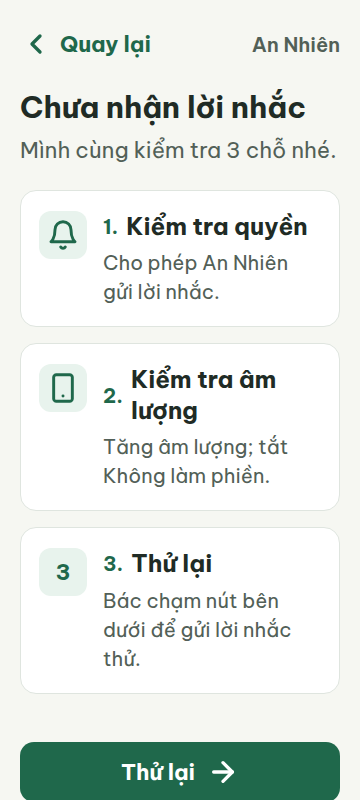
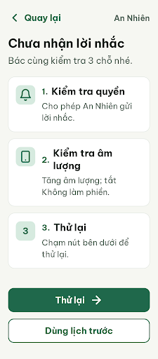
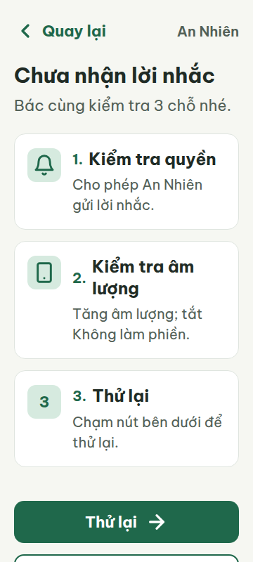
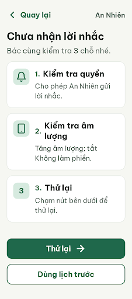
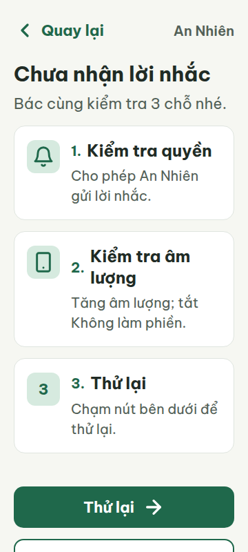

# N03 — Chưa nhận lời nhắc

Project: `2013215887278758682` — An Nhiên (project của Sanh)

**Màn chốt hiện tại: v2 — 97 điểm**

Screen ID: `490a925c2f954326899ce86280da194d`

**Kết quả: CONVERGED** · stop_reason: patience_2

| Vòng | Điểm | Error | Warn | Đã sửa | Regression |
|---|---:|---:|---:|---|---|
| v0 | 81 | 1 | 3 | — | — |
| v1 | 97 | 0 | 1 | R-TXT-03, R-LANG-02, R-STY-01 | — |
| v2 | 97 | 0 | 1 | — | — |

## v0 — 81 điểm

Screen: `projects/2013215887278758682/screens/97878e56c6ed4cbbb2d13396322452cd`





- R-TXT-03 (error): Mô tả bước 3: ‘Bác chạm nút bên dưới để gửi lời nhắc thử.’. Bằng chứng: Ở viewport 360 px, .step-desc tại bước 3 có 3 dòng (metrics: height 87 px, line-height 29 px), vượt giới hạn đoạn 2 dòng.. Sửa: Rút gọn còn tối đa 2 dòng, ví dụ ‘Chạm nút bên dưới để gửi lời nhắc thử.’ (8 tiếng).
- R-LANG-02 (warn): Dòng giới thiệu dưới tiêu đề và mô tả bước 3. Bằng chứng: Văn bản chuyển từ ‘Mình cùng kiểm tra 3 chỗ nhé.’ sang cách xưng hô ‘Bác’ trong ‘Bác chạm nút bên dưới…’.. Sửa: Thống nhất xưng ‘Bác’: đổi dòng giới thiệu thành ‘Bác cùng kiểm tra 3 chỗ nhé.’
- R-STY-01 (warn): Nền ô số/icon của các bước trong .step-badge. Bằng chứng: HTML dùng #E8F3ED; màu này không có trong token DESIGN.md (màu nền tương ứng đã định nghĩa là primary-container #D6EADF).. Sửa: Đổi nền .step-badge từ #E8F3ED sang #D6EADF.
- R-STY-03 (warn): Khoảng cách giữa hai nút ở chân màn. Bằng chứng: HTML đặt .footer-section gap 20 px; DESIGN.md quy định khoảng cách giữa các khối là 16 px, và đây không phải cặp nút lời nhắc cần khoảng cách 20 px.. Sửa: Đặt khoảng cách giữa hai nút là 16 px.

Màn có bố cục và chữ dễ đọc; còn một lỗi về mô tả bước cuối dài ba dòng và ba sai lệch nhẹ về cách xưng hô, màu token và khoảng cách.

### Edit prompt

```text
Keep the overall layout and everything not mentioned below unchanged.
1. [R-TXT-03] In step 3, replace “Bác chạm nút bên dưới để gửi lời nhắc thử.” with the shorter exact text “Chạm nút bên dưới để thử lại.” It must wrap to no more than 2 lines at 360px. Preserve all three steps and both destinations.
2. [R-LANG-02] Change the subtitle under the heading to “Bác cùng kiểm tra 3 chỗ nhé.” so the screen uses one consistent form of address.
3. [R-STY-01] Change the background of every `.step-badge` from `#E8F3ED` to the documented `#D6EADF` (`primary-container`). Leave other colors unchanged.
4. [R-STY-03] Set the vertical gap between the two footer buttons to exactly 16px. Keep both buttons 60px high and retain their current labels and order.
Do not add icons or change the content, typography, destinations, card layout, or any other colors.

```

## v1 — 97 điểm

Screen: `projects/2013215887278758682/screens/0045bb0a4a054d08b31f95b83fb5a0e4`





- R-STY-03 (warn): Khoảng cách dưới dòng giới thiệu ‘Bác cùng kiểm tra 3 chỗ nhé.’, trước thẻ bước 1. Bằng chứng: Ở viewport 360 px, dòng giới thiệu kết thúc tại y=165.8 và khối bước bắt đầu tại y=189.8, tạo khoảng cách 24 px; luật quy định 16 px giữa các khối.. Sửa: Đổi .header-section margin-bottom từ 24 px thành 16 px.

Màn xử lý sự cố đạt 97 điểm; các lỗi trước về mô tả, xưng hô và màu token đã được sửa, còn khoảng cách 24 px giữa phần giới thiệu và danh sách bước.

### Edit prompt

```text
Keep the overall layout and everything not mentioned below unchanged.
1. [R-STY-03] In `.header-section`, change the margin below the introduction from 24px to exactly 16px so the gap before the first recovery step is 16px at 360px and 412px.
Preserve all Vietnamese copy, step card sizes, documented colors, typography, icons, buttons, and navigation destinations.

```

## v2 — 97 điểm

Screen: `projects/2013215887278758682/screens/490a925c2f954326899ce86280da194d`





- R-STY-03 (warn): Khoảng trống giữa danh sách bước và nhóm nút cuối màn. Bằng chứng: Ở viewport 360 px, danh sách bước kết thúc tại y=656.55 và footer bắt đầu tại y=688.55, cách 32 px; ở 412 px, danh sách kết thúc tại y=625.36 và footer bắt đầu tại y=657.36, cũng cách 32 px. Các khoảng cách nhóm khác đo được là 16 px (giới thiệu→bước, giữa các bước, giữa hai nút); còn khoảng cách 32 px này vượt mức 16 px của luật.. Sửa: Giảm khoảng cách sau `.steps-container` từ 32 px xuống 16 px ở cả viewport 360 px và 412 px.

Màn N03 đạt 97 điểm; khoảng trống 32 px trước nhóm nút vẫn vượt mức 16 px giữa các khối.
