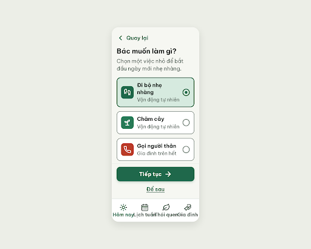
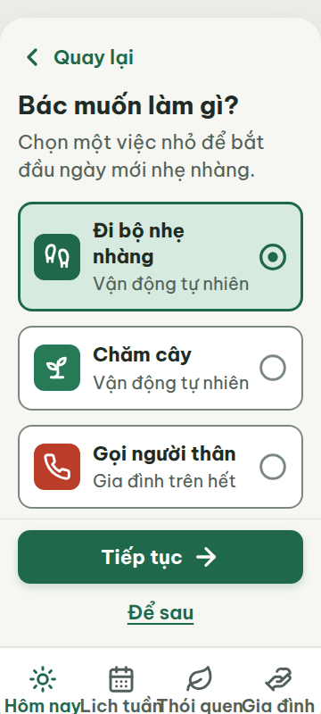
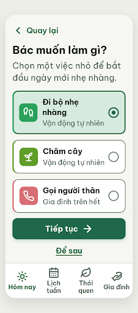
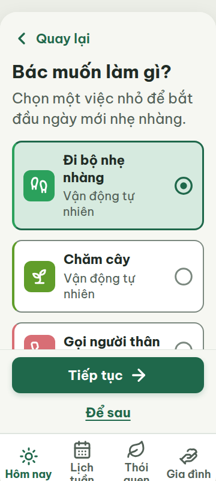
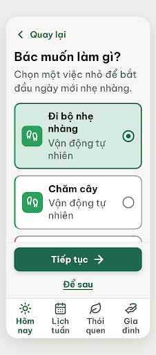
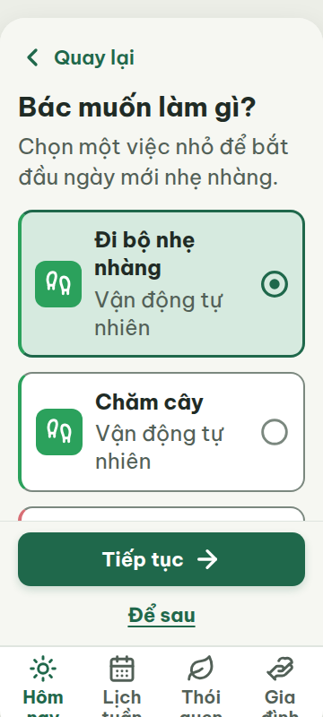

# N04 — Chọn việc đầu tiên

Project: `2013215887278758682` — An Nhiên (project của Sanh)

**Màn chốt hiện tại: v2 — 100 điểm**

Screen ID: `185c95bb279a45a394a37008e5cb66d7`

**Kết quả: CONVERGED** · stop_reason: score_100

| Vòng | Điểm | Error | Warn | Đã sửa | Regression |
|---|---:|---:|---:|---|---|
| v0 | 64 | 3 | 2 | — | — |
| v1 | 81 | 1 | 3 | R-LAY-01, R-COL-02, R-NAV-01 | R-TXT-01, R-ICON-03 |
| v2 | 100 | 0 | 0 | R-TXT-01, R-TXT-02, R-ICON-03, R-COL-03 | — |

## v0 — 64 điểm

Screen: `projects/2013215887278758682/screens/634e2360b16c438697d1a8334a7e9322`





- R-TXT-02 (warn): Tiêu đề “Bác muốn làm gì?”. Bằng chứng: Tiêu đề 28 px, thấp hơn cỡ xấp xỉ 30 px; chữ nội dung và nút khoảng 20–22 px.. Sửa: Đặt tiêu đề màn hình 30 px; giữ nội dung 24 px và chữ nút 22 px.
- R-LAY-01 (error): Nhãn bottom nav ở chiều rộng 360 px. Bằng chứng: Mỗi tab rộng 86 px nhưng nhãn nowrap như “Lịch tuần” và “Thói quen” vượt vùng tab; ảnh cho thấy các nhãn nhập vào nhau và bị cắt trong khung overflow:hidden.. Sửa: Cho nhãn xuống 2 dòng hoặc rút gọn bằng bố cục vừa vùng 78 px hữu dụng/tab; bỏ nowrap và kiểm tra tổng nav không quá 360 px.
- R-COL-02 (error): Các thẻ chọn việc. Bằng chứng: Ba thẻ có ô icon màu nhưng không có vạch màu dọc bên trái theo quy tắc; ảnh cho thấy cạnh trái chỉ là viền bo đồng nhất.. Sửa: Thêm vạch trái rộng 4 px vào mỗi thẻ, dùng màu nhấn đúng thói quen tương ứng.
- R-COL-03 (warn): Ô icon của ba thói quen mẫu. Bằng chứng: HTML dùng #1F684B, #287A57, #BA3D2A; DESIGN.md quy định lần lượt habit-move-accent #2BA15C, habit-plant-accent #609D2A và habit-family-accent #D86E75.. Sửa: Đổi nền ô icon thành #2BA15C cho Đi bộ, #609D2A cho Chăm cây, và #D86E75 cho Gọi người thân; dùng icon trắng.
- R-NAV-01 (error): Thanh điều hướng dưới cùng. Bằng chứng: Có đủ bốn icon và nhãn đúng nội dung, nhưng nhãn ở ảnh bị dồn/chồng lên nhau ở khung 360 px nên không đọc rõ.. Sửa: Bố trí lại 4 tab trong 360 px; giữ mỗi nhãn trọn vẹn trên tối đa 2 dòng, vùng tab tối thiểu 48 × 48 px.

Ba lỗi cần sửa: nhãn bottom nav bị chồng/cắt ở 360 px, thẻ thiếu vạch màu nhấn bên trái và ô icon dùng sai ba màu nhấn theo DESIGN.md.

### Edit prompt

```text
Keep the overall layout and everything not mentioned below unchanged.
1. R-TXT-02: Increase the screen heading “Bác muốn làm gì?” from 28px to 30px; set main body copy to 24px and button labels to 22px.
2. R-LAY-01 and R-NAV-01: Reflow the four bottom-nav labels within 360px: allow labels to wrap to at most 2 lines, remove nowrap/overflow clipping, and give each tab enough width for “Hôm nay”, “Lịch tuần”, “Thói quen”, “Gia đình” to remain fully readable with clear gaps. Keep 20px label type and all icons.
3. R-COL-02 and R-COL-03: For the three task cards, add a 4px full-height left accent stripe and a matching solid accent icon tile with white icon. Use exact accents: Walking #2BA15C, Plant-care #609D2A, Family/call #D86E75. Do not use primary/danger colors in place of these habit accents.
Preserve the three activity choices, “Tự đặt tên việc”, “Tiếp tục”, “Để sau”, and the rule that nothing is saved until review. Generate a new screen and preserve N04 v0 unchanged.

```

## v1 — 81 điểm

Screen: `projects/2013215887278758682/screens/afa01453a29a4da889eaf60aab2bee76`





- R-TXT-01 (error): Nhãn bottom nav: Hôm nay, Lịch tuần, Thói quen, Gia đình. Bằng chứng: HTML đặt cả bốn nhãn ở 18 px, dưới mức tối thiểu 20 px.. Sửa: Đặt font-size của cả bốn nhãn bottom nav thành 20 px; cho phép nhãn xuống dòng trong tab.
- R-TXT-02 (warn): Chữ trong các thẻ chọn việc. Bằng chứng: Tiêu đề màn đã lên 30 px và dòng giới thiệu 24 px, nhưng tên việc vẫn 22 px và mô tả vẫn 20 px.. Sửa: Đặt tên việc và mô tả trong thẻ ở khoảng 24 px; giữ tiêu đề 30 px và chữ nút 22 px.
- R-ICON-03 (warn): Ô icon của thẻ “Chăm cây”. Bằng chứng: Thẻ dùng icon mầm cây thay vì icon Lucide trong từ điển cho thói quen Vận động tự nhiên; nội dung thẻ ghi “Vận động tự nhiên”.. Sửa: Đổi icon thẻ “Chăm cây” thành Lucide `footprints` 32 px, theo mục Thói quen trong Từ điển icon.
- R-COL-03 (warn): Ô icon thẻ “Chăm cây”. Bằng chứng: Nội dung thẻ gắn hoạt động này với Vận động tự nhiên, nhưng nền icon đang là #609D2A (màu Ăn nhiều rau, đậu); Vận động tự nhiên dùng #2BA15C.. Sửa: Đổi nền ô icon và vạch trái thẻ “Chăm cây” sang #2BA15C; giữ icon màu trắng.

Đã sửa được tràn nhãn nav, thiếu vạch màu và hai màu thói quen; còn nhãn nav dưới 20 px, cỡ chữ nội dung nhỏ, cùng icon và màu chưa khớp cho thẻ Chăm cây.

### Edit prompt

```text
Keep the overall layout and everything not mentioned below unchanged.
1. [R-TXT-01] Increase all four bottom navigation labels (“Hôm nay”, “Lịch tuần”, “Thói quen”, “Gia đình”) from 18 px to 20 px minimum. Let labels wrap inside each tab; do not clip or shrink them.
2. [R-TXT-02] Increase the activity-card titles and descriptions to 24 px. Preserve the screen title at 30 px and button labels at 22 px.
3. [R-ICON-03] For the “Chăm cây” card, use Lucide `footprints` at 32 px. “Chăm cây, tưới rau” is a documented activity under “Vận động tự nhiên” in vocabulary.md.
4. [R-COL-03] Set the “Chăm cây” card icon background and its left accent stripe to the Move accent `#2BA15C`; keep the icon white.

Preserve Vietnamese wording, the existing selection state, spacing structure, navigation, and all other colors and content.

```

## v2 — 100 điểm

Screen: `projects/2013215887278758682/screens/185c95bb279a45a394a37008e5cb66d7`






Các nhãn nav và chữ trong thẻ đã đạt cỡ yêu cầu; icon, màu thói quen khớp với hoạt động được ghi trên thẻ và không còn lỗi theo bộ luật.
