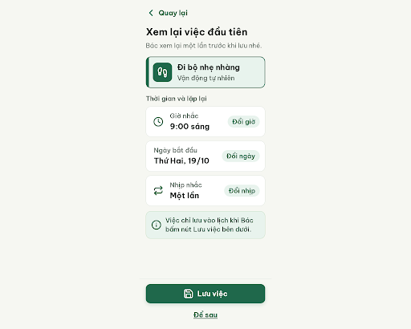
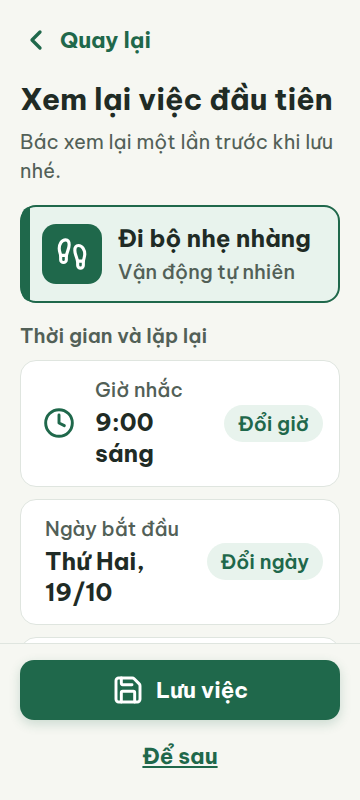
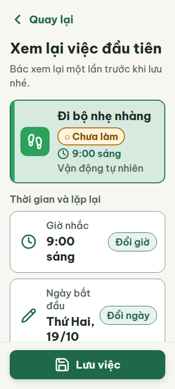
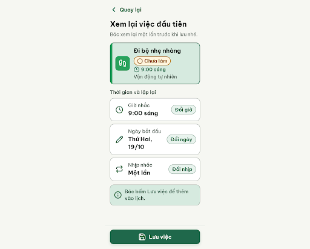
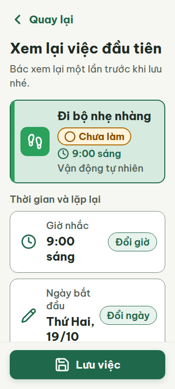

# N05 — Xem lại việc đầu tiên

Project: `2013215887278758682` — An Nhiên (project của Sanh)

**Màn chốt hiện tại: v3 — 97 điểm**

Screen ID: `531974bf4f074684b23c2d296c9ce448`

**Kết quả: CONVERGED** · stop_reason: patience_2

| Vòng | Điểm | Error | Warn | Đã sửa | Regression |
|---|---:|---:|---:|---|---|
| v0 | 51 | 4 | 3 | — | — |
| v1 | 97 | 0 | 1 | R-CON-02, R-TXT-03, R-TXT-05, R-ICON-02, R-COL-03, R-STA-01, R-STY-01 | R-ICON-03 |
| v2 | 94 | 0 | 2 | — | R-CON-02 |
| v3 | 97 | 0 | 1 | R-ICON-03 | R-CON-02 |

## v0 — 51 điểm

Screen: `projects/2013215887278758682/screens/d4c8c14ed117454db0d5d56784a116e7`





- R-CON-02 (warn): Viền các nút Giờ nhắc, Ngày bắt đầu và Nhịp nhắc. Bằng chứng: v0.html dùng border #DFE5DF trên nền nút #FFFFFF, tương phản khoảng 1.2:1 (< 3:1).. Sửa: Đổi viền control sang #7B887F (3.44:1 trên nền trắng).
- R-TXT-03 (error): Thẻ ghi chú dưới danh sách, câu “Việc chỉ lưu vào lịch khi Bác bấm nút Lưu việc bên dưới.”. Bằng chứng: v0-metrics-360.json đo .note-text cao 84px với line-height 28px, tức 3 dòng; giới hạn là 2 dòng.. Sửa: Rút gọn thành “Bác bấm Lưu việc để thêm vào lịch.” để vừa tối đa 2 dòng ở 360px.
- R-TXT-05 (error): Thẻ việc đã chọn “Đi bộ nhẹ nhàng”. Bằng chứng: Thẻ có icon và tên việc nhưng không có giờ hay nhãn trạng thái; nhãn “Vận động tự nhiên” là dòng phụ duy nhất.. Sửa: Thêm giờ “9:00 sáng” và chip “○ Chưa làm” cạnh tên việc; giữ tối đa một dòng phụ.
- R-ICON-02 (error): Nút “Ngày bắt đầu” và nút phụ “Để sau”. Bằng chứng: Hai nút thao tác không có icon; các hàng Giờ nhắc/Nhịp nhắc và nút Lưu việc có icon.. Sửa: Thêm Lucide calendar-days 32px vào nút Ngày bắt đầu và Lucide arrow-right 32px vào nút Để sau.
- R-COL-03 (warn): Ô icon và vạch trái của thẻ việc “Đi bộ nhẹ nhàng”. Bằng chứng: CSS khai báo --habit-move: #1F684B; DESIGN.md quy định Vận động tự nhiên dùng #2BA15C.. Sửa: Đổi --habit-move thành #2BA15C cho nền ô icon và vạch trái.
- R-STA-01 (error): Thẻ việc đã chọn “Đi bộ nhẹ nhàng”. Bằng chứng: Thẻ không có nhãn trạng thái đặt cạnh tên việc; ảnh chỉ cho thấy tên việc và tên thói quen.. Sửa: Thêm chip trạng thái “○ Chưa làm” màu viền vàng đậm cạnh tên việc.
- R-STY-01 (warn): Thẻ việc đã chọn và thẻ ghi chú. Bằng chứng: v0.html dùng #E8F3ED cho nền chọn/note và #C4DEC0 cho viền note; DESIGN.md quy định primary-container #D6EADF.. Sửa: Đổi nền #E8F3ED thành #D6EADF và viền #C4DEC0 thành token outline #7B887F.

Màn dễ đọc, đúng bố cục xem lại và có nút lưu rõ; cần rút gọn ghi chú, hoàn thiện nội dung thẻ việc và sửa icon/màu theo token.

### Edit prompt

```text
Keep the overall layout and everything not mentioned below unchanged.
1. [R-CON-02] Change the border of the time/date/repeat controls from #DFE5DF to #7B887F so each control outline reaches at least 3:1 contrast against white.
2. [R-TXT-03] Replace the reassurance note with the exact shorter copy “Bác bấm Lưu việc để thêm vào lịch.” and keep it within 2 lines at 360px.
3. [R-TXT-05, R-STA-01] In the selected task card, show the task time “9:00 sáng” and add a visible “○ Chưa làm” status chip next to the task name; keep the secondary line to one line maximum.
4. [R-ICON-02] Add the documented Lucide pencil 32px with visible “Đổi ngày” label to the date editing control; do not use calendar-days because DESIGN.md reserves it for the Lịch tuần tab/title. Remove the invented “Để sau” secondary action and its icon; keep only the documented primary “Lưu việc” action in the footer.
5. [R-COL-03] Set the move-habit accent stripe and icon tile to #2BA15C.
6. [R-STY-01] Replace the selected task/note background #E8F3ED with #D6EADF; replace the note border #C4DEC0 with #7B887F. Preserve all other palette tokens and text.

```

## v1 — 97 điểm

Screen: `projects/2013215887278758682/screens/d93bfb6ced594ae8b7ee395028246cd8`




- R-ICON-03 (warn): Biểu tượng “○” trong chip “○ Chưa làm”. Bằng chứng: Ảnh cho thấy ký hiệu vòng tròn nhỏ hơn chữ chip; HTML đặt toàn bộ nhãn ở 20px, dưới mức ngoại lệ 24px, và ký hiệu không phải icon Lucide circle trong từ điển.. Sửa: Dùng icon Lucide circle 24×24px trong chip, giữ nhãn “Chưa làm” ở 20px.

Màn xem lại rõ và dễ đọc; mọi lỗi mức error từ vòng trước đã được khắc phục, còn ký hiệu trạng thái cần tăng lên 24px và dùng Lucide circle.

### Edit prompt

```text
Keep the overall layout and everything not mentioned below unchanged.
1. [R-ICON-03] In the “Chưa làm” status chip, replace the plain 20px “○” character with the documented Lucide `circle` icon at 24×24px, stroke 2–2.5. Keep it beside the visible “Chưa làm” label and preserve the chip colors, shape, text and all other screen details.

```

## v2 — 94 điểm

Screen: `projects/2013215887278758682/screens/5c0400d6d9ab4b468175e9f66a5292cb`




- R-CON-02 (warn): Ô icon thói quen trong thẻ ‘Đi bộ nhẹ nhàng’. Bằng chứng: HTML đặt ô icon #2BA15C trên nền thẻ chọn #D6EADF; độ tương phản đo được là 2.63:1, dưới 3:1. Viền các hàng điều khiển #7B887F trên trắng đạt 3.44:1.. Sửa: Đổi nền thẻ chọn thành #FFFFFF để ô icon #2BA15C đạt 3.30:1, hoặc thêm nền viền sáng phù hợp để tương phản ô icon với nền tối thiểu 3:1.
- R-ICON-03 (warn): Biểu tượng đồng hồ cạnh giờ ‘9:00 sáng’ trong thẻ việc. Bằng chứng: Ảnh và metrics cho thấy icon đồng hồ 24×24 px. Ngoại lệ 24 px chỉ áp dụng cho icon trong chip trạng thái; các icon khác phải từ 32 px và dùng Lucide theo từ điển.. Sửa: Tăng icon đồng hồ Lucide cạnh giờ trong thẻ lên 32×32 px; giữ circle Lucide trong chip trạng thái ở 24×24 px.

Màn đạt mọi luật mức error; còn hai cảnh báo về độ tương phản ô icon thói quen và cỡ icon đồng hồ trong thẻ việc.

### Edit prompt

```text
Keep the overall layout and everything not mentioned below unchanged.
1. [R-ICON-03] In the “Chưa làm” status chip, replace the plain 20px “○” character with the documented Lucide `circle` icon at 24×24px, stroke 2–2.5. Keep it beside the visible “Chưa làm” label and preserve the chip colors, shape, text and all other screen details.

```

## v3 — 97 điểm

Screen: `projects/2013215887278758682/screens/531974bf4f074684b23c2d296c9ce448`




- R-CON-02 (warn): Viền ba nút “Giờ nhắc”, “Ngày bắt đầu” và “Nhịp nhắc”. Bằng chứng: HTML đặt viền nút ở #DFE5DF trên nền thẻ #FFFFFF; tương phản xấp xỉ 1.25:1, thấp hơn yêu cầu 3:1.. Sửa: Đổi viền các nút điều khiển sang tối thiểu #7B887F trên nền #FFFFFF (3.70:1).

Màn xem lại rõ và dễ đọc; icon trạng thái đã đúng quy cách, nhưng viền ba nút điều khiển chưa đủ tương phản.
