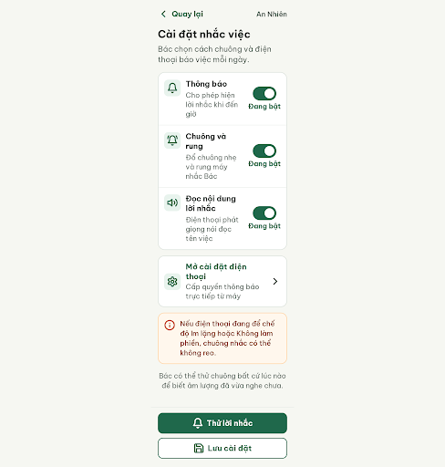
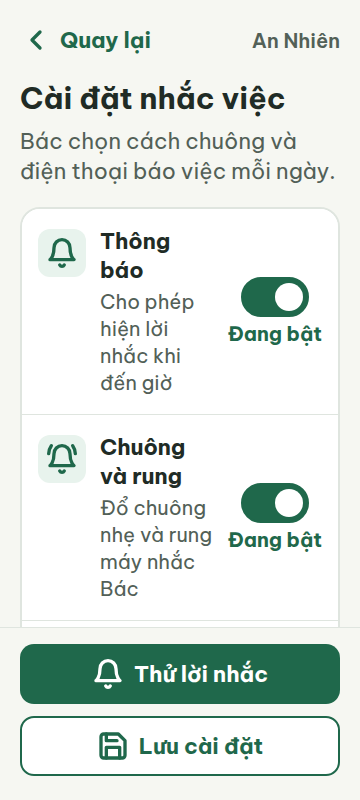
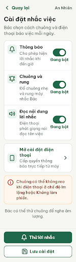
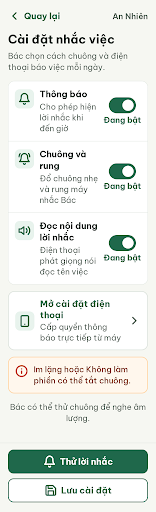
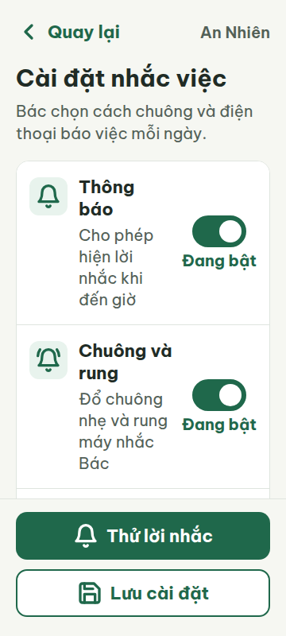
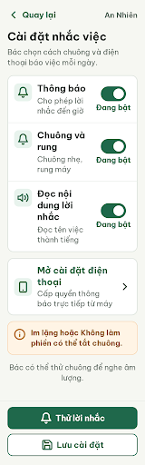
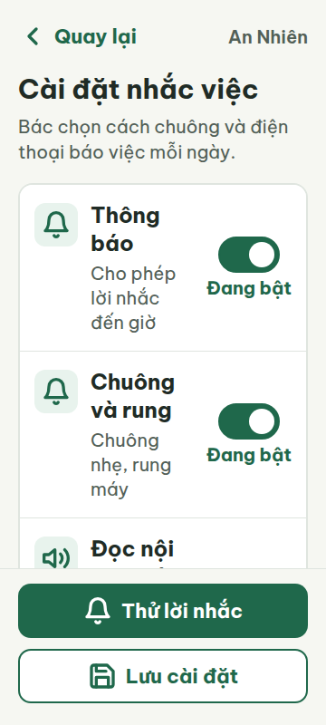
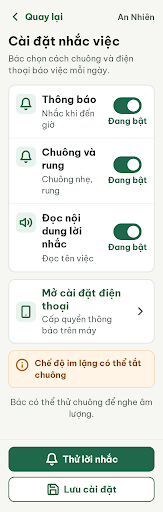
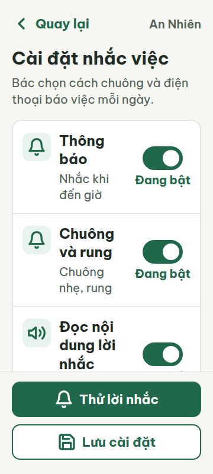

# N07 — Cài đặt nhắc việc

Project: `2013215887278758682` — An Nhiên (project của Sanh)

**Màn chốt hiện tại: v4 — 100 điểm**

Screen ID: `e6c79c80f4484c03829c3ca64cbab493`

**Kết quả: CONVERGED** · stop_reason: score_100

| Vòng | Điểm | Error | Warn | Đã sửa | Regression |
|---|---:|---:|---:|---|---|
| v0 | 84 | 1 | 2 | — | — |
| v1 | 87 | 1 | 1 | R-ICON-03 | — |
| v2 | 90 | 1 | 0 | R-STY-02 | — |
| v3 | 77 | 2 | 1 | R-TXT-03 | R-LAY-01, R-ICON-03 |
| v4 | 100 | 0 | 0 | R-TXT-03 | — |

## v0 — 84 điểm

Screen: `projects/2013215887278758682/screens/385be7f16f3b45f7879428105d984c3d`





- R-TXT-03 (error): Thẻ lưu ý và đoạn hướng dẫn bên dưới. Bằng chứng: Câu 'Nếu điện thoại đang để chế độ Im lặng hoặc Không làm phiền, chuông nhắc có thể không reo.' có 19 tiếng và hiển thị 5 dòng; câu 'Bác có thể thử chuông bất cứ lúc nào để biết âm lượng đã vừa nghe chưa.' có 17 tiếng và hiển thị 3 dòng ở 360 px.. Sửa: Thay lần lượt bằng 'Chuông có thể không reo khi điện thoại ở chế độ Im lặng hoặc Không làm phiền.' và 'Bác có thể thử chuông để nghe âm lượng.'; giữ mỗi đoạn tối đa 2 dòng ở 360 px.
- R-ICON-03 (warn): Biểu tượng của mục 'Mở cài đặt điện thoại'. Bằng chứng: Hình bánh răng không khớp mục 'Điện thoại (thiết bị, quyền, dữ liệu trên máy)' trong từ điển icon; các SVG hiển thị có khung 32 × 32 px.. Sửa: Đổi biểu tượng bánh răng của 'Mở cài đặt điện thoại' thành Lucide smartphone, kích thước 32 × 32 px.
- R-STY-02 (warn): Nhóm thẻ tùy chọn và thẻ liên kết cài đặt. Bằng chứng: CSS đặt bán kính nhóm thẻ là 20 px, thẻ liên kết là 18 px và thẻ lưu ý là 18 px; token yêu cầu card bo 16 px.. Sửa: Đặt border-radius của cả ba thẻ/nhóm thẻ thành 16 px; giữ nút ở 14 px và font Be Vietnam Pro.

Màn đạt các kiểm tra chính về cỡ chữ, tương phản và vùng chạm; còn một lỗi câu dài và hai cảnh báo về icon, bo góc thẻ.

### Edit prompt

```text
Keep the overall layout and everything not mentioned below unchanged.
1. [R-TXT-03] Replace the long warning sentence with exactly: “Chuông có thể không reo khi điện thoại ở chế độ Im lặng hoặc Không làm phiền.” Replace the long explanatory sentence with exactly: “Bác có thể thử chuông để nghe âm lượng.” Ensure each paragraph occupies at most 2 lines at 360 px.
2. [R-ICON-03] Change the icon beside “Mở cài đặt điện thoại” from a gear to the documented Lucide icon “smartphone”, 32 × 32 px.
3. [R-STY-02] Set the settings option cards, phone-settings link card, and warning card border-radius to 16 px. Keep buttons at 14 px and preserve Be Vietnam Pro.
Preserve the Vietnamese labels, switch states, all existing settings and action behavior, colors, and spacing structure.

```

## v1 — 87 điểm

Screen: `projects/2013215887278758682/screens/4146b59742874ca091d46f5f27aa137a`




- R-TXT-03 (error): Thẻ lưu ý 'Chuông có thể không reo…' ở khung 360 px. Bằng chứng: Đoạn văn ngắn lại nhưng vẫn chiếm 4 dòng trong vùng chữ rộng 238 px; luật giới hạn đoạn văn tối đa 2 dòng.. Sửa: Rút gọn thành 'Im lặng hoặc Không làm phiền có thể tắt chuông.'; để chữ 20 px và đoạn không quá 2 dòng ở 360 px.
- R-STY-02 (warn): Nhóm thẻ tùy chọn lời nhắc. Bằng chứng: CSS của .settings-group đặt border-radius 20 px; style nội tuyến 16 px chỉ áp vào section aria-label, không ghi đè radius của section.settings-group nên góc ngoài vẫn 20 px. Thẻ cài đặt điện thoại và lưu ý đã về 16 px.. Sửa: Đổi border-radius của .settings-group từ 20 px thành 16 px; giữ Be Vietnam Pro, gradient none và nút 14 px.

V1 sửa được icon điện thoại và bo góc hai thẻ; câu lưu ý vẫn dài hơn hai dòng ở 360 px và nhóm thẻ chính còn bo 20 px.

### Edit prompt

```text
Keep the overall layout and everything not mentioned below unchanged.
1. [R-TXT-03] In the warning card, replace the entire warning sentence with exactly: “Im lặng hoặc Không làm phiền có thể tắt chuông.” Set the text to 20 px and ensure it occupies no more than 2 lines at 360 px.
2. [R-STY-02] Set the outer settings-group container .settings-group border-radius to exactly 16 px. Apply the radius to the visible outer group itself, not only an inner section.
Preserve all switches, labels, colors, button radius 14 px, Be Vietnam Pro, icon smartphone, and existing spacing.

```

## v2 — 90 điểm

Screen: `projects/2013215887278758682/screens/72b9a7f5efcd46fa8684856b03e2abdd`





- R-TXT-03 (error): Các mô tả trong nhóm tùy chọn lời nhắc ở khung 360 px. Bằng chứng: Metrics ghi “Cho phép hiện lời nhắc khi đến giờ” thành 4 dòng, “Đổ chuông nhẹ và rung máy nhắc Bác” và “Điện thoại phát giọng nói đọc tên việc” thành 3 dòng; luật giới hạn mỗi đoạn tối đa 2 dòng. Dòng lưu ý đã rút còn 2 dòng.. Sửa: Rút gọn mỗi mô tả xuống tối đa 2 dòng ở 360 px, ví dụ “Cho phép lời nhắc đến giờ”, “Chuông nhẹ, rung máy” và “Đọc tên việc thành tiếng”; giữ cỡ chữ 20 px.

V2 sửa bo góc của các thẻ về 16 px và rút ngắn lưu ý xuống hai dòng; các mô tả trong nhóm cài đặt vẫn dài 3–4 dòng ở 360 px.

## v3 — 77 điểm

Screen: `projects/2013215887278758682/screens/9e3b806a05094bbabf835a87fc5d7981`





- R-LAY-01 (error): Khung 412 px. Bằng chứng: Metrics 412 báo scrollWidth 412, nhưng các phần tử con vươn đến x=392 từ lề trái 22 và card đặt tại x=20 rộng 372; chỉ còn 20 px ở mép phải. Ở khung 360 px không tràn ngang.. Sửa: Sửa device-wrapper và fixed-footer dùng width:min(100%, 412px), bỏ min-width 360px; đảm bảo content-area padding ngang 20px và card không vượt x=392 ở 412 px.
- R-TXT-03 (error): Các mô tả tùy chọn và ghi chú ở khung 360 px. Bằng chứng: Metrics 360: “Cho phép lời nhắc đến giờ”, “Chuông nhẹ, rung máy”, “Đọc nội dung lời nhắc”, “Đọc tên việc thành tiếng”, “Cấp quyền thông báo trực tiếp từ máy” và lưu ý “Im lặng hoặc Không làm phiền có thể tắt chuông.” đều hiển thị 3 dòng. Luật giới hạn đoạn tối đa 2 dòng.. Sửa: Giới hạn từng đoạn tối đa 2 dòng ở 360 px; ví dụ đổi thành “Cho phép nhắc khi đến giờ”, “Chuông nhẹ và rung”, “Đọc tên việc”, “Cấp quyền thông báo trên máy” và “Chế độ im lặng có thể tắt chuông”.
- R-ICON-03 (warn): Biểu tượng chuông ở hàng “Thông báo”, “Chuông và rung” và nút “Thử lời nhắc”. Bằng chứng: Ảnh 360 cho thấy cùng hình chuông được dùng cho ý nghĩa Thông báo, Chuông và rung, và hành động Thử lời nhắc; từ điển quy định một icon một nghĩa, chuông cho Lời nhắc và bell-ring cho Bật nhắc.. Sửa: Dùng `bell` chỉ cho “Thông báo/Lời nhắc”, `bell-ring` cho “Chuông và rung/Bật nhắc”, và `volume-2` cho nút “Thử lời nhắc”; giữ mỗi SVG 32 × 32 px.

V3 rút ngắn một số mô tả nhưng chúng vẫn thành 3 dòng ở 360 px; 412 px tràn ngang và icon chuông bị dùng lặp cho nhiều nghĩa.

### Edit prompt

```text
Keep the best N07 v2 layout, dimensions, spacing, colors, card radii, icons, switch states, footer and navigation unchanged. Make text-only changes to the settings descriptions so each description fits within 2 lines at 360 px, retaining 20 px text.
Replace the three settings descriptions with exactly:
- “Thông báo”: “Nhắc khi đến giờ”
- “Chuông và rung”: “Chuông nhẹ, rung”
- “Đọc nội dung lời nhắc”: “Đọc tên việc”
Replace the phone-settings card description with exactly “Cấp quyền thông báo trên máy”.
Replace the warning card text with exactly “Chế độ im lặng có thể tắt chuông”.
Keep the note below the card exactly “Bác có thể thử chuông để nghe âm lượng.”
Do not change titles, labels, icons, actions, outer group radius (16 px), button radius (14 px), Be Vietnam Pro, or element widths. Ensure no horizontal overflow at 360 px or 412 px.

```

## v4 — 100 điểm

Screen: `projects/2013215887278758682/screens/e6c79c80f4484c03829c3ca64cbab493`






V4 rút gọn các mô tả; mọi đoạn văn hiển thị ở khung 360 px tối đa hai dòng và không có câu dài hơn 15 tiếng.

## Bản N07 đến muộn từ request ban đầu

Trong lúc khôi phục request generation trước đó, Stitch đã thêm một màn khác lên canvas: `projects/2013215887278758682/screens/8b6538f417544fb9b81dfdd1dbe93b60`. Màn này được giữ nguyên và gắn nhãn “An Nhiên - Cài đặt nhắc việc (V0 trễ)”; không dùng làm best vì không có response/artifact gắn được với request trước để kiểm tra và review độc lập. Các vòng v0–v4 trong bảng là lịch sử đã xác minh và chấm theo quy trình.
