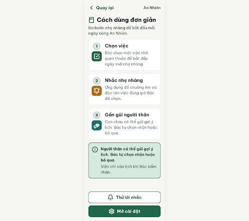
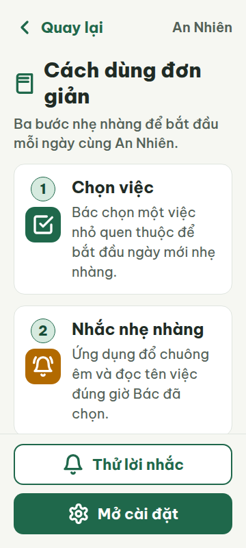
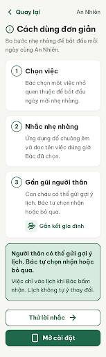
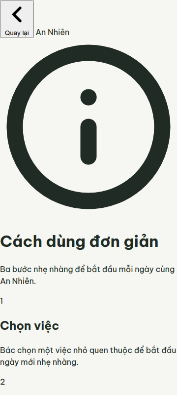
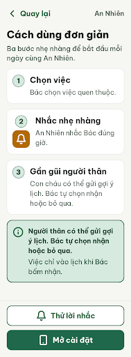
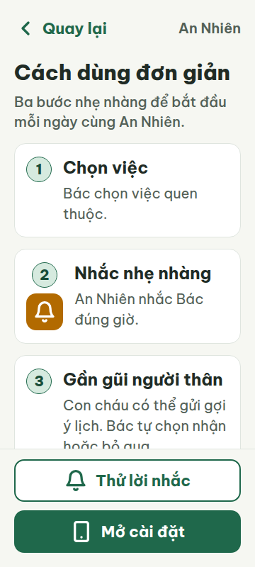
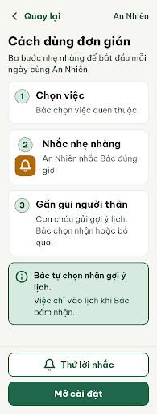
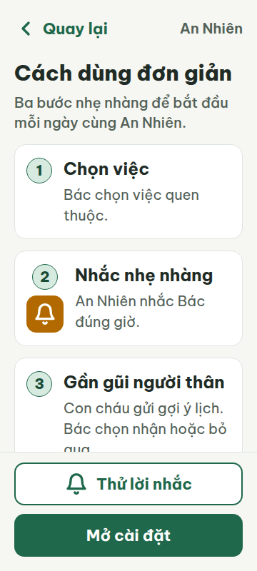

# N08 — Cách dùng đơn giản

Project: `2013215887278758682` — An Nhiên (project của Sanh)

**Màn chốt hiện tại: v2 — 87 điểm**

Screen ID: `c9a5170959fc4cd28bfde8a562a74474`

**Kết quả: NEEDS_HUMAN** · stop_reason: patience_2

| Vòng | Điểm | Error | Warn | Đã sửa | Regression |
|---|---:|---:|---:|---|---|
| v0 | 87 | 1 | 1 | — | — |
| v1 | 84 | 1 | 2 | — | — |
| v2 | 87 | 1 | 1 | R-TXT-03 | R-ICON-03 |
| v3 | 80 | 2 | 0 | R-ICON-03 | R-ICON-02 |

## v0 — 87 điểm

Screen: `projects/2013215887278758682/screens/99eda771162341a2ac3c7d7bc5950308`





- R-TXT-03 (error): Các mô tả dưới bước 1 và bước 2 trong thẻ hướng dẫn. Bằng chứng: Ở viewport 360 px, ‘Bác chọn một việc nhỏ quen thuộc để bắt đầu ngày mới nhẹ nhàng.’ và ‘Ứng dụng đổ chuông êm và đọc tên việc đúng giờ Bác đã chọn.’ đều chiếm 4 dòng theo metrics; quy tắc giới hạn đoạn văn ở 2 dòng.. Sửa: Rút mỗi mô tả còn tối đa 2 dòng ở 360 px, ví dụ: ‘Bác chọn việc quen thuộc.’ và ‘An Nhiên nhắc Bác đúng giờ.’
- R-ICON-03 (warn): Các icon ở tiêu đề, bước 1, bước 3 và nút ‘Mở cài đặt’. Bằng chứng: HTML dùng các hình book/open-book, check-square, hand-heart và settings; các nghĩa/tên này không có trong từ điển icon của DESIGN.md. Icon hand-heart cũng được quy định riêng cho tab Gia đình, còn icon bell-ring trong bước 2 được gắn nghĩa ‘Bật nhắc’, không phải nhắc việc.. Sửa: Dùng icon có tên trong từ điển và đúng nghĩa: tiêu đề có thể bỏ icon; thay biểu tượng hoàn thành ở bước 1 bằng circle-check chỉ nếu nghĩa là ‘Đã xong’ (nếu không có icon khớp, dùng số bước, không thêm icon); thay hand-heart bằng info nếu thể hiện gợi ý, và thay settings bằng smartphone nếu chỉ thao tác trên điện thoại; dùng bell cho lời nhắc ở bước 2.

Màn dễ đọc và cân đối; cần rút gọn mô tả hai bước ở viewport 360 px và chỉnh các icon về đúng từ điển.

### Edit prompt

```text
Keep the overall layout, step order, footer actions, typography, colors, spacing, and destinations unchanged except for the exact changes below.
1. [R-TXT-03] In step 1 replace “Bác chọn một việc nhỏ quen thuộc để bắt đầu ngày mới nhẹ nhàng.” with “Bác chọn việc quen thuộc.” In step 2 replace “Ứng dụng đổ chuông êm và đọc tên việc đúng giờ Bác đã chọn.” with “An Nhiên nhắc Bác đúng giờ.” Ensure each description is no more than 2 lines at a 360px viewport.
2. [R-ICON-03] Remove the undocumented book icon beside the screen title and the undocumented `check-square` icon from step 1; keep its numbered badge and text. Replace `bell-ring` in step 2 with documented Lucide `bell` 32px for the reminder meaning. Remove `hand-heart` from step 3 and retain its numbered badge and text because no distinct documented icon fits that step. Replace the undocumented `settings` icon on “Mở cài đặt” with documented Lucide `smartphone` 32px for phone settings. Keep all visible labels and icons paired with text. Preserve the existing documented `bell` on “Thử lời nhắc” and the `info` icon on the reassurance note.
Do not add icon meanings to shared design files and do not change any other visible copy.

```

## v1 — 84 điểm

Screen: `projects/2013215887278758682/screens/fe390a58660e4c11a479771ad4a75d9a`





- R-TXT-01 (error): Các nhãn và nội dung trong ảnh 360px, gồm ‘An Nhiên’ và chữ trên nút. Bằng chứng: v1-metrics-360.json ghi ‘An Nhiên’ và các đoạn văn ở 16px; chữ trong hai nút ở 13.33px, đều dưới 20px.. Sửa: Đặt cỡ chữ hiển thị tối thiểu 20px cho mọi span, p và button; giữ nút 22px.
- R-TXT-02 (warn): Các đoạn hướng dẫn và hai nút cuối màn. Bằng chứng: Ảnh cho thấy chữ nội dung nhỏ hơn mức khoảng 24px; chỉ các tiêu đề thẻ đạt độ lớn gần mức yêu cầu. Nút cuối màn cũng nhỏ hơn rõ rệt.. Sửa: Tăng nội dung chính lên 24px và chữ hai nút lên 22px; tiêu đề màn giữ khoảng 30px.
- R-ICON-03 (warn): Icon bàn tay trong bước 3 và mũi tên trong nút ‘Thử lời nhắc’. Bằng chứng: Từ điển dành `hand-heart` cho tab Gia đình, nhưng hình dùng cho ‘Gắn kết gia đình’; `arrow-right` dành Tiếp tục/Bắt đầu nhưng nằm cạnh hành động thử nghe lời nhắc.. Sửa: Đổi icon cạnh ‘Gắn kết gia đình’ thành `users` 32px (nghĩa thói quen Gắn kết cộng đồng trong từ điển) và icon nút ‘Thử lời nhắc’ thành `eye` 32px (Xem thử).

Màn hướng dẫn gọn và bố cục rõ, nhưng chữ thực tế dưới ngưỡng tối thiểu và hai icon chưa đúng nghĩa trong từ điển.

### Edit prompt

```text
Keep the overall layout and everything not mentioned below unchanged.
1. [R-ICON-03] Replace the unsupported book icon beside the screen title with documented Lucide `info` 32px.
2. [R-ICON-03] Remove the unsupported `check-square` icon from step 1; retain its numbered badge and text. Keep the documented `bell-ring` 32px for “Nhắc nhẹ nhàng”.
3. [R-ICON-03] For “Thử lời nhắc”, replace the repeated `bell` with documented Lucide `eye` 32px to convey preview/test. For “Mở cài đặt”, replace unsupported `settings` with documented Lucide `smartphone` 32px. Keep `chevron-left` 32px for back.
4. [R-ICON-03] Ensure all icons are distinct by meaning, documented, and have visible labels; do not use unsupported icons. Preserve all text, layout, typography and colors.

```

## v2 — 87 điểm

Screen: `projects/2013215887278758682/screens/c9a5170959fc4cd28bfde8a562a74474`





- R-TXT-03 (error): Mô tả ở thẻ bước 3 và phần trấn an. Bằng chứng: Trong ảnh v2 ở 360 px, “Con cháu có thể gửi gợi ý lịch. Bác tự chọn nhận hoặc bỏ qua.” hiển thị 3 dòng; đoạn nhấn mạnh trong thẻ trấn an cũng hiển thị 3 dòng, vượt giới hạn 2 dòng/đoạn.. Sửa: Rút mỗi đoạn còn tối đa 2 dòng ở 360 px; ví dụ bước 3: “Con cháu gửi gợi ý lịch. Bác chọn nhận hoặc bỏ qua.”; phần trấn an: “Bác tự chọn nhận gợi ý lịch.”
- R-ICON-03 (warn): Nút “Mở cài đặt” ở chân màn. Bằng chứng: Icon hình điện thoại có kích thước 32×32 px nhưng đang mang nghĩa mở cài đặt; từ điển chỉ quy định smartphone cho thông tin về điện thoại/thiết bị, không có icon settings.. Sửa: Đổi icon của “Mở cài đặt” thành smartphone chỉ khi nút mở thông tin điện thoại; nếu là cài đặt, dùng icon đã có đúng nghĩa trong từ điển hoặc bỏ icon, giữ nhãn chữ.

Màn đã rút gọn mô tả các bước đầu, nhưng đoạn ở bước 3 và phần trấn an vẫn quá dài; icon cài đặt chưa khớp từ điển.

### Edit prompt

```text
Keep the overall layout and everything not mentioned below unchanged.

1. [R-TXT-03] In step 3, replace the description with exactly: “Con cháu gửi gợi ý lịch. Bác chọn nhận hoặc bỏ qua.” Keep it to at most 2 lines at 360 px.
2. [R-TXT-03] In the reassurance card, replace the bold sentence with exactly: “Bác tự chọn nhận gợi ý lịch.” Keep it to at most 2 lines at 360 px. Preserve any separate supporting sentence if present.
3. [R-ICON-03] Remove the smartphone icon from the “Mở cài đặt” button; keep the label and button styling unchanged. Do not replace it with another icon.

Preserve the existing typography, spacing, colors, rounded corners, and all other content. This is a Vietnamese mobile onboarding guide for older adults.

```

## v3 — 80 điểm

Screen: `projects/2013215887278758682/screens/aa2905d637e84493a7dbbf3f2d90730e`





- R-TXT-03 (error): Mô tả bước 3 và các đoạn ở khung trấn an. Bằng chứng: Ở viewport 360px, .step-desc bước 3 có vùng chữ rộng 234px và cao 87px với line-height 29px (3 dòng). .reassurance-sub cao 58px (2 dòng), trong giới hạn; không có đoạn nào vượt 2 dòng ngoài mô tả bước 3. Các câu đều dưới 15 tiếng.. Sửa: Rút mô tả bước 3 thành câu ngắn tối đa 2 dòng ở 360px, ví dụ: “Con cháu gửi gợi ý. Bác chọn nhận hoặc bỏ qua.”
- R-ICON-02 (error): Nút chính “Mở cài đặt” ở chân màn. Bằng chứng: Ảnh v3 cho thấy nút primary cao 60px nhưng chỉ có chữ, không có icon; mã HTML cũng không chứa SVG trong nút này. Luật yêu cầu mọi nút hành động chính có icon.. Sửa: Thêm Lucide settings 32×32px màu trắng trước nhãn “Mở cài đặt” và ghi nghĩa “Cài đặt” vào từ điển icon của DESIGN.md; hiện từ điển chưa định nghĩa icon cho nghĩa này.

Mô tả bước 3 vẫn tràn thành ba dòng ở 360px; nút chính thiếu icon có nghĩa được quy định trong từ điển.
