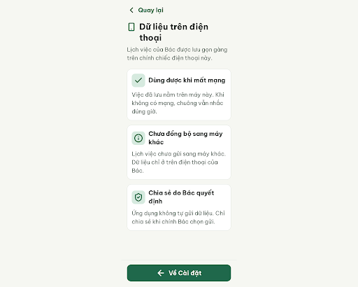
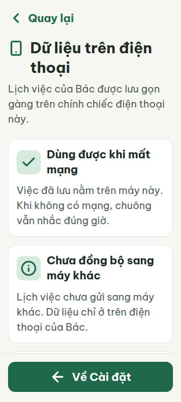
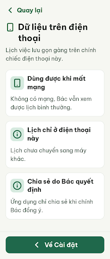
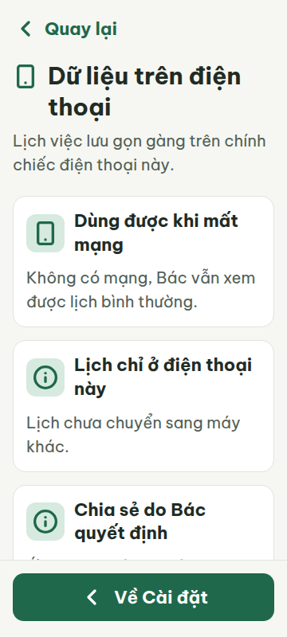
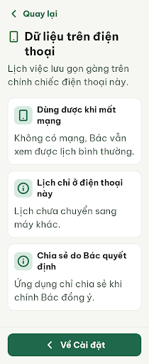
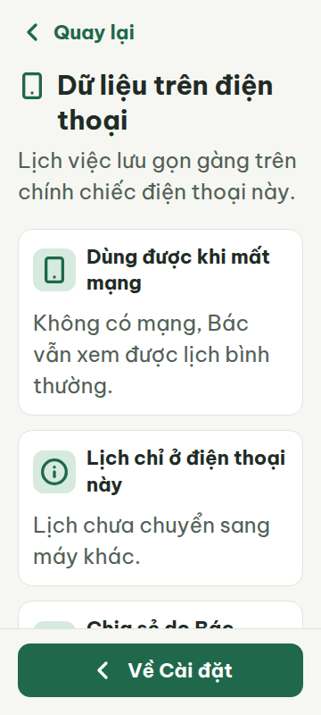
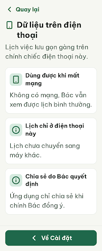
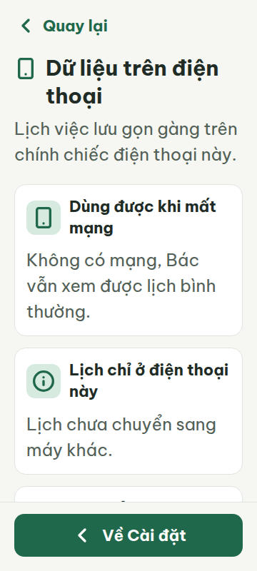

# N20 — Dữ liệu trên điện thoại

Project: `2013215887278758682` — An Nhiên (project của Sanh)

**Màn chốt hiện tại: v1 — 94 điểm**

Screen ID: `c556fb1baca24692a8d759e083975ccf`

**Kết quả: CONVERGED** · stop_reason: patience_2

| Vòng | Điểm | Error | Warn | Đã sửa | Regression |
|---|---:|---:|---:|---|---|
| v0 | 71 | 2 | 3 | — | — |
| v1 | 94 | 0 | 2 | R-TXT-03, R-ICON-03, R-VOC-01 | — |
| v2 | 84 | 1 | 2 | R-TXT-02, R-STY-03 | R-TXT-03 |
| v3 | 90 | 1 | 0 | R-TXT-02, R-STY-03 | R-TXT-03 |

## v0 — 71 điểm

Screen: `projects/2013215887278758682/screens/e5293a7fbb4b4856b9beb49b5d374f4b`





- R-TXT-02 (warn): Nội dung các thẻ thông tin và tiêu đề thẻ. Bằng chứng: Nội dung chính hiển thị 20px, tiêu đề thẻ 22px; luật hướng tới nội dung 24px.. Sửa: Tăng chữ nội dung chính lên 24px và tiêu đề thẻ lên 24px.
- R-TXT-03 (error): Đoạn giới thiệu và nội dung các thẻ thông tin ở 360px. Bằng chứng: Metrics 360 ghi đoạn giới thiệu và cả ba đoạn nội dung dài 3 dòng; hai câu trong thẻ có 16 tiếng: “Việc đã lưu nằm trên máy này. Khi không có mạng, chuông vẫn nhắc đúng giờ.” và “Lịch việc chưa gửi sang máy khác. Dữ liệu chỉ ở trên điện thoại của Bác.”. Sửa: Rút mỗi đoạn xuống tối đa 15 tiếng và dàn trong tối đa 2 dòng ở 360px; ví dụ: “Lịch việc lưu trên điện thoại này.”
- R-ICON-03 (warn): Icon dấu kiểm ở thẻ “Dùng được khi mất mạng”, khiên dấu kiểm ở “Chia sẻ do Bác quyết định” và mũi tên trái ở nút cuối. Bằng chứng: Các SVG đều 32×32px, nhưng `check`, `shield-check` và `arrow-left` không thuộc Từ điển icon; nút “Về Cài đặt” cũng dùng mũi tên trái thay vì icon điều hướng được liệt kê.. Sửa: Dùng icon Lucide đã có trong từ điển: `smartphone` cho thẻ offline, `info` cho thẻ chia sẻ và `chevron-left` cho nút quay về; giữ khung 32×32px.
- R-VOC-01 (error): Tiêu đề thẻ “Chưa đồng bộ sang máy khác” và nội dung thẻ. Bằng chứng: Từ “đồng bộ” xuất hiện trong UI; mục 5 vocabulary.md liệt kê đây là thuật ngữ kỹ thuật cần tránh.. Sửa: Đổi tiêu đề thành “Lịch chỉ ở điện thoại này” và dùng “Lịch chưa chuyển sang máy khác” thay cho cụm có “đồng bộ”.
- R-STY-03 (warn): Lề nội dung ở viewport 360px. Bằng chứng: CSS media query đặt lề trái/phải nội dung và footer ở 16px khi viewport rộng tối đa 360px; luật yêu cầu lề màn 20px.. Sửa: Giữ lề ngang 20px ở 360px; duy trì khoảng cách giữa các khối 16px.

Màn rõ ràng và tương phản tốt, nhưng cần rút gọn các đoạn dài, thay thuật ngữ “đồng bộ”, và chỉnh icon cùng lề 360px theo quy tắc.

### Edit prompt

```text
Keep the overall layout and everything not mentioned below unchanged.
1. [R-TXT-02] Increase information-card headings and body copy to 24px.
2. [R-TXT-03] Shorten the intro and each information paragraph to no more than 15 Vietnamese words and 2 lines at 360px. Use concise copy such as “Lịch việc lưu trên điện thoại này.” and “Không có mạng, Bác vẫn xem được lịch.” Avoid promising that a reminder will always fire.
3. [R-ICON-03] Replace unsupported icons with dictionary icons: use `smartphone` for on-device/offline information, `info` for the sharing/autonomy card, and `chevron-left` for the “Về Cài đặt” return action. Keep icons 32×32px, stroke 2–2.5. Do not use `check`, `shield-check`, or `arrow-left`.
4. [R-VOC-01] Remove the forbidden term “đồng bộ”; change the heading “Chưa đồng bộ sang máy khác” to “Lịch chỉ ở điện thoại này” and describe the data as “Lịch chưa chuyển sang máy khác.”
5. [R-STY-03] Use 20px horizontal margins at 360px, including footer; preserve 16px block gaps.

```

## v1 — 94 điểm

Screen: `projects/2013215887278758682/screens/c556fb1baca24692a8d759e083975ccf`





- R-TXT-02 (warn): Đoạn giới thiệu và nội dung ba thẻ thông tin. Bằng chứng: Ảnh và metrics 360 ghi chữ nội dung chính ở 20px; luật hướng tới khoảng 24px.. Sửa: Tăng .intro-text và .card-body từ 20px lên 24px; giữ tiêu đề màn 30px và chữ nút 22px.
- R-STY-03 (warn): Lề ngang nội dung và nút ở viewport 360px. Bằng chứng: Metrics ghi nội dung bắt đầu tại x=16px; CSS media query đặt lề nội dung và footer 16px, trong khi luật yêu cầu 20px.. Sửa: Đổi lề ngang ở media query max-width:360px từ 16px sang 20px; giữ khoảng cách giữa các khối 16px.

Đã sửa được các lỗi về độ dài câu, icon và từ tránh dùng; còn hai cảnh báo về cỡ chữ nội dung và lề màn 360px.

### Edit prompt

```text
Keep the overall layout and everything not mentioned below unchanged.
1. [R-TXT-02] Increase .intro-text and all .card-body copy from 20px to 24px; keep the screen title at 30px and button labels at 22px. Ensure line-height remains readable and cards can grow naturally.
2. [R-STY-03] At viewport width 360px, change horizontal content and footer margins from 16px to 20px; retain 16px vertical gaps between blocks. Preserve all exact text, icons, colors, and card order.

```

## v2 — 84 điểm

Screen: `projects/2013215887278758682/screens/c9e05e2a4afd449a87b830ede398ef2d`





- R-TXT-02 (warn): Tiêu đề các thẻ thông tin. Bằng chứng: Nội dung chính đã lên 24px, nhưng ba tiêu đề thẻ vẫn là 22px; tên việc/thẻ theo DESIGN.md dùng title-lg 24px.. Sửa: Tăng .card-title từ 22px lên 24px; giữ tiêu đề màn 30px và chữ nút 22px.
- R-TXT-03 (error): Đoạn mô tả trong thẻ “Dùng được khi mất mạng”. Bằng chứng: Ở viewport 360px, metrics cho thấy đoạn “Không có mạng, Bác vẫn xem được lịch bình thường.” dài 3 dòng; luật giới hạn đoạn văn tối đa 2 dòng.. Sửa: Rút gọn câu thành “Mất mạng, Bác vẫn xem lịch được.” để hiển thị tối đa 2 dòng ở 360px.
- R-ICON-03 (warn): Ô icon của hai thẻ “Lịch chỉ ở điện thoại này” và “Chia sẻ do Bác quyết định”. Bằng chứng: Ảnh cho thấy cả hai thẻ dùng cùng biểu tượng cảnh báo dạng vòng tròn có dấu chấm than; icon không biểu đạt riêng hai ý và cách dùng không khớp mục Từ điển icon.. Sửa: Dùng Lucide smartphone 32px cho “Lịch chỉ ở điện thoại này” và Lucide info 32px cho “Chia sẻ do Bác quyết định”; không dùng lại circle-alert ngoài lỗi nhập.

Đã tăng nội dung lên 24px và sửa lề 360px; còn một đoạn 3 dòng, tiêu đề thẻ 22px và biểu tượng bị dùng sai nghĩa.

## v3 — 90 điểm

Screen: `projects/2013215887278758682/screens/837aec79736d4aaa9aea64c4621adf26`





- R-TXT-03 (error): Nội dung thẻ “Dùng được khi mất mạng” ở rộng 360px. Bằng chứng: v3-metrics-360.json đo đoạn “Không có mạng, Bác vẫn xem được lịch bình thường.” ở 24px thành 3 dòng.. Sửa: Rút gọn thành “Mất mạng, Bác vẫn xem lịch được.” để đoạn hiển thị tối đa 2 dòng ở 360px.

Đã sửa cỡ chữ nội dung và lề 360px; đoạn giải thích đầu tiên vẫn tràn thành 3 dòng ở 360px.
