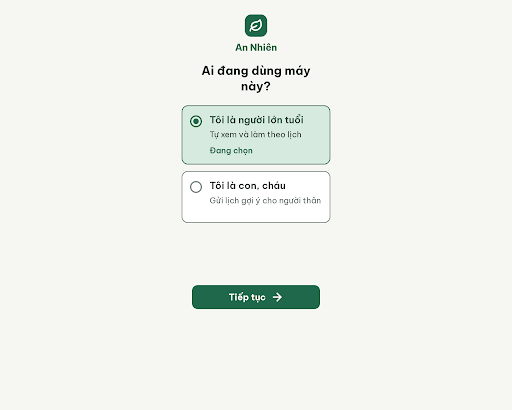
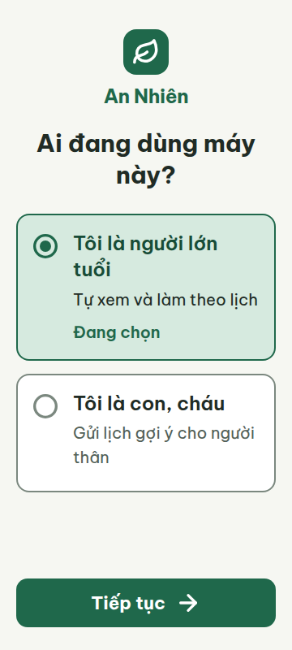
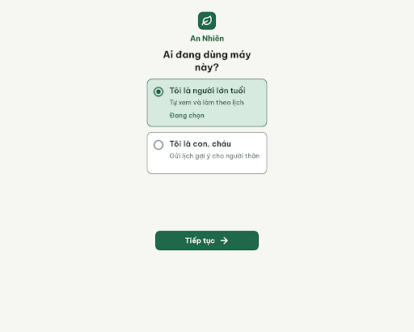
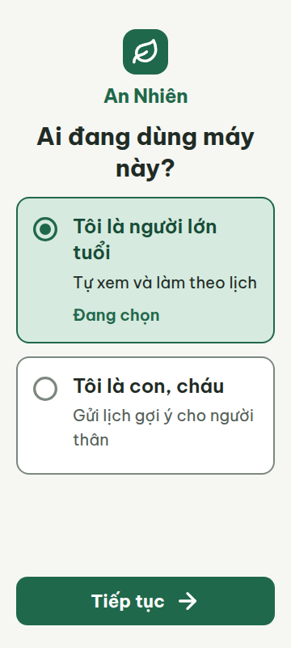

# C01 — Chọn vai trò (Hiếu, làn B)

Project riêng: `4739396749322828698` — An Nhiên — Hiếu — Codex

**Màn chốt hiện tại: v1 — 100 điểm**

Screen ID: `6fbd38cfb456447aa7629c18c6a5142c`

**Kết quả: CONVERGED** · stop_reason: score_100

| Vòng | Điểm | Error | Warn | Đã sửa | Regression |
|---|---:|---:|---:|---|---|
| v0 | 97 | 0 | 1 | — | — |
| v1 | 100 | 0 | 0 | R-STY-03 | — |

## v0 — 97 điểm

Screen: `projects/4739396749322828698/screens/9c299fb08e08456fb0c57efa4f1bbf2d`





- R-STY-03 (warn): Khoảng cách giữa thương hiệu, câu hỏi và nhóm lựa chọn. Bằng chứng: CSS brand-header margin-bottom24px; main-heading margin-bottom28px; choices-container margin-bottom20px. DOM360 câu hỏi kết thúc y234.80, thẻ đầu bắt đầu y262.80: cách28px, khác token16px.. Sửa: Đặt margin-bottom của .brand-header, .main-heading và .choices-container thành16px; giữ padding ngang20px và gap hai thẻ16px.

C01 đọc rõ, chọn vai trò và tiếp tục dễ chạm; còn khoảng cách giữa các khối chưa theo token16px.

### Edit prompt

```text
Keep the overall layout and everything not mentioned below unchanged.
1. Standardize the inter-block spacing to exactly16px: set .brand-header margin-bottom:16px, .main-heading margin-bottom:16px and .choices-container margin-bottom:16px. Keep horizontal viewport padding20px, the gap between the two role cards16px, current Vietnamese wording, colors, font sizes and icons unchanged. Preserve 360x800 and412px responsive layout, no horizontal overflow, descriptions at most2 lines and the60px bottom Continue button.

```

## v1 — 100 điểm

Screen: `projects/4739396749322828698/screens/6fbd38cfb456447aa7629c18c6a5142c`






C01 đạt mọi luật áp dụng; đã sửa khoảng cách giữa các khối về16px, chữ và vùng chạm rõ ràng ở360px và412px.

## So phong cách với S03

Màu nền/primary/chữ, font Be Vietnam Pro, cỡ chữ30/24/20/22px và bo góc thẻ16/nút14px khớp S03 v3. Chi tiết: [style-comparison.md](style-comparison.md).

HTML được render tắt JavaScript trang để đo tại360×800 và412×800; font tải thành công, không tràn ngang. Ảnh viewport là bản kiểm tra; v1.png/v1.html giữ nguyên từ Stitch.

Chỉ hoàn thành B01; chưa chạy B02 trở đi, chưa export Figma.

## Kiểm tra hiển thị Stitch

Project và màn chốt lấy được bằng API, nhưng list_screens trả rỗng và project chưa có screenInstances. Chưa xác nhận màn hiển thị trên canvas. Điểm CONVERGED chỉ là kết quả review artifact; bàn giao trên giao diện Stitch chưa được xác nhận.
