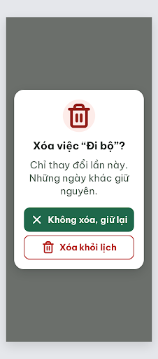
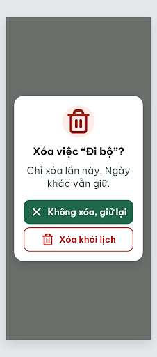

# DLG-Delete Xóa việc – log vòng lặp Stitch

| Vòng | Điểm | Số error | Số warn | Đã sửa | Regression |
| --- | --- | --- | --- | --- | --- |
| v0 | 90 | 1 | 0 | – | – |
| v1 | 100 | 0 | 0 | R-TXT-03 | không |

**Màn chốt: v1 – điểm 100**
**Kết quả: CONVERGED** (điểm 100).

best: v1 – điểm 100

screen id: v0 `bc8c534bdc87422b9371b9a59ead5eb0` · v1 (màn chốt) `0837859db1b04283be1bf85c8a629f69` (project 2013215887278758682). Biến thể của DLG-Done, màn gốc `c1d660d473ef49c7aeff150aef996d8d`.

Ghi chú:
- Tiêu đề rút thành "Xóa việc “Đi bộ”?" (handoff ghi tên đầy đủ “Đi bộ quanh công viên”, quá dài cho hộp 272px).
- Câu phạm vi rút từ handoff ("Chỉ thay đổi lần này. Những ngày khác giữ nguyên.") thành "Chỉ xóa lần này. Ngày khác vẫn giữ." để vừa 2 dòng. **Cần người quyết định:** snackbar sau khi xóa trong handoff ghi "khỏi lịch mọi ngày", còn user-flow ghi "mất ở mọi ngày"; câu "Chỉ xóa lần này" chỉ đúng với việc không lặp hoặc khi người dùng chọn "Chỉ lần này" ở N13. Với việc lặp hằng ngày cần nói rõ phạm vi theo lựa chọn N13.
- Thẻ `<title>` trong HTML vẫn ghi "DLG-Done"; không hiện trên màn.
- Critic không ghi được file critique nên orchestrator chép lại JSON (rút gọn).

## v0 – điểm 90



| Luật | Mức | Vị trí | Bằng chứng | Sửa |
| --- | --- | --- | --- | --- |
| R-TXT-03 | error | Dòng mô tả | "Chỉ thay đổi lần này. Những ngày khác giữ nguyên." rớt 3 dòng ở 24px, "nguyên." nằm riêng | Rút còn "Chỉ xóa lần này. Ngày khác vẫn giữ." |

### Edit prompt gửi sau v0 (v0-edit-prompt.txt)

```
Keep the overall layout and everything not mentioned below unchanged.
1. Replace the detail text with exactly "Chỉ xóa lần này. Ngày khác vẫn giữ." (two short sentences, at most 2 lines), font-size 24px (set on the element itself), weight 400, color #526057, line-height 1.35, centered, 12px below the question.
2. Keep the header circle #FDECE9 with the `trash-2` icon 64px #912018, the question "Xóa việc “Đi bộ”?" 26px bold, the one filled green button "Không xóa, giữ lại" with `x` icon, the outline red button "Xóa khỏi lịch" with `trash-2` icon (8px gap, both 272x60px), and all colors exactly as they are. Nothing clipped, all text at least 20px.
```

## v1 – điểm 100



Không còn vi phạm. Đã sửa: R-TXT-03. Regression: không.
