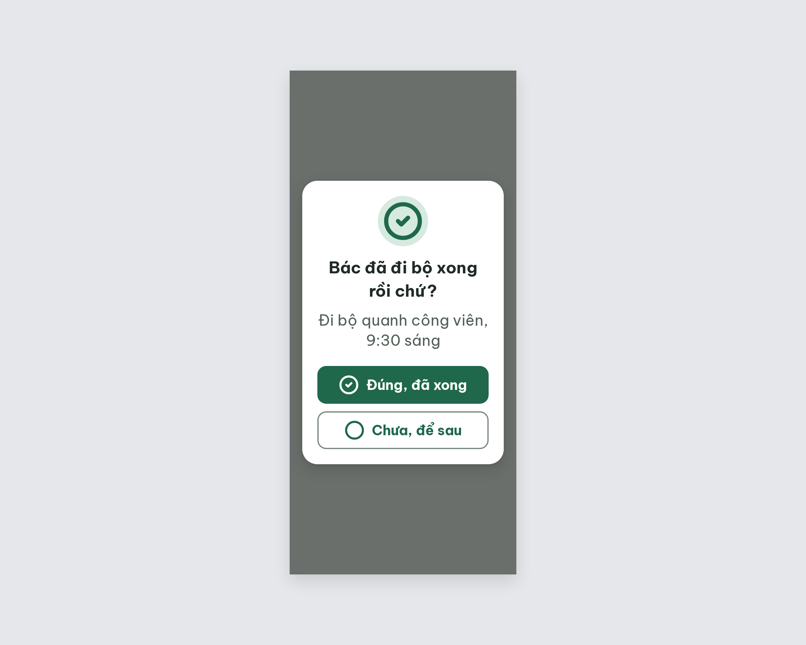
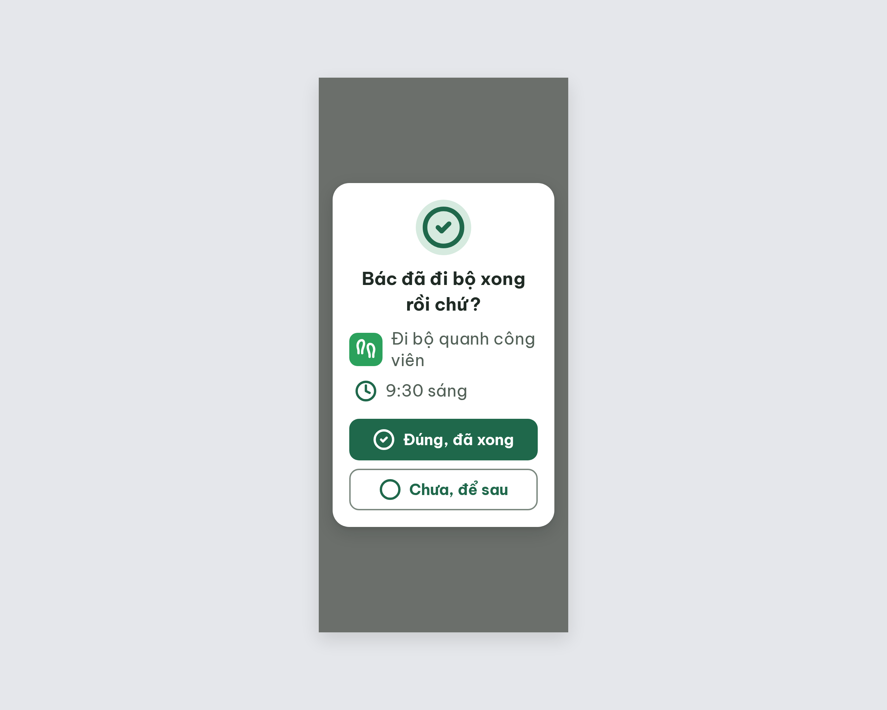
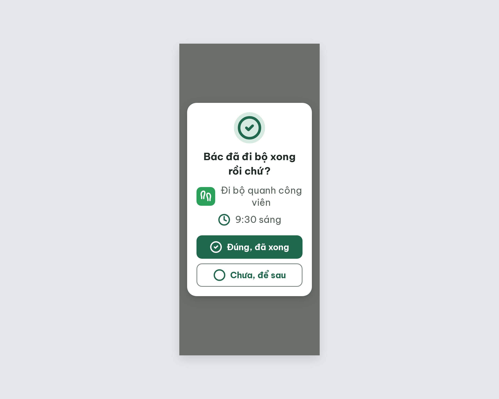

# DLG-Done Xác nhận đã xong – log vòng lặp Stitch

| Vòng | Điểm | Số error | Số warn | Đã sửa | Regression |
| --- | --- | --- | --- | --- | --- |
| v0 | 90 | 1 | 0 | – | – |
| v1 | 97 | 0 | 1 | R-ICON-02 | R-CEN-01 |
| v2 | 100 | 0 | 0 | R-CEN-01 | không |

**Màn chốt: v2 – điểm 100**
**Kết quả: CONVERGED** (điểm 100).

screen id: v0 `f7af0389ca464815b905eed36f92929d` · v1 `a1743a4689ca4beab4399fe96b6b9ef0` · v2 (màn chốt) `c1d660d473ef49c7aeff150aef996d8d` (project 2013215887278758682)

Ghi chú: tên việc "Đi bộ quanh công viên" xuống 2 dòng, chữ "viên" nằm riêng một dòng (vẫn trong giới hạn 2 dòng, không trừ điểm). Nếu muốn gọn có thể rút thành "Đi bộ công viên".

## v0 – điểm 90



| Luật | Mức | Vị trí | Bằng chứng | Sửa |
| --- | --- | --- | --- | --- |
| R-ICON-02 | error | Dòng chi tiết "Đi bộ quanh công viên, 9:30 sáng" | Chỉ có chữ, thiếu icon thói quen `footprints` và icon giờ `clock` | Ô 48x48 nền `habit-move-accent` chứa `footprints` trắng 32px; thêm `clock` 32px trước giờ |

### Edit prompt gửi sau v0 (v0-edit-prompt.txt)

```
Keep the overall layout and everything not mentioned below unchanged.
1. Replace the single detail line "Đi bộ quanh công viên, 9:30 sáng" with two left-aligned rows, centered as a group under the question, 12px gap between the rows, text 24px regular (400), color #526057.
2. Row 1: a 48x48px tile, radius 12px, filled #2BA15C, containing a white Lucide `footprints` icon 32px (stroke 2.5), then 12px gap, then the text "Đi bộ quanh công viên" (may wrap to 2 lines).
3. Row 2: a Lucide `clock` icon 32px (stroke 2.5, color #1F684B), then 12px gap, then the text "9:30 sáng".
4. Keep the 80x80px circle with the `circle-check` icon 64px at the top of the dialog, the question, and both buttons exactly as they are. Keep all content inside the 272px width; nothing clipped.
```

## v1 – điểm 97



| Luật | Mức | Vị trí | Bằng chứng | Sửa |
| --- | --- | --- | --- | --- |
| R-CEN-01 | warn | Khối `#dialog-desc` | `align-items: flex-start; text-align: left`, hàng "9:30 sáng" dồn trái, lệch so với phần còn lại | Căn giữa khối và từng hàng, bỏ `flex: 1` và `padding-left` |

Đã sửa: R-ICON-02. Regression: R-CEN-01 (do prompt v0 yêu cầu "left-aligned rows"). best: v1 – điểm 97

### Edit prompt gửi sau v1 (v1-edit-prompt.txt)

```
Keep the overall layout and everything not mentioned below unchanged.
1. Center the detail block under the question: the container of the two rows ("Đi bộ quanh công viên" and "9:30 sáng") must use align-items: center and text-align: center, so the block sits on the vertical center axis of the dialog like the icon, the question and the buttons.
2. Make each of the two rows center its own content (justify-content: center), with no full-width stretching; the "Đi bộ quanh công viên" text must not use flex: 1, and the "9:30 sáng" row must have no left padding.
3. Keep the 48x48px #2BA15C tile with the white `footprints` icon 32px, the `clock` icon 32px #1F684B, the 24px text #526057, the 12px gaps, and both buttons exactly as they are.
```

## v2 – điểm 100



Không còn vi phạm. Đã sửa R-CEN-01. Regression: không. best: v2 – điểm 100
