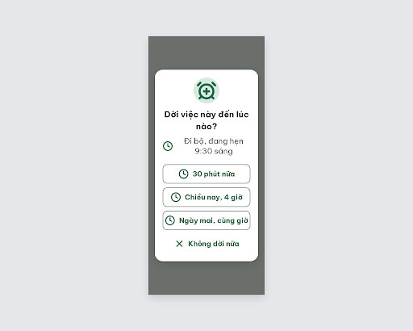
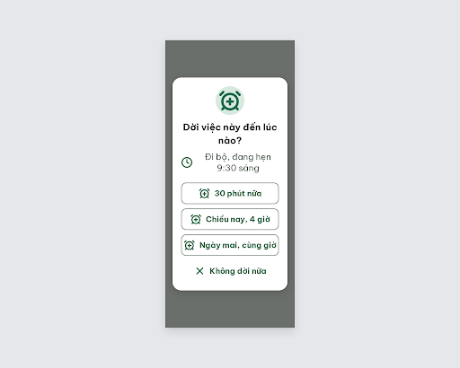

# DLG-Later Dời việc – log vòng lặp Stitch

| Vòng | Điểm | Số error | Số warn | Đã sửa | Regression |
| --- | --- | --- | --- | --- | --- |
| v0 | 97 | 0 | 1 | – | – |
| v1 | 100 | 0 | 0 | R-ICON-03 | không |

**Màn chốt: v1 – điểm 100**
**Kết quả: CONVERGED** (điểm 100).

best: v1 – điểm 100

screen id: v0 `5af7a349f19946d896a8a3f805e6f3dd` · v1 (màn chốt) `1d3212248de24652a655f7556b0e4b65` (project 2013215887278758682). Biến thể của DLG-Done, màn gốc `c1d660d473ef49c7aeff150aef996d8d`.

Ghi chú:
- Thêm icon `x` (Không đổi, đóng hộp thoại) vào Từ điển icon của `assets/stitch/DESIGN.md` trước khi chạy.
- Stitch trả màn kích thước 2560×2048 (deviceType DESKTOP) dù gọi MOBILE; ảnh vẫn là hộp thoại 320px giữa nền scrim, giống DLG-Done.
- Chữ "Ngày mai, cùng giờ" (22px đậm) chạm sát viền phải nút, chưa bị cắt, chưa đo bằng trình duyệt. Nếu muốn thoáng hơn: padding ngang 12px hoặc hạ chữ nút còn 21px (21px vẫn ≥ 20px).
- Critic không ghi được file critique nên orchestrator chép lại JSON (đã rút gọn luật n/a).

## v0 – điểm 97



| Luật | Mức | Vị trí | Bằng chứng | Sửa |
| --- | --- | --- | --- | --- |
| R-ICON-03 | warn | 3 nút "30 phút nữa", "Chiều nay, 4 giờ", "Ngày mai, cùng giờ" | Cả 3 nút dùng `clock`, trùng icon dòng "Đi bộ, đang hẹn 9:30 sáng" (`clock` = giờ của việc) | Đổi icon 3 nút sang `alarm-clock-plus` 32px |

### Edit prompt gửi sau v0 (v0-edit-prompt.txt)

```
Keep the overall layout and everything not mentioned below unchanged.
1. In each of the three outline buttons ("30 phút nữa", "Chiều nay, 4 giờ", "Ngày mai, cùng giờ"), replace the Lucide `clock` icon with a Lucide `alarm-clock-plus` icon 32px, stroke 2.5, color #1F684B, on the left of the label.
2. Keep the Lucide `clock` icon 32px #1F684B only in the detail row "Đi bộ, đang hẹn 9:30 sáng".
3. Keep the "Không dời nữa" text button with its `x` icon, the header circle, button sizes (272x60px), gaps and all text exactly as they are.
```

## v1 – điểm 100



Không còn vi phạm. Đã sửa: R-ICON-03. Regression: không.
