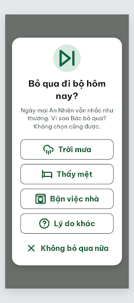
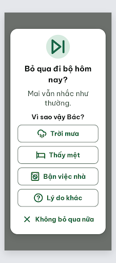

# DLG-Skip Bỏ qua hôm nay – log vòng lặp Stitch

| Vòng | Điểm | Số error | Số warn | Đã sửa | Regression |
| --- | --- | --- | --- | --- | --- |
| v0 | 74 | 2 | 2 | – | – |
| v1 | 100 | 0 | 0 | R-TXT-01, R-TXT-02, R-TXT-03, R-ICON-03 | không |

**Màn chốt: v1 – điểm 100**
**Kết quả: CONVERGED** (điểm 100).

best: v1 – điểm 100

screen id: v0 `9f9cb617a10c4601bb43af2fc3fd613e` · v1 (màn chốt) `de1224b0d7b64b968a008c03877ff2bd` (project 2013215887278758682). Biến thể của DLG-Done, màn gốc `c1d660d473ef49c7aeff150aef996d8d`.

Ghi chú:
- Thêm 4 icon lý do bỏ qua vào Từ điển icon của `assets/stitch/DESIGN.md` trước khi chạy: `cloud-rain` (Trời mưa), `bed` (Thấy mệt), `washing-machine` (Bận việc nhà), `circle-help` (Lý do khác).
- Nhãn lý do rút thành "Thấy mệt" (handoff ghi "Thấy trong người mệt", quá dài cho nút 272px). Câu "(không bắt buộc)" bị bỏ ở v1 vì v0 hứa "Không chọn cũng được" mà không có đường bỏ qua không lý do; thay bằng "Mai vẫn nhắc như thường." + nhãn "Vì sao vậy Bác?". "Lý do khác" là đường thoát cho Bác không muốn nêu lý do.
- Tiêu đề rớt riêng "nay?" và mô tả rớt riêng "thường." xuống dòng (không trừ điểm). Có thể giảm padding ngang thẻ còn 20px.
- Thẻ `<title>` trong HTML vẫn ghi "DLG-Done"; không hiện trên màn.
- Critic không ghi được file critique nên orchestrator chép lại JSON (rút gọn).

## v0 – điểm 74



| Luật | Mức | Vị trí | Bằng chứng | Sửa |
| --- | --- | --- | --- | --- |
| R-TXT-01 | error | Dòng mô tả | `font-size: 17px` viết thẳng trong thẻ | 24px, #526057 |
| R-TXT-03 | error | Dòng mô tả | 3 câu, 3 dòng ở 17px; lên 24px sẽ 4–5 dòng | Rút còn 1 câu "Mai vẫn nhắc như thường." |
| R-TXT-02 | warn | Dòng mô tả | Chữ nội dung 17px | 24px |
| R-ICON-03 | warn | Nút "Bận việc nhà" | Icon tự vẽ, giống máy ảnh | Lucide `washing-machine` chuẩn |

### Edit prompt gửi sau v0 (v0-edit-prompt.txt)

```
Keep the overall layout and everything not mentioned below unchanged.
1. Replace the detail text with exactly "Mai vẫn nhắc như thường." (one sentence, at most 2 lines), font-size 24px (set it on the element itself, not smaller than 24px), weight 400, color #526057, line-height 1.35, centered.
2. Between that detail text and the first reason button, 16px below the text, add a centered label "Vì sao vậy Bác?" Be Vietnam Pro 22px bold (700), color #202B25. 12px below it come the four reason buttons.
3. In the button "Bận việc nhà", use the exact Lucide `washing-machine` icon, 32px, stroke 2.5, color #1F684B: a rounded rectangle body with a drum circle, a small dot at the top right of the panel, no camera-like shape.
4. Keep the question "Bỏ qua đi bộ hôm nay?" 26px bold, the `skip-forward` header icon, the four outline reason buttons (272x60px, 12px gap), the "Không bỏ qua nữa" text button with `x`, and all colors exactly as they are. No filled button, nothing clipped, all text at least 20px.
```

## v1 – điểm 100



Không còn vi phạm. Đã sửa: R-TXT-01, R-TXT-02, R-TXT-03, R-ICON-03. Regression: không.
