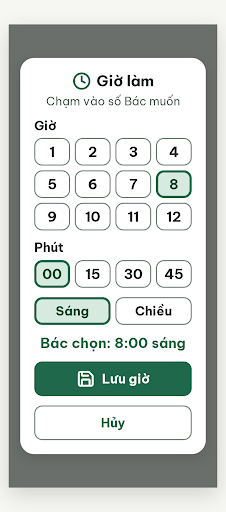

# DLG-TaskTime Chọn giờ làm – log vòng lặp Stitch

| Vòng | Điểm | Số error | Số warn | Đã sửa | Regression |
| --- | --- | --- | --- | --- | --- |
| v0 | 100 | 0 | 0 | – | – |

**Màn chốt: v0 – điểm 100**
**Kết quả: CONVERGED** (điểm 100).

screen id: v0 (màn chốt) `36ace0d5cfb640a083bb5a156c8ed17d` (project 2013215887278758682)

Biến thể của DLG-WakeTime (màn chốt v1, screen id `b7fb2dc55f914dc8990be08add07fc40`).

Ghi chú cho người quyết định / Flutter:
- Giống DLG-WakeTime: dùng nút chạm thay 3 cột `ListWheelScrollView` (FR05, R-GES-01); phút chỉ 00/15/30/45; nút chính "Lưu giờ" thay "Xong". Cần cập nhật `flutter-handoff.md` dòng 254 cho cả hai dialog.
- Tiêu đề "Giờ làm" dễ hiểu nhầm là giờ đi làm; cân nhắc "Giờ làm việc này" (critic không trừ điểm).
- Trạng thái đang chọn chỉ có nền nhạt + viền dày 4 px + dòng "Bác chọn: 8:00 sáng", không có `circle-dot`/"Đang chọn" (critic cho R-COL-01 đạt, sát ranh giới).
- HTML export: thẻ `<title>` ghi "DLG-WakeTime" và script khởi tạo giờ "5", ảnh hiện 8. Flutter bỏ qua, nhưng nên sửa nếu dùng HTML.
- `v0-critique.json` do orchestrator ghi lại từ kết quả critic, vì critic không có quyền ghi file.

## v0 – điểm 100

Không có vi phạm. best: v0 – điểm 100.

### Prompt v0 (biến thể, edit_screens)

Xem `v0-prompt.txt`.
