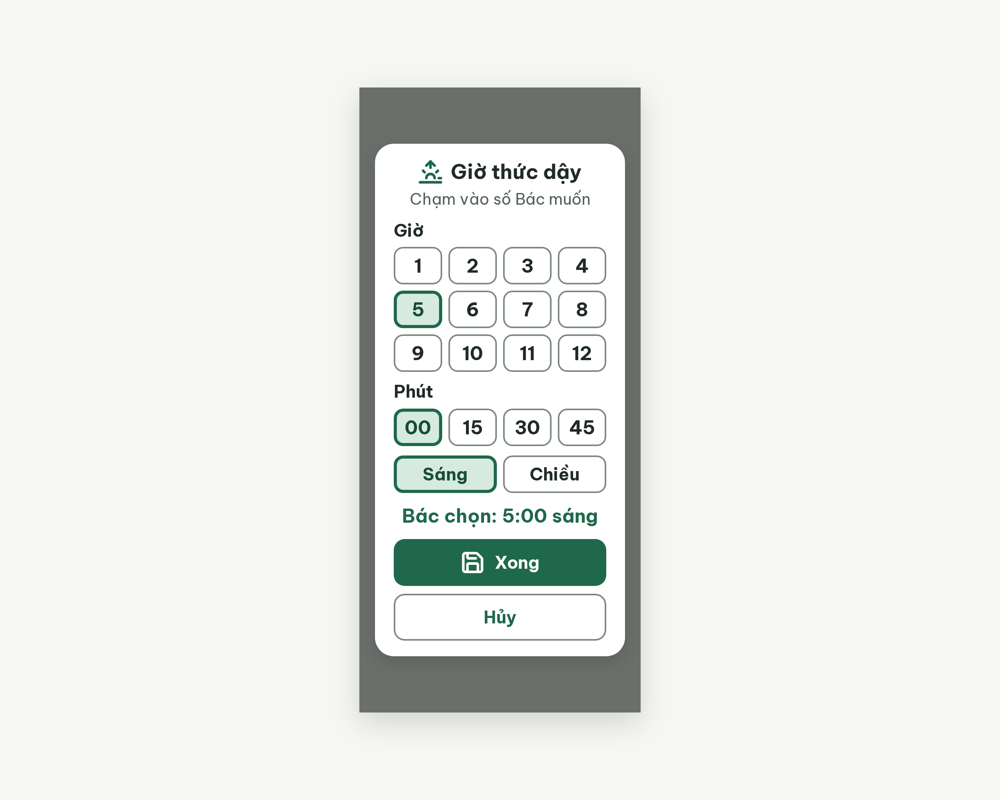
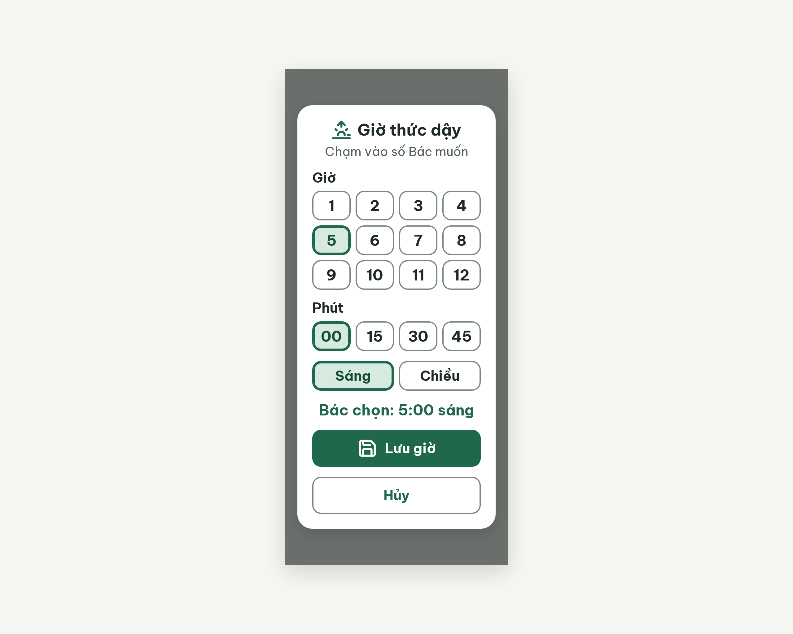

# DLG-WakeTime Chọn giờ thức dậy – log vòng lặp Stitch

| Vòng | Điểm | Số error | Số warn | Đã sửa | Regression |
| --- | --- | --- | --- | --- | --- |
| v0 | 88 | 0 | 4 | – | – |
| v1 | 100 | 0 | 0 | R-ICON-03, R-LANG-02, R-STY-02, R-STY-03 | không |

**Màn chốt: v1 – điểm 100**
**Kết quả: CONVERGED** (điểm 100).

screen id: v0 `21be536d56db425f8e358e552b49640f` · v1 (màn chốt) `b7fb2dc55f914dc8990be08add07fc40` (project 2013215887278758682)

Ghi chú cho người quyết định / Flutter:
- **Khác `flutter-handoff.md`:** handoff mô tả 3 cột `ListWheelScrollView` + gợi ý "Vuốt để chọn giờ". Màn này dùng nút chạm (lưới giờ 1–12, phút 00/15/30/45, Sáng/Chiều) vì `PRD.md` FR05 ghi "không bánh xe cuộn" và `rule.md` R-GES-01 (error) cấm thao tác chỉ làm bằng vuốt. Cần cập nhật handoff và `DLG-TaskTime` cho thống nhất. Phút chỉ có 4 mốc (00, 15, 30, 45), handoff cho 00–59.
- Nút chính đổi "Xong" → "Lưu giờ" (v1): icon `save` khớp nghĩa "Lưu", và nhãn là động từ + việc (SG-16). `vocabulary.md` mục 3 vẫn ghi "Hủy / Xong"; cân nhắc cập nhật.
- Trạng thái "đang chọn" chỉ có nền nhạt + viền dày 4 px + dòng chữ "Bác chọn: 5:00 sáng", không có `circle-dot` / chữ "Đang chọn". Critic cho R-COL-01 đạt nhờ dòng chữ tóm tắt.
- Khoảng cách tiêu đề → dòng gợi ý là 6 px (không phải 16 px); critic không tính lỗi.

## v0 – điểm 88



| Luật | Mức | Vị trí | Bằng chứng | Sửa |
| --- | --- | --- | --- | --- |
| R-ICON-03 / R-LANG-02 | warn | Nút chính "Xong" | Icon `save` (nghĩa "Lưu") đi với nhãn "Xong"; nhãn không phải động từ + việc | Đổi nhãn thành "Lưu giờ", giữ `save` 32px |
| R-STY-03 | warn | Khoảng cách trong hộp thoại | Các khối cách 6, 12, 14 px; hai nút cách 10 px | Mọi khối 16 px; gap hai nút 16 px |
| R-STY-02 | warn | Nút chọn giờ/phút/buổi, padding hộp thoại | `.choice-btn` bo 12 px (phải 14); padding 20px 24px (phải 24) | Bo 14 px, padding 24 px |

### Edit prompt gửi sau v0 (v0-edit-prompt.txt)

```
Keep the overall layout and everything not mentioned below unchanged.
1. Rename the filled button label from "Xong" to "Lưu giờ" (22px bold, white); keep the Lucide `save` icon 32px white on its left.
2. Set the vertical gap between all blocks inside the dialog to exactly 16px: below the hint "Chạm vào số Bác muốn", below the hour grid, below the minute row, below the "Sáng"/"Chiều" row, and below the line "Bác chọn: 5:00 sáng".
3. Set the gap between the two bottom buttons "Lưu giờ" and "Hủy" to 16px.
4. Set the corner radius of all choice buttons (the 12 hour buttons, the 4 minute buttons, "Sáng", "Chiều") to 14px.
5. Set the dialog padding to 24px on all four sides (currently 20px top and bottom). Keep the dialog width 320px; the dialog must still fit inside the 800px height with at least 40px free above and below.
```

## v1 – điểm 100



Không còn vi phạm. Đã sửa 4 luật của v0. Regression: không. best: v1 – điểm 100
