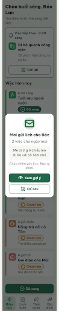

# G11 Popup Mai gửi lịch cho Bác – log vòng lặp Stitch

| Vòng | Điểm | Số error | Số warn | Đã sửa | Regression |
|---|---|---|---|---|---|
| v0 | 97 | 0 | 1 | – | – |
| v1 | 97 | 0 | 1 | không (sửa 7/8 icon, R-ICON-03 còn 1 chỗ) | không |
| v2 | 100 | 0 | 0 | R-ICON-03 | không |

**Màn chốt: v2 – điểm 100** (screen id `e81f0f46e9e0464cbc6573147faabb10`)

**Kết quả: CONVERGED** (điểm 100, không còn error)

Project: 2013215887278758682 · Biến thể của S03 (`--from S03`), gốc: screen id `cc28fdd64e6e4c70b59b419c44376787` (màn chốt S03 = v3, `Kết quả: PASS`).
v0 screen id: `6678b2c6050b41788162878cffa11cb5`. v1 và v2 cùng screen id `e81f0f46e9e0464cbc6573147faabb10`: lần sửa v2 Stitch áp DOM operation tại chỗ, không tạo màn mới; `get_screen` lần đầu trả bản cũ (HTML rỗng), lần hai mới trả bản đã sửa.

Ghi chú khung: Stitch gắn MOBILE, ảnh rộng 780 (2x), trang cuộn dài 4072. Popup nằm giữa khung nhìn 360 × 800 trên nền Hôm nay đã làm tối.

Lần chạy trước (Stitch timeout 2 lần, NEEDS_HUMAN) đã được thay bằng lần chạy này; `v0-prompt.txt` dùng lại nguyên văn.

## v0 – điểm 97

| Luật | Mức | Vị trí | Bằng chứng | Sửa |
|---|---|---|---|---|
| R-ICON-03 | warn | "Để sau", "Dời lại" | `clock` (chỉ cho Giờ của việc) | `alarm-clock-plus` |
| R-ICON-03 | warn | Thẻ "Gọi điện cho Mai" | `phone` thay vì `house` | `house` |
| R-ICON-03 | warn | Tab Lịch tuần, Gia đình | `calendar`, `users` | `calendar-days`, `hand-heart` |
| R-ICON-03 | warn | Chip và nút "Đã xong" | `check` | `circle-check` |
| R-ICON-03 | warn | Vận động, "Ăn sáng chậm rãi" | SVG tự vẽ | `footprints`, `utensils` |

best: v0 – điểm 97

### v0 edit prompt (`v0-edit-prompt.txt`)

Keep the overall layout and everything not mentioned below unchanged. Đổi 8 icon sai Từ điển: `alarm-clock-plus` (Để sau, Dời lại), `house` (Gọi điện cho Mai), `calendar-days`, `hand-heart`, `circle-check`, `footprints`, `utensils`; giữ `mail`, `eye`, `sun`, `leaf`, `wind`, `coffee`.

## v1 – điểm 97

| Luật | Mức | Vị trí | Bằng chứng | Sửa |
|---|---|---|---|---|
| R-ICON-03 | warn | Ô icon "Tưới rau ngoài vườn" | SVG người tự vẽ, cùng thói quen Vận động tự nhiên mà thẻ khác dùng `footprints` | Lucide `footprints` 32px trắng, nền #2BA15C |

Không regression. Điểm không cao hơn v0: bộ đếm "không tăng" = 1. best: v1 – điểm 97 (bằng điểm, ít error bằng nhau, lấy vòng sau).

### v1 edit prompt (`v1-edit-prompt.txt`)

Keep the overall layout and everything not mentioned below unchanged. 1. Row "Tưới rau ngoài vườn": tile 48x48 #2BA15C shows Lucide `footprints` 32px white, stroke 2.5, identical to "Đi bộ quanh công viên". 2. Everything else stays.

## v2 – điểm 100

Không còn vi phạm. Đã sửa: R-ICON-03. Không regression.
best: v2 – điểm 100
