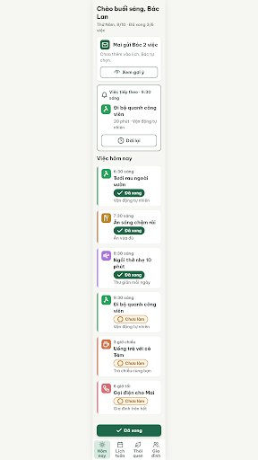
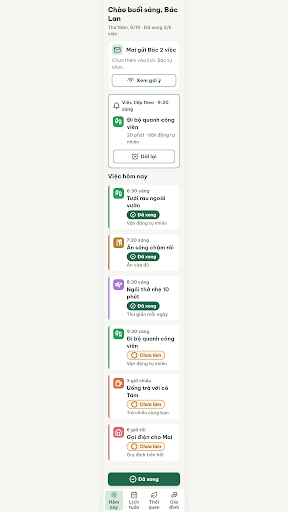

# G12 Hôm nay · thẻ gợi ý của Mai – log vòng lặp Stitch

| Vòng | Điểm | Số error | Số warn | Đã sửa | Regression |
|---|---|---|---|---|---|
| v0 | 94 | 0 | 2 | – | – |
| v1 | 97 | 0 | 1 | R-ONE-02 (và 5 icon sai Từ điển trong R-ICON-03) | không |
| v2 | – | – | – | không có bản mới (xem bên dưới) | – |

**Màn chốt (tạm): v1 – điểm 97** · best: v1 – điểm 97
**Kết quả: CHƯA XONG** – vòng v2 bị Stitch lỗi, chưa đủ điều kiện dừng (bộ đếm "không tăng" = 0, chưa tới v8). Chạy tiếp bằng `/stitch-loop G12 --resume`. Không có error nên không cần NEEDS_HUMAN.

Project: 2013215887278758682 · Biến thể của S03 (`--from S03`), gốc: screen id `cc28fdd64e6e4c70b59b419c44376787` (màn chốt S03 = v3).
screen id: v0 `38bb5cbd4a154f17afdbca683cf3e562` · v1 (màn chốt tạm) `b2cf1df76b9f47b6af08c77424741a96`

Ghi chú: critic không ghi được file nên orchestrator ghi `v0-critique.json`, `v1-critique.json` từ kết quả critic trả về (`v1-critique.json` chỉ giữ các luật fail). Trước khi chạy, thêm vào `DESIGN.md` Từ điển icon: `mail` (gợi ý lịch từ người thân) và mở rộng `eye` cho "Xem gợi ý".

## v0 – điểm 94

| Luật | Mức | Vị trí | Bằng chứng | Sửa |
|---|---|---|---|---|
| R-ICON-03 | warn | Nút/chip "Đã xong", nút "Dời lại", ô icon Đi bộ / Ăn / Gọi điện, tab Lịch tuần, tab Gia đình | `check` thay `circle-check`; `clock` thay `alarm-clock-plus`; icon đi bộ tự vẽ; `phone` thay `house`; `users` thay `hand-heart`; `calendar` thay `calendar-days` | Đổi đúng Lucide theo Từ điển |
| R-ONE-02 | warn | Thẻ "Mai gửi Bác 2 việc" | Có bóng đổ + ô icon đặc #1F684B, lấn khối Việc tiếp theo | Bỏ bóng, ô icon nền #D6EADF, icon #174C37 |

### Edit prompt v0 → v1
Xem `v0-edit-prompt.txt` (7 sửa đổi: thẻ Mai quieter, `circle-check`, `alarm-clock-plus`, `footprints`, `utensils`, `house`, `calendar-days` + `hand-heart`).

## v1 – điểm 97

Đã sửa: R-ONE-02. Regression: không.

| Luật | Mức | Vị trí | Bằng chứng | Sửa |
|---|---|---|---|---|
| R-ICON-03 | warn | Ô icon "Ăn sáng chậm rãi" | `utensils` vẽ sai: đầu nĩa đè lên dao, nét thân đứng trơ (do path trong edit prompt v0 chưa đúng Lucide) | Dùng đúng 3 path Lucide `utensils` |

Ghi chú critic: dòng "Mai gửi Bác 2 việc" để `nowrap`, chỉ còn ~222px; trong ảnh vẫn gọn, nên xem lại ở cỡ thật 360px.

### Edit prompt v1 → v2
Xem `v1-edit-prompt.txt` (1 sửa đổi: `utensils` đúng path).

## v2 – không có kết quả

- Lần 1: `edit_screens` trả về lời xác nhận và một thao tác DOM, nhưng `get_screen` vẫn trả đúng URL ảnh / HTML của v1; `v2.png`, `v2.html` tải về **giống hệt v1** (cùng kích thước, path `utensils` cũ vẫn còn). Không có bản mới thật, nên không chấm.
- Lần 2 (prompt "regenerate"): Stitch trả lỗi 502 "Please try again in 30 seconds".
- `v2.png`, `v2.html` trong thư mục chỉ là bản sao của v1, không dùng.

## Chạy tiếp từ v1 (luật mới)

Chấm lại `v1.png`/`v1.html`: **97**, 0 error, 1 warn (R-ICON-03 `utensils`). Giống điểm cũ. Bản cũ: `v1-critique.old.json`. Bộ đếm "không tăng" = 0. Các file `v2.*` giả (bản sao v1) đã xoá. Sửa tiếp trên screen id `b2cf1df76b9f47b6af08c77424741a96` bằng `v1-edit-prompt.txt`.

## v2 (chạy tiếp) – không có bản mới

`edit_screens` (nội dung `v1-edit-prompt.txt`) trả xác nhận kèm 1 thao tác DOM trên screen `b2cf1df76b9f47b6af08c77424741a96` và đổi tiêu đề màn, nhưng `get_screen` vẫn trả HTML/ảnh **giống hệt v1** (cùng 21220 byte / 32911 byte, không có path `M3 2v7c0 1.1.9`). Giống lần trước, không chấm được. Không gọi lại để khỏi tốn quota.

**Cập nhật kết quả:** màn chốt vẫn **v1 – điểm 97** (0 error, 1 warn R-ICON-03 `utensils`). Kết quả: **CHƯA ÁP DỤNG ĐƯỢC SỬA** (Stitch không ghi thay đổi); không có error nên không cần NEEDS_HUMAN. Cách xử lý: mở màn trong Stitch sửa tay icon "Ăn sáng chậm rãi" thành Lucide `utensils`, hoặc sửa ở Figma sau khi export.

## Chạy tiếp lần 3 – vẫn không có bản mới

`get_screen` `b2cf1df76b9f47b6af08c77424741a96` (tiêu đề đã đổi sau các lần edit trước) trả HTML tải về **giống hệt v1** (21220 byte, không có path `M3 2v7c0 1.1.9`). Hai lần `edit_screens` trước không ghi thay đổi nên không gọi lại để khỏi tốn quota. `v1` đã chấm lại theo luật hiện tại ở mục "Chạy tiếp từ v1" (97, 0 error, 1 warn). Màn chốt vẫn **v1 – điểm 97**. Kết quả: **CHƯA ÁP DỤNG ĐƯỢC SỬA** – sửa tay icon `utensils` trong Stitch hoặc Figma.

## Sửa cục bộ (không qua Stitch)
Stitch không lưu edit_screens. Đã sửa trực tiếp `v1.html`: icon "Ăn sáng chậm rãi" thành Lucide utensils (stroke 2.5). Dùng file này để đưa vào Figma. Chưa chấm lại, `v1.png` là ảnh cũ.

## Chạy tiếp lần 4 – Stitch vẫn không ghi sửa

`get_screen` `b2cf1df76b9f47b6af08c77424741a96` trả HTML 21220 byte, bằng bản v1 gốc từ Stitch (`v1.html` cục bộ là 21601 byte vì đã sửa tay `utensils`). Tiêu đề màn đổi nhưng nội dung không đổi, nên không gọi `edit_screens` lần nữa. Màn chốt vẫn **v1 – điểm 97** (0 error, 1 warn R-ICON-03). Kết quả: **CHƯA ÁP DỤNG ĐƯỢC SỬA** – dùng `v1.html` đã vá tay hoặc sửa icon trong Figma.
