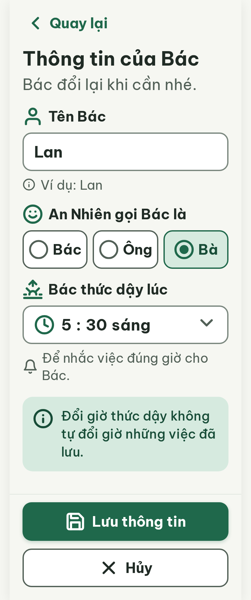
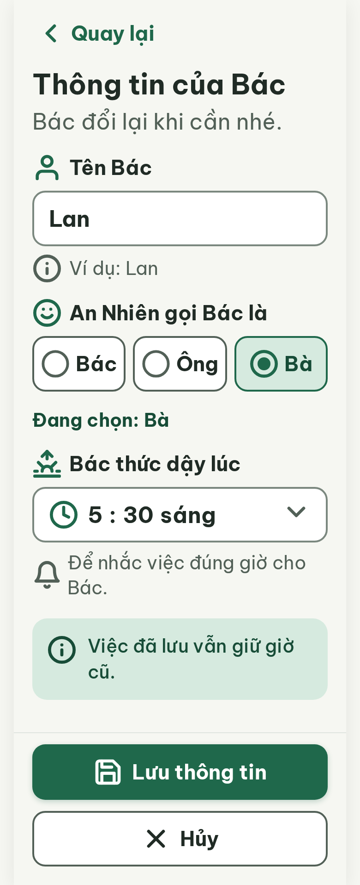

# N06 Thông tin của Bác (Sửa hồ sơ) – log vòng lặp Stitch

Biến thể của S02 (màn chốt `17a2ead138fc48ea93625d553324704a`). Project 2013215887278758682.
screen id v0: ed30856e70174cd3abbc75e6e28bf6fc
screen id v1: 0b71950e67114ca08c0a9bbfd3e18aa2
screen id v2: a69f1e339467495591d7376521dce445

| Vòng | Điểm | Số error | Số warn | Đã sửa | Regression |
| --- | --- | --- | --- | --- | --- |
| v0 | 87 | 1 | 1 | – | – |
| v1 | 97 | 0 | 1 | R-TXT-03 | không |
| v2 | 100 | 0 | 0 | R-ICON-03 | không |

**Màn chốt: v2 – điểm 100** (Stitch screen id `a69f1e339467495591d7376521dce445`)
**Kết quả: CONVERGED** (điểm 100)

best: v2 – điểm 100

Ghi chú:
- Tên màn đổi theo `vocabulary.md`: "Thông tin của Bác" (thay "Sửa hồ sơ"), nút "Lưu thông tin" (thay "Lưu hồ sơ"), thêm nút viền "Hủy".
- Câu lưu ý trong `flutter-handoff.md` ("Đổi giờ thức dậy không tự đổi giờ những việc đã lưu.", 12 tiếng) xuống 3 dòng ở 20px nên vi phạm R-TXT-03. Đã rút còn "Việc đã lưu vẫn giữ giờ cũ." – cần chốt lại câu này trong `flutter-handoff.md` / `AppStyleGuide.md`.
- Thêm vào Từ điển icon (`assets/stitch/DESIGN.md`): `smile` = cách xưng hô.
- Stitch vẽ lại icon `sunrise` ở nhãn "Bác thức dậy lúc" lệch nét so với Lucide gốc; dùng bản gốc khi dựng Figma / Flutter.
- Critic không có quyền ghi file nên `v*-critique.json` do điều phối ghi lại từ câu trả lời của critic (v2 chỉ ghi bản tóm tắt).
- Sau khi Hủy hoặc rời form khi đã sửa → N14 (ngoài phạm vi màn này).

## v0 – điểm 87

| Luật | Mức | Vị trí | Bằng chứng | Sửa |
| --- | --- | --- | --- | --- |
| R-TXT-03 | error | Khối lưu ý nền #D6EADF | Câu 12 tiếng xuống 3 dòng, vượt 2 dòng | Rút thành "Việc đã lưu vẫn giữ giờ cũ." |
| R-ICON-03 | warn | Dòng "Ví dụ: Lan", dòng chuông; ô "Bà" | Icon info 20px, bell 24px; thiếu chữ "Đang chọn" | Icon 32px; thêm "Đang chọn: Bà" |

Edit prompt đã dùng: `v0-edit-prompt.txt`.

## v1 – điểm 97

| Luật | Mức | Vị trí | Bằng chứng | Sửa |
| --- | --- | --- | --- | --- |
| R-ICON-03 | warn | Ô giờ "5 : 30 sáng" | Icon `clock` (nghĩa "Giờ của việc") dùng cho giờ thức dậy, nhãn trên đã là `sunrise` | Thay bằng `sunrise` 32px |

Đã sửa: R-TXT-03 · Regression: không. Edit prompt đã dùng: `v1-edit-prompt.txt`.

## v2 – điểm 100

Không còn vi phạm. Đã sửa: R-ICON-03 · Regression: không.
