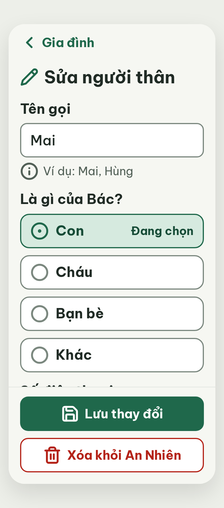

# N09 Sửa người thân – log vòng lặp Stitch

| Vòng | Điểm | Số error | Số warn | Đã sửa | Regression |
| --- | --- | --- | --- | --- | --- |
| v0 | 100 | 0 | 0 | – | – |

**Màn chốt: v0 – điểm 100** (Stitch screen id `5d7a4160a28d4a6b8b650e3cc0edcfe9`, project 2013215887278758682)
**Kết quả: CONVERGED**

Biến thể của S12 (màn chốt `4e54d2bf87a94c40a1c7a3e56e05aa3f`). Project 2013215887278758682.
screen id: 5d7a4160a28d4a6b8b650e3cc0edcfe9 (v0)
best: v0 – điểm 100

## v0 – điểm 100

Không có vi phạm. Ghi chú ngoài luật (không trừ điểm):
- Footer cao 168px che trường "Số điện thoại": khi mới mở màn, nhãn trường bị cắt ngang ở mép footer (vẫn cuộn được, padding-bottom 180px).
- Thẻ `<title>` trong HTML vẫn ghi "Thêm người thân"; chữ này không hiện trên màn. Sửa khi dựng Flutter.
- Ảnh v0.png tải bằng hậu tố `=w780` (không có hậu tố chỉ ra ảnh 226×512).
