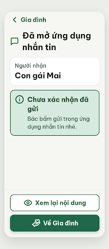

# N10 Đã mở ứng dụng chia sẻ – log vòng lặp Stitch

Biến thể của S17b (`--from S17b`), v0 sinh bằng `edit_screens` trên screen id `8dbd82153c14463aa7a54d58eb920e7b` (màn chốt S17b v1, project 2013215887278758682).

| Vòng | Điểm | Số error | Số warn | Đã sửa | Regression |
| --- | --- | --- | --- | --- | --- |
| v0 | 100 | 0 | 0 | – | – |

**Màn chốt: v0 – điểm 100** (Stitch screen id `258d3f64d4694b2faa316a89327b7aad`, project 2013215887278758682)
**Kết quả: CONVERGED**

screen id: 258d3f64d4694b2faa316a89327b7aad (v0)

## v0 – điểm 100

Không có vi phạm. Số đo từ HTML: chữ nhỏ nhất 20px; tương phản `#526057` / trắng ≈ 6,6 : 1, `#174C37` / `#D6EADF` 7,85 : 1; hai nút 60px × 320px, cách nhau 12px; nút Back 48px cao có chữ "Gia đình"; câu dài nhất 9 tiếng.

Ghi chú: `stitch-critic` không ghi được file (bị từ chối quyền), điều phối chép nguyên văn JSON nó trả về vào `v0-critique.json`.

best: v0 – điểm 100.

Còn để ý (không phải vi phạm luật): tiêu đề trạng thái "Chưa xác nhận đã gửi" xuống 2 dòng, chữ "gửi" đứng một mình ở dòng 2. Có thể rút gọn nếu người dùng muốn gọn hơn.
